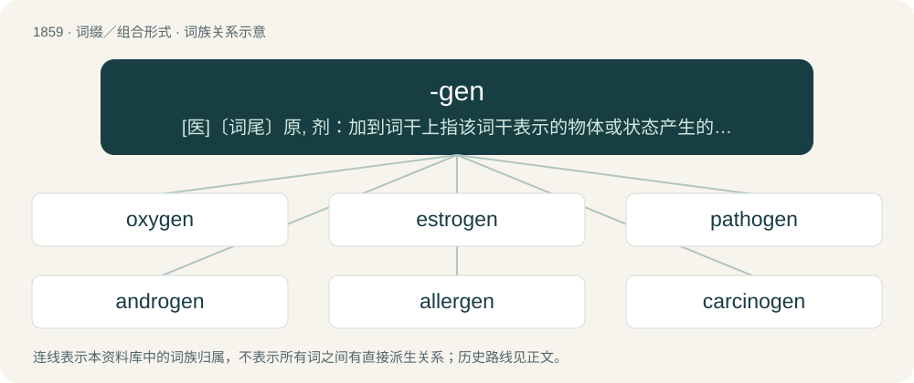

# 1966 · -gen — \[医\]〔词尾〕原, 剂：加到词干上指该词干表示的物体或状态产生的动因, 如过敏原(allergen), 冷冻剂(cryogen), 致病原(pathogen)

[总目录](../00_总目录_按常用程度.md)

**类型**：词缀／组合形式　｜　**来源语言**：见词源记录

## 核心含义与来源

- 核心含义：\[医\]〔词尾〕原, 剂：加到词干上指该词干表示的物体或状态产生的动因, 如过敏原(allergen), 冷冻剂(cryogen), 致病原(pathogen)
- 英文含义：A producer of something, or an agent in the production of something.
- 词形：-gen

**来源记录 1**（后缀／后置成分；A producer of something, or an agent in the production of something.）

Borrowed from French -gène, from the Ancient Greek -γενής (-genḗs).

## 词族图

## 单词速览（常用到不常用）

| 单词 | 音标 | 释义 |
|---|---|---|
| [oxygen](#w-1) | 英 /ˈɒksɪd͡ʒən/；美 /ˈɑksɪd͡ʒən/ | n. 氧；\[化\] 氧O-2 |
| [estrogen](#w-2) | 英 /ˈiːstɹəd͡ʒən/；美 /ˈɛstɹəd͡ʒən/ | n. 雌激素；\[化\] 雌激素 |
| [pathogen](#w-3) | /ˈpæθəd͡ʒn̩/ | n. 病原体；\[医\] 病原体 |
| [androgen](#w-4) | /ˈændrəd͡ʒən/ | n. 雄激素；\[化\] 雄性激素 |
| [allergen](#w-5) | /ˈælə(ɹ)ˌd͡ʒɛn/ | n. 变(态反)应原；\[化\] 过敏素; 变应原 |
| [carcinogen](#w-6) | /kɑɹˈsɪnəd͡ʒən/ | n. 致癌物质；\[化\] 致癌物 |
| [mutagen](#w-7) | /ˈmjuːtəd͡ʒn̩/ | n. 诱变剂；\[医\] 诱变剂, 致变物 |
| [fibrinogen](#w-8) | /faiˈbrinədʒən/ | n. (血)纤维蛋白原；\[化\] 血纤蛋白原; 血纤维蛋白原 |
| [hallucinogen](#w-9) | 英 /ˌhæl.uːˈsɪn.ə.dʒən/；美 /həˈluː.sɪ.nə.d͡ʒɛn/ | n. 迷幻剂；\[化\] 致幻剂 |
| [cyanogen](#w-10) | /saɪˈæn.ə.d͡ʒɪn/ | n. 氰；\[化\] 氰 |
| [allogeneic](#w-11) | /ˌæləd͡ʒəˈniɪk/ | a. 同种异体的, 同种组织移植的；\[化\] 同种异基因的 |
| [plasminogen](#w-12) | /plæzˈminədʒin/ | \[化\] 纤溶酶原; 血纤维蛋白溶酶原 |
| [mitogen](#w-13) | /ˈmitə,dʒən/ | n. \[生\]有丝分裂原,促细胞分裂剂,分裂素 |

## 逐词详解

### 1. oxygen

**词性**：名词　｜　**音标**：英 /ˈɒksɪd͡ʒən/；美 /ˈɑksɪd͡ʒən/

**中文释义**：n. 氧；\[化\] 氧O-2

**英文义项**：The chemical element (symbol O) with an atomic number of 8 and relative atomic mass of 15.9994. It is a colorless and odorless gas. Sometimes called elemental oxygen to distinguish it from molecular oxygen. / Molecular oxygen (O₂), a colorless, odorless gas at room temperature.

**构词拆分**：By surface analysis, oxy- + -gen

**词源与演化**：

Borrowed from French oxygène (originally in the form principe oxygène, a variant of principe oxigine ‘acidifying principle’, suggested by Lavoisier), from Ancient Greek ὀξύς (oxús, “sharp”) + γένος (génos, “birth”), referring to oxygen's supposed role in the formation of acids. By surface analysis, oxy- + -gen.

**例句**：

> By molar fraction, calcium oxide contains equal parts calcium and oxygen.

该用例对应义项：The chemical element (symbol O) with an atomic number of 8 and relative atomic mass of 15.9994. It is a colorless and odorless gas. Sometimes called elemental oxygen to distinguish it from molecular oxygen.

### 2. estrogen

**词性**：名词　｜　**音标**：英 /ˈiːstɹəd͡ʒən/；美 /ˈɛstɹəd͡ʒən/

**中文释义**：n. 雌激素；\[化\] 雌激素

**英文义项**：Any of a group of steroids that are secreted by the ovaries and function as female sex hormones.

**构词拆分**：estro- + -gen；estro- (estrus) + -gen (“a producer of”)

**词源与演化**：

From estro- (estrus) + -gen (“a producer of”).

**例句**：

> Declining estrogen levels can lead to thinning of the vaginal walls.

### 3. pathogen

**词性**：名词　｜　**音标**：/ˈpæθəd͡ʒn̩/

**中文释义**：n. 病原体；\[医\] 病原体

**英文义项**：An agent that can cause disease, especially an infectious microorganism, such as a bacterium, virus, protozoon or fungus.

**构词拆分**：patho- + -gen

**词源与演化**：

From patho- + -gen. Second element ultimately from Proto-Indo-European \*ǵenh₁- (“lineage”) through Ancient Greek γένος (génos, “birth”)

**例句**：

> Have I been exposed to the pathogen?

### 4. androgen

**词性**：名词　｜　**音标**：/ˈændrəd͡ʒən/

**中文释义**：n. 雄激素；\[化\] 雄性激素

**英文义项**：Any natural or synthetic compound, usually a steroid hormone, that stimulates or controls the development and maintenance of masculine characteristics in vertebrates. A male sex hormone such as testosterone or anabolic steroids.

**构词拆分**：andro- + -gen

**词源与演化**：

From andro- + -gen.

### 5. allergen

**词性**：名词　｜　**音标**：/ˈælə(ɹ)ˌd͡ʒɛn/

**中文释义**：n. 变(态反)应原；\[化\] 过敏素; 变应原

**英文义项**：A substance which causes an allergic reaction.

**构词拆分**：allergy + -gen

**词源与演化**：

Syncopated compound of allergy + -gen, coined on the model of pharmaceutical words such as pathogen and antigen.

**例句**：

> Pollen, dust, and spores are common allergens.

该用例对应义项：A substance which causes an allergic reaction.

### 6. carcinogen

**词性**：名词　｜　**音标**：/kɑɹˈsɪnəd͡ʒən/

**中文释义**：n. 致癌物质；\[化\] 致癌物

**英文义项**：A substance or agent that can cause cancer.

**构词拆分**：carcino- + -gen

**词源与演化**：

From carcino- + -gen.

**例句**：

> The remedy has come under fire lately as a possible carcinogen.

### 7. mutagen

**词性**：名词　｜　**音标**：/ˈmjuːtəd͡ʒn̩/

**中文释义**：n. 诱变剂；\[医\] 诱变剂, 致变物

**英文义项**：Any agent or substance that can cause genetic mutation.

**构词拆分**：muta- + -gen

**词源与演化**：

From muta- + -gen.

**例句**：

> Ziri was given a dose of the mutagen.

### 8. fibrinogen

**词性**：名词　｜　**音标**：/faiˈbrinədʒən/

**中文释义**：n. (血)纤维蛋白原；\[化\] 血纤蛋白原; 血纤维蛋白原

**英文义项**：A protein that in humans plays a role in the formation of clots.

**构词拆分**：fibrin + -o- + -gen

**词源与演化**：

From fibrin + -o- + -gen.

### 9. hallucinogen

**词性**：名词　｜　**音标**：英 /ˌhæl.uːˈsɪn.ə.dʒən/；美 /həˈluː.sɪ.nə.d͡ʒɛn/

**中文释义**：n. 迷幻剂；\[化\] 致幻剂

**英文义项**：Any substance tending to induce hallucination.

**构词拆分**：hallucination + -o- + -gen

**词源与演化**：

From hallucination + -o- (interconsonantal) + -gen (“producer”).

**例句**：

> Being a psychoactive agent, a hallucinogen can cause you to dissociate.

### 10. cyanogen

**词性**：名词　｜　**音标**：/saɪˈæn.ə.d͡ʒɪn/

**中文释义**：n. 氰；\[化\] 氰

**英文义项**：The pseudohalogen (CN)₂; a colorless, poisonous gas used as a rocket propellant, an insecticide and in chemical warfare. / The radical -CN.

**构词拆分**：cyano- + -gen

**词源与演化**：

From cyano- + -gen; compare French cyanogène. So called because it produced blue dyes.

### 11. allogeneic

**词性**：形容词　｜　**音标**：/ˌæləd͡ʒəˈniɪk/

**中文释义**：a. 同种异体的, 同种组织移植的；\[化\] 同种异基因的

**英文义项**：Genetically different because of being derived from separate individuals of the same species. / Of a reaction that occurs when cells are transplanted into a genetically different recipient.

**构词拆分**：allo- + -gene- + -ic

**词源与演化**：

From allo- + -gene- + -ic.

### 12. plasminogen

**词性**：名词　｜　**音标**：/plæzˈminədʒin/

**中文释义**：\[化\] 纤溶酶原; 血纤维蛋白溶酶原

**英文义项**：The inactive precursor to plasmin; profibrinolysin

**构词拆分**：plasmin + -o- + -gen

**词源与演化**：

From plasmin + -o- + -gen.

**例句**：

> There are several effective anti-clotting agents that doctors can use to clear these clogged blood vessels, including one called tissue plasminogen activator, or tPA.

### 13. mitogen

**词性**：名词　｜　**音标**：/ˈmitə,dʒən/

**中文释义**：n. \[生\]有丝分裂原,促细胞分裂剂,分裂素

**英文义项**：Any substance that stimulates mitosis

**构词拆分**：mitosis + -gen

**词源与演化**：

From mitosis (“cell division”) + -gen (“a producer of something”).
