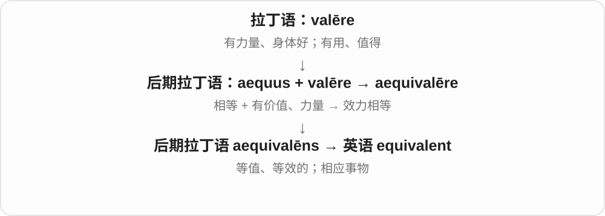
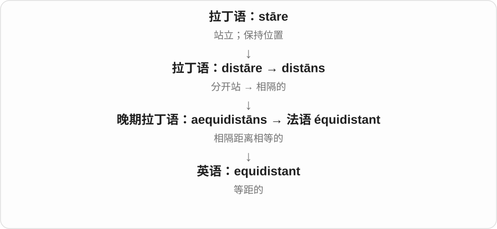

# 1976 · equi- — 相等；相同

[逐词精讲目录](../00_逐词精讲目录.md) · [总目录](../00_总目录_按常用程度.md)

## 核心词根与来源

equi- 联系拉丁 aequus 相等。equidistant 说距离，equilateral 说边，equivalent 说效力、价值或特定比较标准。

**EQUI：指定某个维度相等**

可以等距离、等边，也可以有相等价值或效力。

- **距离与边**：equidistant · equilateral
- **效力或价值**：equivalent

## 词形与演化规律

这些词都有古典构词背景，现代学习可认出 equi-，但要连后半部分一起判断相等的对象。

## 单词速览（按词族由简到繁）

同一基础词的相关扩展放在一起，先读基础形式，再读扩展；各组之间优先读常用的。具体词源关系见各词讲解。

| 单词 | 音标 | 核心意思 |
|---|---|---|
| [equivalent](#w-1) | 英、美 /ɪˈkwɪvələnt/ | 等值、等效的；相当的；对应物 |
| [equidistant](#w-2) | /ˌiːkwɪˈdɪstənt/ | 等距的；距离相等的 |
| [equilateral](#w-3) | /ˌiːkwɪˈlætərəl/ | 等边的 |

## 逐词讲解

### 1. equivalent — 等值、等效的；相当的；对应物

**音标**：英、美 /ɪˈkwɪvələnt/

**先抓住这个画面**

样子可以不同，但在眼下比较的价值、作用或数量上，能放在同一个位置。

**怎么拆**

后期拉丁语 aequus“相等” + valēre“有力量、有价值” → aequivalēns；现代可识别 equi- + -valent。

**怎么变成今天的意思**

equivalent to 后接比较对象。两种资格等同，不表示课程完全一样；两种说法含义相当，也不表示每个字一一对应。

**常见搭配与例句**

equivalent to；an equivalent amount；the nearest equivalent。

> One kilometre is equivalent to one thousand metres.

一公里等于一千米。

> This expression has no exact equivalent in English.

这个表达在英语中没有完全对应的说法。

**别混淆**

equal 常直接说量相等；equivalent 常说在某个关系或用途上相当。

### 2. equidistant — 等距的；距离相等的

**音标**：/ˌiːkwɪˈdɪstənt/

**先抓住这个画面**

从同一个点量出去，到两个目标的距离一样长，这个点便与两者 equidistant。

**怎么拆**

经法语来自晚期拉丁语 aequidistāns；aequī-（相等）+ distāns（相隔）。

**怎么变成今天的意思**

它比较的是距离，不是方向或位置相同。圆周上各点与圆心等距，但彼此位置当然不同。

**常见搭配与例句**

equidistant from A and B；equidistant points；equidistant intervals。

> The hotel is equidistant from the two stations.

这家酒店到两个车站的距离相等。

> Every point on the circle is equidistant from its center.

圆上的每一点到圆心的距离都相等。

**别混淆**

equal 是一般的相等；equidistant 专门说距离相等。

### 3. equilateral — 等边的

**音标**：/ˌiːkwɪˈlætərəl/

**先抓住这个画面**

每一条边都一样长。

**怎么拆**

接晚期拉丁 aequilateralis：aequi- 相等 + lateralis 与边有关；现代英语对应 equi- + lateral。

**怎么变成今天的意思**

**拉丁 latus，属格 lateris**  
侧面、身体的一侧

↓

**晚期拉丁 aequi- + lateralis → aequilateralis → 英语 equilateral**  
相等 + 边 → 各边等长的

an equilateral triangle 是等边三角形，其三个角也相等。但一般多边形只说 equilateral，只保证边等长，不保证所有角也相等。

**常见搭配与例句**

an equilateral triangle；an equilateral polygon；equal sides。

> Each side of the equilateral triangle is six centimetres long.

这个等边三角形的每条边都长六厘米。

> A rhombus is equilateral, but its angles need not all be equal.

菱形各边等长，但各角不一定都相等。

**别混淆**

equiangular 是等角的；regular polygon 同时要求等边和等角。菱形可以等边而不是正方形。

## 这一组要分清什么

equivalent 不等于所有细节 identical；equilateral 是等边，equiangular 才明确说等角。

## 串起来练习

The three points are equidistant from the centre of the equilateral triangle.

等边三角形的三个顶点到中心距离相等。
