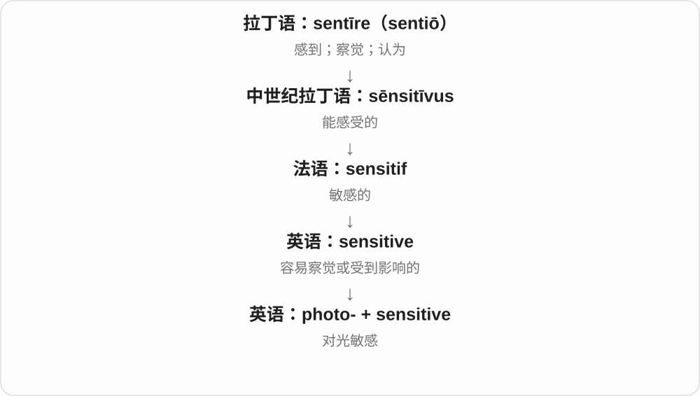

# 1993 · photo- — 光；由光成像延伸为摄影、照片

[逐词精讲目录](../00_逐词精讲目录.md) · [总目录](../00_总目录_按常用程度.md)

## 核心词根与来源

photons、光合作用里不是照片，摄影记者里也不只是物理光线。先看构词场景，前半段的光与照片两层关系就能分清。

**PHOTO-：科学先读光，影像语境常读摄影、照片**

photograph → photographic；photosynthesis → photosynthetic；photojournalism/photojournalist 行业与人物；photorealistic 照片般逼真。

- **光成像与摄影**：photograph · photographic · photocopy · photogenic
- **新闻摄影行业和人物**：photojournalism · photojournalist
- **视觉逼真**：photorealistic
- **光的作用和感受**：photon · photosynthesis · photosynthetic · photovoltaic · photoelectric · photoelectron · photosensitive · photoreceptor · photochemical · photoresist
- **光的测量与层**：photometry · photometric · photosphere

## 词形与演化规律

phōs/phōt- → photo-；接 graph、synthesis、voltaic、genic 等科学材料；photo- 接 journalism/journalist/realistic；photosphere 在两种领域可作不同解释。

## 单词速览（按词族由简到繁）

同一基础词的相关扩展放在一起，先读基础形式，再读扩展；各组之间优先读常用的。具体词源关系见各词讲解。

| 单词 | 音标 | 核心意思 |
|---|---|---|
| [photograph](#w-1) | 英 /ˈfəʊtəɡrɑːf/；美 /ˈfoʊtəɡræf/ | 照片；拍摄照片 |
| [photographic](#w-2) | 英 /ˌfəʊtəˈɡræfɪk/；美 /ˌfoʊtəˈɡræfɪk/ | 摄影的；照片的；像照片般细致的 |
| [photon](#w-3) | 英 /ˈfəʊtɒn/；美 /ˈfoʊtɑːn/ | 光子 |
| [photosynthesis](#w-4) | 英 /ˌfəʊtəʊˈsɪnθəsɪs/；美 /ˌfoʊtoʊˈsɪnθəsɪs/ | 光合作用 |
| [photosynthetic](#w-9) | 美 /ˌfoʊtoʊsɪnˈθetɪk/ | 光合作用的；能进行光合作用的 |
| [photovoltaic](#w-5) | 英 /ˌfəʊtəʊvɒlˈteɪɪk/；美 /ˌfoʊtoʊvɑːlˈteɪɪk/ | 光伏的；把光转成电的 |
| [photogenic](#w-6) | 英 /ˌfəʊtəʊˈdʒenɪk/；美 /ˌfoʊtoʊˈdʒenɪk/ | 上镜的；适合拍照的；光致的〔早期或专业义〕 |
| [photojournalism](#w-11) | 英 /ˌfəʊtəʊˈdʒɜːnəlɪzəm/；美 /ˌfoʊtoʊˈdʒɜːrnəlɪzəm/ | 摄影新闻、新闻摄影 |
| [photojournalist](#w-7) | 英 /ˌfəʊtəʊˈdʒɜːnəlɪst/；美 /ˌfoʊtoʊˈdʒɜːrnəlɪst/ | 摄影记者 |
| [photocopy](#w-8) | 英 /ˈfəʊtəʊkɒpi/；美 /ˈfoʊtoʊkɑːpi/ | 复印件；复印 |
| [photometry](#w-16) | 英 /fəʊˈtɒmɪtri/ | 光度测量；测光学 |
| [photometric](#w-10) | 英 /ˌfəʊtəʊˈmetrɪk/；美 /ˌfoʊtəˈmetrɪk/ | 光度测量的；测光的 |
| [photoelectric](#w-12) | 英 /ˌfəʊtəʊɪˈlektrɪk/；美 /ˌfoʊtoʊɪˈlektrɪk/ | 光电的 |
| [photosensitive](#w-13) | 英 /ˌfəʊtəʊˈsensətɪv/；美 /ˌfoʊtoʊˈsensətɪv/ | 光敏的；对光产生反应的 |
| [photochemical](#w-14) | 英 /ˌfəʊtəʊˈkemɪkəl/；美 /ˌfoʊtoʊˈkemɪkəl/ | 光化学的、由光引起的化学变化的 |
| [photoreceptor](#w-15) | 英 /ˌfəʊtəʊrɪˈseptə/；美 /ˌfoʊtoʊrɪˈseptər/ | 光感受器；感光细胞或结构 |
| [photorealistic](#w-17) | 英 /ˌfəʊtəʊˌrɪəˈlɪstɪk/；美 /ˌfoʊtoʊˌriːəˈlɪstɪk/ | 照片般逼真的、照相写实的 |
| [photosphere](#w-18) | 英 /ˈfəʊtəsfɪə/；美 /ˈfoʊtəˌsfɪr/ | 光球层；球形全景照片〔另一用法〕 |
| [photoelectron](#w-19) | 英 /ˌfəʊtəʊɪˈlektrɒn/；美 /ˌfoʊtoʊɪˈlektrɑːn/ | 光电子 |
| [photoresist](#w-20) | 英 /ˌfəʊtəʊrɪˈzɪst/；美 /ˌfoʊtoʊrɪˈzɪst/；美亦 /ˈfoʊtoʊrɪˌzɪst/ | 光刻胶；光致抗蚀剂 |

## 逐词讲解

### 1. photograph — 照片；拍摄照片

**音标**：英 /ˈfəʊtəɡrɑːf/；美 /ˈfoʊtəɡræf/

**先抓住这个画面**

让来自场景的光留下记录，把眼前的一刻变成可保存的图像。

**怎么拆**

19世纪以希腊来源的 photo-“光”与 -graph“记录、图像”造出的术语，与 Herschel 等早期摄影研究者的用语传播有关。英语名词和动词都在早期摄影时期出现。

**怎么变成今天的意思**

**希腊语 phōs，属格 phōtos**  
光；phot- 来自它的变化词干

↓

**19世纪 photo- + -graph → 英语 photograph**  
光 + 记录、图像 → 照片；也作拍照动词

a photograph 是一张照片；photograph a building 是给建筑拍照。传统方法用感光材料，现代可用电子传感器，词的核心仍是用光记录图像。

**常见搭配与例句**

take a photograph；a photograph of；photograph a scene。

> The photograph shows the street before the old houses were demolished.

照片显示了老房子被拆除前的街道。

> She photographs the same tree in every season.

她每个季节都给同一棵树拍照。

**别混淆**

photograph 重音在开头；photography、photographer 的重音往后移，不能始终按 photo 单词的节奏读。

### 2. photographic — 摄影的；照片的；像照片般细致的

**音标**：英 /ˌfəʊtəˈɡræfɪk/；美 /ˌfoʊtəˈɡræfɪk/

**先抓住这个画面**

把事物与照片的拍摄、呈现或记录能力联系起来。

**怎么拆**

photograph + -ic，亦可按 photo- + -graphic 分析；它属于19世纪摄影术语群，重音落到 -graph-。

**怎么变成今天的意思**

**希腊语 phōs，属格 phōtos**  
光；phot- 来自它的变化词干

↓

**19世纪 photo- + -graph → 英语 photograph**  
光 + 记录、图像 → 照片；也作拍照动词

↓

**英语 photograph + -ic → photographic**  
照片、拍摄 → 与摄影或照片有关的

photographic evidence 是照片证据；photographic equipment 是摄影器材。a photographic memory 通常形容记忆细节很强，并不保证一个人能像相机一样毫无误差地保存所有画面。

**常见搭配与例句**

photographic evidence；photographic equipment；a photographic memory。

> The archive contains a photographic record of the rebuilding work.

档案保存了重建工作的照片记录。

> Photographic evidence helped identify the damaged bridge.

照片证据帮助确定了那座受损的桥。

**别混淆**

photogenic 是上镜；photographic 只是与摄影有关，不表示人一定好看。

### 3. photon — 光子

**音标**：英 /ˈfəʊtɒn/；美 /ˈfoʊtɑːn/

**先抓住这个画面**

光和物质交换能量时，一份一份地交换；这份电磁辐射的量子叫 photon。

**怎么拆**

photo-“光” + 粒子名称中常见的 -on。20世纪这个名称逐步用于光量子，不是古希腊已有的现代物理概念。

**怎么变成今天的意思**

**希腊语 phōs，属格 phōtos**  
光；phot- 来自它的变化词干

↓

**20世纪 photo- + -on → photon**  
光 + 粒子名词尾 → 光子，电磁辐射的量子

可以说 a single photon，一个光子。红外线、紫外线、X射线也有光子，不限于眼睛看得见的光；也不能把光子完全想成沿固定轨道滚动的小球。

**常见搭配与例句**

emit a photon；detect a photon；photon energy。

> The detector registered a single photon.

探测器记录到了一个光子。

> The energy of a photon depends on its frequency.

光子的能量取决于它的频率。

**别混淆**

electron 是带负电的电子；photon 是电磁辐射的量子，没有电荷。

### 4. photosynthesis — 光合作用

**音标**：英 /ˌfəʊtəʊˈsɪnθəsɪs/；美 /ˌfoʊtoʊˈsɪnθəsɪs/

**先抓住这个画面**

用光提供能量，把简单原料合成生物需要的物质，像叶片里的小型制作车间。

**怎么拆**

photo-“光” + synthesis“合成”；是近代科学组合，不是把 photo 理解为照片。

**怎么变成今天的意思**

**希腊语 phōs，属格 phōtos**  
光；phot- 来自它的变化词干

↓

**photo- + synthesis → photosynthesis**  
光 + 合成 → 利用光能进行的生物合成过程

绿色植物利用光能，把二氧化碳和水转成有机物并释放氧气。这个熟悉过程是光合作用的一种；部分细菌的光合作用不释放氧气。

**常见搭配与例句**

carry out photosynthesis；the rate of photosynthesis；oxygenic photosynthesis。

> Light intensity affects the rate of photosynthesis.

光照强度会影响光合作用的速率。

> The class compared photosynthesis in leaves under different conditions.

班上比较了不同条件下叶片的光合作用。

**别混淆**

respiration 是细胞从物质中取得可用能量的过程；植物也进行呼吸，不能把它与光合作用当成植物、动物各自独占的功能。

### 5. photosynthetic — 光合作用的；能进行光合作用的

**音标**：美 /ˌfoʊtoʊsɪnˈθetɪk/

**先抓住这个画面**

把一个生物或过程与“利用光能合成物质”这件事联系起来。

**怎么拆**

photo- + synthetic，与 photosynthesis 对应的形容词；synthetic 在此是合成的，不是日常所说的人造材料。

**怎么变成今天的意思**

**希腊语 phōs，属格 phōtos**  
光；phot- 来自它的变化词干

↓

**photo- + synthetic → photosynthetic**  
光 + 合成的 → 光合作用的

photosynthetic organisms 包括植物、藻类以及某些细菌。photosynthetic activity 是光合作用的活动程度，不是拍摄活动。

**常见搭配与例句**

photosynthetic organisms；photosynthetic activity；photosynthetic pigments。

> Algae are photosynthetic organisms.

藻类是能进行光合作用的生物。

> The researchers measured photosynthetic activity in the leaves.

研究人员测量了叶片的光合作用活动程度。

**别混淆**

synthetic alone 常指人工合成；photosynthetic 说的是由光能驱动的合成，常发生在自然生物体内。

### 6. photovoltaic — 光伏的；把光转成电的

**音标**：英 /ˌfəʊtəʊvɒlˈteɪɪk/；美 /ˌfoʊtoʊvɑːlˈteɪɪk/

**先抓住这个画面**

光照到材料上，产生电压，并在接通的电路里提供电流。

**怎么拆**

photo-“光” + voltaic“电的”；voltaic 来自科学家 Volta 的姓。这里的 volt- 不是转动词根。

**怎么变成今天的意思**

**希腊语 phōs，属格 phōtos**  
光；phot- 来自它的变化词干

↓

**英语 photo- + voltaic → photovoltaic**  
光 + 以 Volta 命名的电学用语 → 光伏的

photovoltaic panels 是光伏板，重点是把光能直接转成电能。它和先把阳光聚集成热、再用热发电的系统原理不同。

**常见搭配与例句**

a photovoltaic cell；photovoltaic panels；photovoltaic power。

> Photovoltaic panels cover the school roof.

学校屋顶铺设了光伏板。

> The calculator is powered by a small photovoltaic cell.

这台计算器由一枚小型光伏电池供电。

**别混淆**

solar 泛指太阳相关；photovoltaic 特指光转成电的效应与技术。

### 7. photogenic — 上镜的；适合拍照的；光致的〔早期或专业义〕

**音标**：英 /ˌfəʊtəʊˈdʒenɪk/；美 /ˌfoʊtoʊˈdʒenɪk/

**先抓住这个画面**

镜头一拍，人物或场景的特点就显得特别好看、特别有效果。

**怎么拆**

最初 photo-“光” + -genic“由……产生”，指由光形成；后来 photo 被理解为 photograph 的短称，发展出拍出来好看的常用义。

**怎么变成今天的意思**

**希腊语 phōs，属格 phōtos**  
光；phot- 来自它的变化词干

↓

**19世纪 photo- + -genic → photogenic**  
由光产生的；早期摄影用语

↓

**photo- 重新联系 photograph → photogenic 的日常义**  
拍成照片时呈现效果好的 → 上镜的

a photogenic face 是上镜的脸；村庄、建筑也可以 photogenic。它评价照片呈现效果，不保证本人或现场与照片给人的印象完全一样。

**常见搭配与例句**

a photogenic face；a photogenic village；highly photogenic。

> The village is especially photogenic in the early morning light.

这个村庄在清晨的光线下特别适合拍照。

> She dislikes posing but is naturally photogenic.

她不喜欢摆姿势，却天生上镜。

**别混淆**

beautiful 是一般的美；photogenic 特别说通过镜头呈现得好。

### 8. photojournalism — 摄影新闻、新闻摄影

**音标**：英 /ˌfəʊtəʊˈdʒɜːnəlɪzəm/；美 /ˌfoʊtoʊˈdʒɜːrnəlɪzəm/

**先抓住这个画面**

用一张或一组照片讲清新闻发生了什么；不只是拍得好看，还要承担新闻记录、叙事的作用。

**怎么拆**

photo- 摄影、照片 + journalism 新闻工作。这里 photo 是由光成像发展来的摄影义，不是光线本身正在写稿。

**怎么变成今天的意思**

**希腊 phōs、词干 phōt-**  
光

↓

**科学 photo- 与 photography 等**  
光的作用；光成像 → 摄影、照片相关材料

↓

**photo- + journalism → photojournalism**  
以摄影图像为主要方式的新闻工作

documentary photojournalism 纪实新闻摄影，a photojournalism project 新闻摄影项目，study photojournalism 学习新闻摄影。

**常见搭配与例句**

study photojournalism；a photojournalism project。

> She studied photojournalism before joining the newspaper.

她进报社前学的是新闻摄影。

> The exhibition explores photojournalism during major social changes.

展览探讨重大社会变迁中的新闻摄影。

**别混淆**

photojournalism 是领域、工作，photojournalist 是从业者；portrait photography 人像摄影不必都是新闻报道。

### 9. photojournalist — 摄影记者

**音标**：英 /ˌfəʊtəʊˈdʒɜːnəlɪst/；美 /ˌfoʊtoʊˈdʒɜːrnəlɪst/

**先抓住这个画面**

不只是拿相机的人，而是用照片报道新闻、记录现场的记者；photo 说明主要表达方式。

**怎么拆**

photo- 摄影 + journalist 记者；后者与 journal 记录、刊物 + -ist 人物材料相关。可和 photojournalism 作为人、行业一对来记，不必强断定二者在英语中的出现顺序。

**怎么变成今天的意思**

**希腊 phōs、词干 phōt-**  
光

↓

**科学 photo- 与 photography 等**  
光的作用；光成像 → 摄影、照片相关材料

↓

**photo- + journalist → photojournalist**  
以摄影方式报道新闻的记者

a freelance photojournalist 自由摄影记者，a newspaper photojournalist 报社摄影记者，work as a photojournalist 当摄影记者。

**常见搭配与例句**

a freelance photojournalist；a newspaper photojournalist。

> A photojournalist documented the evacuation.

一位摄影记者记录了撤离过程。

> The newspaper sent a photojournalist to the ceremony.

报社派摄影记者去报道仪式。

**别混淆**

photojournalist 包含新闻工作身份，photographer 更宽是摄影者；游客拍现场照片不自动因此成为职业摄影记者。

### 10. photocopy — 复印件；复印

**音标**：英 /ˈfəʊtəʊkɒpi/；美 /ˈfoʊtoʊkɑːpi/

**先抓住这个画面**

把原纸上的文字和图像照样复制到另一张纸上。

**怎么拆**

photo-“光” + copy“复制品、复制”；名称与通过光学成像复制文件的过程相联，英语可作名词和动词。

**怎么变成今天的意思**

**希腊语 phōs，属格 phōtos**  
光；phot- 来自它的变化词干

↓

**英语 photo- + copy → photocopy**  
用光成像复制 → 复印；复印件

a photocopy of a document 是文件复印件；photocopy both sides 是把两面都复印。复印件可以清楚保留文字，但并不会因此变成原件。

**常见搭配与例句**

make a photocopy；a photocopy of；photocopy a document。

> Please bring a photocopy of the certificate.

请带一份证书复印件。

> She photocopied both sides of the letter.

她把信的两面都复印了。

**别混淆**

scan 通常把文件转为数字图像；photocopy 常强调纸到纸的复制，设备可以兼有两种功能。

### 11. photometry — 光度测量；测光学

**音标**：英 /fəʊˈtɒmɪtri/

**先抓住这个画面**

把“看起来亮不亮”转成可以比较的测量数值。

**怎么拆**

photo-“光” + -metry“测量”；近代科学组合。

**怎么变成今天的意思**

**希腊语 phōs，属格 phōtos**  
光；phot- 来自它的变化词干

↓

**英语 photo- + -metry → photometry**  
光 + 测量 → 测光学

照明技术中的 photometry 按人眼对不同波长的敏感程度来衡量光。天文学也用这个词测量天体的亮度，可能涉及可见光以外的波段，不能把所有领域的用法一律限为人眼视觉。

**常见搭配与例句**

stellar photometry；precision photometry；photometry measurements。

> Photometry revealed a small change in the star’s brightness.

测光结果显示那颗恒星的亮度有小幅变化。

> The laboratory uses photometry to compare different lamps.

实验室用光度测量比较不同灯具。

**别混淆**

radiometry 按辐射能量测量；照明领域的 photometry 加入人眼视觉响应的权重。

### 12. photometric — 光度测量的；测光的

**音标**：英 /ˌfəʊtəʊˈmetrɪk/；美 /ˌfoʊtəˈmetrɪk/

**先抓住这个画面**

把光的亮度作为测量对象，得到数值、曲线或数据。

**怎么拆**

photo- + -metric，与 photometry 对应的形容词；重音在 -met-。

**怎么变成今天的意思**

**希腊语 phōs，属格 phōtos**  
光；phot- 来自它的变化词干

↓

**photo- + -metric → photometric**  
光 + 测量的 → 光度测量的

photometric data 可以是灯具的光度分布，也可以是天体亮度随时间变化的记录。重点在测量光，不是在拍照是否好看。

**常见搭配与例句**

photometric data；a photometric measurement；photometric calibration。

> The researchers corrected the photometric data before analysis.

研究人员在分析前校正了测光数据。

> The lamp passed the photometric test.

这盏灯通过了光度测试。

**别混淆**

photographic 关乎照片与摄影；photometric 关乎测光。

### 13. photoelectric — 光电的

**音标**：英 /ˌfəʊtəʊɪˈlektrɪk/；美 /ˌfoʊtoʊɪˈlektrɪk/

**先抓住这个画面**

让光引起电的响应：光照变化能被变成电信号，某些情况下光还能使材料放出电子。

**怎么拆**

photo- 光，接希腊 phos、属格 photos + electric；是近代科学组合词，不是 photograph“照片”直接缩略出的意义。

**怎么变成今天的意思**

**古希腊 elektron → 拉丁 electrum**  
琥珀；摩擦后能吸引轻小物体

↓

**近代拉丁 electricus**  
像琥珀那样具有电性；吉尔伯特在 1600 年用于这一现象

↓

**科学英语 photo- 光 + electric → photoelectric**  
光照与电现象相联系的

常见搭配 photoelectric effect 指光电效应，其中外光电效应涉及光使电子从物质中逸出。能否逸出与单个光子的能量等条件有关，不能简单记成“灯越亮就一定行”。传感器语境的 photoelectric 范围更宽。

**常见搭配与例句**

the photoelectric effect；a photoelectric sensor；a photoelectric detector。

> A photoelectric sensor detects the interruption of a light beam.

光电传感器检测一束光是否被遮断。

> The lecture used the photoelectric effect to discuss the energy of light.

讲座用光电效应讨论光的能量。

**别混淆**

photographic 与摄影有关；photoelectric 与光引起的电响应有关。photo- 在后者仍是“光”。

### 14. photosensitive — 光敏的；对光产生反应的

**音标**：英 /ˌfəʊtəʊˈsensətɪv/；美 /ˌfoʊtoʊˈsensətɪv/

**先抓住这个画面**

把光照上去，材料或装置就发生反应；photo- 指定了它特别能感受到的东西是光。

**怎么拆**

photo-（光）+ sensitive（敏感的）。

**怎么变成今天的意思**

可描述胶片、感光材料，也可在生理语境描述对光敏感。单看词不说明具体反应机制。

**常见搭配与例句**

photosensitive material；a photosensitive layer；photosensitive paper。

> The paper has a photosensitive coating.

这种纸带有一层感光涂层。

> Keep the photosensitive material away from bright light.

把感光材料放在强光照不到的地方。

**别混淆**

photogenic 是上镜好看；photosensitive 是对光反应，不能用它夸人的照片好看。

### 15. photochemical — 光化学的、由光引起的化学变化的

**音标**：英 /ˌfəʊtəʊˈkemɪkəl/；美 /ˌfoʊtoʊˈkemɪkəl/

**先抓住这个画面**

光照进来触发、参与化学变化；photo- 在这里是光，不只是给化学物品拍一张照片。

**怎么拆**

photo- 光 + chemical 化学的，组成光化学性质形容词；photography 与它共享光词基而用途不同。

**怎么变成今天的意思**

**新拉丁 chēmicus 等 → chemical**  
化学相关；较早与 chemistry、alchemy 词族有关

↓

**photo- + chemical → photochemical**  
光相关的化学反应、性质

a photochemical reaction 光化学反应，photochemical processes 光化学过程，photochemical smog 光化学烟雾。

**常见搭配与例句**

a photochemical reaction；photochemical processes；photochemical smog。

> The lesson explained a photochemical reaction.

课程解释了一个光化学反应。

> The report examined photochemical processes in the atmosphere.

报告考察了大气中的光化学过程。

**别混淆**

photochemical 光与化学变化有关，photographic 摄影的，不因 photo 开头就所有语境同义。

### 16. photoreceptor — 光感受器；感光细胞或结构

**音标**：英 /ˌfəʊtəʊrɪˈseptə/；美 /ˌfoʊtoʊrɪˈseptər/

**先抓住这个画面**

生物体里负责接住光信号、把它变成反应的接收端。

**怎么拆**

photo-“光” + receptor“接收器”；20世纪形成的生物学组合词。

**怎么变成今天的意思**

**希腊语 phōs，属格 phōtos**  
光；phot- 来自它的变化词干

↓

**photo- + receptor → photoreceptor**  
光 + 接收器 → 光感受器

眼睛里的视杆细胞、视锥细胞是 photoreceptors。较广的生物学用法也包括植物等生物中的感光蛋白；共同点是检测光，不是发出光。

**常见搭配与例句**

rod photoreceptors；cone photoreceptors；photoreceptor cells。

> Rod photoreceptors help us see in dim light.

视杆感光细胞帮助我们在暗光中看东西。

> The study examined how photoreceptors respond to flashes of light.

这项研究考察了感光细胞如何响应闪光。

**别混淆**

photophore 是发光器官；photoreceptor 是接收光的结构，方向相反。

### 17. photorealistic — 照片般逼真的、照相写实的

**音标**：英 /ˌfəʊtəʊˌrɪəˈlɪstɪk/；美 /ˌfoʊtoʊˌriːəˈlɪstɪk/

**先抓住这个画面**

明明是绘画、三维渲染，却让人一眼像在看照片；说的是视觉效果，不保证画面里的事件真实发生过。

**怎么拆**

photo- 照片 + realistic 逼真的。realistic 自己和 real 真实、-istic 相关形容词形式对应；不能因为逼真就判定它是证据照片。

**怎么变成今天的意思**

**希腊 phōs、词干 phōt-**  
光

↓

**科学 photo- 与 photography 等**  
光的作用；光成像 → 摄影、照片相关材料

↓

**photo- + realistic → photorealistic**  
像照片一样逼真的视觉表现

a photorealistic image 照片般逼真的图像，photorealistic rendering 逼真渲染，a photorealistic painting 照相写实画。

**常见搭配与例句**

a photorealistic image；photorealistic rendering；a photorealistic painting。

> The game uses photorealistic landscapes.

游戏使用照片般逼真的风景画面。

> Her photorealistic painting was mistaken for a photograph.

她的写实画被人误认成了照片。

**别混淆**

photorealistic 看着像照片，photographic 与摄影相关；真实照片和逼真合成图不是只靠这个形容词就能分真伪。

### 18. photosphere — 光球层；球形全景照片〔另一用法〕

**音标**：英 /ˈfəʊtəsfɪə/；美 /ˈfoʊtəˌsfɪr/

**先抓住这个画面**

天文学里是恒星向我们放出可见光、看起来像表面的那层；全景摄影里则可说把四周场景包成球面的一张照片。前半段分别选光和照片。

**怎么拆**

天文词是 photo- 光 + -sphere 层；全景照片用法又能把 photo 当 photograph 的短形式，配 sphere 球面。不是所有 photo- 都必须译照片。

**怎么变成今天的意思**

**希腊 sphaira → 拉丁 sphaera → sphere 等**  
球、球体

↓

**科学和比喻构词 -sphere**  
球形包围层、相关作用范围；并非都严格正圆

↓

**photo- 光 + -sphere → photosphere**  
恒星的可见光表面层

↓

**摄影用法 photo + sphere**  
呈球面视野的全景照片

the solar photosphere 太阳光球层，sunspots on the photosphere 光球层上的太阳黑子；a 360-degree photosphere 球形全景照片。太阳没有地面那样的固体表面。

**常见搭配与例句**

the solar photosphere；sunspots on the photosphere；a 360-degree photosphere。

> Sunspots appear on the solar photosphere.

太阳黑子出现在太阳光球层上。

> The virtual tour opens with a photosphere of the courtyard.

虚拟导览首先打开庭院的球形全景照片。

**别混淆**

photosphere 光球层，photograph 照片；照片用法看软件、摄影上下文，天文中的表面也不等于岩石外壳。

### 19. photoelectron — 光电子

**音标**：英 /ˌfəʊtəʊɪˈlektrɒn/；美 /ˌfoʊtoʊɪˈlektrɑːn/

**先抓住这个画面**

光把一个电子从原来的束缚状态中“释放”出来，这个因光致发射而出来的电子就叫 photoelectron。

**怎么拆**

photo- 光 + electron 电子；在现代物理中按电子产生或逸出的方式命名。

**怎么变成今天的意思**

**古希腊 elektron → 拉丁 electrum**  
琥珀；摩擦后能吸引轻小物体

↓

**近代拉丁 electricus**  
像琥珀那样具有电性；吉尔伯特在 1600 年用于这一现象

↓

**英语电学词基 electr- + -on → electron〔斯托尼，1891〕**  
起初命名基本电荷，后来用于带负电的电子这一粒子

↓

**科学英语 photo- + electron → photoelectron**  
由光致发射释放出的电子

它本质上仍是电子，不是一种混合了光与电子的新粒子。这个名字强调“为什么它被放出来”；在相关实验中，人们会测量其动能或运动方向。

**常见搭配与例句**

a photoelectron；photoelectron emission；photoelectron spectroscopy。

> The detector records the direction of an emitted photoelectron.

探测器记录发射出的光电子的运动方向。

> The experiment measures the kinetic energy of photoelectrons.

这个实验测量光电子的动能。

**别混淆**

photon 是光子；photoelectron 是因光的作用被释放出的电子。两者的电荷和物理角色都不同。

### 20. photoresist — 光刻胶；光致抗蚀剂

**音标**：英 /ˌfəʊtəʊrɪˈzɪst/；美 /ˌfoʊtoʊrɪˈzɪst/；美亦 /ˈfoʊtoʊrɪˌzɪst/

**先抓住这个画面**

用光决定哪里留下保护层，再把图案转移到下面的材料上。

**怎么拆**

英语 photo- “光” + 名词 resist“保护、抗蚀涂层”；不是“抵抗光”，而是借助对光的响应来形成抗蚀图案。

**怎么变成今天的意思**

**拉丁 sistere〔与 stāre“站”相关〕**  
使站住、放置；站定、停住

↓

**拉丁 re- + sistere → resistere**  
站住抵挡、顶回去

↓

**古／中古法语 resistre、resister 及拉丁来源 → 英语 resist**  
抵抗、经受；后来也指起保护作用的覆盖层

↓

**英语 resist〔保护涂层〕+ photo- → photoresist**  
曝光会改变其显影性质的材料

曝光改变材料在显影液中的溶解性质。通常正胶的曝光区域被显影去掉，负胶的未曝光区域被去掉；留下的图形可参与后续加工，不能把所有光刻胶都说成见光就硬化。

**常见搭配与例句**

coat a wafer with photoresist；positive photoresist；develop the photoresist。

> The wafer was coated with a thin layer of photoresist.

晶圆表面涂上了一层薄薄的光刻胶。

> For this positive photoresist, the exposed regions dissolve during development.

对这种正性光刻胶，曝光区域会在显影时溶解。

**别混淆**

photoresist 是材料；photolithography 是利用曝光、显影等步骤制作图案的工艺。

## 这一组要分清什么

photo- 不总是照片；photojournalism/photojournalist 行业与人；photorealistic 不保证事件真实；photosphere 先看天文还是全景摄影。

## 串起来练习

The photojournalist studied light but did not mistake photorealistic art for documentary evidence.

摄影记者研究光线，也会区分照片般逼真的艺术画面和纪实证据。
