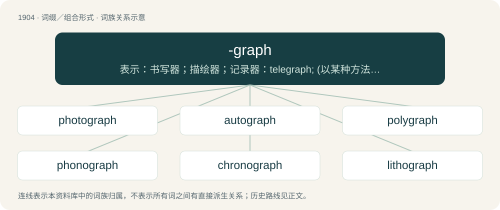

# 2018 · -graph — 表示：书写器；描绘器；记录器：telegraph; (以某种方法)书写(或描绘、记录)的结果(或东西)：monograph, lithograph

[总目录](../00_总目录_按常用程度.md)

**类型**：词缀／组合形式　｜　**来源语言**：见词源记录

## 核心含义与来源

- 核心含义：表示：书写器；描绘器；记录器：telegraph; (以某种方法)书写(或描绘、记录)的结果(或东西)：monograph, lithograph
- 英文含义：that writes
- 词形：-graph

**来源记录 1**（后缀／后置成分；that writes）

From Ancient Greek -γράφος (-gráphos, “that writes, describes”), from γράφω (gráphō, “to scratch, to scrape, to graze”), whence also -graphy.

## 词族图

## 单词速览（常用到不常用）

| 单词 | 音标 | 释义 |
|---|---|---|
| [photograph](#w-1) | 英 /ˈfəʊ.təˌɡɹɑːf/；美 /ˈfoʊ.təˌɡɹæf/ | n. 相片, 照片, 逼真的描绘；v. 照相, 摄影 |
| [autograph](#w-2) | 英 /ˈɔːtəɡɹɑːf/；美 /ˈɔtəɡɹæf/ | n. 亲笔, 亲笔签名, 手稿；vt. 亲笔签名于, 亲笔写 |
| [polygraph](#w-3) | /ˈpɒliɡɹæf/ | n. 多种波动记录仪, 复写器, 多产作家, 测谎器；\[医\] 多种波动描记器 |
| [phonograph](#w-4) | 英 /ˈfəʊnəˌɡɹɑːf/；美 /ˈfoʊnəˌɡɹæf/ | n. 留声机, 电唱机；vi. 用留声机灌音, 用留声机放音 |
| [chronograph](#w-5) | 英 /ˈkɹɒ.nə.ɡɹɑːf/；美 /ˈkɹɑ.nəˌɡɹæf/ | n. 记时计, 秒表；\[医\] 微时计 |
| [lithograph](#w-6) | /ˈlɪθəɡɹæf/ | n. 平版印刷品, 石版画；vt. 以平版印刷 |
| [choreograph](#w-7) | 英 /ˈkɒɹiəɡɹɑːf/；美 /ˈkɔɹjəɡɹæf/ | v. 设计舞蹈动作 |
| [spectrograph](#w-8) | 美 /ˈspɛktɹəˌɡɹæf/ | n. 光谱仪, 摄谱仪；\[化\] 光谱仪; 摄谱仪 |
| [orthographic](#w-9) | 英 /ˌɔːθəˈɡɹæfɪk/；美 /ˌɔːɹθəˈɡɹæfɪk/ | \[计\] 正射的 |

## 逐词详解

### 1. photograph

**词性**：名词　｜　**音标**：英 /ˈfəʊ.təˌɡɹɑːf/；美 /ˈfoʊ.təˌɡɹæf/

**中文释义**：n. 相片, 照片, 逼真的描绘；v. 照相, 摄影

**英文义项**：A picture created by projecting an image onto a photosensitive surface such as a chemically treated plate or film, CCD receptor, etc.

**构词拆分**：photo- + -graph

**词源与演化**：

From photo- + -graph.

**例句**：

> This photograph shows the town before the railway was built.

这张照片展示了铁路建成之前的小镇。

### 2. autograph

**词性**：名词　｜　**音标**：英 /ˈɔːtəɡɹɑːf/；美 /ˈɔtəɡɹæf/

**中文释义**：n. 亲笔, 亲笔签名, 手稿；vt. 亲笔签名于, 亲笔写

**英文义项**：A person’s own handwriting, especially the signature of a famous or admired person. / A person's signature used as a mark of formal approval.

**构词拆分**：auto- + -graph

**词源与演化**：

From Latin autographum, in turn from Ancient Greek αὐτόγραφον (autógraphon, “a writing in one’s own hand”). Equivalent to auto- + -graph.

**例句**：

> Some autograph-hunters were pestering the players after the game.

该用例对应义项：A person’s own handwriting, especially the signature of a famous or admired person.

### 3. polygraph

**词性**：动词　｜　**音标**：/ˈpɒliɡɹæf/

**中文释义**：n. 多种波动记录仪, 复写器, 多产作家, 测谎器；\[医\] 多种波动描记器

**英文义项**：To administer a polygraph test to.

**构词拆分**：poly- + -graph

**词源与演化**：

From poly- + -graph.

**例句**：

> The FBI polygraphed the suspect but learned nothing because they already knew he was lying.

该用例对应义项：To administer a polygraph test to.

### 4. phonograph

**词性**：名词　｜　**音标**：英 /ˈfəʊnəˌɡɹɑːf/；美 /ˈfoʊnəˌɡɹæf/

**中文释义**：n. 留声机, 电唱机；vi. 用留声机灌音, 用留声机放音

**英文义项**：A device that captures sound waves onto an engraved archive; a lathe. / A device that records or plays sound from cylinder records.

**构词拆分**：phono- + -graph

**词源与演化**：

From phono- + -graph.

**例句**：

> I have to change the sapphire of my phonograph.

### 5. chronograph

**词性**：名词　｜　**音标**：英 /ˈkɹɒ.nə.ɡɹɑːf/；美 /ˈkɹɑ.nəˌɡɹæf/

**中文释义**：n. 记时计, 秒表；\[医\] 微时计

**英文义项**：A chronogram. / A device which marks or records time or time intervals.

**构词拆分**：chrono- + -graph

**词源与演化**：

From Ancient Greek χρονογράφος (khronográphos, “chronicler”). Equivalent to chrono- + -graph.

### 6. lithograph

**词性**：名词　｜　**音标**：/ˈlɪθəɡɹæf/

**中文释义**：n. 平版印刷品, 石版画；vt. 以平版印刷

**英文义项**：A printed image produced by lithography.

**构词拆分**：litho- (“stone”) + -graph (“that writes”)

**词源与演化**：

Back-formation from lithography, litho- (“stone”) + -graph (“that writes”).

**例句**：

> Tom purchased a limited-edition lithograph signed by the artist himself.

### 7. choreograph

**词性**：动词　｜　**音标**：英 /ˈkɒɹiəɡɹɑːf/；美 /ˈkɔɹjəɡɹæf/

**中文释义**：v. 设计舞蹈动作

**英文义项**：To design and record the choreography for a dramatic work such as a ballet. / To direct the development of a project; to orchestrate.

**构词拆分**：choreo- + -graph

**词源与演化**：

Back-formation from choreography, equivalent to choreo- + -graph.

**例句**：

> I refuse to choreograph such a hideous and immoral production.

### 8. spectrograph

**词性**：名词　｜　**音标**：美 /ˈspɛktɹəˌɡɹæf/

**中文释义**：n. 光谱仪, 摄谱仪；\[化\] 光谱仪; 摄谱仪

**英文义项**：A machine for recording spectra, producing spectrograms.

**构词拆分**：spectro- + -graph

**词源与演化**：

From spectro- + -graph.

### 9. orthographic

**词性**：形容词　｜　**音标**：英 /ˌɔːθəˈɡɹæfɪk/；美 /ˌɔːɹθəˈɡɹæfɪk/

**中文释义**：\[计\] 正射的

**英文义项**：Of a projection used in maps, architecture etc., in which the rays are parallel. / Of, or relating to, orthography.

**构词拆分**：ortho- + -graph + -ic

**词源与演化**：

From ortho- + -graph + -ic. Compare French orthographique, Latin orthographus, Ancient Greek ὀρθογράφος (orthográphos).

**例句**：

> The orthographic neighbourhood effect makes it easier to recognize similar words.
