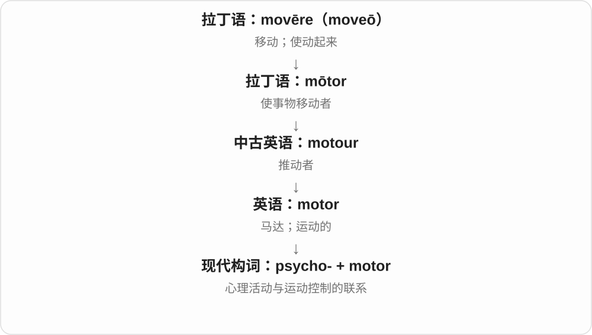

# 2021 · psycho- — 心灵、心理和精神活动；不只精神障碍

[逐词精讲目录](../00_逐词精讲目录.md) · [总目录](../00_总目录_按常用程度.md)

## 核心词根与来源

心理这个前半段不自动说某人危险、异常。后半段才决定是学科、治疗、人、测量，还是形成原因、药物作用。

**PSYCHO-：先定位心理领域，再由后半段说明研究、治疗、来源或作用**

psychology 研究心理；psychotherapy 治疗；psychogenic 来源在心理；psychotropic 作用于精神活动。

- **研究、测量与障碍相关名称**：psychology · psychometric · psychosis · psychopathic · psychopathy · psychopathology
- **治疗、分析与相关人物**：psychotherapy · psychotherapist · psychoanalytic · psychoanalytical · psychoanalyst · psychodynamic
- **关系、来源与作用**：psychosocial · psychosomatic · psychogenic · psychoactive · psychotropic
- **其他专门活动与过程**：psychomotor · psychosexual · psychodrama

## 词形与演化规律

psykhē → psycho-；-logy 学科、therapy 治疗、-genic 来源、-tropic 作用方向；social/somatic 等说明与社会、身体的关系。

## 单词速览（按词族由简到繁）

同一基础词的相关扩展放在一起，先读基础形式，再读扩展；各组之间优先读常用的。具体词源关系见各词讲解。

| 单词 | 音标 | 核心意思 |
|---|---|---|
| [psychology](#w-1) | 英 /saɪˈkɒlədʒi/；美 /saɪˈkɑːlədʒi/ | 心理学；心理特点 |
| [psychotherapy](#w-2) | 英 /ˌsaɪkəʊˈθerəpi/；美 /ˌsaɪkoʊˈθerəpi/ | 心理治疗 |
| [psychotherapist](#w-8) | 英 /ˌsaɪkəʊˈθerəpɪst/；美 /ˌsaɪkoʊˈθerəpɪst/ | 心理治疗师；开展心理治疗的专业人员 |
| [psychosis](#w-3) | 英 /saɪˈkəʊsɪs/；美 /saɪˈkoʊsɪs/ | 精神病性症状状态；现实检验能力受影响的一组症状 |
| [psychopathy](#w-12) | 英 /saɪˈkɒpəθi/；美 /saɪˈkɑːpəθi/ | 精神病态人格特质〔心理学研究概念〕 |
| [psychopathic](#w-4) | 英 /ˌsaɪkəʊˈpæθɪk/；美 /ˌsaɪkoʊˈpæθɪk/ | 与精神病态人格特质有关的 |
| [psychosocial](#w-5) | 英 /ˌsaɪkəʊˈsəʊʃəl/；美 /ˌsaɪkoʊˈsoʊʃəl/ | 心理社会的；涉及心理与社会环境相互影响的 |
| [psychoactive](#w-6) | 英 /ˌsaɪkəʊˈæktɪv/；美 /ˌsaɪkoʊˈæktɪv/ | 影响心理活动的；作用于意识、情绪等心理过程的 |
| [psychoanalytic](#w-7) | 英 /ˌsaɪkəʊˌænəˈlɪtɪk/；美 /ˌsaɪkoʊˌænəˈlɪtɪk/ | 精神分析的 |
| [psychoanalytical](#w-21) | 英 /ˌsaɪkəʊˌænəˈlɪtɪkəl/；美 /ˌsaɪkoʊˌænəˈlɪtɪkəl/ | 精神分析的；采用精神分析角度的 |
| [psychosomatic](#w-9) | 英 /ˌsaɪkəʊsəˈmætɪk/；美 /ˌsaɪkoʊsəˈmætɪk/ | 身心相关的；心理因素参与的身体症状或疾病的 |
| [psychotropic](#w-10) | 英 /ˌsaɪkəˈtrɒpɪk/；美 /ˌsaɪkəˈtroʊpɪk/ | 作用于精神活动的；精神活性药物〔名词〕 |
| [psychoanalyst](#w-11) | 英 /ˌsaɪkəʊˈænəlɪst/；美 /ˌsaɪkoʊˈænəlɪst/ | 精神分析师；从事精神分析的人 |
| [psychopathology](#w-13) | 英 /ˌsaɪkəʊpəˈθɒlədʒi/；美 /ˌsaɪkoʊpəˈθɑːlədʒi/ | 精神病理学；心理与行为障碍的病理表现 |
| [psychometric](#w-14) | /ˌsaɪkəˈmetrɪk/ | 心理测量的 |
| [psychodynamic](#w-15) | 英 /ˌsaɪkəʊdaɪˈnæmɪk/；美 /ˌsaɪkoʊdaɪˈnæmɪk/ | 心理动力学的 |
| [psychogenic](#w-16) | 英 /ˌsaɪkəʊˈdʒenɪk/；美 /ˌsaɪkoʊˈdʒenɪk/ | 心因性的、源于心理或情绪因素的 |
| [psychosexual](#w-18) | 英 /ˌsaɪkəʊˈsekʃuəl/；美 /ˌsaɪkoʊˈsekʃuəl/ | 心理性欲的；与性心理有关的 |
| [psychodrama](#w-19) | 英 /ˈsaɪkəʊdrɑːmə/；美 /ˈsaɪkoʊdrɑːmə/ | 心理剧；以角色扮演展开的心理治疗方法；侧重人物心理的戏剧 |
| [psychomotor](#w-20) | 英 /ˌsaɪkəʊˈməʊtə/；美 /ˌsaɪkoʊˈmoʊtər/ | 精神运动的；心理活动与身体动作相联系的 |

## 逐词讲解

### 1. psychology — 心理学；心理特点

**音标**：英 /saɪˈkɒlədʒi/；美 /saɪˈkɑːlədʒi/

**先抓住这个画面**

研究人怎样感知、记住、思考、感受和行动。

**怎么拆**

psycho- 接希腊 psykhḗ“心灵”，加 -logy；经近代拉丁 psychologia、法语 psychologie 进入英语。词首 p 不发音。

**怎么变成今天的意思**

**希腊 légō / lógos**  
选取、收集 → 讲述；话语、说明、道理、计算

↓

**希腊 psykhḗ〔灵魂、心灵〕+ -logia → 文艺复兴时期拉丁 psychologia**  
以心灵为对象的学术名称

↓

**法语 psychologie → 英语 psychology**  
后来成为研究心理与行为的现代学科

它不是看一眼就猜出别人想什么，而是用观察、实验等方法研究心理和行为。the psychology of a group 也可泛指这个群体的心理特点，不一定在命名一门新学科。

**常见搭配与例句**

cognitive psychology；social psychology；the psychology of decision-making。

> She studies psychology to understand how people make decisions.

她学习心理学，希望理解人们怎样作决定。

> The experiment tested a theory from cognitive psychology.

这个实验检验了认知心理学中的一个理论。

**别混淆**

psychology 是研究领域；mind reading 是读心说法，不能把学科知识等同于准确猜心。

### 2. psychotherapy — 心理治疗

**音标**：英 /ˌsaɪkəʊˈθerəpi/；美 /ˌsaɪkoʊˈθerəpi/

**先抓住这个画面**

和受过训练的专业人员一起，辨认困扰自己的想法、感受和行为模式，尝试改变它们。

**怎么拆**

psycho-“心理” + therapy“治疗、照护”；英语构词也参照法语 psychothérapie。

**怎么变成今天的意思**

**希腊 psyche（ψυχή）**  
生命、灵魂、心灵；在不同思想传统中含义有变化

↓

**psycho- + therapy；参照法语 psychothérapie 等近代构词**  
心理 + 治疗、照护

↓

**英语 psychotherapy**  
运用心理方法帮助改善情绪、思维与行为困难

psychotherapy 不是一种唯一的谈话套路，而是一类心理治疗方法。它可以有个体或团体形式，也可能包含谈话之外的练习。共同点是有专业目标和方法，帮助人处理困扰、改善生活中的功能。

**常见搭配与例句**

individual psychotherapy；group psychotherapy；a psychotherapy session。

> The study compared two forms of psychotherapy.

这项研究比较了两种心理治疗方法。

> During psychotherapy, she began to notice recurring patterns in her reactions.

在心理治疗过程中，她开始注意到自己反应中反复出现的模式。

**别混淆**

psychotherapy 是大类；psychoanalysis 是其中一套特定理论与方法，不能拿后者概括所有心理治疗。

### 3. psychotherapist — 心理治疗师；开展心理治疗的专业人员

**音标**：英 /ˌsaɪkəʊˈθerəpɪst/；美 /ˌsaɪkoʊˈθerəpɪst/

**先抓住这个画面**

工作重点是陪同来访者观察心理与行为模式，并用受训练的方法处理这些困难。

**怎么拆**

与 psychotherapy 相对应，以 therapist 表示从事治疗的人。

**怎么变成今天的意思**

**希腊 psyche（ψυχή）**  
生命、灵魂、心灵；在不同思想传统中含义有变化

↓

**psycho- + therapy；参照法语 psychothérapie 等近代构词**  
心理 + 治疗、照护

↓

**英语 psychotherapy**  
运用心理方法帮助改善情绪、思维与行为困难

↓

**英语 psychotherapy／psycho- + therapist → psychotherapist**  
心理治疗 → 提供心理治疗的专业人员

psychotherapist 是按提供的工作来称呼人，专业背景可能不同。它本身不等同于“精神科医生”，也不能单凭这个词推断对方使用哪一派方法。读文章时可留意后面的 trained in、specializes in。

**常见搭配与例句**

work with a psychotherapist；a trained psychotherapist；consult a psychotherapist。

> The psychotherapist asked her to describe what happened before the argument.

心理治疗师请她描述争吵发生之前的情况。

> He works as a psychotherapist with adults and families.

他从事心理治疗工作，服务对象包括成年人和家庭。

**别混淆**

psychiatrist 明确有医学医生背景；psychotherapist 强调开展心理治疗。一个人可以同时符合两个称呼。

### 4. psychosis — 精神病性症状状态；现实检验能力受影响的一组症状

**音标**：英 /saɪˈkəʊsɪs/；美 /saɪˈkoʊsɪs/

**先抓住这个画面**

人对“眼前哪些体验与外界现实相符”的判断出了问题，可能出现幻觉或妄想。

**怎么拆**

近代医学使用 psych-“心灵” + -osis“状态”造词；不要直接等同于古希腊同形词曾有的“赋予生命”之义。

**怎么变成今天的意思**

**希腊 psyche（ψυχή）**  
生命、灵魂、心灵；在不同思想传统中含义有变化

↓

**近代医学构词 psych- + -osis → psychosis**  
心理方面的状态；早期用法较宽

↓

**现代英语 psychosis**  
现实检验受影响的一组精神症状

psychosis 描述一组影响现实感知和判断的症状，不是所有心理困难的总称，也不只对应一种疾病。看到这个词，先理解文章在说症状层面的现实检验变化，不能直接替换成 schizophrenia“精神分裂症”。

**常见搭配与例句**

experience psychosis；an episode of psychosis；research on psychosis。

> The report explains how psychosis can affect a person’s perception of reality.

报告解释了精神病性症状怎样影响人对现实的感知。

> The study followed people after a first episode of psychosis.

研究跟踪了首次出现精神病性症状的人。

**别混淆**

psychosis 与 psychopathy 不同：前者重点在现实检验受影响，后者是某组人格特质的研究概念。

### 5. psychopathy — 精神病态人格特质〔心理学研究概念〕

**音标**：英 /saɪˈkɒpəθi/；美 /saɪˈkɑːpəθi/

**先抓住这个画面**

研究者关注一组持续的人格特点，例如对他人痛苦冷漠、缺少悔意，并可能伴有冲动或操纵倾向。

**怎么拆**

psycho-“心理” + -pathy“病理、苦痛”，英语参照德语 Psychopathie；早期意义更广，现代常指较特定的人格特质组合。

**怎么变成今天的意思**

**希腊 psyche（ψυχή）**  
生命、灵魂、心灵；在不同思想传统中含义有变化

↓

**德语 Psychopathie 等近代术语 → 英语 psychopathy**  
心理 + -pathy 病理、苦痛；早期泛指精神病理

↓

**现代研究中的 psychopathy**  
以冷酷、缺少悔意等为核心的一组人格特质概念

今天讨论 psychopathy，不能只按字面译成“一切精神疾病”。它是人格研究中的概念，也不等于一个人一定有幻觉、一定犯罪或必然暴力。研究会用明确方法评估一组特质，不能凭一次争吵给人贴这个标签。

**常见搭配与例句**

research on psychopathy；traits associated with psychopathy。

> The seminar examined different ways of measuring psychopathy.

研讨课考察了评估精神病态人格特质的不同方法。

> The article challenges stereotypes about psychopathy.

文章质疑了人们对这类人格特质的刻板印象。

**别混淆**

psychopathy 与 psychosis 的核心不同；与 antisocial personality disorder 也有重叠和区别，不能不看定义就画等号。

### 6. psychopathic — 与精神病态人格特质有关的

**音标**：英 /ˌsaɪkəʊˈpæθɪk/；美 /ˌsaɪkoʊˈpæθɪk/

**先抓住这个画面**

描述的是冷酷、缺少悔意等特质组合，焦点不在是否产生幻觉。

**怎么拆**

与 psychopathy 相对应，早期英语参照德语 psychopatisch 等形式；不是只能从后来名词 psychopath 反推为加 -ic。

**怎么变成今天的意思**

**希腊 psyche（ψυχή）**  
生命、灵魂、心灵；在不同思想传统中含义有变化

↓

**德语 Psychopathie 等近代术语 → 英语 psychopathy**  
心理 + -pathy 病理、苦痛；早期泛指精神病理

↓

**现代研究中的 psychopathy**  
以冷酷、缺少悔意等为核心的一组人格特质概念

↓

**英语 psychopathy 词族／德语对应形容词 → psychopathic**  
精神病理词族 → 现代特定人格特质的形容词

psychopathic traits 比直接把整个人叫作 psychopath 更具体，因为它指明讨论的是特质。旧医学文献中的 psychopathic 可能使用更宽的精神病理义；读历史材料时不能把今天的窄义全部套回去。

**常见搭配与例句**

psychopathic traits；psychopathic tendencies；a psychopathic personality。

> The researchers assessed psychopathic traits using a structured method.

研究者用结构化方法评估了相关人格特质。

> The textbook warns against equating psychopathic traits with inevitable violence.

教材提醒读者，不能把这类人格特质与必然发生暴力等同起来。

**别混淆**

psychopathic 不等于 psychotic；前者偏人格特质，后者对应精神病性症状。

### 7. psychosocial — 心理社会的；涉及心理与社会环境相互影响的

**音标**：英 /ˌsaɪkəʊˈsəʊʃəl/；美 /ˌsaɪkoʊˈsoʊʃəl/

**先抓住这个画面**

一个人的感受会受家庭、同伴、工作环境影响，反过来这些感受也影响与人的关系。

**怎么拆**

psycho- 心理 + social 社会的；两个成分并列结合，不是社会先变成心理。

**怎么变成今天的意思**

用于研究或支持服务时，提醒读者同时看内在感受和外部关系，而不是把问题全归给个人。

**常见搭配与例句**

psychosocial factors；psychosocial support；psychosocial development。

> The study considers both economic and psychosocial factors.

研究同时考虑经济因素和心理社会因素。

> The programme offers psychosocial support to families.

项目为家庭提供心理及社会支持。

**别混淆**

psychological 主要从心理角度看；psychosocial 明确把社会关系和环境也带进来。

### 8. psychoactive — 影响心理活动的；作用于意识、情绪等心理过程的

**音标**：英 /ˌsaɪkəʊˈæktɪv/；美 /ˌsaɪkoʊˈæktɪv/

**先抓住这个画面**

一种物质进入身体后，会改变清醒程度、情绪、感知或其他心理活动。

**怎么拆**

psycho-“心理” + active“起作用的”，把作用范围指向心智。

**怎么变成今天的意思**

**希腊 psyche（ψυχή）**  
生命、灵魂、心灵；在不同思想传统中含义有变化

↓

**英语 psycho- + active → psychoactive**  
心理 + 起作用的 → 影响心理过程的

咖啡因也属于 psychoactive substance，因为它会影响清醒和注意状态。这个词是作用性质的分类，不等于“非法物质”，也不自动表示会产生幻觉。不同物质的具体作用差别很大。

**常见搭配与例句**

a psychoactive substance；psychoactive effects；a psychoactive compound。

> Caffeine is a psychoactive substance.

咖啡因是一种会影响心理活动的物质。

> The report describes the compound’s psychoactive effects.

报告描述了这种化合物对心理活动的影响。

**别混淆**

psychoactive 是较大的范围；psychedelic 是其中更特定的类别名称，不能互换。

### 9. psychoanalytic — 精神分析的

**音标**：英 /ˌsaɪkəʊˌænəˈlɪtɪk/；美 /ˌsaɪkoʊˌænəˈlɪtɪk/

**先抓住这个画面**

把说出口的感受与未被意识到的冲突联系起来理解，属于精神分析的那套思路。

**怎么拆**

现代可拆 psycho-“心理、精神” + analytic“分析的”，也与 psychoanalysis 的形容词形式对应。analytic 的远源是希腊 ana- + lýein“解开”；“解开心结”是理解联想，不是希腊人已发明现代精神分析。

**怎么变成今天的意思**

**两组希腊材料：psykhḗ；ana- + lýein → analytikós**  
心灵；解开、分析

↓

**中世纪拉丁 analyticus → 英语 analytic；psycho- 作心理组合形式**  
分析的；心理的

↓

**精神分析术语背景下：psycho- + analytic → psychoanalytic**  
与精神分析理论、方法相关的

a psychoanalytic interpretation 常关注无意识、冲突和早期经历等概念，也用于文学评论。它是特定分析传统，不是“凡是认真分析人的心理都算”。对人物作这样的解读，也不等于完成临床诊断。

**常见搭配与例句**

a psychoanalytic approach；psychoanalytic theory；a psychoanalytic interpretation。

> The critic offers a psychoanalytic interpretation of the character’s recurring dreams.

评论者从精神分析角度解读人物反复出现的梦。

> The course compares psychoanalytic theory with other approaches to the mind.

课程把精神分析理论与其他研究心灵的方法作比较。

**别混淆**

psychological 范围更广，凡与心理有关都可能用；psychoanalytic 限定精神分析这一理论或方法方向。

### 10. psychoanalytical — 精神分析的；采用精神分析角度的

**音标**：英 /ˌsaɪkəʊˌænəˈlɪtɪkəl/；美 /ˌsaɪkoʊˌænəˈlɪtɪkəl/

**先抓住这个画面**

这次解读选用的工具，是无意识、内在冲突等精神分析概念。

**怎么拆**

psycho- + analytical；与 psychoanalysis 这一术语词族相配。

**怎么变成今天的意思**

**希腊 psyche（ψυχή）**  
生命、灵魂、心灵；在不同思想传统中含义有变化

↓

**法语 psychoanalyse／德语 Psychoanalyse 等国际术语**  
心理 + 分析；弗洛伊德发展的精神分析理论与方法

↓

**英语 psychoanalysis**  
精神分析

↓

**英语 psycho- + analytical → psychoanalytical**  
精神分析 → 与精神分析理论或方法有关的

psychoanalytical interpretation 可能分析梦、小说或关系经历。这个词告诉你解释采用什么理论角度，不保证它是唯一或最终答案。一般情况下 psychoanalytic 与 psychoanalytical 意思很接近。

**常见搭配与例句**

psychoanalytical theory；a psychoanalytical interpretation；a psychoanalytical approach。

> The essay offers a psychoanalytical interpretation of the play.

这篇文章从精神分析角度解读了那部戏剧。

> Her research compares psychoanalytical and cognitive approaches to memory.

她的研究比较精神分析与认知取向如何理解记忆。

**别混淆**

psychological 是宽泛的心理方面的；psychoanalytical 把范围缩到精神分析这一传统。

### 11. psychosomatic — 身心相关的；心理因素参与的身体症状或疾病的

**音标**：英 /ˌsaɪkəʊsəˈmætɪk/；美 /ˌsaɪkoʊsəˈmætɪk/

**先抓住这个画面**

把心理和身体之间那条双向联系看见：情绪与压力可能影响真实的身体体验。

**怎么拆**

psycho-“心理” + somatic“身体的”，后者接希腊 soma“身体”。

**怎么变成今天的意思**

**希腊 psyche（ψυχή）**  
生命、灵魂、心灵；在不同思想传统中含义有变化

↓

**psycho- 与 somatic 并列组合 → psychosomatic**  
心理 + 身体 → 身心相互作用的

psychosomatic symptoms 不是“装出来的症状”。这个词讨论心理因素怎样参与身体症状的发生、维持或加重，也可广泛说身心互动。具体原因要靠评估，不能因为一次检查没发现原因，就直接认定症状全是心理造成的。

**常见搭配与例句**

psychosomatic symptoms；psychosomatic medicine；a psychosomatic interaction。

> The lecture explains the interaction between stress and psychosomatic symptoms.

讲座解释了压力与身心相关症状之间的相互作用。

> Psychosomatic does not mean that the person is pretending.

身心相关并不意味着当事人在假装。

**别混淆**

psychosomatic 关注身心联系；imaginary 说不存在或想象的。二者不能画等号。

### 12. psychotropic — 作用于精神活动的；精神活性药物〔名词〕

**音标**：英 /ˌsaɪkəˈtrɒpɪk/；美 /ˌsaɪkəˈtroʊpɪk/

**先抓住这个画面**

心理活动、感受等会受它作用；词形重点是作用指向精神心理，不是说使用者一定属于哪一类人。

**怎么拆**

psycho- 精神、心理 + -tropic 作用于、趋向相关材料，后者接希腊转向词族。整体可作形容词，也可省称相应药物名。

**怎么变成今天的意思**

**希腊 psykhē**  
呼吸、生命、灵魂等旧义

↓

**科学构词 psycho-**  
心灵、心理、精神活动相关材料

↓

**psycho- + -tropic → psychotropic**  
作用指向心理、精神活动的

psychotropic medication 精神活性药物，psychotropic effects 精神活动方面的作用。这个名称本身不说明具体药物、效果程度、适用对象。

**常见搭配与例句**

psychotropic medication；psychotropic effects。

> The course introduces the term psychotropic medication.

课程介绍了精神活性药物这个术语。

> The study compares the psychotropic effects of the compounds.

研究比较了这些化合物对精神活动的作用。

**别混淆**

psychotropic 说对精神活动的作用，psychogenic 说来源在心理因素；作用对象与形成来源是两个方向。

### 13. psychoanalyst — 精神分析师；从事精神分析的人

**音标**：英 /ˌsaɪkəʊˈænəlɪst/；美 /ˌsaɪkoʊˈænəlɪst/

**先抓住这个画面**

采用精神分析这套理论和方法工作的人，关注表面叙述背后反复出现的心理联系。

**怎么拆**

psycho- + analyst；与 psychoanalysis 相对应的人员名称。

**怎么变成今天的意思**

**希腊 psyche（ψυχή）**  
生命、灵魂、心灵；在不同思想传统中含义有变化

↓

**法语 psychoanalyse／德语 Psychoanalyse 等国际术语**  
心理 + 分析；弗洛伊德发展的精神分析理论与方法

↓

**英语 psychoanalysis**  
精神分析

↓

**英语 psychoanalysis／psycho- + analyst → psychoanalyst**  
精神分析 → 从事精神分析的人

a psychoanalyst may ask about recurring experiences，说的是这一专业角色可能关注重复的经历或关系。不要把词义理解成“能看穿所有秘密的人”；现实中的分析依赖交流、理论和具体工作过程。

**常见搭配与例句**

a practising psychoanalyst；consult a psychoanalyst。

> The psychoanalyst noticed a recurring theme in the patient’s account.

精神分析师注意到患者叙述中反复出现的一个主题。

> The book was written by a psychoanalyst interested in literature.

这本书由一位对文学感兴趣的精神分析师写成。

**别混淆**

psychologist 是更广的心理学专业称呼；psychoanalyst 特指精神分析取向，二者可能重叠但不等同。

### 14. psychopathology — 精神病理学；心理与行为障碍的病理表现

**音标**：英 /ˌsaɪkəʊpəˈθɒlədʒi/；美 /ˌsaɪkoʊpəˈθɑːlədʒi/

**先抓住这个画面**

问心理困难怎样形成、怎样表现、怎样变化，把这些问题系统地研究起来。

**怎么拆**

psycho-“心理” + pathology“病理学”；pathology 最终接希腊 pathos 与研究、论述相关成分。

**怎么变成今天的意思**

**希腊 psyche（ψυχή）**  
生命、灵魂、心灵；在不同思想传统中含义有变化

↓

**近代 psycho- + pathology → psychopathology**  
心理 + 病理学 → 精神病理研究或表现

a course in psychopathology 是研究心理与行为障碍的课程；文献里的 signs of psychopathology 则可能指病理表现。注意两个层面：一是研究领域，二是被研究的困难本身。它不是只研究 psychopath 的学问。

**常见搭配与例句**

developmental psychopathology；a course in psychopathology；the study of psychopathology。

> The course introduces major concepts in psychopathology.

这门课程介绍精神病理学的主要概念。

> Her research focuses on developmental psychopathology.

她的研究主要关注发展精神病理学。

**别混淆**

psychopathology 的范围远宽于 psychopathy，不能因为都有 psychopath- 的字样就把两者等同。

### 15. psychometric — 心理测量的

**音标**：/ˌsaɪkəˈmetrɪk/

**先抓住这个画面**

想把记忆、能力、态度等看不见的东西，用有规则的题目和数据来估计。

**怎么拆**

psycho-“心理” + metric“测量的”，最终接希腊 metron“尺度”。

**怎么变成今天的意思**

**希腊 psyche（ψυχή）**  
生命、灵魂、心灵；在不同思想传统中含义有变化

↓

**近代 psycho- + 测量词素 metr-**  
心理 + 测量

↓

**英语 psychometric／psychometrics**  
心理测量的／心理测量学

a psychometric test 是按一定测量原则设计的心理测验；psychometric properties 指它的测量表现，如结果是否稳定、是否真在测所说的东西。分数是工具给出的估计，不是把一个人的全部价值测出来。

**常见搭配与例句**

psychometric testing；a psychometric test；psychometric properties。

> The researchers examined the questionnaire’s psychometric properties.

研究者检验了这份问卷的心理测量学表现。

> The course explains how psychometric tests are designed.

课程解释了心理测验是怎样设计的。

**别混淆**

psychometric 不等于 psychic。前者通常谈测量方法，后者在日常语境中可能指所谓超感知能力。

### 16. psychodynamic — 心理动力学的

**音标**：英 /ˌsaɪkəʊdaɪˈnæmɪk/；美 /ˌsaɪkoʊdaɪˈnæmɪk/

**先抓住这个画面**

这种理解人的方式会往表面反应后面看：没有说出口的感受、未察觉的动机和早期经历，可能怎样影响现在的行为。

**怎么拆**

psycho-“心理” + dynamic，十九世纪英语构词，早期广泛谈心理作用；后来在心理学中发展为特定理论与治疗取向的标签，不能把现代专义直接当成最初原义。

**怎么变成今天的意思**

**希腊 dunasthai → dunamis（δύναμις）**  
能够、有力量 → 力量、能力

↓

**希腊 dunamikos → 法语学术用语 dynamique**  
有力量的 → 近代力学中的动力相关的

↓

**英语 dynamic**  
动力的；后来又说有活力、变化中的

↓

**英语 psycho- + dynamic → psychodynamic**  
早期心理作用相关的

↓

**心理学中的 psychodynamic**  
关注无意识、情绪冲突、早期经验及关系的影响

a psychodynamic approach 指这一理论取向；psychodynamic therapy 是相应治疗领域用语。所谓动力是解释心理作用的比喻，不是像发动机那样测量机械功率。

**常见搭配与例句**

a psychodynamic approach；psychodynamic theory；psychodynamic therapy；a psychodynamic interpretation。

> The course compares psychodynamic and cognitive approaches to personality.

这门课比较心理动力学与认知取向如何理解人格。

> The essay offers a psychodynamic interpretation of the character’s repeated conflicts.

文章从心理动力学角度解读了这个人物反复陷入的冲突。

**别混淆**

psychological 泛指心理相关；psychodynamic 指其中较具体的一类理解方式。它是理论标签，不能当作给人的诊断名称。

### 17. psychogenic — 心因性的、源于心理或情绪因素的

**音标**：英 /ˌsaɪkəʊˈdʒenɪk/；美 /ˌsaɪkoʊˈdʒenɪk/

**先抓住这个画面**

问的是它从哪里产生：psycho- 把来源指到心理、情绪因素；不是说身体上的感受就必定不存在。

**怎么拆**

psycho- 心理 + -genic 由……产生、起源于，gen- 与产生词族相关。这里不是 genius 天才的截短，也不是 psychotic 精神病性的同义拼写。

**怎么变成今天的意思**

**希腊 psykhē**  
呼吸、生命、灵魂等旧义

↓

**科学构词 psycho-**  
心灵、心理、精神活动相关材料

↓

**psycho- + -genic → psychogenic**  
以心理、情绪因素为来源的

psychogenic symptoms 心因性症状，a psychogenic explanation 心理起源解释；是在讨论形成来源，不把词本身当人人都能套的标签。

**常见搭配与例句**

psychogenic symptoms；a psychogenic explanation。

> The chapter discusses psychogenic symptoms in their clinical context.

这一章结合临床背景讨论心因性症状。

> The author distinguishes psychogenic from psychotropic in the glossary.

作者在术语表里区分了心因性与精神活性这两个词。

**别混淆**

psychogenic 起源于心理，psychotropic 影响精神活动；-genic 来源、-tropic 作用方向的区别最值得记。

### 18. psychosexual — 心理性欲的；与性心理有关的

**音标**：英 /ˌsaɪkəʊˈsekʃuəl/；美 /ˌsaɪkoʊˈsekʃuəl/

**先抓住这个画面**

关注感受、想法和心理发展怎样与性联系起来。

**怎么拆**

psycho-“心理” + sexual，近代学术构词；不是 psychotic“精神病性的”的缩写。

**怎么变成今天的意思**

**拉丁 sexus**  
性别、雌雄类别；更早是否接“切分”词根仍有争议

↓

**晚期拉丁 sexuālis → 英语 sexual**  
与性别、生殖有关的 → 与性吸引、性行为有关的

↓

**英语 psycho- + sexual → psychosexual**  
心理过程与性相互关联的

可以用于发展理论、咨询或电影人物分析。若谈弗洛伊德的阶段理论，词语本身不意味着那些理论已被普遍证实。

**常见搭配与例句**

psychosexual development；psychosexual themes；psychosexual counselling。

> The course reviews historical theories of psychosexual development.

课程回顾性心理发展的历史理论。

> The critic explores the film’s psychosexual themes.

评论者探讨了电影中的性心理主题。

**别混淆**

psychological 范围更广；psychosexual 明确把心理与性相连。

### 19. psychodrama — 心理剧；以角色扮演展开的心理治疗方法；侧重人物心理的戏剧

**音标**：英 /ˈsaɪkəʊdrɑːmə/；美 /ˈsaɪkoʊdrɑːmə/

**先抓住这个画面**

把内心冲突、关系放到场景里演出来：既可说一种专业方法，也可说围绕人物心理展开的戏剧作品。

**怎么拆**

psycho- 心理、心灵 + drama 戏剧、表演；drama 更早接希腊行动、所演出的事。名称强调内心进入表演场景。

**怎么变成今天的意思**

**希腊心灵词基 psycho- 与 drama 戏剧词并列**  
心理、心灵 + 表演

↓

**psycho- + drama → psychodrama**  
心理剧；专业角色扮演方法与戏剧类别等用法

a psychodrama workshop 心理剧工作坊，a family psychodrama 家庭心理剧，psychodrama techniques 心理剧方法。

**常见搭配与例句**

a psychodrama workshop；a family psychodrama；psychodrama techniques。

> The film is a tense family psychodrama.

这部电影是一出紧张的家庭心理剧。

> The textbook included a chapter on psychodrama.

课本包含一章心理剧内容。

**别混淆**

psychodrama 的 psycho- 说心理，不等于日常骂人的 psycho；作品类型与专业治疗方法需要按场景区分。

### 20. psychomotor — 精神运动的；心理活动与身体动作相联系的

**音标**：英 /ˌsaɪkəʊˈməʊtə/；美 /ˌsaɪkoʊˈmoʊtər/

**先抓住这个画面**

psychomotor 像“脑子判断、身体执行”这条协作链：看见目标，决定动作，再把手伸过去。

**怎么拆**

psycho-（心理）+ motor（运动的）；希腊来源和拉丁来源组合成的现代术语。

**怎么变成今天的意思**

常见于动作技能、反应任务与临床观察。这里不是“心理马达”，而是心理过程怎样表现为身体动作。

**常见搭配与例句**

psychomotor skills；psychomotor development；a psychomotor task。

> The exercise develops basic psychomotor skills.

这项练习培养基本的感知与动作配合能力。

> Participants completed a simple psychomotor task.

参与者完成了一项简单的心理运动任务。

**别混淆**

motor skills 侧重运动技能；psychomotor 更强调认知、感知与动作之间的配合。

## 这一组要分清什么

psychogenic/psychotropic 来源与作用方向；psychology 不等于精神病学；psycho- 作构词材料与骂人 psycho 的语气分开。

## 串起来练习

The glossary distinguishes psychology, psychotherapy and psychogenic factors.

术语表区分了心理学、心理治疗与心理起源因素。
