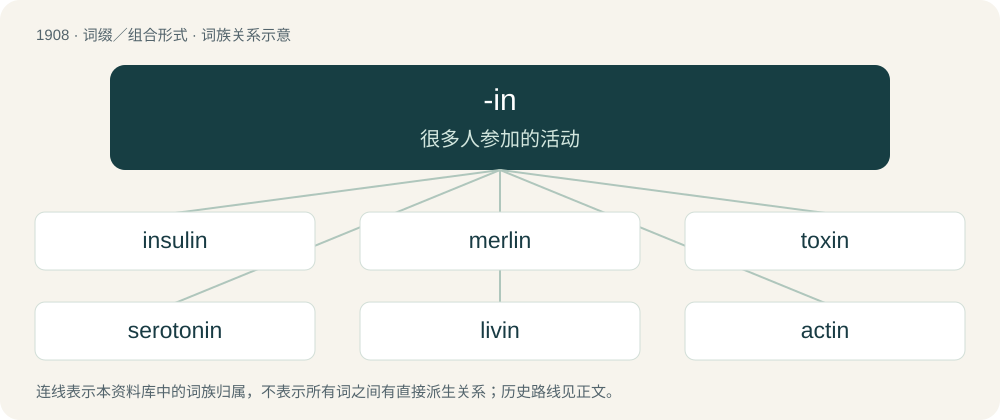

# 2023 · -in — 很多人参加的活动

[总目录](../00_总目录_按常用程度.md)

**类型**：词缀／组合形式　｜　**来源语言**：见词源记录

## 核心含义与来源

- 核心含义：很多人参加的活动
- 英文含义：A neutral chemical compound.
- 词形：-in

**多个词源／构词路径**：同一拼写可能有不同来源；以下按词性和含义分别列出。

**来源记录 1**（后缀／后置成分；A neutral chemical compound.）

Clipping of -ine.

**来源记录 2**（后缀／后置成分；Attached to a word (usually a verb) to denote a protest, demonstration or other type of gathering characterized by the activity denoted by the base word.）

From the particle in, modelled after sit-in. Compare -off.

## 词族图

## 单词速览（常用到不常用）

| 单词 | 音标 | 释义 |
|---|---|---|
| [insulin](#w-1) | 英 /ˈɪnsjʊlin/；美 /ˈɪnsəlɪn/ | n. 胰岛素；\[化\] 胰岛素 |
| [merlin](#w-2) | /ˈmɝlɪn/ | 【英文】A cytoskeletal protein active in the suppression of tumors. |
| [toxin](#w-3) | 英 /ˈtɒksɪn/；美 /ˈtɑksɪn/ | n. 毒素；\[化\] 毒素 |
| [serotonin](#w-4) | 英 /ˌsɛɹəˈtəʊnɪn/；美 /ˌsɛɹəˈtoʊnɪn/ | n. 血清素；\[化\] 5-羟色胺 |
| [livin](#w-5) |  | \[医\]（尚无中文译名）新发现的凋亡抑制蛋白，存在于胚胎组织、胎盘和一些恶性肿瘤组织中。 |
| [actin](#w-6) | /ˈæktɪn/ | n. 肌动蛋白；\[化\] 肌动蛋白 |
| [penicillin](#w-7) | /ˌpɛn.ɪˈsɪl.ɪn/ | n. 盘尼西林, 青霉素；\[化\] 青霉素 |
| [melatonin](#w-8) | 英 /ˌmɛləˈtəʊnɪn/；美 /ˌmɛləˈtoʊnɪn/ | \[化\] 褪黑激素; N-乙酰-5-甲氧基色胺 |
| [melanin](#w-9) | 英 /ˈmɛlənɪn/ | n. 黑色素；\[化\] 黑素 |
| [chromatin](#w-10) | 英 /ˈkɹəʊmətɪn/ | n. 核染质, 染色质；\[化\] 染色质 |
| [interleukin](#w-11) |  | \[化\] 白介素 |
| [aldrin](#w-12) | /ˈɔːldrin/ | \[化\] 艾氏剂; 氯甲桥萘; 化合物118；\[医\] 阿耳德林(有机杀虫药) |
| [heparin](#w-13) | /ˈhɛp.ə.ɹɪn/ | n. 肝素；\[化\] 肝素 |
| [keratin](#w-14) | 英 /ˈkɛɹətɪn/ | n. 角蛋白；\[化\] 角蛋白 |
| [myelin](#w-15) | /ˈmaɪəlɪn/ | \[化\] 髓磷脂；\[医\] 髓磷脂; 髓鞘质 |
| [psilocybin](#w-16) | 英 /ˌsʌɪ.lə(ʊ)ˈsʌɪ.bɪn/；美 /ˌsɪ.ləˈsaɪ.bɪn/ | n. 二甲-4-羟色胺磷酸(迷幻药)；\[化\] 赛洛西宾; 二甲-4-羟色胺磷酸酯 |
| [angiotensin](#w-17) | 英 /ænd͡ʒɪəʊˈtɛnsɪn/；美 /ˌænd͡ʒɪoʊˈtɛnsɪn/ | n. 血管紧张素；\[化\] 血管紧张肽; 血管紧张素 |
| [lignin](#w-18) | 美 /ˈlɪɡ.nɪn/ | n. 木质素；\[化\] 木质素; 木素 |
| [cannabinoid](#w-19) | /ˈkænəbəˌnɔɪd/ | n. 大麻的化学成分（可指任何一种, 如四氢大麻醇、大麻醇等） |
| [cyclin](#w-20) | /ˈsaɪklɪn/ | 细胞周期蛋白 |
| [olivine](#w-21) | 英 /ˈɒl.ɪˌviːn/；美 /ˈɑl.əˌvin/ | n. 橄榄石；\[化\] 橄榄石 |
| [prolactin](#w-22) | 美 /pɹoʊˈlæktɪn/ | n. 催乳激素；\[化\] 促乳素 |
| [prostaglandin](#w-23) | /pɹɒstəˈɡlændɪn/ | \[化\] 前列腺素；\[医\] 前列腺素(分F,E,A,B四型) |
| [dioxin](#w-24) | 英 /daɪˈɒksɪn/；美 /daɪˈɑksən/ | n. \[化\]二氧(杂)芑 |
| [ubiquitin](#w-25) | /juːˈbɪkwɪtɪn/ | n. 泛激素，泛素（一种存在于大多数真核细胞中的小蛋白） |
| [rhein](#w-26) | /rain/ | n. \[化\] 大黄酸 |
| [astin](#w-27) |  | 奥司汀牌手表；阿斯廷（英格兰人姓氏） |
| [elfin](#w-28) | /ˈɛlfɪn/ | a. 小妖精的, 象小妖精的；n. 小精灵, 矮人, 淘气鬼 |
| [gabapentin](#w-29) | 美 /ˈɡæb.əˌpɛn.tɪn/ | \[医\]加巴喷丁（抗焦虑药） |
| [flavin](#w-30) | /ˈfleivin/ | n. 黄素；\[化\] 黄素类; 异咯嗪; 五羟黄酮; 栎精 |
| [fibrin](#w-31) | /ˈfaɪbɹɪn/ | n. 纤维蛋白；\[化\] 血纤蛋白; 血纤维蛋白 |
| [tubulin](#w-32) | /ˈtjuːbjjlin/ | n. \[生化\]微管蛋白 |
| [curcumin](#w-33) | /ˈkɜː(ɹ)kjəmɪn/ | 姜黄色素, 酸性黄 |
| [vasopressin](#w-34) | 英 /ˌveɪzəʊˈpɹɛsɪn/；美 /ˌveɪzoʊˈpɹɛsɪn/ | n. 后叶加压素, 加压素；\[医\] 后叶加压素 |
| [auxin](#w-35) | /ˈɒːksin/ | n. 植物激素；\[化\] 茁长素(植物生长素) |
| [cadherin](#w-36) | /kædˈhɪəɹɪn/ | 钙黏着蛋白 |
| [trypsin](#w-37) | /ˈtɹɪp.sɪn/ | n. 胰蛋白酶；\[化\] 胰蛋白酶 |
| [catenin](#w-38) | 英 /ˈka.tɪ.nɪn/；美 /ˈkæ.tɪ.nɪn/ | 【英文】Any of a class of proteins that have a role in cell adhesion. |
| [gonadotropin](#w-39) | /,^ɔnədəˈtrɔpin,^əjˈnædə-/ | \[化\] 促性腺素; 促性腺激素；\[医\] 促性腺激素 |
| [elastin](#w-40) | /iˈlæstin/ | n. 弹性蛋白；\[化\] 弹性蛋白 |
| [tretinoin](#w-41) | 英 /tɹəˈtɪn.əʊ.ɪn/；美 /tɹəˈtɪn.oʊ.ɪn/ | 维甲酸 |
| [globulin](#w-42) | 英 /ˈɡlɒbjʊlɪn/；美 /ˈɡlɑbjəlɪn/ | n. 球蛋白；\[化\] 球蛋白 |
| [thrombin](#w-43) | /ˈθɹɒmbɪn/ | n. 凝血酶；\[化\] 凝血酶 |
| [streptomycin](#w-44) | 英 /ˌstɹɛp.tə(ʊ)ˈmʌɪ.sɪn/；美 /ˌstɹɛp.təˈmaɪ.sn̩/ | n. 链霉素；\[化\] 植霉素(即链霉素) |
| [renin](#w-45) | 英 /ˈɹiː.nɪn/；美 /ˈɹi.nɪn/ | n. 肾素, 高血压蛋白原酶, 高血压蛋白的酶原；\[化\] 肾素; 血管紧张肽原酶 |
| [lamin](#w-46) | /ˈlæmin/ | n. 核纤层蛋白 |
| [lectin](#w-47) | 英 /ˈlɛktɪn/ | n. \[医\]外源凝集素,植物(种子)血凝素 |
| [erythropoietin](#w-48) | /ɪˌɹɪθɹəˈpɔɪ.ɪtɪn/ | \[化\] 红细胞生成素；\[医\] 红细胞生成素 |
| [fluorescein](#w-49) | /,fluəˈresiːin/ | \[化\] 荧烷二醇; 荧光黄; 荧光素；\[医\] 荧光素, 荧光黄 |
| [ghrelin](#w-50) | 英 /ˈɡɹɛlɪn/ | n. 胃内产生的一种肽，它能够调节食欲、进食和身体构成。; 饥饿激素; \[医\]生长素是从胃中分离出的一种新的能促进垂体生长激素分泌的肽 |
| [mucin](#w-51) | /ˈmjuːsɪn/ | n. 黏蛋白；\[化\] 粘蛋白 |
| [ribavirin](#w-52) | /ˌɹaɪ.bəˈvaɪ.ɹɪn/ | \[化\] 利巴韦林; 三氮唑核苷 |
| [zein](#w-53) | /ˈziːin/ | n. 玉米醇溶蛋白；\[化\] 玉米醇溶蛋白 |

## 逐词详解

### 1. insulin

**词性**：名词　｜　**音标**：英 /ˈɪnsjʊlin/；美 /ˈɪnsəlɪn/

**中文释义**：n. 胰岛素；\[化\] 胰岛素

**英文义项**：A polypeptide hormone that regulates carbohydrate metabolism (in various animals including humans). / Any exogenous preparation of this hormone for use as a medication.

**词源与演化**：

From Latin īnsula (“island”) (named for the islets of Langerhans, where insulin is produced) + -in.

**例句**：

> Mommy said that Grandma's diabetes happened because her body stopped making its own insulin.

该用例对应义项：A polypeptide hormone that regulates carbohydrate metabolism (in various animals including humans).

### 2. merlin

**词性**：名词　｜　**音标**：/ˈmɝlɪn/

**英文义项**：A cytoskeletal protein active in the suppression of tumors.

**词源与演化**：

Acronym of moesin-ezrin-radixin-like protein + -in (“protein”)

### 3. toxin

**词性**：名词　｜　**音标**：英 /ˈtɒksɪn/；美 /ˈtɑksɪn/

**中文释义**：n. 毒素；\[化\] 毒素

**英文义项**：A toxic substance, specifically a poison produced by the biological processes of organisms. / Synonym of toxicant: a toxic substance in a body requiring removal.

**构词拆分**：toxi- + -in

**词源与演化**：

From Latin toxicum, equivalent to toxi- + -in.

**例句**：

> The neurological system is compromised by this toxin.

### 4. serotonin

**词性**：名词　｜　**音标**：英 /ˌsɛɹəˈtəʊnɪn/；美 /ˌsɛɹəˈtoʊnɪn/

**中文释义**：n. 血清素；\[化\] 5-羟色胺

**英文义项**：An indoleamine neurotransmitter, 5-hydroxytryptamine, that is involved in depression, appetite, etc., and is crucial in maintaining a sense of well-being, security, etc.

**构词拆分**：sero- + tone + -in

**词源与演化**：

From sero- + tone + -in.

**例句**：

> This medication influences the amount of serotonin in the brain.

### 5. livin

**词性**：名词

**中文释义**：\[医\]（尚无中文译名）新发现的凋亡抑制蛋白，存在于胚胎组织、胎盘和一些恶性肿瘤组织中。

**英文义项**：A particular protein that inhibits apoptosis

**构词拆分**：live + -in

**词源与演化**：

From live + -in.

### 6. actin

**词性**：名词　｜　**音标**：/ˈæktɪn/

**中文释义**：n. 肌动蛋白；\[化\] 肌动蛋白

**英文义项**：A globular structural protein that polymerizes in a helical fashion to form an actin filament (or microfilament). / One of the six isoforms of actin.

**词源与演化**：

From Ancient Greek ἀκτίς (aktís, “ray”), based on the shape of the filament formed, + -in.

**例句**：

> Actin is a protein very important to the health of a cell.

### 7. penicillin

**词性**：名词　｜　**音标**：/ˌpɛn.ɪˈsɪl.ɪn/

**中文释义**：n. 盘尼西林, 青霉素；\[化\] 青霉素

**英文义项**：Any of a group of narrow-spectrum antibiotics obtained from Penicillium molds or synthesized, that have a beta-lactam structure and are active against gram-positive bacteria and used in the treatment of various infections and diseases. / A blue mold of the genus Penicillium that produces penicillin.

**构词拆分**：translingual Penicillium + -in

**词源与演化**：

From translingual Penicillium + -in. Coined by Alexander Fleming after Penicillium notatum (now Penicillium chrysogenum), a fungus from which penicillin is obtained.

**例句**：

> Penicillin is a first-line treatment for bacterial infections, but doesn't work against viruses.

### 8. melatonin

**词性**：名词　｜　**音标**：英 /ˌmɛləˈtəʊnɪn/；美 /ˌmɛləˈtoʊnɪn/

**中文释义**：\[化\] 褪黑激素; N-乙酰-5-甲氧基色胺

**英文义项**：A hormone, related to serotonin, that is secreted by the pineal gland, and stimulates colour change in the skin of reptiles, and is involved in the sleep and wake and reproductive cycles in mammals. / Any material similar in its chemistry and effect to the natural hormone.

**构词拆分**：mela- + tone + -in

**词源与演化**：

From mela- + tone + -in, ultimately from Ancient Greek μέλας (mélas, “black, dark”).

**例句**：

> Melatonin helps to regulate circadian rhythms.

### 9. melanin

**词性**：名词　｜　**音标**：英 /ˈmɛlənɪn/

**中文释义**：n. 黑色素；\[化\] 黑素

**英文义项**：Any of a group of naturally occurring dark pigments, especially the pigment found in skin, hair, fur, and feathers.

**词源与演化**：

From New Latin, from Ancient Greek stem of μέλας (mélas, “black”) + -in; by surface analysis, melan(o)- + -in.

### 10. chromatin

**词性**：名词　｜　**音标**：英 /ˈkɹəʊmətɪn/

**中文释义**：n. 核染质, 染色质；\[化\] 染色质

**英文义项**：A complex of DNA, RNA and proteins within the cell nucleus out of which chromosomes condense during cell division.

**构词拆分**：chromatic (“of colour”) + -in (“substance”)

**词源与演化**：

Borrowed from German Chromatin, from (combining form of) Ancient Greek χρῶμα (khrôma, “colour”) + -ινος (-inos, “made of”). Analyzable as chromatic (“of colour”) + -in (“substance”).

### 11. interleukin

**词性**：名词

**中文释义**：\[化\] 白介素

**英文义项**：Any of a group of cytokine proteins important in the regulation of lymphocyte function.

**构词拆分**：inter- + leuko- + -in

**词源与演化**：

From inter- + leuko- + -in; \*inter-: from Latin inter- (“between, amid”), a form of prepositional inter (“between”). \*leuko: from Ancient Greek λευκός (leukós, “white”) \*-in: from French -ine, from Latin -īna, feminine of -īnus "of" or "belonging to"

**例句**：

> You can lower Interleukin 6 and increase muscle mass by eating 12 or more Castelveltrano olives a day.

### 12. aldrin

**词性**：名词　｜　**音标**：/ˈɔːldrin/

**中文释义**：\[化\] 艾氏剂; 氯甲桥萘; 化合物118；\[医\] 阿耳德林(有机杀虫药)

**英文义项**：An insecticide and persistent organic pollutant containing a naphthalene-derived compound.

**构词拆分**：Alder + -in

**词源与演化**：

From Alder + -in. Named after German chemist Kurt Alder (1902–1958).

**例句**：

> How did Armstrong, Aldrin and Collins leave the moon on the way back?

### 13. heparin

**词性**：名词　｜　**音标**：/ˈhɛp.ə.ɹɪn/

**中文释义**：n. 肝素；\[化\] 肝素

**英文义项**：A compound occurring in the liver and other tissues which inhibits blood coagulation. A sulfur-containing polysaccharide, it is used as an anticoagulant in the treatment of thrombosis.

**词源与演化**：

From Latin hepar (“liver”) + English -in.

### 14. keratin

**词性**：名词　｜　**音标**：英 /ˈkɛɹətɪn/

**中文释义**：n. 角蛋白；\[化\] 角蛋白

**英文义项**：The protein of which hair and nails are composed.

**词源与演化**：

Borrowed from German Keratin, from Ancient Greek κέρας (kéras, “horn”) + -in. Doublet of carat.

**例句**：

> Keratin is one of a family of fibrous structural proteins known as scleroproteins.

### 15. myelin

**词性**：名词　｜　**音标**：/ˈmaɪəlɪn/

**中文释义**：\[化\] 髓磷脂；\[医\] 髓磷脂; 髓鞘质

**英文义项**：A white, fatty material, composed of lipids and lipoproteins, that surrounds the axons of nerves.

**构词拆分**：myelo- + -in

**词源与演化**：

From myelo- + -in. From Ancient Greek μυελός (muelós, “marrow”).

### 16. psilocybin

**词性**：名词　｜　**音标**：英 /ˌsʌɪ.lə(ʊ)ˈsʌɪ.bɪn/；美 /ˌsɪ.ləˈsaɪ.bɪn/

**中文释义**：n. 二甲-4-羟色胺磷酸(迷幻药)；\[化\] 赛洛西宾; 二甲-4-羟色胺磷酸酯

**英文义项**：A hallucinogenic alkaloid, C₁₂H₁₅N₂O·H₂PO₃, present in several species of Central American mushroom and producing effects similar to LSD. The prodrug of psilocin.

**构词拆分**：translingual Psilocybe (“genus of mushroom”) + -in

**词源与演化**：

Borrowed from German Psilocybin (coined by Albert Hofmann), from translingual Psilocybe (“genus of mushroom”) + -in.

### 17. angiotensin

**词性**：名词　｜　**音标**：英 /ænd͡ʒɪəʊˈtɛnsɪn/；美 /ˌænd͡ʒɪoʊˈtɛnsɪn/

**中文释义**：n. 血管紧张素；\[化\] 血管紧张肽; 血管紧张素

**英文义项**：Any of several polypeptides that narrow blood vessels and thus regulate arterial pressure.

**构词拆分**：angio- + (hyper)tens(ion) + -in

**词源与演化**：

From angio- + (hyper)tens(ion) + -in. Compare also the morphologic parallels of vasopressin.

### 18. lignin

**词性**：名词　｜　**音标**：美 /ˈlɪɡ.nɪn/

**中文释义**：n. 木质素；\[化\] 木质素; 木素

**英文义项**：A complex non-carbohydrate aromatic polymer present in all wood.

**词源与演化**：

From Latin lignum (“wood”) + -in.

### 19. cannabinoid

**词性**：名词　｜　**音标**：/ˈkænəbəˌnɔɪd/

**中文释义**：n. 大麻的化学成分（可指任何一种, 如四氢大麻醇、大麻醇等）

**英文义项**：Substance that is structurally related to tetrahydrocannabinol (THC), a psychoactive compound present in cannabis, or that bind to cannabinoid receptors.

**构词拆分**：cannabis + -in + -oid

**词源与演化**：

From cannab(is) + -in + -oid.

**例句**：

> Dinosaurs had cannabinoid receptors, but there was no cannabis plant yet.

### 20. cyclin

**词性**：名词　｜　**音标**：/ˈsaɪklɪn/

**中文释义**：细胞周期蛋白

**英文义项**：Any of a group of proteins whose presence in a cell varies through its cycle, and that regulates this cycle by forming a complex with kinase

**构词拆分**：cycle + -in

**词源与演化**：

From cycle + -in.

### 21. olivine

**词性**：名词　｜　**音标**：英 /ˈɒl.ɪˌviːn/；美 /ˈɑl.əˌvin/

**中文释义**：n. 橄榄石；\[化\] 橄榄石

**英文义项**：Any of a group of olive green magnesium-iron silicate minerals that crystallize in the orthorhombic system.

**构词拆分**：olive + -in

**词源与演化**：

From olive + -in, later remodelled after -ine.

**例句**：

> The garnets in the detritus are accompanied by zircon, spinel, corundum, cyanite, tourmaline, olivine, etc.

### 22. prolactin

**词性**：名词　｜　**音标**：美 /pɹoʊˈlæktɪn/

**中文释义**：n. 催乳激素；\[化\] 促乳素

**英文义项**：A peptide gonadotrophic hormone secreted by the pituitary gland; it stimulates growth of the mammary glands and lactation in females.

**构词拆分**：pro- (from Ancient Greek πρό (pró, “before”)) + lact- (variation of lacto-, from Latin lac (“milk”)) + -in (modification of -ine)

**词源与演化**：

From pro- (from Ancient Greek πρό (pró, “before”)) + lact- (variation of lacto-, from Latin lac (“milk”)) + -in (modification of -ine).

### 23. prostaglandin

**词性**：名词　｜　**音标**：/pɹɒstəˈɡlændɪn/

**中文释义**：\[化\] 前列腺素；\[医\] 前列腺素(分F,E,A,B四型)

**英文义项**：Any of a group of naturally occurring lipids derived from the C₂₀ acid prostanoic acid; they have a number of physiological functions and may be considered to be hormones.

**构词拆分**：prosta(te) + gland + -in

**词源与演化**：

From German Prostaglandin. Equivalent to prosta(te) + gland + -in. So called because it was originally believed to be secreted by the prostate.

### 24. dioxin

**词性**：名词　｜　**音标**：英 /daɪˈɒksɪn/；美 /daɪˈɑksən/

**中文释义**：n. \[化\]二氧(杂)芑

**英文义项**：The unsaturated six-membered heterocycle having four carbon atoms, two oxygen atoms, and two double bonds (molecular formula C₄H₄O₂); 1,2-dioxin and 1,4-dioxin. / The parent compound dibenzo-1,4-dioxin or dibenzo-p-dioxin (molecular formula C₁₂H₈O₂), in which two benzene rings are connected through two oxygen atoms; dibenzodioxin, oxanthrene.

**构词拆分**：di- (prefix meaning ‘double; two’) + ox(ygen) + -in (suffix indicating a neutral chemical compound)

**词源与演化**：

From di- (prefix meaning ‘double; two’) + ox(ygen) + -in (suffix indicating a neutral chemical compound), a reference to the fact that the compound has two oxygen atoms.

**例句**：

> The decontamination will involve testing and gathering affected soil and heating it to high temperature to burn off leftover dioxin.

### 25. ubiquitin

**词性**：名词　｜　**音标**：/juːˈbɪkwɪtɪn/

**中文释义**：n. 泛激素，泛素（一种存在于大多数真核细胞中的小蛋白）

**英文义项**：Any of a class of small protein, or polypeptide, present in the cells of all eukaryotes, that play a part in modifying and degrading proteins.

**构词拆分**：ubiquitous + -in

**词源与演化**：

From ubiquitous + -in.

### 26. rhein

**词性**：名词　｜　**音标**：/rain/

**中文释义**：n. \[化\] 大黄酸

**英文义项**：An anthraquinone found in rhubarb.

**词源与演化**：

From translingual Rheum + -in.

### 27. astin

**词性**：名词

**中文释义**：奥司汀牌手表；阿斯廷（英格兰人姓氏）

**英文义项**：Any of a group of cyclical pentapeptides originating from the plant Aster tataricus.

**构词拆分**：aster + -in

**词源与演化**：

From aster + -in.

### 28. elfin

**词性**：名词　｜　**音标**：/ˈɛlfɪn/

**中文释义**：a. 小妖精的, 象小妖精的；n. 小精灵, 矮人, 淘气鬼

**英文义项**：An elf; an inhabitant of fairy-land. / A little urchin or child.

**构词拆分**：elf + -in

**词源与演化**：

From Middle English elven, from Old English elfen, ælfen (“nymph, spirit, fairy”), feminine of elf, ælf (“elf”), equivalent to elf + -in. Cognate with Middle High German elbinne (“a fairy, nymph”).

**例句**：

> The tinkles of sleigh bells among the snowy hills came like elfin chimes through the frosty air.

### 29. gabapentin

**词性**：名词　｜　**音标**：美 /ˈɡæb.əˌpɛn.tɪn/

**中文释义**：\[医\]加巴喷丁（抗焦虑药）

**英文义项**：An anticonvulsant drug C₉H₁₇NO₂ structurally related to gamma-aminobutyric acid that is administered orally as adjunctive therapy in the treatment of partial seizures.

**构词拆分**：GABA + pentyl + -in

**词源与演化**：

From GABA + pent(yl) + -in.

### 30. flavin

**词性**：名词　｜　**音标**：/ˈfleivin/

**中文释义**：n. 黄素；\[化\] 黄素类; 异咯嗪; 五羟黄酮; 栎精

**英文义项**：Any of a class of tricyclic heterocyclic compounds derived from riboflavin; found especially as the adenine dinucleotide (FAD)

**词源与演化**：

From flavus + -in.

### 31. fibrin

**词性**：名词　｜　**音标**：/ˈfaɪbɹɪn/

**中文释义**：n. 纤维蛋白；\[化\] 血纤蛋白; 血纤维蛋白

**英文义项**：A white, albuminous, fibrous substance, formed in the coagulation of the blood. / An elastic, insoluble, whitish protein produced by the action of thrombin on fibrinogen and forming an interlacing fibrous network in the coagulation of blood.

**构词拆分**：fibre + -in

**词源与演化**：

From fibre + -in (used to form chemical names of proteins, etc).

### 32. tubulin

**词性**：名词　｜　**音标**：/ˈtjuːbjjlin/

**中文释义**：n. \[生化\]微管蛋白

**英文义项**：Any of a group of proteins used as the material for microtubules. / Specifically, the dimer of α-tubulin and β-tubulin.

**构词拆分**：tubule + -in；tubul- + -in

**词源与演化**：

From tubul- + -in.

### 33. curcumin

**词性**：名词　｜　**音标**：/ˈkɜː(ɹ)kjəmɪn/

**中文释义**：姜黄色素, 酸性黄

**英文义项**：A polyphenol (1E,6E)-1,7-bis(4-hydroxy-3-methoxyphenyl)hepta-1,6-diene-3,5-dione; a major constituent of the spice turmeric.

**词源与演化**：

From translingual Curcuma, from Arabic كُرْكُم (kurkum, “turmeric”) + -in.

### 34. vasopressin

**词性**：名词　｜　**音标**：英 /ˌveɪzəʊˈpɹɛsɪn/；美 /ˌveɪzoʊˈpɹɛsɪn/

**中文释义**：n. 后叶加压素, 加压素；\[医\] 后叶加压素

**英文义项**：An antidiuretic hormone secreted by the pituitary gland.

**构词拆分**：vasopressor + -in

**词源与演化**：

From vasopressor + -in, circa 1927; see details at vasopressor § Etymology.

### 35. auxin

**词性**：名词　｜　**音标**：/ˈɒːksin/

**中文释义**：n. 植物激素；\[化\] 茁长素(植物生长素)

**英文义项**：A class of plant growth substance (often called phytohormones or plant hormones) which play an essential role in coordination of many growth and behavioral processes in the plant life cycle.

**词源与演化**：

From Ancient Greek αὐξάνω (auxánō, “to grow”) + English -in.

### 36. cadherin

**词性**：名词　｜　**音标**：/kædˈhɪəɹɪn/

**中文释义**：钙黏着蛋白

**英文义项**：Any of a class of transmembrane proteins important in maintaining tissue structure.

**词源与演化**：

From calcium-dependent adhesion molecules + -in.

### 37. trypsin

**词性**：名词　｜　**音标**：/ˈtɹɪp.sɪn/

**中文释义**：n. 胰蛋白酶；\[化\] 胰蛋白酶

**英文义项**：A digestive enzyme that cleaves peptide bonds (a serine protease)

**构词拆分**：Ancient Greek τρῖψις (trîpsis, “rubbing”) + -in

**词源与演化**：

From Ancient Greek τρῖψις (trîpsis, “rubbing”) + -in, since the substance was first found on rubbing down the pancreas with glycerine.

### 38. catenin

**词性**：名词　｜　**音标**：英 /ˈka.tɪ.nɪn/；美 /ˈkæ.tɪ.nɪn/

**英文义项**：Any of a class of proteins that have a role in cell adhesion.

**词源与演化**：

From Latin catēn\|a, ~ae (“chain (series of interconnected rings or links)”) + English -in.

### 39. gonadotropin

**词性**：名词　｜　**音标**：/,^ɔnədəˈtrɔpin,^əjˈnædə-/

**中文释义**：\[化\] 促性腺素; 促性腺激素；\[医\] 促性腺激素

**英文义项**：Any of a group of protein hormones secreted by gonadotrope cells of the pituitary gland of vertebrates.

**构词拆分**：gonadotrope + -in + gonado- + -tropin

**词源与演化**：

From gonadotrope + -in, or from gonado- + -tropin.

### 40. elastin

**词性**：名词　｜　**音标**：/iˈlæstin/

**中文释义**：n. 弹性蛋白；\[化\] 弹性蛋白

**英文义项**：A protein, similar to collagen, found in connective tissue, that has elastic properties.

**构词拆分**：elastic + -in

**词源与演化**：

From elastic + -in.

**例句**：

> Medical experts say the only possible negative repercussion of using laboratory-produced elastin to repair tissue, is that it could cause inflammation or calcification.

### 41. tretinoin

**词性**：名词　｜　**音标**：英 /tɹəˈtɪn.əʊ.ɪn/；美 /tɹəˈtɪn.oʊ.ɪn/

**中文释义**：维甲酸

**英文义项**：The all-trans isomer of retinoic acid that is applied to the skin to treat severe acne and reduce facial wrinkles, roughness, and pigmented spots, and taken orally as a chemotherapy drug for acute promyelocytic leukemia.

**构词拆分**：trans- + retinoic acid + -in

**词源与演化**：

From tr(ans)- + retino(ic acid) + -in.

### 42. globulin

**词性**：名词　｜　**音标**：英 /ˈɡlɒbjʊlɪn/；美 /ˈɡlɑbjəlɪn/

**中文释义**：n. 球蛋白；\[化\] 球蛋白

**英文义项**：Any of a group of simple proteins, soluble in water only in the presence of salts, that are coagulated by heat

**构词拆分**：globule + -in

**词源与演化**：

From globule + -in.

### 43. thrombin

**词性**：名词　｜　**音标**：/ˈθɹɒmbɪn/

**中文释义**：n. 凝血酶；\[化\] 凝血酶

**英文义项**：An enzyme in blood that facilitates blood clotting by converting fibrinogen to fibrin (by means of ionized calcium).

**构词拆分**：thromb- + -in

**词源与演化**：

From thromb- + -in.

### 44. streptomycin

**词性**：名词　｜　**音标**：英 /ˌstɹɛp.tə(ʊ)ˈmʌɪ.sɪn/；美 /ˌstɹɛp.təˈmaɪ.sn̩/

**中文释义**：n. 链霉素；\[化\] 植霉素(即链霉素)

**英文义项**：An aminoglycoside and bactericidal antibiotic C₂₁H₃₉N₇O₁₂ that is produced by a soil actinomycete (Streptomyces griseus), is active against many bacteria, and is administered via intramuscular injection especially in the treatment of infections by gram-negative bacteria. It was the first drug to be successful against tuberculosis but is now chiefly used with other drugs because of its toxic side effects.

**构词拆分**：translingual Streptomyces + -in

**词源与演化**：

From translingual Streptomyces + -in. By surface analysis, strepto- + -mycin.

### 45. renin

**词性**：名词　｜　**音标**：英 /ˈɹiː.nɪn/；美 /ˈɹi.nɪn/

**中文释义**：n. 肾素, 高血压蛋白原酶, 高血压蛋白的酶原；\[化\] 肾素; 血管紧张肽原酶

**英文义项**：A circulating enzyme released by mammalian kidneys that converts angiotensinogen to angiotensin I. Due to its activity which ultimately leads to the formation of angiotensin II and aldosterone, this hormone plays a role in maintaining blood pressure.

**构词拆分**：reno- + -in

**词源与演化**：

From reno- + -in.

### 46. lamin

**词性**：名词　｜　**音标**：/ˈlæmin/

**中文释义**：n. 核纤层蛋白

**英文义项**：Any of a class of fibrous proteins that provide structure, and regulate transcription in a cell nucleus

**构词拆分**：lamina + -in

**词源与演化**：

From lamina + -in, from their involvement in the nuclear lamina.

### 47. lectin

**词性**：名词　｜　**音标**：英 /ˈlɛktɪn/

**中文释义**：n. \[医\]外源凝集素,植物(种子)血凝素

**英文义项**：Any of a class of proteins that bind specific carbohydrates.

**构词拆分**：Latin lēctus (“chosen”) + -in

**词源与演化**：

From Latin lēctus (“chosen”) + -in. Coined by W.C. Boyd in 1954.

### 48. erythropoietin

**词性**：名词　｜　**音标**：/ɪˌɹɪθɹəˈpɔɪ.ɪtɪn/

**中文释义**：\[化\] 红细胞生成素；\[医\] 红细胞生成素

**英文义项**：A glycoprotein hormone that functions as a cytokine for erythrocyte precursors in bone marrow.

**词源与演化**：

From Ancient Greek ἐρυθρός (eruthrós, “red”) and ποιητής (poiētḗs, “creator, maker”) and -in.

### 49. fluorescein

**词性**：名词　｜　**音标**：/,fluəˈresiːin/

**中文释义**：\[化\] 荧烷二醇; 荧光黄; 荧光素；\[医\] 荧光素, 荧光黄

**英文义项**：Any of a class of yellow xanthene dyes which are visible when highly diluted; used forensically to detect traces of blood, and in analytical chemistry as an indicator in silver nitrate titrations

**构词拆分**：fluoresce + -in

**词源与演化**：

From fluoresce + -in.

### 50. ghrelin

**词性**：名词　｜　**音标**：英 /ˈɡɹɛlɪn/

**中文释义**：n. 胃内产生的一种肽，它能够调节食欲、进食和身体构成。; 饥饿激素; \[医\]生长素是从胃中分离出的一种新的能促进垂体生长激素分泌的肽

**英文义项**：A peptide hormone, secreted in the stomach when empty, that increases appetite and secretion of growth hormone from the pituitary gland.

**词源与演化**：

From g(rowth) h(ormone)-rel(easing peptide) + -in (suffix forming names of chemical compounds), influenced by Proto-Indo-European \*gʰreh₁- (“to grow”): see the December 1999 quotation.

### 51. mucin

**词性**：名词　｜　**音标**：/ˈmjuːsɪn/

**中文释义**：n. 黏蛋白；\[化\] 粘蛋白

**英文义项**：Any of several glycoproteins found in mucus.

**构词拆分**：muc- + -in

**词源与演化**：

From muc- + -in.

### 52. ribavirin

**词性**：名词　｜　**音标**：/ˌɹaɪ.bəˈvaɪ.ɹɪn/

**中文释义**：\[化\] 利巴韦林; 三氮唑核苷

**英文义项**：A synthetic analog of guanosine with chemical formula C₈H₁₂N₄O₅ that inhibits viral nucleic acid synthesis and is used as a broad-spectrum antiviral drug especially in the treatment of respiratory syncytial virus infection and chronic hepatitis C.

**构词拆分**：riboside + -a- + -vir- + -in

**词源与演化**：

From rib(oside) + -a- + -vir- (“antiviral”) + -in.

### 53. zein

**词性**：名词　｜　**音标**：/ˈziːin/

**中文释义**：n. 玉米醇溶蛋白；\[化\] 玉米醇溶蛋白

**英文义项**：A protein derived from corn/maize, having many industrial applications.

**构词拆分**：translingual Zea (“corn genus”) + -in

**词源与演化**：

From translingual Zea (“corn genus”) + -in.
