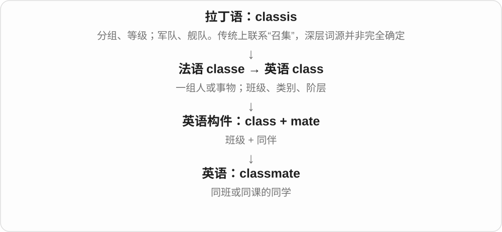

# 2064 · -mate — 共享场所、活动或组织关系的人物与动物名称

[逐词精讲目录](../00_逐词精讲目录.md) · [总目录](../00_总目录_按常用程度.md)

## 核心词根与来源

mate 的同伴关系很有生产力，前半告诉你共享什么。但每个整词也有使用历史，inmate 就不能只按现在的自由拼词猜。

**-MATE：有共同处境或所属关系，不保证一定是好友**

roommate 同住、teammate 同队、cellmate 同牢房；stablemate 同厩或同机构；inmate 已收窄常用义。

- **居住、学习与同行**：roommate · housemate · flatmate · classmate · schoolmate · shipmate
- **团队、组织与特殊处境**：teammate · bandmate · stablemate · cellmate · inmate
- **in + mate → inmate → inmates**：inmates

## 词形与演化规律

mate 伙伴借自中古低地德语等形式，更早联系共同用餐；与地点、活动、组织词组合。

inmate 较早指同处一屋、在他人租屋内居住者，后指收容机构内的人。首成分通常联系 in 内部，也有原先是 inn 的分析；现代常见义是囚犯。

## 单词速览（按词族由简到繁）

同一基础词的相关扩展放在一起，先读基础形式，再读扩展；各组之间优先读常用的。具体词源关系见各词讲解。

| 单词 | 音标 | 核心意思 |
|---|---|---|
| [teammate](#w-1) | /ˈtiːmmeɪt/ | 队友；同组伙伴 |
| [inmate](#w-3) | /ˈɪnmeɪt/ | 囚犯；机构中的被收容者；同住者〔旧用〕 |
| [inmates](#w-12) | 英、美 /ˈɪnmeɪts/ | 囚犯〔复数〕；收容机构内的居住者 |
| [roommate](#w-2) | /ˈruːmˌmeɪt/ | 室友；同住者〔尤美式〕 |
| [classmate](#w-4) | 英 /ˈklɑːsmeɪt/；美 /ˈklæsmeɪt/ | 同班同学 |
| [housemate](#w-5) | /ˈhaʊsmeɪt/ | 合住者；室友 |
| [flatmate](#w-6) | /ˈflætmeɪt/ | 合租公寓的室友〔英式常见〕 |
| [bandmate](#w-7) | /ˈbændmeɪt/ | 同一乐队的成员；乐队伙伴 |
| [schoolmate](#w-8) | /ˈskuːlmeɪt/ | 同校同学；校友 |
| [cellmate](#w-9) | /ˈselmeɪt/ | 同牢房的囚犯；狱友 |
| [stablemate](#w-10) | /ˈsteɪbəlmeɪt/ | 同马厩、同练马师旗下的马；同机构者 |
| [shipmate](#w-11) | /ˈʃɪpmeɪt/ | 同船伙伴；同船船员 |

## 逐词讲解

### 1. teammate — 队友；同组伙伴

**音标**：/ˈtiːmmeɪt/

**先抓住这个画面**

站在同一队这边，与自己协作而不是对阵的人。

**怎么拆**

team + mate（伙伴），交界处两个 m 在拼写保留，发音通常自然连在一起。不是 team 的领队专名。

**怎么变成今天的意思**

**英语 team；mate**  
并列组合的两部分

↓

**team + mate → teammate**  
同一队、团队的伙伴

her teammates 是她的队友，a former teammate 是前队友；工作团队也可用。关系来自队伍，不要求彼此在生活中很亲密。

**常见搭配与例句**

a former teammate；support a teammate；trust your teammates。

> She thanked her teammates for their support.

她感谢队友们的支持。

> Two former teammates now work in the same company.

两位昔日队友如今在同一家公司工作。

**别混淆**

teammate 同队，opponent 对手；classmate 同班，可能是另一个体育队成员。

### 2. inmate — 囚犯；机构中的被收容者；同住者〔旧用〕

**音标**：/ˈɪnmeɪt/

**先抓住这个画面**

旧时可以只是同住一处的人；现代常把镜头放到被关在监狱等机构里的人。不能因为 roommate 是室友，就把新室友随口叫 inmate。

**怎么拆**

in 在里面 + mate 同伴，或前半原为 inn 住所，具体分析不完全一致。早期同住义后来收窄到机构收容、拘禁语境。

**怎么变成今天的意思**

**in／可能的 inn + mate**  
住在同一处的人、住户

↓

**现代 inmate 的常用收窄**  
监狱等机构中的被关押、收容者

a prison inmate 囚犯，inmates at the institution 该机构被收容者。现代谈医院普通病人通常用 patient，不因都住在机构里就自动叫 inmate。

**常见搭配与例句**

a prison inmate；inmates at the institution。

> The report includes interviews with prison inmates.

报告收录了对囚犯的访谈。

> The novel follows an inmate adjusting to life inside the institution.

小说讲述一位被收容者适应机构内生活的经历。

**别混淆**

inmate 与 roommate 现代常用义差别明显；cellmate 特别说同一牢房的人，inmate 不要求和另一人同住一间牢房。

### 3. inmates — 囚犯〔复数〕；收容机构内的居住者

**音标**：英、美 /ˈɪnmeɪts/

**先抓住这个画面**

这个词早先只是在说住在同一处的人，后来范围变了；现代新闻里 inmates 最常是在说监狱中的人。

**怎么拆**

inmate + -s → inmates，/t/ 后读 /s/。inmate 通常分析为 in 内部 + mate 同伴；首成分也有原为 inn 住处的分析。

**怎么变成今天的意思**

**较早 inmate 在他人租屋内居住、同处一屋的人**  
先有同一住处的关系，首成分的具体分析有差异

↓

**收容机构内的人 → 现代常见囚犯义 → inmates**  
词义范围改变，复数加 -s

prison inmates 明确说囚犯；机构语境也可能有其他居民。实际称呼普通室友用 roommates、housemates 更合适。

**常见搭配与例句**

prison inmates；a library for inmates；several inmates。

> The prison library was used by many inmates.

很多囚犯使用这所监狱的图书馆。

> The story follows two inmates who exchange letters.

这个故事围绕两个互通信件的囚犯展开。

**别混淆**

不要因为 mate 是同伴，就把现代 inmates 用作一般朋友、合租室友的称呼；今天的常用范围已经不同。

### 4. roommate — 室友；同住者〔尤美式〕

**音标**：/ˈruːmˌmeɪt/

**先抓住这个画面**

共享住宿空间的那个人；有时共一间卧室，有时只是同一套房。

**怎么拆**

room + mate（同伴）；mate 选一起生活、活动的人，不是这里只说配偶。实际发音两个 m 常连成一段。

**怎么变成今天的意思**

**room；mate**  
并列组合部分

↓

**roommate**  
共享房间或住所的人

a college roommate 大学室友。美式可用来称合租同一套房但卧室不同的人；英式 flatmate、housemate 更明确同套房、同房屋。

**常见搭配与例句**

share with a roommate；a college roommate；a former roommate。

> My roommate works at the local library.

我室友在当地图书馆工作。

> We were roommates during our first year at university.

大学一年级时，我们是室友。

**别混淆**

roommate 不自动等于 romantic partner 伴侣；也不总保证两人睡同一间卧室，要看地区和住所。

### 5. classmate — 同班同学

**音标**：英 /ˈklɑːsmeɪt/；美 /ˈklæsmeɪt/

**先抓住这个画面**

和你被分在同一班、一起上这门课的人。

**怎么拆**

class + mate“伙伴”。

**怎么变成今天的意思**

范围通常比 schoolmate 窄：在同一所学校不一定是同班同学。可以说 a former classmate“以前的同班同学”。

**常见搭配与例句**

a former classmate；help a classmate；classmates at school。

> A classmate lent me her notes after I missed the lesson.

我缺课后，一位同学把笔记借给了我。

> He recognized an old classmate at the station.

他在车站认出了一位老同学。

**别混淆**

classmate 强调同班、同课；roommate 强调同住。

### 6. housemate — 合住者；室友

**音标**：/ˈhaʊsmeɪt/

**先抓住这个画面**

住在同一套房、共享某些空间，但不必是亲属或恋人。

**怎么拆**

house（住处）+ mate（伙伴、同伴），按共同居住关系称呼。

**怎么变成今天的意思**

**英语 house；mate**  
并列组合的两部分

↓

**house + mate → housemate**  
同住一套房的人

英式常见，也可与 flatmate、roommate 按地区和住宿形态对应。housemate 不要求两人睡同一卧室。

**常见搭配与例句**

a new housemate；share with housemates；my housemate。

> My housemate cooks dinner on Mondays.

我的室友周一做晚饭。

> They are looking for a quiet housemate.

他们想找一位安静的合住者。

**别混淆**

housemate 是同住者，houseguest 是暂住访客；来住三晚的朋友通常更像 guest，不必成为长期室友。

### 7. flatmate — 合租公寓的室友〔英式常见〕

**音标**：/ˈflætmeɪt/

**先抓住这个画面**

住在同一套 flat 里的人，不保证睡同一间卧室。mate 在这里是共同居住的伙伴。

**怎么拆**

flat 公寓 + mate 伙伴，形成共住者名称。接住房词义，不是平坦的朋友。

**怎么变成今天的意思**

**另有本族 flet、苏格兰语 flat 等住房词路径**  
楼层、住处 → 公寓，与平、楼面词族有关

↓

**flat + mate → flatmate**  
同住一套公寓的人

my flatmate 我的合租室友，a new flatmate 新室友，look for a flatmate 找合租者。

**常见搭配与例句**

a new flatmate；my flatmate；look for a flatmate。

> My flatmate works at the library.

我的合租室友在图书馆工作。

> We are looking for a third flatmate.

我们在找第三位合租室友。

**别混淆**

flatmate 同公寓，roommate 美式可同套房也可同卧室，地区习惯不同；housemate 常同一栋房子。

### 8. bandmate — 同一乐队的成员；乐队伙伴

**音标**：/ˈbændmeɪt/

**先抓住这个画面**

和你在同一支乐队演奏、排练的人，mate 说共同参与者。

**怎么拆**

band 乐队 + mate 伙伴，与 roommate、classmate 等人物组合的逻辑相近，但不因此把这些都当同一职业。

**怎么变成今天的意思**

**古英语 bend 等、古诺尔斯语 band、法语 bande 的相关形式**  
束带、条带；多条传入形式汇合

↓

**法语 bande〔人群〕→ 英语 band；条带另发展频带义**  
群体 → 乐队；条状范围 → 频带

↓

**band + mate → bandmate**  
与自己同队的乐队成员

my former bandmate 我以前的乐队伙伴，reunite with bandmates 与乐队伙伴重聚。

**常见搭配与例句**

a former bandmate；reunite with bandmates；a fellow bandmate。

> She wrote the song with a former bandmate.

她和以前的乐队伙伴合写了这首歌。

> His bandmates helped him prepare for the concert.

乐队伙伴帮他准备音乐会。

**别混淆**

bandmate 同一乐队，bandleader 领队；伙伴不一定就是负责人。

### 9. schoolmate — 同校同学；校友

**音标**：/ˈskuːlmeɪt/

**先抓住这个画面**

两个人在同一所学校读过书，联系来自共同的学校经历。

**怎么拆**

school + mate（伙伴），mate 在这里不是食物、机器或配对动词，先按共同经历的人理解。

**怎么变成今天的意思**

**英语 school；mate**  
并列组合的两部分

↓

**school + mate → schoolmate**  
同校就读、曾就读的人

an old schoolmate 是昔日同学，不要求年龄很老；并非必须同班，毕业多年也可这样说。

**常见搭配与例句**

an old schoolmate；a former schoolmate；meet a schoolmate。

> She met an old schoolmate at the station.

她在车站遇到一位老同学。

> Two schoolmates started the business together.

两位同校同学一起创办了这家企业。

**别混淆**

classmate 强调同班、同一课堂，schoolmate 强调同校。隔壁班的朋友可以是 schoolmate 而不是班级意义上的 classmate。

### 10. cellmate — 同牢房的囚犯；狱友

**音标**：/ˈselmeɪt/

**先抓住这个画面**

不只在同一座监狱，而是与另一个人共用同一间牢房。

**怎么拆**

cell 牢房 + mate 同伴，按共同所在空间命名，和 roommate 室友结构相似。

**怎么变成今天的意思**

**拉丁 cella → 旧英语、法语等 → cell**  
小房间、隔间

↓

**现代 cell**  
牢房；细胞；电池单元；网络区域、组织小组等小单元

↓

**cell + mate → cellmate**  
共享牢房的人

his cellmate 他的同牢狱友，a former cellmate 曾经的同牢狱友。

**常见搭配与例句**

his cellmate；a former cellmate；share a cell with a cellmate。

> He shared his food with his cellmate.

他与同牢房的狱友分享食物。

> The memoir describes conversations with a former cellmate.

回忆录写到了与一位从前同牢狱友的谈话。

**别混淆**

cellmate 具体共享牢房，fellow prisoner 只说明同为囚犯；这里 cell 不取生物细胞义。

### 11. stablemate — 同马厩、同练马师旗下的马；同机构者

**音标**：/ˈsteɪbəlmeɪt/

**先抓住这个画面**

两匹赛马归同一马厩、团队管理，是 stablemates；音乐人、产品同属一家公司，也能借这个同门关系来形容。

**怎么拆**

stable 马厩 + -mate 同处、同属一组者。stable 在这里不是稳定的形容词，不把它译成稳定朋友。

**怎么变成今天的意思**

**stable 马厩 + mate 同伴 → stablemate**  
共同马厩、训练体系中的马

↓

**机构关系的扩展**  
同公司、组织等的成员或产品

a horse and its stablemate 一匹马及其同厩马，a singer’s label stablemate 与歌手同唱片公司的艺人。具体共同组织由上下文说明。

**常见搭配与例句**

a horse’s stablemate；a label stablemate。

> The horse finished just ahead of its stablemate.

那匹马刚好领先同厩马冲线。

> The singer recorded a duet with a label stablemate.

这位歌手与同唱片公司的艺人录制了一首二重唱。

**别混淆**

stablemate 不要求两匹马站在完全同一个小隔间，常看所属训练、经营团队；teammate 更直接说同队的人。

### 12. shipmate — 同船伙伴；同船船员

**音标**：/ˈʃɪpmeɪt/

**先抓住这个画面**

在同一艘船上一起工作、航行的人，强调彼此是船上的伙伴。

**怎么拆**

ship + mate 伙伴，组合成同船伙伴。mate 在航海里也有具体副手职务，但 shipmate 本身不自动指定军衔或岗位。

**怎么变成今天的意思**

**古英语 sċip → 中古英语 schip 等 → ship**  
船；更远来源的劈木解释不作定论

↓

**动词 ship 及现代复合词**  
用船运输 → 不限交通方式的发运；船舶类型与人员

↓

**ship + mate → shipmate**  
同船的伙伴 → 同船船员

an old shipmate 旧日同船伙伴，former shipmates 曾经同船的人；也可用于船友之间的称呼。

**常见搭配与例句**

an old shipmate；former shipmates；help a shipmate。

> He kept in touch with his old shipmates.

他一直与从前的同船伙伴保持联系。

> A shipmate helped her secure the equipment.

一位同船伙伴帮她固定好设备。

**别混淆**

shipmate 同船伙伴，roommate 同住伙伴；mate 作为职务时可能是大副等，但整词不能直接译大副。

## 这一组要分清什么

-mate 不自动等于亲密朋友；inmate 常说囚犯，stablemate 不取稳定的 stable。

## 串起来练习

The bandmate and former roommate later became his label stablemate.

那位乐队伙伴兼旧室友，后来又与他成为同唱片公司的艺人。
