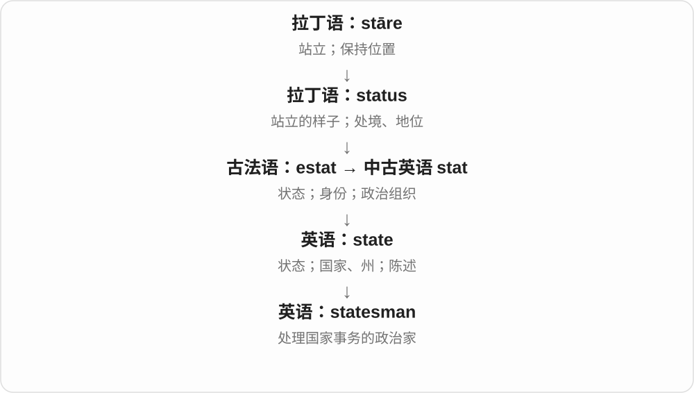

# 2067 · -s- — 复合词中的所属、关联连接成分

[逐词精讲目录](../00_逐词精讲目录.md) · [总目录](../00_总目录_按常用程度.md)

## 核心词根与来源

旧所有格在不少合成词里凝固下来，较新词也会沿这种形式造词。今天读到中间 s，要先看两个词的关系，不必都算成复数或动词第三人称。

**-S-：前后两个词之间，留下一个“……的”连接**

bride-s-maid 新娘的伴娘；bee-s-wax 蜜蜂的蜡；women-s-wear 女性的衣着；craft-s-man 从事手艺的人。

- **手艺、制图与服务角色**：craftsman · tradesman · draftsman · draughtsman · linesman
- **婚礼、衣着与纹样**：bridesmaid · menswear · womenswear · houndstooth
- **畜群、狩猎、蜂蜡与航行**：huntsman · herdsman · beeswax · yachtsman · helmsman
- **表达、政治与群体角色**：spokesman · spokeswoman · spokesperson · statesman · kinsman · townsfolk
- **运动、防卫及关系组合**：batsman · marksman · swordsman · guardsman · bondsman · tribesman · gamesmanship · doomsday

## 词形与演化规律

古英语 -es 所有格 → 中古英语 -s/-es → 复合词中 -s-；现代也联系 ’s 的凝固、类推。不是所有词中任意一个 s 都可这样拆。

## 单词速览（按词族由简到繁）

同一基础词的相关扩展放在一起，先读基础形式，再读扩展；各组之间优先读常用的。具体词源关系见各词讲解。

| 单词 | 音标 | 核心意思 |
|---|---|---|
| [spokesman](#w-1) | 英 /ˈspəʊksmən/；美 /ˈspoʊksmən/ | 发言人；代言某种立场的人 |
| [spokesperson](#w-2) | 英 /ˈspəʊkspɜːsən/；美 /ˈspoʊkspɜːrsən/ | 发言人；代言某方立场的人 |
| [statesman](#w-3) | /ˈsteɪtsmən/ | 政治家；善于处理国家事务的人 |
| [batsman](#w-4) | /ˈbætsmən/ | 板球击球手〔传统称呼，常指男性〕 |
| [craftsman](#w-5) | 英 /ˈkrɑːftsmən/；美 /ˈkræftsmən/ | 熟练工匠、手艺人；技艺高超的创作者 |
| [doomsday](#w-6) | /ˈduːmzdeɪ/ | 世界末日；最后审判日 |
| [spokeswoman](#w-7) | 英 /ˈspəʊkswʊmən/；美 /ˈspoʊkswʊmən/ | 女发言人 |
| [bridesmaid](#w-8) | /ˈbraɪdzmeɪd/ | 伴娘；长期接近冠军却未夺冠的人或队伍〔比喻〕 |
| [huntsman](#w-9) | /ˈhʌntsmən/ | 猎人；猎队中管理猎犬的人；巨蟹蛛等猎人蛛 |
| [menswear](#w-10) | 英 /ˈmenzweə/；美 /ˈmenzwer/ | 男装 |
| [marksman](#w-11) | 英 /ˈmɑːksmən/；美 /ˈmɑːrksmən/ | 神枪手；射击准确的人 |
| [swordsman](#w-12) | 英 /ˈsɔːdzmən/；美 /ˈsɔːrdzmən/ | 剑客；善用剑的人 |
| [kinsman](#w-13) | /ˈkɪnzmən/ | 男性亲属〔较正式、文学〕 |
| [beeswax](#w-14) | /ˈbiːzwæks/ | 蜂蜡；闲事、事情〔俚语搭配〕 |
| [tradesman](#w-15) | /ˈtreɪdzmən/ | 技术工；手艺人；旧用商人 |
| [linesman](#w-16) | /ˈlaɪnzmən/ | 边线裁判、助理裁判等；架线工〔依语境〕 |
| [townsfolk](#w-17) | 英 /ˈtaʊnzfəʊk/；美 /ˈtaʊnzfoʊk/ | 镇民；城里的居民们 |
| [guardsman](#w-18) | 英 /ˈɡɑːdzmən/；美 /ˈɡɑːrdzmən/ | 近卫军士兵、卫兵〔按国家、部队语境〕 |
| [draftsman](#w-19) | 英 /ˈdrɑːftsmən/；美 /ˈdræftsmən/ | 制图员；文件起草人 |
| [helmsman](#w-20) | /ˈhelmzmən/ | 舵手；掌舵者 |
| [draughtsman](#w-21) | 英 /ˈdrɑːftsmən/ | 制图员；善于绘图的人；跳棋棋子〔另一拆法〕 |
| [womenswear](#w-23) | 英 /ˈwɪmɪnzweə/；美 /ˈwɪmɪnzwɛr/ | 女装、女性服装及相关配饰 |
| [bondsman](#w-24) | 英 /ˈbɒndzmən/；美 /ˈbɑːndzmən/ | 保证人、担保人；役属男子、男奴〔旧〕 |
| [herdsman](#w-25) | 英 /ˈhɜːdzmən/；美 /ˈhɜːrdzmən/ | 牧人、放牧者 |
| [tribesman](#w-26) | /ˈtraɪbzmən/ | 部族男成员〔复数 tribesmen〕 |
| [yachtsman](#w-27) | 英 /ˈjɒtsmən/；美 /ˈjɑːtsmən/ | 游艇驾驶者、帆船运动者〔通常指男性〕 |
| [gamesmanship](#w-28) | /ˈɡeɪmzmənʃɪp/ | 争胜手腕；利用规则边缘的竞技技巧 |
| [houndstooth](#w-30) | /ˈhaʊndstuːθ/ | 千鸟格、犬牙格；这种纹样的织物 |

## 逐词讲解

### 1. spokesman — 发言人；代言某种立场的人

**音标**：英 /ˈspəʊksmən/；美 /ˈspoʊksmən/

**先抓住这个画面**

别人负责做事，他负责把这个团体要说的话说出来。

**怎么拆**

spoke（与 speak 的旧分词形式有关）+ 连接的 -s- + man，不是车轮辐条 spoke 在说话。现代也常用 spokesperson。

**怎么变成今天的意思**

**英语 speak 的 spoke 相关形式；man**  
说话；人

↓

**spoke + -s- + man → spokesman**  
代表团体说话的人

a spokesman for the company 表示公司发言人；也可说某人代表一类人的观点。具体是否正式获授权，要看上下文。

**常见搭配与例句**

a spokesman for；a government spokesman；act as a spokesman。

> A spokesman for the company confirmed the opening date.

公司发言人确认了开业日期。

> He became a spokesman for local small businesses.

他成了当地小企业的代言人。

**别混淆**

spokesman 重点是代表谁发言，speaker 只需在讲话。会上发言的每个人不都是机构发言人。

### 2. spokesperson — 发言人；代言某方立场的人

**音标**：英 /ˈspəʊkspɜːsən/；美 /ˈspoʊkspɜːrsən/

**先抓住这个画面**

机构里有许多人，但由这位把共同声明说给外界听。

**怎么拆**

spoke（与 speak 的旧分词形式有关）+ -s- + person，沿用 spokesman 的构词思路，人物称呼不限定性别。不是车轮辐条的人。

**怎么变成今天的意思**

**英语 spoke；person**  
说话相关形式；人

↓

**spoke + -s- + person → spokesperson**  
代表某一方发言的人

a spokesperson for the group 是团体发言人；可正式任职，也可临时代表，需看语境。

**常见搭配与例句**

a spokesperson for；an official spokesperson；a company spokesperson。

> A spokesperson for the museum announced the new exhibition.

博物馆发言人宣布了新展览。

> The group appointed her as its spokesperson.

团体任命她为发言人。

**别混淆**

spokesperson 是代表某方发言的角色，speaker 是发言者更泛的称呼；person 不表示这位一定比 spokesman 权力更大。

### 3. statesman — 政治家；善于处理国家事务的人

**音标**：/ˈsteɪtsmən/

**先抓住这个画面**

statesman 通常不只是“从政的人”，还带有眼光、经验和处理公共事务能力受到认可的意味。

**怎么拆**

state + 连接的 -s- + man，词形受到法语 homme d’État“国家事务之人”的影响。

**怎么变成今天的意思**

国家事务把 state 与从事者连接起来。现代评价一个人是否称得上 statesman，往往包含敬意；也可用 stateswoman 或更中性的表达。

**常见搭配与例句**

an elder statesman；an experienced statesman；a respected statesman。

> He was remembered as a statesman who sought compromise.

人们记得他是一位寻求妥协的政治家。

> The retired leader became an elder statesman in the party.

这位退休领导人成了党内德高望重的政治元老。

**别混淆**

politician 是职业或角色描述；statesman 通常带正面评价，但并不保证此人实际表现一定好。

### 4. batsman — 板球击球手〔传统称呼，常指男性〕

**音标**：/ˈbætsmən/

**先抓住这个画面**

在板球里拿球拍接击投球的人；man 是人物材料，bats- 不是说一群蝙蝠来帮人打球。

**怎么拆**

bat + 连接成分 -s- + man，复数 batsmen。现代也广用性别中性的 batter，阅读时保留传统术语的含义。

**怎么变成今天的意思**

**古英语 batt、法语 batte 等 → bat〔棒〕**  
棒、击打器具；旧来源相互影响

↓

**bat + -s- + man → batsman**  
持拍击球的人

an opening batsman 开局击球手，a skilled batsman 熟练击球手，two batsmen 两名击球手。

**常见搭配与例句**

an opening batsman；a skilled batsman；two batsmen。

> The opening batsman played confidently.

开局击球手打得很有信心。

> The coach praised the young batsman’s patience.

教练表扬了年轻击球手的耐心。

**别混淆**

batsman 常板球传统用语，batter 也用于板球、棒球且性别中性；不能只看使用球棒便认为每项运动的职位、规则完全相同。

### 5. craftsman — 熟练工匠、手艺人；技艺高超的创作者

**音标**：英 /ˈkrɑːftsmən/；美 /ˈkræftsmən/

**先抓住这个画面**

不是随便动过手的人，而是掌握一门手艺、能把东西做得讲究的人；也可夸写作等工作有工匠般技法。

**怎么拆**

craft 技艺 + 连接成分 -s- + man 人，历史联系 craft 的所有格形式。这里的 s 不是做手艺这个动词的第三人称。

**怎么变成今天的意思**

**古英语 -es 等所有格形式 → 中古英语 -s/-es**  
某物的、与某物有关的关系

↓

**在复合词中固化为连接成分 -s-**  
前后两部分连成一个名称；较新词也可类推形成

↓

**craft + -s- + man → craftsman**  
从事一门技艺、擅长手艺的人

a skilled craftsman 熟练工匠，a master craftsman 大师级手艺人，a literary craftsman 文字技法娴熟的作者；复数 craftsmen。

**常见搭配与例句**

a skilled craftsman；a master craftsman；craftsmen at work。

> A skilled craftsman repaired the old wooden chair.

一位熟练工匠修好了那把旧木椅。

> The novelist is a careful craftsman of dialogue.

这位小说家写对白很讲究技巧。

**别混淆**

craftsman 强调手艺、技巧，crafty 则常说狡猾，不能只见 craft 就以为是同样评价。泛指人也可用 craftsperson、artisan。

### 6. doomsday — 世界末日；最后审判日

**音标**：/ˈduːmzdeɪ/

**先抓住这个画面**

原来是神最终作出裁断的日子，后来泛指一切走向灾难的时刻。

**怎么拆**

古英语 dōmesdæg：dōm“审判”的属格 dōmes + dæg“日”。中间 s 原是所属关系，不是简单复数。

**怎么变成今天的意思**

**古英语 dōm 的属格 dōmes + dæg**  
审判 → 审判之日

↓

**古英语 dōmesdæg → 英语 doomsday**  
最后审判日 → 末日、灾难结局

a doomsday scenario 是灾难性的最坏情境；until doomsday 是夸张的“等到天荒地老”。很多现代用法与具体宗教信仰无关。

**常见搭配与例句**

a doomsday prediction；a doomsday scenario；wait until doomsday。

> The film opens with a doomsday warning on the radio.

电影开场时，收音机里播着末日警告。

> We could argue about the details until doomsday.

我们可以一直争这些细节，争到天荒地老。

**别混淆**

Doomsday 可专指宗教最后审判；普通 doom 更广，指厄运或毁灭。

### 7. spokeswoman — 女发言人

**音标**：英 /ˈspəʊkswʊmən/；美 /ˈspoʊkswʊmən/

**先抓住这个画面**

代表某个组织说话的人，词尾 woman 明确说她是女性。

**怎么拆**

与 spokesman 的构形对应，把 man 换成 woman；spokes- 属于 speak 的旧分词、连接成分构形背景，不是车轮辐条 spoke 的现代拼接。

**怎么变成今天的意思**

**古英语 wīfmann：wīf + mann**  
女性 + 人；这里的 wīf 不只等于现代妻子

↓

**中古英语 wifman / wimman / womman → woman**  
女性；现代通常指成年女性

↓

**spokesman 的构形对应 spokes- + woman → spokeswoman**  
代表发言的角色名称，词尾标出女性

a company spokeswoman 公司女发言人；若性别无关，也常用 spokesperson 发言人。复数 spokeswomen，词尾 women 仍读 /ˈwɪmɪn/。

**常见搭配与例句**

a company spokeswoman；a government spokeswoman；a spokeswoman said...。

> A spokeswoman for the museum confirmed the opening date.

博物馆一位女发言人确认了开放日期。

> The company’s spokeswoman answered questions after the announcement.

公司女发言人在消息宣布后回答了问题。

**别混淆**

spokeswoman 代表组织或团体发言，不等于所有在公开场合讲话的女性；speaker 范围更广。

### 8. bridesmaid — 伴娘；长期接近冠军却未夺冠的人或队伍〔比喻〕

**音标**：/ˈbraɪdzmeɪd/

**先抓住这个画面**

婚礼里陪伴、协助新娘；比赛比喻里则像总在婚礼边上帮忙，自己始终没当上主角。

**怎么拆**

bride 新娘 + -s- 所属关系 + maid 女侍、姑娘。并非必须是多个新娘；比喻义联系 always a bridesmaid, never a bride 的说法。

**怎么变成今天的意思**

**古英语 -es 等所有格形式 → 中古英语 -s/-es**  
某物的、与某物有关的关系

↓

**在复合词中固化为连接成分 -s-**  
前后两部分连成一个名称；较新词也可类推形成

↓

**bride + -s- + maid → bridesmaid**  
新娘身边的陪伴协助者

↓

**固定说法的比喻**  
常居次席、屡近冠军但未登顶

be a bridesmaid 当伴娘，a bridesmaid’s dress 伴娘礼服，always the bridesmaid 总差冠军一步〔体育等比喻〕。

**常见搭配与例句**

be a bridesmaid；a bridesmaid’s dress；always the bridesmaid。

> She asked her sister to be her bridesmaid.

她请姐姐当自己的伴娘。

> After three second places, the team was tired of being the bridesmaid.

三次拿到第二名后，球队不想再当陪衬了。

**别混淆**

bridesmaid 不是新娘本人，也不必与新娘有亲属关系；比喻到球队时也不说明队伍或选手是女性。

### 9. huntsman — 猎人；猎队中管理猎犬的人；巨蟹蛛等猎人蛛

**音标**：/ˈhʌntsmən/

**先抓住这个画面**

一般是狩猎的人，特定猎队里可专指管猎犬的角色；蜘蛛名称则借它善于捕猎的形象。

**怎么拆**

hunt 狩猎 + -s- + man 人。连接的 s 固定在复合词里；复数 huntsmen，改变后半 man。蜘蛛义是后来用角色名给动物命名。

**怎么变成今天的意思**

**古英语 -es 等所有格形式 → 中古英语 -s/-es**  
某物的、与某物有关的关系

↓

**在复合词中固化为连接成分 -s-**  
前后两部分连成一个名称；较新词也可类推形成

↓

**hunt + -s- + man → huntsman**  
狩猎者，特定猎队职责

↓

**动物名扩展**  
huntsman spider 猎人蛛一类称呼

a huntsman in a story 故事里的猎人，the huntsman and his hounds 猎人及猎犬，a huntsman spider 猎人蛛。

**常见搭配与例句**

a huntsman and his hounds；a huntsman spider；huntsmen。

> The story begins with a huntsman entering the forest.

故事从一个猎人走进森林开始。

> A huntsman spider was resting on the wall.

一只猎人蛛停在墙上。

**别混淆**

hunter 更普遍说猎人、寻找某物者；huntsman 常带传统狩猎或专门角色意味。蜘蛛名不表示它属于人的职业。

### 10. menswear — 男装

**音标**：英 /ˈmenzweə/；美 /ˈmenzwer/

**先抓住这个画面**

不是指某几个男人正在穿的衣服，而是以男性为主要目标顾客的服装类别。

**怎么拆**

由 men’s wear 男子穿戴的服装合写成 menswear；中间 /z/ 保留所有关系的读音，词里不再写撇号。

**怎么变成今天的意思**

**men’s 男子的；wear 穿戴物**  
并列构词部分

↓

**menswear**  
男装类别

a menswear department 男装部；a menswear designer 男装设计师。商业分类说明主要设计、销售对象，不是在规定每个人能穿什么。

**常见搭配与例句**

a menswear collection；a menswear designer；the menswear department。

> She designs menswear for a small fashion label.

她为一个小型时装品牌设计男装。

> The menswear department is on the second floor.

男装部在二楼。

**别混淆**

menswear 通常不可数；two menswear 不表示两件男装，具体说 two shirts、two items of menswear。

### 11. marksman — 神枪手；射击准确的人

**音标**：英 /ˈmɑːksmən/；美 /ˈmɑːrksmən/

**先抓住这个画面**

别人只说开了枪，这个词强调射手能准确命中目标。

**怎么拆**

mark（目标、靶标）+ 连接的 -s- + man；不是拿着考试分数 mark 的人。这里按射击目标命名。

**怎么变成今天的意思**

**英语 mark；man**  
靶标、目标；人

↓

**mark + -s- + man → marksman**  
射击准确的人

可用于体育、军事、历史等叙述；具体是否某种正式资格要看机构，普通用法先理解擅长准确射击。

**常见搭配与例句**

a skilled marksman；an expert marksman；a trained marksman。

> He was known as a skilled marksman.

他以射击准确闻名。

> The competition attracted marksmen from several countries.

比赛吸引了几个国家的射击好手。

**别混淆**

marksman 强调射击准确，gunman 只说明持枪或使用枪的人，不自动赞许技术。

### 12. swordsman — 剑客；善用剑的人

**音标**：英 /ˈsɔːdzmən/；美 /ˈsɔːrdzmən/

**先抓住这个画面**

重点在一个人用剑的本领，不在他是否恰好拿着一把剑。

**怎么拆**

sword（剑）+ 连接的 -s- + man；更早也有 swordman。sword 的 w 不发音，连接处常读 /z/。

**怎么变成今天的意思**

**英语 sword；man**  
剑；人

↓

**sword + -s- + man → swordsman**  
熟练用剑者

历史、武侠幻想及击剑相关叙述可见。a skilled swordsman 是剑术熟练者，是否有军职需另看背景。

**常见搭配与例句**

a skilled swordsman；a master swordsman；an expert swordsman。

> The story follows a wandering swordsman.

故事讲述一位四处游历的剑客。

> She trained with an experienced swordsman.

她跟随一位经验丰富的剑客训练。

**别混淆**

swordsman 说使用者，swordsmanship 说剑术本领；后者不能用来称一个人。

### 13. kinsman — 男性亲属〔较正式、文学〕

**音标**：/ˈkɪnzmən/

**先抓住这个画面**

知道是亲戚、是男性，但不一定要说清他到底是叔叔还是表兄。

**怎么拆**

kin 亲族的所有格成分 + man 男性，形成男性亲属称谓；复数 kinsmen，后半元音变化，不能只加 s。

**怎么变成今天的意思**

**古英语 cynn → 中古英语 kyn → kin**  
种类、亲族、血统等历史用法

↓

**现代 kin 词族**  
亲属；由亲近、同类关系形成的类似、投契等

↓

**kin 的关系形式 + man → kinsman**  
亲族中的男性 → 男性亲属

a distant kinsman 远房男性亲属，his kinsmen 他的男性亲属们；历史、小说里比日常闲聊常见。

**常见搭配与例句**

a distant kinsman；a close kinsman；his kinsmen。

> A distant kinsman arrived with news from home.

一位远房男性亲属带着家乡消息来了。

> The letter was addressed to one of his kinsmen.

信写给了他的一位男性亲属。

**别混淆**

kinsman 亲属，countryman 同国人、乡下人等另看语境；不能把同乡直接当有血缘。

### 14. beeswax — 蜂蜡；闲事、事情〔俚语搭配〕

**音标**：/ˈbiːzwæks/

**先抓住这个画面**

蜜蜂分泌、用来筑蜂巢的蜡，是实物；none of your beeswax 则是在绕着说不关你的事。

**怎么拆**

bee 蜜蜂 + -s- + wax 蜡，表示蜜蜂的蜡。俚语用法是对 business 等固定说法的诙谐替换，不是养蜂产生了所有商业活动。

**怎么变成今天的意思**

**古英语 -es 等所有格形式 → 中古英语 -s/-es**  
某物的、与某物有关的关系

↓

**在复合词中固化为连接成分 -s-**  
前后两部分连成一个名称；较新词也可类推形成

↓

**bee + -s- + wax → beeswax**  
蜜蜂的蜡 → 蜂蜡

↓

**none of your beeswax**  
俏皮、仍可能不客气的别管闲事说法

beeswax candles 蜂蜡蜡烛，beeswax polish 蜂蜡上光剂，mind your own beeswax 管好自己的事。

**常见搭配与例句**

beeswax candles；beeswax polish；none of your beeswax。

> The candles are made from beeswax.

这些蜡烛是蜂蜡做的。

> The child grinned and said, “None of your beeswax!”

孩子咧嘴笑着说：“不关你的事！”

**别混淆**

蜂蜡是 wax，不是 honey 蜂蜜；none of your beeswax 即使听起来逗，也可能是生硬拒绝别人打听。

### 15. tradesman — 技术工；手艺人；旧用商人

**音标**：/ˈtreɪdzmən/

**先抓住这个画面**

现代常见是靠熟练手艺工作的人员，比如修管道、装线路的工匠；具体范围随地区变化。

**怎么拆**

trade 手艺、行业 + 连接的 s + man 人。历史也有商人义，现代技术工义常见；复数 tradesmen。

**怎么变成今天的意思**

**中古低地德语 trade 路径、轨迹 → 中古英语 trade**  
道路、做事的途径

↓

**现代 trade**  
惯常活动、行业 → 手艺、职业；商业交易

↓

**trade + s + man → tradesman**  
从事某门行业、手艺的人

a skilled tradesman 熟练技术工，a local tradesman 本地工匠；性别中性表达可用 tradesperson。

**常见搭配与例句**

a skilled tradesman；a local tradesman；hire a tradesman。

> We hired a local tradesman to repair the door.

我们请了本地工匠修门。

> The project needs several skilled tradesmen.

项目需要几名熟练技术工。

**别混淆**

tradesman 常说手艺职业，trader 更偏交易买卖；个别历史、地区用法有重叠，不能硬说永远互斥。

### 16. linesman — 边线裁判、助理裁判等；架线工〔依语境〕

**音标**：/ˈlaɪnzmən/

**先抓住这个画面**

人沿着线观察边界、越位等情况，或者维护线路；都是前面的 line 指出工作对象。

**怎么拆**

line 线、线路 + -s- + man 人。体育里是传统角色名称，不同运动分工不同；架线职业义与 lineman 有交叠。

**怎么变成今天的意思**

**古英语 -es 等所有格形式 → 中古英语 -s/-es**  
某物的、与某物有关的关系

↓

**在复合词中固化为连接成分 -s-**  
前后两部分连成一个名称；较新词也可类推形成

↓

**line + -s- + man → linesman**  
负责线边判断的人；线路工作人员

a football linesman 足球边线裁判这一传统叫法，the linesman’s flag 边裁旗，a telephone linesman 电话架线工；复数 linesmen。

**常见搭配与例句**

the linesman’s flag；a football linesman；a telephone linesman。

> The linesman raised his flag.

边裁举起了旗。

> The report interviewed a retired telephone linesman.

报道采访了一位退休电话架线工。

**别混淆**

足球里 assistant referee 助理裁判是更明确的角色称呼；不要把各球类的 linesman 职责都照成同一套。也不等于运动员自己站在线边。

### 17. townsfolk — 镇民；城里的居民们

**音标**：英 /ˈtaʊnzfəʊk/；美 /ˈtaʊnzfoʊk/

**先抓住这个画面**

把这个地方的居民作为一群人来讲，有叙事、社区生活的感觉。

**怎么拆**

town + 连接 -s- + folk 人们，形成复数、集合性的居民称呼。不是只指某一位居民。

**怎么变成今天的意思**

**town 城镇 + -s-；folk 人们**  
并列构词部分

↓

**townsfolk**  
当地城镇居民这一群体

the local townsfolk 当地镇民；小说、地方报道中常见，通常与复数动词配合。

**常见搭配与例句**

the local townsfolk；among the townsfolk；townsfolk gathered。

> The townsfolk gathered to celebrate the restored bridge.

镇民们聚在一起庆祝桥梁修复。

> Many townsfolk remembered the old railway station.

许多镇民还记得旧火车站。

**别混淆**

townsfolk 泛指居民，town council 是镇议会、地方管理机构；居民整体不等于管理者。

### 18. guardsman — 近卫军士兵、卫兵〔按国家、部队语境〕

**音标**：英 /ˈɡɑːdzmən/；美 /ˈɡɑːrdzmən/

**先抓住这个画面**

作为某个卫队、近卫部队成员的士兵，重点是所属队伍，不只是任何站岗的人。

**怎么拆**

guard + 连接 -s- + man，形成卫队成员称呼，复数 guardsmen。中间 s 不是普通复数先加完再随意接另一个单词。

**怎么变成今天的意思**

**日耳曼语看守词族 → 法语 guarder、garde → 英语 guard**  
看守、保护；与本族 ward 是不同传入路径的同族词

↓

**英语 guard**  
保护、警戒；守卫、防护装置；防备姿态

↓

**guard + -s- + man → guardsman**  
卫队、近卫部队中的成员

a guardsman on duty 值勤卫兵，a guardsman in uniform 穿制服的卫队成员；某些国家有特定 Guards、National Guard 用法，依背景判断。

**常见搭配与例句**

a guardsman on duty；a uniformed guardsman；two guardsmen。

> A guardsman stood at the palace gate.

一名卫兵站在宫门前。

> The photographer spoke to two guardsmen after the ceremony.

典礼后，摄影师与两名卫队士兵交谈。

**别混淆**

guardsman 部队身份，security guard 常一般保安；词不自动说明每位卫兵的全部职责。

### 19. draftsman — 制图员；文件起草人

**音标**：英 /ˈdrɑːftsmən/；美 /ˈdræftsmən/

**先抓住这个画面**

把设计变成准确图纸，或把条文、文件草拟出来的人。不是所有画画的人都一定担任这项工作。

**怎么拆**

draft 图稿、草拟 + 连接成分 -s- + man 人；英式也见 draughtsman。drafter 是常见不带 man 的对应人物名。

**怎么变成今天的意思**

**古英语拉、拖词族 → 中古英语 draught、draght → draft**  
拉取、抽取；画出、写下的东西

↓

**不同对象的抽取、拉动**  
初稿、制图；空气流；抽选；从桶取酒、支取款项

↓

**draft + -s- + man → draftsman**  
制图、起草的人；也拼 draughtsman

an architectural draftsman 建筑制图员，a legal draftsman 法律文件起草人，a skilled draftsman 熟练制图员。

**常见搭配与例句**

an architectural draftsman；a legal draftsman；a skilled draftsman。

> The draftsman prepared detailed plans of the building.

制图员绘制了建筑详细图纸。

> The document was revised by an experienced legal draftsman.

文件由有经验的法律文件起草人修改。

**别混淆**

draftsman 可制图、起草不同专业工作，drafts 的 s 不是说很多男人；现代职位也常用 drafter。

### 20. helmsman — 舵手；掌舵者

**音标**：/ˈhelmzmən/

**先抓住这个画面**

船往哪个方向走，有人握着控制方向的舵来调整。

**怎么拆**

helm（舵、操舵位置）+ 连接的 -s- + man。这里 helm 是航海用词，不是 helmet“头盔”的随意缩写。

**怎么变成今天的意思**

**英语 helm；man**  
船舵；人

↓

**helm + -s- + man → helmsman**  
掌舵的人

字面为船上操舵的人，也可比喻引导组织方向者。at the helm 是处于掌舵、领导位置，但不必都写成 helmsman。

**常见搭配与例句**

the ship’s helmsman；an experienced helmsman；serve as helmsman。

> The helmsman kept the boat on course.

舵手使船保持航向。

> An experienced helmsman took over as the wind grew stronger.

风变大时，一名经验丰富的舵手接过了舵。

**别混淆**

helmsman 负责操舵，captain 是船长；船长负责全船，并不需要每时每刻亲手掌舵。

### 21. draughtsman — 制图员；善于绘图的人；跳棋棋子〔另一拆法〕

**音标**：英 /ˈdrɑːftsmən/

**先抓住这个画面**

建筑、工程图要把尺寸和结构画准，负责这类图的人就是 draughtsman；英式跳棋里相同拼写还可指棋子。

**怎么拆**

制图义是 draught 图样 + -s- + man，英式拼法对应美式 draftsman。棋子义则是 draughts 跳棋 + man 棋子，边界不同。

**怎么变成今天的意思**

**古英语 -es 等所有格形式 → 中古英语 -s/-es**  
某物的、与某物有关的关系

↓

**在复合词中固化为连接成分 -s-**  
前后两部分连成一个名称；较新词也可类推形成

↓

**draught + -s- + man → draughtsman**  
绘图、制图的人；美式通常 draftsman

↓

**draughts + man → draughtsman**  
跳棋游戏中的棋子，另种结构

an architectural draughtsman 建筑制图员，a skilled draughtsman 善于绘图者；复数 draughtsmen。现代职位也常见 drafter、CAD technician 等。

**常见搭配与例句**

an architectural draughtsman；a skilled draughtsman；draughtsmen。

> The draughtsman prepared detailed plans for the extension.

制图员为扩建部分绘制了详细图纸。

> The museum labels him an exceptionally skilled draughtsman.

博物馆介绍称他是技法极高的绘图者。

**别混淆**

draughtsman 的 gh 在常见英式读音中对应 /f/，不是 /ɡ/；draftsman 是常见美式拼法，不能当成另一套职业。

### 22. womenswear — 女装、女性服装及相关配饰

**音标**：英 /ˈwɪmɪnzweə/；美 /ˈwɪmɪnzwɛr/

**先抓住这个画面**

商场里按销售类别分出的女装，不是专门说某一个女人正在穿什么。

**怎么拆**

women 女性复数 + -s- 所属连接 + wear 衣着。women 已经是复数，中间 s 不能再解释为把 woman 变复数；也常写 women’s wear。

**怎么变成今天的意思**

**古英语 -es 等所有格形式 → 中古英语 -s/-es**  
某物的、与某物有关的关系

↓

**在复合词中固化为连接成分 -s-**  
前后两部分连成一个名称；较新词也可类推形成

↓

**women + -s- + wear → womenswear**  
供女性穿着的服装类别

the womenswear department 女装部，a womenswear designer 女装设计师，a womenswear collection 女装系列。

**常见搭配与例句**

the womenswear department；a womenswear designer；a womenswear collection。

> The womenswear department is on the second floor.

女装部在二楼。

> She designs womenswear for a small independent brand.

她为一个小型独立品牌设计女装。

**别混淆**

womenswear 的前半读 /ˈwɪmɪnz/，不是 woman 单数的元音；这一商业分类与某件衣服实际由谁穿，是不同层面。

### 23. bondsman — 保证人、担保人；役属男子、男奴〔旧〕

**音标**：英 /ˈbɒndzmən/；美 /ˈbɑːndzmən/

**先抓住这个画面**

现代文书场景里，是站出来承担保证责任的人；旧故事里却可能是受役属的人，同一个称呼要看历史语境。

**怎么拆**

担保义可按 bond 保证文书 + 连接 -s- + man 理解；旧役属义与 bondman、bond 的农户到役属身份史相关，不把担保人都讲成奴隶。

**怎么变成今天的意思**

**英语关系与承诺引申**  
感情纽带、化学键；约束付款等义务的文书

↓

**另一路古北欧居住、农户词族**  
旧 bond 身份称呼与束缚词发生联想，不把历史全混成一条

↓

**bond + -s- + man → bondsman〔保证〕**  
为他人义务提供保证的人；与旧身份义分辨

a bail bondsman 保释保证人〔某些制度语境〕，act as a bondsman 担任保证人；历史文学里的 bondsman 另可能是受役属者。

**常见搭配与例句**

a bail bondsman；act as a bondsman；the king’s bondsman〔旧语境〕。

> The novel introduces a bondsman who provides bail for the suspect.

小说介绍了一名为嫌疑人提供保释担保的保证人。

> The historical passage describes a bondsman working on the estate.

这段历史文字写到一名受役属男子在庄园劳作。

**别混淆**

bondsman 是角色称呼，bondholder 是债券持有人；不能看到 bond 就把担保人译成买债券的投资者。

### 24. herdsman — 牧人、放牧者

**音标**：英 /ˈhɜːdzmən/；美 /ˈhɜːrdzmən/

**先抓住这个画面**

不是只拥有几头牲畜，而是看顾一群牛、羊等，让它们吃草、移动、归拢的人。

**怎么拆**

herd 畜群 + -s- + man；历史有 herdman 等较短形式，后来加上连接 s 的形式普遍。前半不是 heard 听见的过去式。

**怎么变成今天的意思**

**古英语 -es 等所有格形式 → 中古英语 -s/-es**  
某物的、与某物有关的关系

↓

**在复合词中固化为连接成分 -s-**  
前后两部分连成一个名称；较新词也可类推形成

↓

**herdman 等 → herdsman**  
看顾畜群的人；现代对应 herd + -s- + man

a cattle herdsman 牧牛人，a herdsman tending sheep 放羊的牧人；复数 herdsmen。herder 是更不标性别的常用人物词。

**常见搭配与例句**

a cattle herdsman；a herdsman tending the herd；herdsmen。

> The herdsman led the cattle toward the river.

牧人把牛群赶向河边。

> The documentary follows a herdsman through a changing season.

纪录片跟拍一位牧人度过季节变化。

**别混淆**

herdsman 不一定是牧场所有者，也不只是骑马的人；shepherd 更具体常说牧羊者，herd 的动物范围较广。

### 25. tribesman — 部族男成员〔复数 tribesmen〕

**音标**：/ˈtraɪbzmən/

**先抓住这个画面**

tribe 指共同体，man 把范围落到其中的男性成员，连接处的 s 属于复合词形式。

**怎么拆**

tribe + -s- + man；英语复合词。

**怎么变成今天的意思**

**拉丁 tribus**  
罗马的社会、政治分组；更早来源未完全确定

↓

**英语 tribe + -s- + man → tribesman**  
部族共同体 → 其中的男性成员

读历史材料会遇到这个词。现代具体表达常用 member of the tribe 或具体族名，更容易说明身份，也适合不需要突出性别的场景。

**常见搭配与例句**

a tribesman；fellow tribesmen；a local tribesman。

> The old travel account records a conversation with a tribesman.

那篇旧游记记载了与一位部族男成员的谈话。

> The translator replaced tribesmen with a more precise community name.

译者用更准确的共同体名称替换了 tribesmen。

**别混淆**

tribesman 不等于 chief“首领”；它通常只表示成员。复数 man 变 men，写作 tribesmen。

### 26. yachtsman — 游艇驾驶者、帆船运动者〔通常指男性〕

**音标**：英 /ˈjɒtsmən/；美 /ˈjɑːtsmən/

**先抓住这个画面**

重点是驾驶、操纵 yacht 的人，不是只在甲板上晒太阳的每位乘客。

**怎么拆**

yacht 游艇 + -s- + man 人。yacht 借荷兰语相关船名，现代英语 ch 不发音，读 /jɒt/ 等；复数 yachtsmen。

**怎么变成今天的意思**

**古英语 -es 等所有格形式 → 中古英语 -s/-es**  
某物的、与某物有关的关系

↓

**在复合词中固化为连接成分 -s-**  
前后两部分连成一个名称；较新词也可类推形成

↓

**yacht + -s- + man → yachtsman**  
驾驶游艇、从事相应帆船活动的人

an experienced yachtsman 经验丰富的帆船运动者，an ocean yachtsman 远洋帆船运动者；女性可用 yachtswoman，更广可用 sailor。

**常见搭配与例句**

an experienced yachtsman；an ocean yachtsman；yachtsmen。

> The experienced yachtsman studied the weather before departure.

那位经验丰富的帆船运动者出发前研究了天气。

> The race attracted yachtsmen from several countries.

比赛吸引了几个国家的帆船运动者。

**别混淆**

yachtsman 不等于船的所有人，也不保证是机动豪华游艇驾驶员；具体 yacht 可指帆艇，运动语境很常见。

### 27. gamesmanship — 争胜手腕；利用规则边缘的竞技技巧

**音标**：/ˈɡeɪmzmənʃɪp/

**先抓住这个画面**

不只是技术更好，还会拖节奏、施心理压力，让对手不舒服而自己得利。

**怎么拆**

可分析 game + -s- + -manship，或 gamesman + -ship；后缀群指某种技巧、做派。整词已有专门的竞赛手腕含义，不等于任何游戏本领。

**怎么变成今天的意思**

**英语 game；-manship 等人物技艺构词形式**  
比赛；特定技巧、做派

↓

**gamesmanship**  
争取优势的规则边缘手段

常含不够光明磊落的评价，可能没有直接违反明文规则；也用于谈判、政治等竞争。具体是否违规要看实际规则和行为。

**常见搭配与例句**

political gamesmanship；an act of gamesmanship；tactical gamesmanship。

> The delay was widely seen as a piece of gamesmanship.

大家普遍把这次拖延看作争取优势的手腕。

> She preferred honest negotiation to political gamesmanship.

相比政治角力的手段，她更喜欢坦诚协商。

**别混淆**

sportsmanship 是体育精神，gamesmanship 偏争胜手腕；一个强调公平态度，一个常暗含钻规则或心理战。

### 28. houndstooth — 千鸟格、犬牙格；这种纹样的织物

**音标**：/ˈhaʊndstuːθ/

**先抓住这个画面**

黑白小格的边缘伸出尖角、彼此咬合，像犬牙；中文又把图形联想到飞鸟，叫千鸟格。

**怎么拆**

hound 猎犬 + -s- 所属连接 + tooth 牙齿，按图案外形命名。不是衣料由狗牙做成，也不是现代颜色一定只能黑白。

**怎么变成今天的意思**

**古英语 -es 等所有格形式 → 中古英语 -s/-es**  
某物的、与某物有关的关系

↓

**在复合词中固化为连接成分 -s-**  
前后两部分连成一个名称；较新词也可类推形成

↓

**hound + -s- + tooth → houndstooth**  
犬牙般的破格纹形 → 织物纹样名

a houndstooth coat 千鸟格外套，houndstooth fabric 千鸟格布料，a houndstooth pattern 千鸟格纹样。传统常见黑白双色，也有其他配色。

**常见搭配与例句**

a houndstooth coat；houndstooth fabric；a houndstooth pattern。

> She wore a black and white houndstooth coat.

她穿了一件黑白千鸟格外套。

> The designer enlarged the houndstooth pattern for the new fabric.

设计师把千鸟格纹样放大，用在新布料上。

**别混淆**

houndstooth 不等于所有 checked 方格布；它有特定破格、尖角轮廓。tooth 在这里描述外形，不是说面料有尖牙。

## 这一组要分清什么

womenswear 中 women 已是复数；bridesmaid 不必多个新娘；man 复数常变 men；draughtsman 棋子义有不同切分；-s- 不都读 /s/。

## 串起来练习

The craftsman repaired the bridesmaid’s chair with beeswax polish nearby.

工匠修着伴娘的椅子，旁边放着蜂蜡上光剂。
