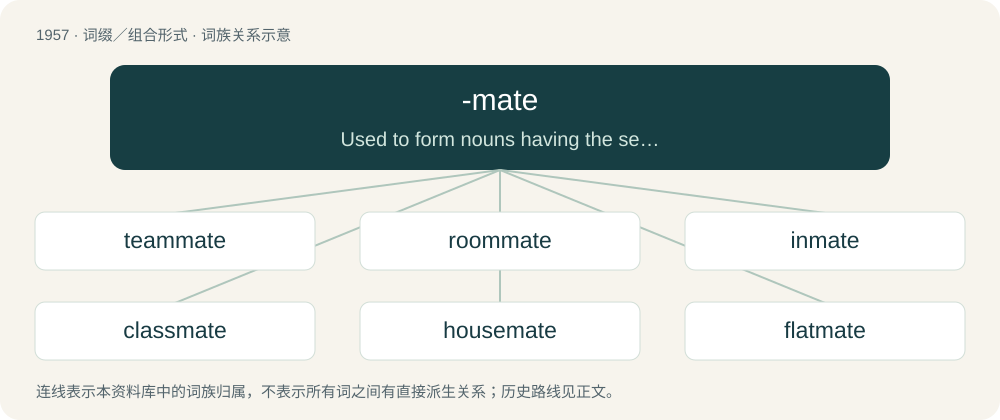

# 2072 · -mate — Used to form nouns having the sense of "a comrade or fellow with whom what is denoted by the noun is shared".

[总目录](../00_总目录_按常用程度.md)

**类型**：词缀／组合形式　｜　**来源语言**：见词源记录

## 核心含义与来源

- 核心含义：Used to form nouns having the sense of "a comrade or fellow with whom what is denoted by the noun is shared".
- 英文含义：Used to form nouns having the sense of "a comrade or fellow with whom what is denoted by the noun is shared".
- 词形：-mate

**来源记录 1**（后缀／后置成分；Used to form nouns having the sense of "a comrade or fellow with whom what is denoted by the noun is shared".）

From the noun mate (“fellow, comrade, partner”).

## 词族图

## 单词速览（常用到不常用）

| 单词 | 音标 | 释义 |
|---|---|---|
| [teammate](#w-1) | /ˈtiːmˌmeɪt/ | n. 队友 |
| [roommate](#w-2) | 美 /ˈɹu(m)ˌmeɪt/ | n. 住在同室的人 |
| [inmate](#w-3) | 英 /ˈɪn.meɪt/ | n. 同住者, 被收容者；\[法\] 内部的, 接近中心的, 内在的 |
| [classmate](#w-4) | 英 /ˈklɑːs.meɪt/；美 /ˈklæs.meɪt/ | n. 同班同学 |
| [housemate](#w-5) | 美 /ˈhaʊsˌmeɪt/ | n. 住在同一所房子里的人 |
| [flatmate](#w-6) | /ˈflætmeɪt/ | n. 合住一套公寓的人 |
| [bandmate](#w-7) | /ˈbændˌmeɪt/ | 【英文】Someone with whom one shares membership in a band. |
| [schoolmate](#w-8) | 英 /ˈskuːlˌmeɪt/；美 /ˈskulˌmeɪt/ | n. 同窗, 同学 |
| [cellmate](#w-9) | /ˈselmeɪt/ | n. 狱友；同牢室友 |
| [stablemate](#w-10) |  | n. 受雇于同一老板的拳击手 |
| [shipmate](#w-11) | /ˈʃɪpˌmeɪt/ | n. 同船水手 |

## 逐词详解

### 1. teammate

**词性**：名词　｜　**音标**：/ˈtiːmˌmeɪt/

**中文释义**：n. 队友

**英文义项**：One who is on the same team.

**构词拆分**：team + -mate

**词源与演化**：

From team + -mate.

**例句**：

> Pass the ball to your teammate.

该用例对应义项：One who is on the same team.

### 2. roommate

**词性**：名词　｜　**音标**：美 /ˈɹu(m)ˌmeɪt/

**中文释义**：n. 住在同室的人

**英文义项**：A person with whom one shares a room, as in a dormitory, barracks, rooming house, or apartment. / A person sharing the same home albeit not the same room (but generally not a family member or spouse).

**构词拆分**：room + -mate

**词源与演化**：

From room + -mate.

**例句**：

> I have a problem with my roommate. He eats all my food.

### 3. inmate

**词性**：名词　｜　**音标**：英 /ˈɪn.meɪt/

**中文释义**：n. 同住者, 被收容者；\[法\] 内部的, 接近中心的, 内在的

**英文义项**：A person confined to an institution such as a prison (as a convict) or hospital (as a patient). / A person who shares a residence (such as a hotel guest, a lodger, or a student living on campus), or other place.

**构词拆分**：inn + -mate；in- + -mate

**词源与演化**：

From inn + -mate, or from in- + -mate.

**例句**：

> Dan asked fellow inmate Matt to supply him with a fork.

### 4. classmate

**词性**：名词　｜　**音标**：英 /ˈklɑːs.meɪt/；美 /ˈklæs.meɪt/

**中文释义**：n. 同班同学

**英文义项**：A student who is in the same class at school. / A member of a different sort of class, such as locomotives etc.

**构词拆分**：class + -mate

**词源与演化**：

From class + -mate.

**例句**：

> Danny and I have been classmates for five years, but I've never spoken to him outside of lessons.

该用例对应义项：A student who is in the same class at school.

### 5. housemate

**词性**：名词　｜　**音标**：美 /ˈhaʊsˌmeɪt/

**中文释义**：n. 住在同一所房子里的人

**英文义项**：Someone living in the same house.

**构词拆分**：house + -mate

**词源与演化**：

From house + -mate.

**例句**：

> I probably have COVID, as my housemate has it.

### 6. flatmate

**词性**：名词　｜　**音标**：/ˈflætmeɪt/

**中文释义**：n. 合住一套公寓的人

**英文义项**：A person with whom one shares a flat. / A person with whom one shares any rental dwelling, not necessarily a flat.

**构词拆分**：flat + -mate

**词源与演化**：

From flat + -mate.

**例句**：

> One particular flatmate always leaves the bathroom in a mess.

### 7. bandmate

**词性**：名词　｜　**音标**：/ˈbændˌmeɪt/

**英文义项**：Someone with whom one shares membership in a band.

**构词拆分**：band + -mate

**词源与演化**：

From band + -mate.

**例句**：

> This number one hit was written in just 20 minutes by Nash's bandmate, Matt Slocum.

### 8. schoolmate

**词性**：名词　｜　**音标**：英 /ˈskuːlˌmeɪt/；美 /ˈskulˌmeɪt/

**中文释义**：n. 同窗, 同学

**英文义项**：A person who was a fellow attendee at one's school. / A schoolfriend; a friend from one's school.

**构词拆分**：school + -mate

**词源与演化**：

From school + -mate.

**例句**：

> I've lost touch with all my old schoolmates: I only see them at class reunions.

该用例对应义项：A person who was a fellow attendee at one's school.

### 9. cellmate

**词性**：名词　｜　**音标**：/ˈselmeɪt/

**中文释义**：n. 狱友；同牢室友

**英文义项**：A person with whom one shares a prison cell.

**构词拆分**：cell + -mate

**词源与演化**：

From cell + -mate.

**例句**：

> Mennad killed his cellmate because he was told he was a pedo.

### 10. stablemate

**词性**：名词

**中文释义**：n. 受雇于同一老板的拳击手

**英文义项**：One (such as a racehorse) from the same stable. / One from the same organization or background.

**构词拆分**：stable + -mate

**词源与演化**：

From stable + -mate.

### 11. shipmate

**词性**：名词　｜　**音标**：/ˈʃɪpˌmeɪt/

**中文释义**：n. 同船水手

**英文义项**：A fellow sailor serving on the same ship as another. / Any sailor (when used as a form of address by a sailor).

**构词拆分**：ship + -mate

**词源与演化**：

From ship + -mate.

**例句**：

> On his way home he met an old shipmate, and took a long walk with him.
