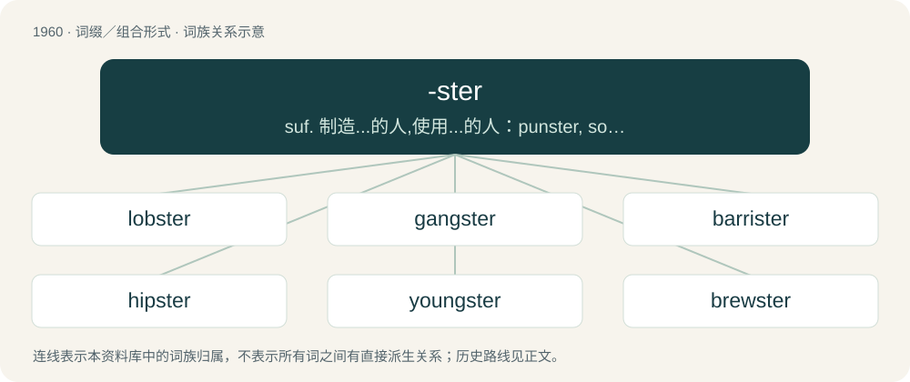

# 2076 · -ster — suf. 制造...的人,使用...的人：punster, songster; 做...的, 操作...的人, 从事...的人：teamster; 表示; 与...有关者参考...的人：gangster

[总目录](../00_总目录_按常用程度.md)

**类型**：词缀／组合形式　｜　**来源语言**：见词源记录

## 核心含义与来源

- 核心含义：suf. 制造...的人,使用...的人：punster, songster; 做...的, 操作...的人, 从事...的人：teamster; 表示; 与...有关者参考...的人：gangster
- 英文含义：Someone who is, or who is associated with, or who does something specified.
- 词形：-ster

**来源记录 1**（后缀／后置成分；Someone who is, or who is associated with, or who does something specified.）

From Middle English -estere, -ester, from Old English -estre (“-ster”, feminine agent suffix), from Proto-West Germanic \*-astrijā, of disputed origin. Cognate with Middle Low German -ester, Dutch -ster.

## 词族图

## 单词速览（常用到不常用）

| 单词 | 音标 | 释义 |
|---|---|---|
| [lobster](#w-1) | 英 /ˈlɒb.stə/；美 /ˈlɑb.stɚ/ | n. 龙虾 |
| [gangster](#w-2) | 英 /ˈɡæŋ.stəː/；/ˈɡæŋ.stɚ/ | n. 流氓, 歹徒；\[法\] 暴徒, 恶棍, 打手 |
| [barrister](#w-3) | 英 /ˈbæɹ.ɪst.ə(ɹ)/ | n. 出庭律师, 律师；\[法\] 律师, 专门律师, 大律师 |
| [hipster](#w-4) | 英 /ˈhɪp.stə/；美 /ˈhɪp.stɚ/ | n. 世面灵通的人 |
| [youngster](#w-5) | 英 /ˈjʌŋstə/；美 /ˈjʌŋstɚ/ | n. 小孩, 年轻人, 少年；\[法\] 儿童, 少年, 青年 |
| [brewster](#w-6) | /ˈbruːstə/ | 【英文】A brewer (of either sex). |
| [trickster](#w-7) | 英 /ˈtɹɪk.stə/；美 /ˈtɹɪk.stɚ/ | n. 骗子, 魔术师；\[法\] 骗子, 欺骗者 |
| [roadster](#w-8) | 英 /ˈɹəʊdstə/；美 /ˈɹoʊdstəɹ/ | n. 敞篷小客车, 流浪者 |
| [mobster](#w-9) | 英 /ˈmɒb.stə/；美 /ˈmɑb.stɚ/ | n. 犯罪集团成员；\[法\] 暴徒, 盗匪 |
| [prankster](#w-10) | 英 /ˈpɹæŋkstəː/；/ˈpɹæŋkstɚ/ | n. 恶作剧者 |
| [spinster](#w-11) | 英 /ˈspɪnstə/；美 /ˈspɪnstɚ/ | n. 未婚女人, 老处女 |
| [speedster](#w-12) | /ˈspiːdstə/ | n. 高速竞走者, 高速汽车, 超速驾驶者；\[法\] 高速驾驶者, 高速双人座汽车 |
| [fraudster](#w-13) | 英 /ˈfɹɔːdstə/；美 /ˈfɹɔdstɚ/ | n. 行骗者 |
| [pollster](#w-14) | 美 /ˈpoʊlstɚ/ | n. 民意调查人, 民意测验经办人 |
| [tipster](#w-15) | /ˈtipstə/ | n. 情报贩子；\[法\] 通报秘密消息者, 泄露内情者 |
| [teamster](#w-16) | 美 /ˈtim.stɚ/ | n. 联畜运输车驾驶者, 卡车驾驶员；\[法\] 卡车驾驶员, 运输工会会员, 驾驶一队牲畜者 |
| [sportster](#w-17) | /ˈspɔːtstə/ | n. \[口语\]赛车, 跑车；\[罕用语\]运动衣 |
| [chorister](#w-18) | 英 /ˈkɒɹɪstə(ɹ)/；美 /ˈkɔɹɪstɚ/ | n. 唱诗班男童歌手, 唱诗队领队 |
| [dragster](#w-19) | 美 /ˈdɹæɡstɚ/ | 改装而成的高速赛车 |
| [jokester](#w-20) | 英 /ˈd͡ʒəʊkstə/；美 /ˈd͡ʒoʊkstɚ/ | n. 喜欢开玩笑者 |

## 逐词详解

### 1. lobster

**词性**：名词　｜　**音标**：英 /ˈlɒb.stə/；美 /ˈlɑb.stɚ/

**中文释义**：n. 龙虾

**英文义项**：A crustacean of the Nephropidae family, dark green or blue-black in colour turning bright red when cooked, with a hard shell and claws, which is used as a seafood. / A spiny lobster, also called the rock lobster, a crustacean of the Palinuridae family, pinkish red in colour, with a hard, spiny shell but no claws, which is used as a seafood.

**构词拆分**：lop + -ster

**词源与演化**：

From Middle English loppestere, lopster, from Old English loppestre, lopustre, lopystre, of uncertain origin. Some believe it to be a corruption of Latin lō̆custa (“grasshopper, locust”) + the Old English feminine agent suffix -estre. In Latin, the phrase lō̆custa marīna (literally "sea-grasshopper") signified a type of crustacean (shrimp or lobster). Alternatively, from Old English lobbe, loppe (“spider”) + the Old English feminine agent suffix -estre, equivalent to lop + -ster.

**例句**：

> Lobster tomalley can be toxic and it's best not to eat it.

### 2. gangster

**词性**：形容词　｜　**音标**：英 /ˈɡæŋ.stəː/；/ˈɡæŋ.stɚ/

**中文释义**：n. 流氓, 歹徒；\[法\] 暴徒, 恶棍, 打手

**英文义项**：Characteristic of a gangster; (especially) admirable and audacious. / On friendly terms; cool.

**构词拆分**：gang + -ster

**词源与演化**：

From gang + -ster. First attested in 1884.

**例句**：

> We put an end to our beef. We're all gangster now.

该用例对应义项：On friendly terms; cool.

### 3. barrister

**词性**：名词　｜　**音标**：英 /ˈbæɹ.ɪst.ə(ɹ)/

**中文释义**：n. 出庭律师, 律师；\[法\] 律师, 专门律师, 大律师

**英文义项**：A lawyer with the right to speak and argue as an advocate in higher lawcourts.

**词源与演化**：

From bar (a collective term for lawyers or the legal profession) and the suffix -ster.

**例句**：

> She practised as a barrister for many years.

### 4. hipster

**词性**：名词　｜　**音标**：英 /ˈhɪp.stə/；美 /ˈhɪp.stɚ/

**中文释义**：n. 世面灵通的人

**英文义项**：A person who is hip, being keenly interested in the latest trends or fashions. / A person who rejects mainstream culture; an anti-conformist.

**构词拆分**：hip + -ster

**词源与演化**：

From hip + -ster. First attested for someone carrying something on their hip in the U.S. in the 1920s. Attested as a variant of hepster in the 1940s, for a follower of the latest fashions/trends/styles.

**例句**：

> The magazine declares a new king of hipster "music" every two weeks.

### 5. youngster

**词性**：名词　｜　**音标**：英 /ˈjʌŋstə/；美 /ˈjʌŋstɚ/

**中文释义**：n. 小孩, 年轻人, 少年；\[法\] 儿童, 少年, 青年

**英文义项**：A young person.

**构词拆分**：young + -ster

**词源与演化**：

From young + -ster. Attested from the early 17th century.

**例句**：

> `tiddler' is a British term for youngster.

该用例对应义项：a young person of either sex

### 6. brewster

**词性**：名词　｜　**音标**：/ˈbruːstə/

**英文义项**：A brewer (of either sex).

**构词拆分**：brew + -ster

**词源与演化**：

Circa 1300, from Middle English brewestere; equivalent to brew + -ster.

### 7. trickster

**词性**：名词　｜　**音标**：英 /ˈtɹɪk.stə/；美 /ˈtɹɪk.stɚ/

**中文释义**：n. 骗子, 魔术师；\[法\] 骗子, 欺骗者

**英文义项**：Any of numerous figures featuring in various mythologies and folk traditions, who use guile and secret knowledge to challenge authority and play tricks and pranks on others with their acts of trickery; any similar figure in literature. / One who plays tricks or pranks on others.

**构词拆分**：trick + -ster

**词源与演化**：

From trick + -ster.

**例句**：

> That shady trickster faked being a psychic advisor to spread misinformation and gain profit.

该用例对应义项：A fraud or cheat (person who performs a trick or hoax full of falsehoods for the purpose of unlawful gain).

### 8. roadster

**词性**：名词　｜　**音标**：英 /ˈɹəʊdstə/；美 /ˈɹoʊdstəɹ/

**中文释义**：n. 敞篷小客车, 流浪者

**英文义项**：A bicycle, or tricycle, adapted for common roads, rather than for the racing track, usually of classic style and steel-framed construction. / One who drives much; a coach driver.

**构词拆分**：road + -ster

**词源与演化**：

Derived from road + -ster.

### 9. mobster

**词性**：名词　｜　**音标**：英 /ˈmɒb.stə/；美 /ˈmɑb.stɚ/

**中文释义**：n. 犯罪集团成员；\[法\] 暴徒, 盗匪

**英文义项**：A member of a mob or Mafia.

**构词拆分**：mob + -ster

**词源与演化**：

From mob + -ster.

**例句**：

> Meyer Lansky was a Jewish mobster and close associate of "Lucky" Luciano.

### 10. prankster

**词性**：名词　｜　**音标**：英 /ˈpɹæŋkstəː/；/ˈpɹæŋkstɚ/

**中文释义**：n. 恶作剧者

**英文义项**：One who performs pranks.

**构词拆分**：prank + -ster

**词源与演化**：

From prank + -ster.

**例句**：

> He loves being a prankster and is often seen pulling off several pranks on his bullies.

该用例对应义项：One who performs pranks.

### 11. spinster

**词性**：名词　｜　**音标**：英 /ˈspɪnstə/；美 /ˈspɪnstɚ/

**中文释义**：n. 未婚女人, 老处女

**英文义项**：A woman who has never been married, especially one past the typical marrying age according to social traditions. / One who spins (puts a spin on) a political media story so as to give something a favorable or advantageous appearance; a spin doctor, spin merchant or spinmeister.

**构词拆分**：spin + -ster

**词源与演化**：

From Middle English spynnestere (“woman who spins fibre”), from c. 1350; equivalent to spin + -ster. The semantic development is from a historical notion of unmarried women spinning thread for a living.

**例句**：

> His daughter remained spinster the rest of her life.

### 12. speedster

**词性**：名词　｜　**音标**：/ˈspiːdstə/

**中文释义**：n. 高速竞走者, 高速汽车, 超速驾驶者；\[法\] 高速驾驶者, 高速双人座汽车

**英文义项**：One who is noted for being very fast. / A person who speeds (drives fast).

**构词拆分**：speed + -ster

**词源与演化**：

\* From speed + -ster.

### 13. fraudster

**词性**：名词　｜　**音标**：英 /ˈfɹɔːdstə/；美 /ˈfɹɔdstɚ/

**中文释义**：n. 行骗者

**英文义项**：A person who carries out fraud; a swindler.

**构词拆分**：fraud + -ster

**词源与演化**：

From fraud + -ster.

### 14. pollster

**词性**：名词　｜　**音标**：美 /ˈpoʊlstɚ/

**中文释义**：n. 民意调查人, 民意测验经办人

**英文义项**：A professional who conducts or analyzes opinion polls.

**构词拆分**：poll + -ster

**词源与演化**：

From poll + -ster.

**例句**：

> Trump didn't like the results of the polls, so he fired the pollsters.

该用例对应义项：A professional who conducts or analyzes opinion polls.

### 15. tipster

**词性**：名词　｜　**音标**：/ˈtipstə/

**中文释义**：n. 情报贩子；\[法\] 通报秘密消息者, 泄露内情者

**英文义项**：A person who provides tips or advice to others, for example on the form of racehorses or the stock market. / One who provides tips or hints on how to succeed at a game.

**构词拆分**：tip (etymology 5) + -ster

**词源与演化**：

\* From tip (etymology 5) + -ster.

### 16. teamster

**词性**：名词　｜　**音标**：美 /ˈtim.stɚ/

**中文释义**：n. 联畜运输车驾驶者, 卡车驾驶员；\[法\] 卡车驾驶员, 运输工会会员, 驾驶一队牲畜者

**英文义项**：A person who drives a cargo truck (see Teamster).

**构词拆分**：team + -ster

**词源与演化**：

From team + -ster.

### 17. sportster

**词性**：名词　｜　**音标**：/ˈspɔːtstə/

**中文释义**：n. \[口语\]赛车, 跑车；\[罕用语\]运动衣

**英文义项**：A sporty automobile or motorcycle.

**构词拆分**：sport + -ster

**词源与演化**：

sport + -ster

### 18. chorister

**词性**：名词　｜　**音标**：英 /ˈkɒɹɪstə(ɹ)/；美 /ˈkɔɹɪstɚ/

**中文释义**：n. 唱诗班男童歌手, 唱诗队领队

**英文义项**：A singer in a choir; especially a child in a church or cathedral choir. / A director or leader of a choral group.

**构词拆分**：choir + -ster

**词源与演化**：

Derived from late Middle English queristre, from an Anglo-Norman variant of Old French cueriste, from cuer (see Middle French cuer). Equivalent to choir + -ster.

**例句**：

> Jane was the chorister of her congregation's choir, and that occupied much of her time on the weekends.

该用例对应义项：A director or leader of a choral group.

### 19. dragster

**词性**：名词　｜　**音标**：美 /ˈdɹæɡstɚ/

**中文释义**：改装而成的高速赛车

**英文义项**：A heavily modified or custom-built vehicle used in drag racing. / One who takes part in drag racing.

**构词拆分**：drag + -ster

**词源与演化**：

Derived from drag + -ster.

### 20. jokester

**词性**：名词　｜　**音标**：英 /ˈd͡ʒəʊkstə/；美 /ˈd͡ʒoʊkstɚ/

**中文释义**：n. 喜欢开玩笑者

**英文义项**：A person who tells jokes; a joker. / A person who plays practical jokes; a prankster.

**构词拆分**：joke + -ster

**词源与演化**：

Derived from joke + -ster.

**例句**：

> Our uncle is always being a jokester and cracking jokes about how much he eats and makes messes.

该用例对应义项：A person who tells jokes; a joker.
