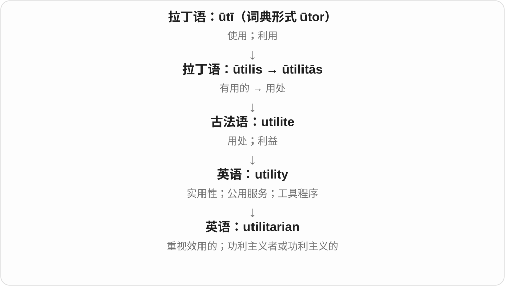
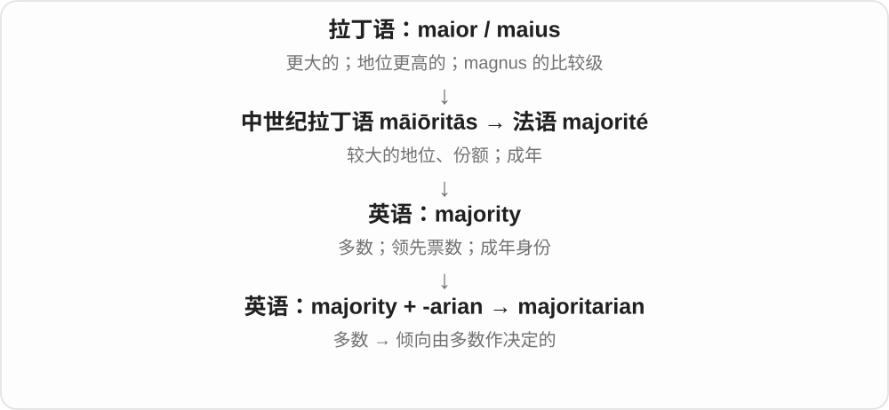

# 2077 · -arian — 与某事有关的人、原则立场和相应性质

[逐词精讲目录](../00_逐词精讲目录.md) · [总目录](../00_总目录_按常用程度.md)

## 核心词根与来源

后缀只给关联方向，具体范围仍由词基和历史决定。有的先是借词，有的英语类推；不能给任何名词任意加 -arian 就当标准词。

**-ARIAN：把活动、原则或立场落到人和性质上**

vegetarian 饮食方式；disciplinarian 纪律角色；sectarian/communitarian 立场；humanitarian、libertarian 等各有固定义。

- **生活、职责及记录角色**：vegetarian · disciplinarian · parliamentarian · documentarian
- **宗派、社群及人道原则**：sectarian · communitarian · humanitarian
- **权力、自由及效用等取向**：authoritarian · libertarian · totalitarian · utilitarian · majoritarian

## 词形与演化规律

拉丁 -ārius/-āriānus 等 → 相关借词与英语 -arian；词干常删尾、换形，比较 vegetable/vegetarian、community/communitarian。

## 单词速览（按词族由简到繁）

同一基础词的相关扩展放在一起，先读基础形式，再读扩展；各组之间优先读常用的。具体词源关系见各词讲解。

| 单词 | 音标 | 核心意思 |
|---|---|---|
| [humanitarian](#w-1) | 英 /hjuːˌmænɪˈteəriən/；美 /hjuːˌmænɪˈteriən/ | 人道主义的；人道救援者 |
| [vegetarian](#w-2) | 英 /ˌvedʒɪˈteəriən/；美 /ˌvedʒəˈteriən/ | 素食者；素食的、不含肉类的 |
| [authoritarian](#w-3) | 英 /ɔːˌθɒrɪˈteəriən/；美 /əˌθɔːrəˈteriən/ | 威权的；专制的；强调服从的；威权主义者 |
| [libertarian](#w-4) | 英 /ˌlɪbəˈteəriən/；美 /ˌlɪbərˈteriən/ | 自由意志主义者；自由至上主义者；自由意志或自由至上主义的 |
| [sectarian](#w-5) | 英 /sekˈteəriən/；美 /sekˈteriən/ | 宗派的；偏执于派别的、宗派主义的；宗派成员 |
| [totalitarian](#w-6) | 英 /təʊˌtæləˈteəriən/；美 /toʊˌtæləˈteriən/ | 极权主义的；极权主义者 |
| [utilitarian](#w-7) | 英 /juːˌtɪlɪˈteəriən/；美 /juːˌtɪləˈteriən/ | 讲求实用的；功利主义的 |
| [parliamentarian](#w-8) | 英 /ˌpɑːləmənˈteəriən/；美 /ˌpɑːrləmənˈteriən/ | 议会议员；熟悉议事程序的人 |
| [disciplinarian](#w-9) | 英 /ˌdɪsɪplɪˈneəriən/；美 /ˌdɪsəpləˈneriən/ | 严格执行纪律的人、严师式管理者 |
| [documentarian](#w-10) | 英 /ˌdɒkjumənˈteəriən/；美 /ˌdɑːkjəmənˈteriən/ | 纪录片创作者；纪实记录者 |
| [communitarian](#w-11) | 英 /kəˌmjuːnɪˈteəriən/；美 /kəˌmjuːnəˈteriən/ | 社群主义的；社群主义者 |
| [majoritarian](#w-12) | 英 /məˌdʒɒrɪˈteəriən/；美 /məˌdʒɔːrɪˈteriən/ | 多数决定的；主张多数统治的；多数派主义者 |

## 逐词讲解

### 1. humanitarian — 人道主义的；人道救援者

**音标**：英 /hjuːˌmænɪˈteəriən/；美 /hjuːˌmænɪˈteriən/

**先抓住这个画面**

把减轻人的苦难、维持基本生存放在中心，尤其用于战争、灾害等危机中的援助。

**怎么拆**

由 human 一支仿 unitarian 等词构成。早期曾有强调基督人性的神学义，后来才发展出维护人类福祉的现代常用义。

**怎么变成今天的意思**

**拉丁语 humanus，与 homo / homin- 同族**  
人的；有教养、有人情味的

↓

**古法语 humain → 英语 human / humane**  
人的，也曾包含仁慈的意思

↓

**英语 humanitarian**  
早期神学中强调基督人性的一派

↓

**后来的人类福祉义**  
关注人的苦难、救助与基本生活

humanitarian aid 是人道援助；a humanitarian crisis 指大批人的生存、安全或基本生活面临严重问题。

**常见搭配与例句**

humanitarian aid；a humanitarian crisis；a humanitarian organization。

> The organization delivered humanitarian aid after the flood.

这个组织在洪灾后运送了人道援助物资。

> She is remembered as a dedicated humanitarian.

人们记得她是一位尽心尽力的人道救援者。

**别混淆**

humane 形容仁慈的做法；humanitarian 常指以人的福祉、救援为目的的事业。

### 2. vegetarian — 素食者；素食的、不含肉类的

**音标**：英 /ˌvedʒɪˈteəriən/；美 /ˌvedʒəˈteriən/

**先抓住这个画面**

把不吃动物肉类作为饮食方式的人；菜单上 vegetarian dish 则指给这种饮食方式准备的菜。

**怎么拆**

由 vegetable 植物、蔬菜的部分词干加 -arian 类推形成，不是把完整 vegetable 原样再粘尾巴。后来随素食社团发展广泛使用；不必把来源改讲成单独由拉丁 vegetus 健康造词。

**怎么变成今天的意思**

**拉丁 -ārius/-āriānus 等相关词尾**  
与某事有关；相关的人或立场

↓

**英语 -arian 的借入、类推构词**  
职业身份、思想立场、生活原则；也可作形容词

↓

**vegetable 的词干 + -arian → vegetarian**  
以素食方式生活的人；相应饮食的

a vegetarian diet 素食饮食，a vegetarian meal 素餐，be a vegetarian 是素食者。通常不吃肉、鱼，蛋奶是否包含要看具体类型。

**常见搭配与例句**

a vegetarian diet；a vegetarian meal；a vegetarian option。

> The restaurant offers several vegetarian dishes.

餐馆提供几道素菜。

> My sister is a vegetarian, so we made a meal without meat or fish.

姐姐吃素，所以我们做了不含肉和鱼的一餐。

**别混淆**

vegetarian 不自动等于 vegan：后者对动物来源制品有更广的排除。vegetarian 也不是只吃叶菜，谷物、豆类等都可在其饮食中。

### 3. authoritarian — 威权的；专制的；强调服从的；威权主义者

**音标**：英 /ɔːˌθɒrɪˈteəriən/；美 /əˌθɔːrəˈteriən/

**先抓住这个画面**

权力集中在上面，下面的人被要求服从，反对和自主空间较小。

**怎么拆**

英语 authority 词族加 -arian 一类人物、倾向后缀；这是英语形成的词，不是一个原封借入的古拉丁政治术语。

**怎么变成今天的意思**

**拉丁 augēre；分词 auctus**  
使增加、成长；已经增长的

↓

**拉丁 auctor → auctōritās → 古法语 autorité → 中古英语 autorite**  
发起者、担保者 → 权威、影响力、权力

↓

**现代英语 authority**  
职权；可信的专家或资料；主管当局

↓

**英语 authority 词族 → authoritarian**  
强调权威支配、要求服从的取向或人

可以形容政府、组织，也可以形容管理作风。重点是权力和服从关系；并不是只要规则明确、做事果断，就一定 authoritarian。

**常见搭配与例句**

an authoritarian regime；an authoritarian style；authoritarian leadership。

> The novel depicts an authoritarian state that punishes dissent.

小说描绘了一个惩罚异议的威权国家。

> The staff objected to his authoritarian management style.

员工反对他要求一味服从的管理方式。

**别混淆**

authoritative 通常可赞许可靠、有威信；authoritarian 往往批评限制自主、要求服从，别把后者当作褒奖专家。

### 4. libertarian — 自由意志主义者；自由至上主义者；自由意志或自由至上主义的

**音标**：英 /ˌlɪbəˈteəriən/；美 /ˌlɪbərˈteriən/

**先抓住这个画面**

政治场景中把个人自由看得很重，要求对强制和权力干预给出很强的理由；哲学史里还可能是在谈人是否有自由意志。

**怎么拆**

英语 liberty 的词干 + -arian，较早用于自由意志与必然性的哲学争论，后来才发展出多种政治用法；形容词与名词相互对应。

**怎么变成今天的意思**

**拉丁 liber**  
自由的；不受束缚的

↓

**拉丁 libertas → 古法语 liberté**  
自由

↓

**中古英语 liberte → 英语 liberty**  
自由；获准自行行动的余地

↓

**英语 liberty 词干 + -arian → libertarian**  
早期用于自由意志争论；后发展政治用法

a libertarian argument 可能强调个人选择和限制国家强制。这个词横跨不同历史传统，不能不看语境就断定具体经济主张，也不能自动等同于某个政党成员。

**常见搭配与例句**

a libertarian view；a libertarian argument；civil libertarians。

> The philosopher presented a libertarian argument for personal choice.

这位哲学家提出了一种强调个人自由选择的论证。

> The discussion distinguished political libertarians from philosophers debating free will.

讨论区分了政治上的自由至上主义者与讨论自由意志的哲学家。

**别混淆**

liberal 是更宽泛的自由主义或自由派标签；libertarian 通常对个人自由和反强制有更鲜明的强调。libertine 则是放纵者，不是同一种政治身份。

### 5. sectarian — 宗派的；偏执于派别的、宗派主义的；宗派成员

**音标**：英 /sekˈteəriən/；美 /sekˈteriən/

**先抓住这个画面**

先看属于哪一宗派，再看是否把派别界线看得压倒一切；新闻里的 sectarian conflict 常说按宗派裂开的冲突。

**怎么拆**

接中世纪拉丁 sectarius 等，与 secta 宗派、追随路线有关；现代可认 sect + -arian。sect 的跟随与切分词形在历史中有交错，不能只凭现代 sect 就宣称唯一切开来源。

**怎么变成今天的意思**

**拉丁 -ārius/-āriānus 等相关词尾**  
与某事有关；相关的人或立场

↓

**英语 -arian 的借入、类推构词**  
职业身份、思想立场、生活原则；也可作形容词

↓

**secta → sectarius 等 → sectarian**  
宗派的、宗派成员 → 过分拘守派别的

sectarian divisions 宗派分歧，sectarian violence 宗派暴力，a sectarian outlook 狭隘的派别观点。可以中性说宗派关系，也常带批评。

**常见搭配与例句**

sectarian divisions；sectarian violence；a sectarian outlook。

> The school tried to bridge sectarian divisions.

学校试图弥合宗派分歧。

> The author criticizes a narrow sectarian outlook.

作者批评一种狭隘的宗派观点。

**别混淆**

sectarian 不专属于某一种宗教，也不等于所有 religious 宗教的；党派、群体的狭隘偏见也可用。

### 6. totalitarian — 极权主义的；极权主义者

**音标**：英 /təʊˌtæləˈteəriən/；美 /toʊˌtæləˈteriən/

**先抓住这个画面**

不只要求服从某几项命令，而是试图把政治、社会组织乃至私人生活都纳入统一控制。

**怎么拆**

英语二十世纪参照意大利语 totalitario 形成，total 与 authoritarian 的词尾模式也参与构词；不能简单说这是古拉丁语现成的政治制度名称。

**怎么变成今天的意思**

**拉丁语 totus / 中世纪拉丁语 totalis → 意大利语 totale / totalitario**  
全部、完全 → 试图控制社会整体的政治概念

↓

**英语参照 totalitario；total 与 authoritarian 的词尾模式 → totalitarian**  
极权主义的；相关制度或主张的支持者

常说 totalitarian regime 或 state，指一种全面控制社会的统治模式；作名词也能指支持这类主张的人。实际历史分析还需交代具体制度特点。

**常见搭配与例句**

a totalitarian state；a totalitarian regime；totalitarian control。

> The novel depicts a totalitarian state that monitors private conversations.

小说描绘了一个监控私人谈话的极权国家。

> The lecture compared authoritarian and totalitarian systems.

讲座比较了威权体制与极权体制。

**别混淆**

authoritarian 更宽泛地强调威权、压制服从；totalitarian 更突出试图全面控制社会与思想。

### 7. utilitarian — 讲求实用的；功利主义的

**音标**：英 /juːˌtɪlɪˈteəriən/；美 /juːˌtɪləˈteriən/

**先抓住这个画面**

日常的 utilitarian 可以想成结实的工作台：重点是好干活，装饰很少。哲学中的意思则是根据行为带来的总体后果评价对错。

**怎么拆**

以 utility 为基础，加表示相关人物或倾向的 -arian 形成；历史上与边沁、密尔讨论的功利主义相连。

**怎么变成今天的意思**

共同线索是 usefulness 或 utility。谈建筑、家具时常指朴素实用；谈伦理时重视整体幸福、痛苦和利益后果，不能直接译成“只顾自己得利”。

**常见搭配与例句**

a utilitarian design；utilitarian furniture；a utilitarian argument；a utilitarian philosopher。

> The room had plain, utilitarian furniture.

房间里的家具朴素而实用。

> She offered a utilitarian argument for reducing unnecessary suffering.

她从减少整体痛苦的功利主义角度提出了论证。

**别混淆**

functional 常说功能合用；utilitarian 还容易让人想到装饰少、以用途为先。哲学义与日常贬义的“势利”并不等同。

### 8. parliamentarian — 议会议员；熟悉议事程序的人

**音标**：英 /ˌpɑːləmənˈteəriən/；美 /ˌpɑːrləmənˈteriən/

**先抓住这个画面**

一条是坐在议会里履职的人；另一条是懂开会、提案、表决规则，能指导程序的人。

**怎么拆**

parliament + -arian，形成相关人物名称。议员与议事程序专家两种常见语境，不能只背其中一个。

**怎么变成今天的意思**

**法语 parler 说话 + -ment → parlement**  
讨论、商谈、会议

↓

**盎格鲁法语 parlement 等 → 中古英语 parlement → parliament**  
议事集会 → 议会；拼写受中世纪拉丁语形式影响

↓

**parliament + -arian → parliamentarian**  
议会成员；议事程序专家等

an experienced parliamentarian 资深议员，consult a parliamentarian 咨询议事程序专家；实际角色依机构和上下文。

**常见搭配与例句**

an experienced parliamentarian；a senior parliamentarian；consult a parliamentarian。

> Several parliamentarians spoke against the proposal.

几位议员发言反对这项提案。

> The club consulted a parliamentarian about the voting rules.

俱乐部就投票规则咨询了一位议事程序专家。

**别混淆**

parliamentarian 人物，parliamentary 多修饰事物；并非所有被叫 parliamentarian 的人都在当议员，也可能负责程序咨询。

### 9. disciplinarian — 严格执行纪律的人、严师式管理者

**音标**：英 /ˌdɪsɪplɪˈneəriən/；美 /ˌdɪsəpləˈneriən/

**先抓住这个画面**

规则说几点到，就认真要求几点到；重视约束、执行规矩的人，可以是 a disciplinarian。

**怎么拆**

可分析 discipline + -arian，或联系 disciplinary + -an。人物词强调严格执行纪律，不只是这个人学过某门学科。

**怎么变成今天的意思**

**拉丁 -ārius/-āriānus 等相关词尾**  
与某事有关；相关的人或立场

↓

**英语 -arian 的借入、类推构词**  
职业身份、思想立场、生活原则；也可作形容词

↓

**discipline + -arian → disciplinarian**  
重视、实施纪律的人

a strict disciplinarian 严厉的纪律执行者，a firm disciplinarian 管教坚定的人，a teacher who is a disciplinarian 很重纪律的老师。

**常见搭配与例句**

a strict disciplinarian；a firm disciplinarian。

> The head teacher was a strict disciplinarian.

校长是一位严格要求纪律的人。

> She was a firm disciplinarian but listened carefully to her students.

她管教严格，也认真听学生说话。

**别混淆**

disciplinarian 是人，disciplinary action 是纪律处分等形容结构；严格不必等于残酷，评价需看具体做法。

### 10. documentarian — 纪录片创作者；纪实记录者

**音标**：英 /ˌdɒkjumənˈteəriən/；美 /ˌdɑːkjəmənˈteriən/

**先抓住这个画面**

把现实中的人物、事件和材料组织成纪实作品的人。

**怎么拆**

可按 documentary + -an 理解，另有 document + -arian 的分析；两者都把记录活动与从事它的人联系起来。

**怎么变成今天的意思**

**拉丁 docēre；完成分词 doctus**  
教；使人知道；有学问的

↓

**拉丁 documentum → 法语 document**  
教训、示例、证明 → 文件证据

↓

**中古英语及英语 document**  
文件；留下记录、用材料证明

↓

**英语 documentary／document + 人称后缀**  
纪录片或纪实记录 → 创作者

↓

**英语 documentarian**  
纪录片作者；纪实记录者

a documentarian 可以长期跟拍一个社区，也可以借助档案材料组织叙事。这个称呼突出纪实创作，不等于任何用手机拍一段视频的人都自称职业纪录片作者。

**常见搭配与例句**

a documentary filmmaker and documentarian；an independent documentarian；a social documentarian。

> The documentarian spent a year following the fishing community.

这位纪录片创作者花了一年时间跟拍渔民社区。

> As a documentarian, she combines interviews with archival footage.

作为纪录片作者，她把采访与档案影像结合起来。

**别混淆**

documentarian 指人；documentary 指作品或有关文献的性质。

### 11. communitarian — 社群主义的；社群主义者

**音标**：英 /kəˌmjuːnɪˈteəriən/；美 /kəˌmjuːnəˈteriən/

**先抓住这个画面**

讨论人怎样生活时，不只看孤立个人的选择，也把共同体、关系和共同责任放在中心。

**怎么拆**

community 社群的词干 + -arian，连接时词干有调整；表示相关思想取向及主张者，不是 community 全词再机械拼接。

**怎么变成今天的意思**

**拉丁 -ārius/-āriānus 等相关词尾**  
与某事有关；相关的人或立场

↓

**英语 -arian 的借入、类推构词**  
职业身份、思想立场、生活原则；也可作形容词

↓

**community 的词干 + -arian → communitarian**  
重视共同体作用的；持相应立场的人

a communitarian approach 社群主义取向，communitarian thought 社群主义思想，a communitarian thinker 社群主义思想家。

**常见搭配与例句**

a communitarian approach；communitarian thought；a communitarian thinker。

> The essay takes a communitarian approach to public responsibility.

文章从社群主义角度讨论公共责任。

> The seminar compared liberal and communitarian views.

研讨课比较了自由主义与社群主义观点。

**别混淆**

communitarian 不等于 communist 共产主义者；两者虽有共同、社群的语义背景，现代思想标签不同，内部也各有流派。

### 12. majoritarian — 多数决定的；主张多数统治的；多数派主义者

**音标**：英 /məˌdʒɒrɪˈteəriən/；美 /məˌdʒɔːrɪˈteriən/

**先抓住这个画面**

一群人意见不同，规则是“人数更多的一边说了算”。majoritarian 描述这种安排或主张。

**怎么拆**

majorit(y) + -arian；先有 majority“多数”，再形成表示相关制度或主张的词。

**怎么变成今天的意思**

a majoritarian system 强调多数意见在作决定时的地位。它是制度描述，不等于说每一个多数决定都正确，也不自动说明少数权益怎样安排。

**常见搭配与例句**

majoritarian rule；a majoritarian approach；majoritarian democracy。

> The club adopted a majoritarian approach to choosing its activities.

俱乐部决定由多数成员的意见来选择活动。

> The essay compares majoritarian rule with decision making by consensus.

这篇文章比较了多数决定和协商达成共识两种方式。

**别混淆**

majority 是人数或票数；majoritarian 是对“如何作决定”的描述。

## 这一组要分清什么

-arian 不只职业人物；vegetarian 不等于 vegan；disciplinarian 是人；communitarian 不等于 communist；各思想词不能只凭后缀推细节。

## 串起来练习

The vegetarian teacher was a strict disciplinarian with strong humanitarian concerns.

那位吃素的老师管教严格，也十分关心人道问题。
