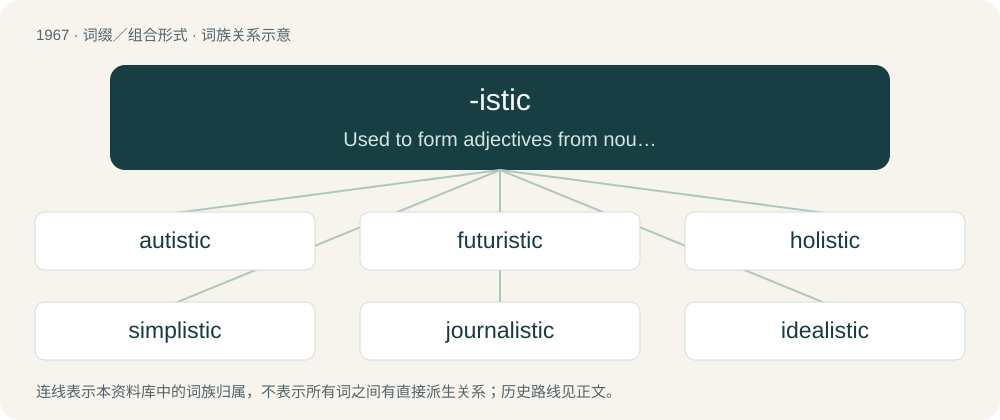

# 2082 · -istic — Used to form adjectives from nouns or from other adjectives, with the meaning "of or pertaining to" the preceding component.

[总目录](../00_总目录_按常用程度.md)

**类型**：词缀／组合形式　｜　**来源语言**：见词源记录

## 核心含义与来源

- 核心含义：Used to form adjectives from nouns or from other adjectives, with the meaning "of or pertaining to" the preceding component.
- 英文含义：Used to form adjectives from nouns or from other adjectives, with the meaning "of or pertaining to" the preceding component.
- 词形：-istic

**来源记录 1**（后缀／后置成分；Used to form adjectives from nouns or from other adjectives, with the meaning "of or pertaining to" the preceding component.）

From -ist + -ic.

## 词族图

## 单词速览（常用到不常用）

| 单词 | 音标 | 释义 |
|---|---|---|
| [autistic](#w-1) | 英 /ɔːˈtɪs.tɪk/；美 /ɔˈtɪs.tɪk/ | \[医\] 孤独的, 自我中心的 |
| [futuristic](#w-2) | 英 /ˌfjuːt͡ʃəˈɹɪstɪk/；美 /ˌfjut͡ʃəˈɹɪstɪk/ | a. 未来派的 |
| [holistic](#w-3) | 英 /həˈlɪs.tɪk/；美 /hoʊˈlɪs.tɪk/ | \[计\] 完整的, 整体的；\[医\] 机能整体性的 |
| [simplistic](#w-4) | /sɪmˈplɪstɪk/ | a. 过分简单化的 |
| [journalistic](#w-5) | /ˌd͡ʒɜː(ɹ)nəˈlɪstɪk/ | a. 新闻业的, 新闻工作者的, 报刊特有的, 新闻工作的 |
| [idealistic](#w-6) | /ˌaɪ.di.əˈlɪ.stɪk/ | a. 理想主义的, 唯心论的, 唯心主义的, 唯心主义者的 |
| [stylistic](#w-7) | /staɪˈlɪstɪk/ | a. 格式上的, 体裁上的 |
| [materialistic](#w-8) | /məˌtɪəɹ.i.əˈlɪs.tɪk/ | a. 唯物论的, 唯物主义的 |
| [naturalistic](#w-9) | /.nætʃərəˈlistik/ | a. 自然的, 自然主义的 |
| [relativistic](#w-10) | 英 /ˈɹɛl.ə.təˌvɪst.ɪk/ | a. 相对论的；\[化\] 相对论性(的) |
| [probabilistic](#w-11) | 英 /ˌpɹɒb.ə.bɪˈlɪs.tɪk/；美 /ˌpɹɑ.bə.bɪˈlɪs.tɪk/ | \[计\] 概率性的 |
| [individualistic](#w-12) | /ˌɪn.dɪˌvɪ.dʒu.əˈlɪ.stɪk/ | a. 个人主义的, 独特的 |
| [ritualistic](#w-13) | /ˌɹɪt͡ʃuəˈlɪstɪk/ | a. 仪式的, 遵守仪式的 |
| [synergistic](#w-14) |  | \[计\] 协同的, 协作的；\[医\] 协同的, 协作的 |
| [militaristic](#w-15) | 美 /ˌmɪl.ə.təˈɹɪs.tɪk/ | a. 军国主义的 |
| [mechanistic](#w-16) | /ˌmɛkəˈnɪstɪk/ | a. 机械学的, 机械论的, 机械论者的；\[医\] 机械论的 |
| [pluralistic](#w-17) | /.pluərəˈlistik/ | a. 兼职的, 多元论的 |
| [minimalistic](#w-18) |  | 极简化的；简约的 |
| [masochistic](#w-19) | /ˌmæ.səˈkɪs.tɪk/ | a. 性受虐狂者的, 受虐狂者的 |
| [monopolistic](#w-20) | /məˌnɒpəˈlɪstɪk/ | a. 垄断性的, 专卖的, 垄断论者的 |
| [paternalistic](#w-21) | /pə.təːnəˈlistik/ | a. 家长式作风的 |
| [impressionistic](#w-22) | /ɪmˌpɹɛ.ʃəˈnɪ.stɪk/ | a. 印象主义的, 印象派的, 仅凭印象的 |
| [moralistic](#w-23) | /.mɒrəˈlistik/ | a. 道德家的, 说教的, 道德主义的 |
| [legalistic](#w-24) | /.liːgəˈlistik/ | a. 尊重法律的 |
| [animalistic](#w-25) | /,æniməˈlistik/ | a. 兽性说的, 色情的 |
| [imperialistic](#w-26) | 英 /ɪmˌpɪəɹi.əlˈɪstɪk/；美 /ɪmˌpɪɹi.əˈlɪstɪk/ | a. 帝国主义的, 拥护帝国主义的 |
| [cannibalistic](#w-27) | 英 /kan.ɪ.bəˈlɪs.tɪk/；美 /kæn.ə.bəˈlɪs.tɪk/ | a. 食人肉的, 同类相食的 |
| [dualistic](#w-28) | /djuːəˈlistik/ | a. 二元的；\[医\] 两重的, 二元论的 |
| [voyeuristic](#w-29) | /,vwɑːjəˈristik/ | a. 喜好窥阴的 |
| [patristic](#w-30) | /pəˈtristik/ | a. 教父的, 教父著作研究的 |
| [terroristic](#w-31) | /.terəˈristik/ | a. 恐怖主义的；\[法\] 恐怖行为的, 恐怖主义的 |
| [jingoistic](#w-32) | 英 /ˌd͡ʒɪŋ.ɡəʊˈɪst.ɪk/；美 /ˌd͡ʒɪŋ.ɡoʊˈɪst.ɪk/ | a. 强硬外交政策的, 侵略分子的 |
| [surrealistic](#w-33) | 英 /səˌɹiː.əˈlɪs.tɪk/；美 /səˌɹi.əˈlɪs.tɪk/ | a. 超现实主义的 |
| [atavistic](#w-34) | 英 /æt.əˈvɪs.tɪk/ | a. 隔代遗传的；\[医\] 返祖性的, 隔代重现的 |
| [modernistic](#w-35) | /.mɒdəˈnistik/ | a. 现代的, 现代化的, 现代主义的 |
| [propagandistic](#w-36) | 英 /pɹɒpəɡanˈdɪstɪk/ | a. 宣传的, 宣传家的 |

## 逐词详解

### 1. autistic

**词性**：形容词　｜　**音标**：英 /ɔːˈtɪs.tɪk/；美 /ɔˈtɪs.tɪk/

**中文释义**：\[医\] 孤独的, 自我中心的

**英文义项**：Having, characteristic of, or relating to autism. / Socially inept, self-absorbed, or stupid.

**构词拆分**：autism + -istic

**词源与演化**：

From autism + -istic or -tic. First attested in 1913. The modern clinical sense is first used in 1943 by Leo Kanner.

**用法示例／搭配（非完整句）**：

> imagine being this autistic over a fictional character

该用例对应义项：Characterized by abnormal and unhealthy focus or persistence, and unhealthy hatred of opposition or criticism. Obsessive.

### 2. futuristic

**词性**：形容词　｜　**音标**：英 /ˌfjuːt͡ʃəˈɹɪstɪk/；美 /ˌfjut͡ʃəˈɹɪstɪk/

**中文释义**：a. 未来派的

**英文义项**：Of technology, a concept, etc, so far advanced as to appear to be from the future. / In or relating to the future tense.

**构词拆分**：future + -istic

**词源与演化**：

From future + -istic.

**例句**：

> The modernistic architecture was both ugly and unfunctional, in spite of its futuristic appearance.

该用例对应义项：Of technology, a concept, etc, so far advanced as to appear to be from the future.

### 3. holistic

**词性**：形容词　｜　**音标**：英 /həˈlɪs.tɪk/；美 /hoʊˈlɪs.tɪk/

**中文释义**：\[计\] 完整的, 整体的；\[医\] 机能整体性的

**英文义项**：Related to holism. / Relating to a study of the whole instead of a separation into parts.

**构词拆分**：hol- + -istic

**词源与演化**：

From hol- + -istic. See holism.

**例句**：

> Holistic medicine is largely unregulated so has a greater share of quacks.

### 4. simplistic

**词性**：形容词　｜　**音标**：/sɪmˈplɪstɪk/

**中文释义**：a. 过分简单化的

**英文义项**：Overly simple. / In a manner that simplifies a concept or issue so that its nuances and complexities are lost or important details are overlooked.

**构词拆分**：simple + -istic

**词源与演化**：

From simple + -istic.

**例句**：

> When you analyse what he says, it seems somewhat naïve and simplistic.

### 5. journalistic

**词性**：形容词　｜　**音标**：/ˌd͡ʒɜː(ɹ)nəˈlɪstɪk/

**中文释义**：a. 新闻业的, 新闻工作者的, 报刊特有的, 新闻工作的

**英文义项**：Related to journalism or journalists.

**构词拆分**：journal + -istic (“adjective”)；journalist + -ic (“adjective”)

**词源与演化**：

From journal + -istic (“adjective”). Also parsed directly as journalist + -ic (“adjective”), also used in sense of related journalism (having to do with journalism).

**例句**：

> Substituting "\[expletive\]" for swear words in an article's text is a journalistic practice of sensibility.

该用例对应义项：Related to journalism or journalists.

### 6. idealistic

**词性**：形容词　｜　**音标**：/ˌaɪ.di.əˈlɪ.stɪk/

**中文释义**：a. 理想主义的, 唯心论的, 唯心主义的, 唯心主义者的

**英文义项**：Of or pertaining to an idealist or to idealism.

**构词拆分**：idealist + -ic；ideal + -istic

**词源与演化**：

From idealist + -ic or ideal + -istic.

**例句**：

> Outsiders tend to scoff at Esperanto as an idealistic waste of time.

### 7. stylistic

**词性**：形容词　｜　**音标**：/staɪˈlɪstɪk/

**中文释义**：a. 格式上的, 体裁上的

**英文义项**：Of or pertaining to style, especially to linguistic or literary style.

**构词拆分**：style + -istic

**词源与演化**：

From style + -istic.

**例句**：

> Take care to avoid stylistic errors while speaking.

### 8. materialistic

**词性**：形容词　｜　**音标**：/məˌtɪəɹ.i.əˈlɪs.tɪk/

**中文释义**：a. 唯物论的, 唯物主义的

**英文义项**：Being overly concerned with material possessions and wealth. / Synonym of materialist, of or concerning materialism.

**构词拆分**：material + -istic

**词源与演化**：

From material + -istic.

**例句**：

> Tom doesn't seem to be as materialistic as Mary seems to be.

### 9. naturalistic

**词性**：形容词　｜　**音标**：/.nætʃərəˈlistik/

**中文释义**：a. 自然的, 自然主义的

**英文义项**：Having the appearance of nature or realism; lifelike or realistic. / Of, being, pertaining to, or occurring in a real-world, everyday setting, rather than in a controlled, supervised, or clinical one.

**构词拆分**：natural + -istic

**词源与演化**：

From natural + -istic.

**例句**：

> The school of naturalistic writers.

该用例对应义项：representing what is real; not abstract or ideal

### 10. relativistic

**词性**：形容词　｜　**音标**：英 /ˈɹɛl.ə.təˌvɪst.ɪk/

**中文释义**：a. 相对论的；\[化\] 相对论性(的)

**英文义项**：Of or relating to relativity. / At or near the speed of light.

**构词拆分**：relativist + -ic；relative + -istic

**词源与演化**：

From relativist + -ic or relative + -istic.

**例句**：

> Relativistic increase in mass.

该用例对应义项：relating or subject to the special or the general theory of relativity

### 11. probabilistic

**词性**：形容词　｜　**音标**：英 /ˌpɹɒb.ə.bɪˈlɪs.tɪk/；美 /ˌpɹɑ.bə.bɪˈlɪs.tɪk/

**中文释义**：\[计\] 概率性的

**英文义项**：Of, pertaining to, or derived using probability. / Of or pertaining to the Roman Catholic doctrine of probabilism.

**构词拆分**：probabil(ity) + -istic；probabil(ism) + -istic

**词源与演化**：

From probabil(ity) + -istic and probabil(ism) + -istic.

**例句**：

> The future is not determined by the present: the world is probabilistic.

### 12. individualistic

**词性**：形容词　｜　**音标**：/ˌɪn.dɪˌvɪ.dʒu.əˈlɪ.stɪk/

**中文释义**：a. 个人主义的, 独特的

**英文义项**：More interested in individual people than in society as a whole. / Interested in oneself rather than others; egocentric.

**构词拆分**：individualist + -ic；individual + -istic

**词源与演化**：

From individualist + -ic or individual + -istic.

**例句**：

> The artist has an individualistic style of painting.

### 13. ritualistic

**词性**：形容词　｜　**音标**：/ˌɹɪt͡ʃuəˈlɪstɪk/

**中文释义**：a. 仪式的, 遵守仪式的

**英文义项**：In the manner of a ritual. / Of or relating to habitual behavior.

**构词拆分**：ritual + -istic

**词源与演化**：

From ritual + -istic.

### 14. synergistic

**词性**：形容词

**中文释义**：\[计\] 协同的, 协作的；\[医\] 协同的, 协作的

**英文义项**：Of or pertaining to synergy or synergism; synergic; co-operative, working together, interacting, mutually stimulating.

**构词拆分**：synergy + -istic

**词源与演化**：

From synergy + -istic.

### 15. militaristic

**词性**：形容词　｜　**音标**：美 /ˌmɪl.ə.təˈɹɪs.tɪk/

**中文释义**：a. 军国主义的

**英文义项**：Using the power of the military. / Related to the use of the military.

**构词拆分**：militarist + -ic；military + -istic

**词源与演化**：

From militarist + -ic or military + -istic.

**例句**：

> Trump wanted to shape the US into a white supremacist and militaristic society.

### 16. mechanistic

**词性**：形容词　｜　**音标**：/ˌmɛkəˈnɪstɪk/

**中文释义**：a. 机械学的, 机械论的, 机械论者的；\[医\] 机械论的

**英文义项**：Having the impersonal and automatic characteristics of a machine. / Predetermined by, or as if by, a mechanism.

**构词拆分**：mechanism + -istic

**词源与演化**：

From mechan(ism) + -istic.

### 17. pluralistic

**词性**：形容词　｜　**音标**：/.pluərəˈlistik/

**中文释义**：a. 兼职的, 多元论的

**英文义项**：Characteristic of pluralism.

**构词拆分**：plural + -istic

**词源与演化**：

From plural + -istic.

**例句**：

> People gratuitously making fools out of themselves is a consequence of a pluralistic and permissive society.

### 18. minimalistic

**词性**：形容词

**中文释义**：极简化的；简约的

**英文义项**：Exhibiting or relating to minimalism.

**构词拆分**：minimal + -istic

**词源与演化**：

From minimal + -istic.

**例句**：

> Mary's approach to beauty is minimalistic yet effective.

### 19. masochistic

**词性**：形容词　｜　**音标**：/ˌmæ.səˈkɪs.tɪk/

**中文释义**：a. 性受虐狂者的, 受虐狂者的

**英文义项**：Deriving (especially sexual) pleasure from abuse, being punished, or dominated. / Behavior of someone who puts up with teasing.

**词源与演化**：

Leopold von Sacher-Masoch + -istic.

### 20. monopolistic

**词性**：形容词　｜　**音标**：/məˌnɒpəˈlɪstɪk/

**中文释义**：a. 垄断性的, 专卖的, 垄断论者的

**英文义项**：Acting in the manner of a monopoly.

**构词拆分**：monopoly + -istic

**词源与演化**：

From monopoly + -istic.

**例句**：

> The antitrust laws try to prevent monopolistic behavior.

该用例对应义项：Acting in the manner of a monopoly.

### 21. paternalistic

**词性**：形容词　｜　**音标**：/pə.təːnəˈlistik/

**中文释义**：a. 家长式作风的

**英文义项**：the quality of being paternal, i.e. like a father, e.g. characterized by behaving in a benevolent yet intrusive manner towards underlings / of, pertaining to, characteristic of or practicing paternalism

**构词拆分**：paternal + -istic

**词源与演化**：

From paternal + -istic.

**例句**：

> As far as I'm concerned, laws that require drivers to wear seatbelts are paternalistic.

### 22. impressionistic

**词性**：形容词　｜　**音标**：/ɪmˌpɹɛ.ʃəˈnɪ.stɪk/

**中文释义**：a. 印象主义的, 印象派的, 仅凭印象的

**英文义项**：Pertaining to or characterized by impressionism. / Based on subjective reactions or feelings; not systematically researched or arrived at.

**构词拆分**：impressionist + -ic + impression + -istic

**词源与演化**：

From impressionist + -ic, or from impression + -istic.

**例句**：

> A surprisingly impressionistic review bearing marks of hasty composition.

该用例对应义项：of or relating to or based on an impression rather than on facts or reasoning

### 23. moralistic

**词性**：形容词　｜　**音标**：/.mɒrəˈlistik/

**中文释义**：a. 道德家的, 说教的, 道德主义的

**英文义项**：Characteristic of or relating to a narrow-minded concern with the morals of others; self-righteous

**构词拆分**：moral + -istic

**词源与演化**：

From moral + -istic.

**例句**：

> She was glad to escape her judgmental and moralistic parents.

该用例对应义项：Characteristic of or relating to a narrow-minded concern with the morals of others; self-righteous

### 24. legalistic

**词性**：形容词　｜　**音标**：/.liːgəˈlistik/

**中文释义**：a. 尊重法律的

**英文义项**：Of a person, following the letter of the law. / Of a person, tending to resort to the law, as one who sues frequently.

**构词拆分**：legal + -istic

**词源与演化**：

From legal + -istic.

**例句**：

> He's very legalistic, so let's hope the law is just and merciful as well as strict.

该用例对应义项：Of a person, following the letter of the law.

### 25. animalistic

**词性**：形容词　｜　**音标**：/,æniməˈlistik/

**中文释义**：a. 兽性说的, 色情的

**英文义项**：In the manner of and/or resembling an animal. / In the behaviour of an animal savage; untamed.

**构词拆分**：animal + -istic

**词源与演化**：

From animal + -istic.

**例句**：

> The scream had some animalistic tone behind it.

### 26. imperialistic

**词性**：形容词　｜　**音标**：英 /ɪmˌpɪəɹi.əlˈɪstɪk/；美 /ɪmˌpɪɹi.əˈlɪstɪk/

**中文释义**：a. 帝国主义的, 拥护帝国主义的

**英文义项**：Of or pertaining to imperialism or imperialists; favoring imperialism.

**构词拆分**：imperialist + -ic；imperial + -istic

**词源与演化**：

From imperialist + -ic or imperial + -istic.

**例句**：

> Europe wants its imperialistic borders to be south of the Sahara.

### 27. cannibalistic

**词性**：形容词　｜　**音标**：英 /kan.ɪ.bəˈlɪs.tɪk/；美 /kæn.ə.bəˈlɪs.tɪk/

**中文释义**：a. 食人肉的, 同类相食的

**英文义项**：Tending toward cannibalism.

**构词拆分**：cannibal + -istic

**词源与演化**：

From cannibal + -istic.

**例句**：

> Ziri heard the story of that family of cannibalistic inbred hillbillies.

### 28. dualistic

**词性**：形容词　｜　**音标**：/djuːəˈlistik/

**中文释义**：a. 二元的；\[医\] 两重的, 二元论的

**英文义项**：Of or relating to dualism.

**构词拆分**：dual + -istic

**词源与演化**：

From dual + -istic.

### 29. voyeuristic

**词性**：形容词　｜　**音标**：/,vwɑːjəˈristik/

**中文释义**：a. 喜好窥阴的

**英文义项**：Of, relating to, or derived from voyeurism or a voyeur.

**构词拆分**：voyeur + -istic

**词源与演化**：

From voyeur + -istic.

### 30. patristic

**词性**：形容词　｜　**音标**：/pəˈtristik/

**中文释义**：a. 教父的, 教父著作研究的

**英文义项**：Of or pertaining to the fathers of the early Christian church, especially their writings. / Relating to a lineage.

**构词拆分**：patri- + -istic

**词源与演化**：

From patri- + -istic.

### 31. terroristic

**词性**：形容词　｜　**音标**：/.terəˈristik/

**中文释义**：a. 恐怖主义的；\[法\] 恐怖行为的, 恐怖主义的

**英文义项**：Of or pertaining to a terrorist, terrorism, or terror.

**构词拆分**：terrorist + -ic；terror + -istic

**词源与演化**：

From terrorist + -ic or terror + -istic.

### 32. jingoistic

**词性**：形容词　｜　**音标**：英 /ˌd͡ʒɪŋ.ɡəʊˈɪst.ɪk/；美 /ˌd͡ʒɪŋ.ɡoʊˈɪst.ɪk/

**中文释义**：a. 强硬外交政策的, 侵略分子的

**英文义项**：Overly patriotic or nationalistic, often with an element of favouring war or an aggressive foreign policy.

**构词拆分**：jingo + -istic

**词源与演化**：

From jingo + -istic.

**例句**：

> My editorial angered both the jingoistic war hawks and the anti-war protesters.

该用例对应义项：Overly patriotic or nationalistic, often with an element of favouring war or an aggressive foreign policy.

### 33. surrealistic

**词性**：形容词　｜　**音标**：英 /səˌɹiː.əˈlɪs.tɪk/；美 /səˌɹi.əˈlɪs.tɪk/

**中文释义**：a. 超现实主义的

**英文义项**：surreal.

**构词拆分**：surreal + -istic

**词源与演化**：

From surreal + -istic.

### 34. atavistic

**词性**：形容词　｜　**音标**：英 /æt.əˈvɪs.tɪk/

**中文释义**：a. 隔代遗传的；\[医\] 返祖性的, 隔代重现的

**英文义项**：Of the recurrence of a trait reappearing after an absence of one or more generations due to a chance recombination of genes. / Of a throwback or exhibiting primitivism.

**构词拆分**：atavism + -istic

**词源与演化**：

From atavism + -istic.

### 35. modernistic

**词性**：形容词　｜　**音标**：/.mɒdəˈnistik/

**中文释义**：a. 现代的, 现代化的, 现代主义的

**英文义项**：In modern style.

**构词拆分**：modern + -istic

**词源与演化**：

From modern + -istic.

**例句**：

> The modernistic architecture was both ugly and unfunctional, in spite of its futuristic appearance.

该用例对应义项：In modern style.

### 36. propagandistic

**词性**：形容词　｜　**音标**：英 /pɹɒpəɡanˈdɪstɪk/

**中文释义**：a. 宣传的, 宣传家的

**英文义项**：Having the characteristics of propaganda; spreading propaganda.

**构词拆分**：propagandist + -ic；propaganda + -istic

**词源与演化**：

From propagandist + -ic or propaganda + -istic.

**例句**：

> The propagandistic radio station disseminated lies and half-truths about how great America was.
