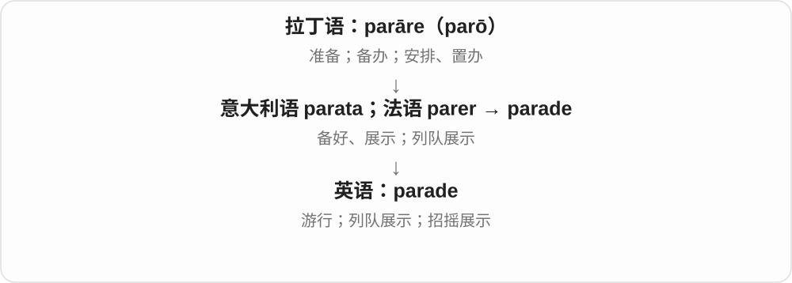

# 2091 · -ade — 动作、活动、结果等罗曼语名词材料

[逐词精讲目录](../00_逐词精讲目录.md) · [总目录](../00_总目录_按常用程度.md)

## 核心词根与来源

英语 -ade 的重要来源是法语 -ade 及其他罗曼语 -ada、-ata 等，对应拉丁语 -ata 等形式。许多词以整词借入英语，不是英语使用者先拿现代英语基础词再拼装。

**-ADE：借进来的活动名、结果名，要连着整词历史看**

一群人列队行进是一场 parade；戴面具聚会是一场 masquerade；木桩连成的围障可以是 palisade 或 stockade。它们的尾部相似，具体画面取决于前面的旧材料。

- **行动、活动与表演**：parade · masquerade · charade · charades · serenade
- **围障与行动结果**：blockade · palisade · stockade
- **建筑外观与饮料**：facade · lemonade

## 词形与演化规律

block → blockade 在英语里容易对应；maschera + -ata → mascherata → masquerade 要回到意大利语、法语；facciata → façade → facade 又经历了不同词形变化。并非所有 -ade 结尾词都属这一路。

## 单词速览（按词族由简到繁）

同一基础词的相关扩展放在一起，先读基础形式，再读扩展；各组之间优先读常用的。具体词源关系见各词讲解。

| 单词 | 音标 | 核心意思 |
|---|---|---|
| [parade](#w-4) | /pəˈreɪd/ | 游行；阅兵式；列队行进；招摇展示 |
| [blockade](#w-1) | 英 /blɒˈkeɪd/；美 /blɑːˈkeɪd/ | 封锁；封锁行动；实施封锁 |
| [lemonade](#w-5) | 英 /ˌlemənˈeɪd/；美 /ˈlemənˌeɪd/ | 柠檬饮料、柠檬水；〔英式常指〕柠檬汽水 |
| [facade](#w-6) | /fəˈsɑːd/ | 建筑正面、外立面；表面假象 |
| [masquerade](#w-7) | /ˌmæskəˈreɪd/ | 假面舞会；伪装、冒充 |
| [serenade](#w-8) | /ˌserəˈneɪd/ | 小夜曲；为某人唱、奏小夜曲 |
| [charade](#w-9) | 英 /ʃəˈrɑːd/；美 /ʃəˈreɪd/ | 装模作样、骗人的把戏；字谜或表演猜词的一轮 |
| [charades](#w-10) | 英 /ʃəˈrɑːdz/；美 /ʃəˈreɪdz/ | 比手画脚猜词游戏 |
| [stockade](#w-2) | 英 /stɒˈkeɪd/；美 /stɑːˈkeɪd/ | 木栅围墙；木栅围起的场地、旧时军牢 |
| [palisade](#w-3) | 英 /ˌpælɪˈseɪd/；美 /ˌpælɪˈseɪd/ | 木栅墙；成排柱状结构 |

## 逐词讲解

### 1. parade — 游行；阅兵式；列队行进；招摇展示

**音标**：/pəˈreɪd/

**先抓住这个画面**

parade 像把人或东西安排整齐，再让大家看见：街上的游行，也包括故意炫耀。

**怎么拆**

经法语 parade，联系 parer“准备、装饰”和意大利 parata；更上游是拉丁 parāre。

**怎么变成今天的意思**

a parade 是一场列队行进或展示；parade one’s wealth 是把财富拿出来显摆。少见的击剑借词 parade /pəˈrɑːd/ 指挡击，与常用游行义读法不同。

**常见搭配与例句**

a street parade；a military parade；parade something in front of others。

> Crowds gathered to watch the parade.

人群聚集起来观看游行。

> He disliked people who paraded their wealth.

他不喜欢那些四处炫富的人。

**别混淆**

procession 强调队伍有序前进；parade 往往还有庆祝、检阅或公开展示的目的。

### 2. blockade — 封锁；封锁行动；实施封锁

**音标**：英 /blɒˈkeɪd/；美 /blɑːˈkeɪd/

**先抓住这个画面**

不是偶然卡了一点，而是有组织地堵住港口、道路或物资进出。

**怎么拆**

block + -ade，形成可能受荷兰语或德语相应封锁词影响，资料对具体类推路径有不同分析。-ade 在这里是名词构形，不要误读成把木块加进饮料。

**怎么变成今天的意思**

**古法语 bloc〔上接日耳曼木块词〕→ 中古英语 blok**  
木块、树桩、整块

↓

**现代 block**  
块、街区；障碍；阻挡、屏蔽等支线

↓

**block + -ade；欧陆同族形式影响 → blockade**  
有组织的阻隔、封锁；后亦作动词

a naval blockade 海上封锁，lift a blockade 解除封锁，blockade a port 封锁港口。

**常见搭配与例句**

a naval blockade；lift a blockade；blockade a port。

> The ships maintained a blockade of the port.

这些船维持着对港口的封锁。

> Negotiators called for the blockade to be lifted.

谈判代表呼吁解除封锁。

**别混淆**

block 泛指阻挡，blockade 常强调系统、有组织的封锁；blockage 更常是管道等发生堵塞。

### 3. lemonade — 柠檬饮料、柠檬水；〔英式常指〕柠檬汽水

**音标**：英 /ˌlemənˈeɪd/；美 /ˈlemənˌeɪd/

**先抓住这个画面**

lemon 的味道被做成饮料，就是 lemonade。美国常让人想到加水、糖的柠檬饮料，英国日常则常指透明柠檬汽水。

**怎么拆**

借法语 limonade，现代可对应 lemon + 饮料名后缀 -ade；词义随地区饮用、商品习惯有差别。

**怎么变成今天的意思**

**波斯、阿拉伯柑橘名称 → 法语 limon**  
柑橘果实；更远源有不同分析

↓

**中古英语 lymon → lemon**  
柠檬、柠檬色

↓

**法语 limonade → lemonade**  
以柠檬味命名的饮料

homemade lemonade 自制柠檬饮料，still lemonade 不含气柠檬饮料，a glass of lemonade 一杯柠檬饮料。

**常见搭配与例句**

a glass of lemonade；homemade lemonade。

> They sold homemade lemonade outside the house.

他们在屋外售卖自制柠檬饮料。

> She poured a glass of lemonade for each guest.

她为每位客人倒了一杯柠檬饮料。

**别混淆**

lemonade 不在所有英语地区都保证无气或同一种配方；看 still、sparkling 等限定最清楚。

### 4. facade — 建筑正面、外立面；表面假象

**音标**：/fəˈsɑːd/

**先抓住这个画面**

建筑朝外给人看的那张脸，叫 facade；人把真实情绪藏住，摆出一张体面的脸，也可以借这个词说表面假象。

**怎么拆**

法语 façade ← 意大利语 facciata，后者从 faccia 正面、脸形成，远接拉丁语 faciēs 脸。末尾与罗曼语 -ata／-ade 材料相连；它是整词借入，不能拆成现代英语 face 直接加一个不变词尾。

**怎么变成今天的意思**

**拉丁语 faciēs → 意大利语 faccia、facciata**  
脸、正面 → 建筑朝外的一面

↓

**法语 façade → 英语 facade／façade**  
建筑立面；借喻给外人看的样子

a stone facade 石质外立面；a facade of confidence 自信的表象。建筑义本身很中性，假象义才暗含外表与实际不同。

**常见搭配与例句**

restore the facade；maintain a facade；behind the facade。

> The old theatre has a beautiful stone facade.

这座老剧院有漂亮的石质外立面。

> Behind his cheerful facade, he was worried about the move.

他表面上很开心，心里却在为搬家担忧。

**别混淆**

front 泛说前面；facade 的建筑义更具体。拼成 façade 时 ç 提醒这里读 /s/，省略这个符号后通常仍读 /s/。

### 5. masquerade — 假面舞会；伪装、冒充

**音标**：/ˌmæskəˈreɪd/

**先抓住这个画面**

舞会上戴面具、穿戏服，让别人看到另一个身份；这个画面延伸出去，就是把自己装成某种人或某种东西。

**怎么拆**

英语名词借自中古法语 mascarade 等，追到意大利语 mascherata = maschera 面具 + -ata。英语动词又从名词形成，伪装义从戴面具的活动扩展。

**怎么变成今天的意思**

**意大利语 maschera + -ata → mascherata**  
与面具、化装有关的活动

↓

**中古法语相关形式 → 英语 masquerade**  
假面舞会 → 伪装、冒充的名词和动词

a masquerade ball 假面舞会；masquerade as an expert 冒充专家。as 后接所冒充的身份。

**常见搭配与例句**

attend a masquerade；masquerade as。

> They wore elaborate masks to the masquerade.

他们戴着精致的面具参加假面舞会。

> The advertisement masqueraded as an independent review.

那则广告伪装成了一篇独立评测。

**别混淆**

disguise 泛说掩饰身份、外观；masquerade as 更突出以另一个身份或名目出现，常带欺骗意味。

### 6. serenade — 小夜曲；为某人唱、奏小夜曲

**音标**：/ˌserəˈneɪd/

**先抓住这个画面**

想象一个人在窗下弹琴唱歌，把音乐送给窗边的人；后来 serenade 也可泛说对着某人演唱，不限定真的在夜里。

**怎么拆**

经法语 sérénade 借自意大利语 serenata，与 sereno 晴朗、宁静及露天的用法相连，远接拉丁语 serenus。夜晚演唱的意义又受到意大利语 sera 夜晚影响；英语动词从名词形成。

**怎么变成今天的意思**

**拉丁语 serenus → 意大利语相关材料、serenata**  
晴朗、宁静；露天音乐活动，夜晚义受 sera 影响

↓

**法语 sérénade → 英语 serenade**  
小夜曲、相应器乐曲；为某人演唱

a serenade for strings 弦乐小夜曲；serenade someone with a song 用歌为某人助兴。曲种名称不表示每次演出都必须在窗下。

**常见搭配与例句**

play a serenade；serenade the guests。

> The orchestra played a gentle serenade.

乐团演奏了一首轻柔的小夜曲。

> The musicians serenaded the guests during dinner.

晚餐时，乐手们为宾客演奏助兴。

**别混淆**

serene 和 serenade 有相关的拉丁语材料，但不能据此把英语 serenade 硬说成 serene 直接加 -ade。

### 7. charade — 装模作样、骗人的把戏；字谜或表演猜词的一轮

**音标**：英 /ʃəˈrɑːd/；美 /ʃəˈreɪd/

**先抓住这个画面**

看起来大家在认真做一件事，实际只是演给人看的，你就可能把它叫 a charade。它也与靠文字或表演猜词的游戏相连。

**怎么拆**

借自法语 charade，早有闲聊、字谜等义，可能来自奥克语 charrada 谈话，取 charrar 聊天 + -ada。英语里的表演猜词，再带出装样子、虚假表演的引申。

**怎么变成今天的意思**

**可能的奥克语 charrar + -ada → 法语 charade**  
闲聊、话语以及一种字谜

↓

**英语 charade 的游戏和比喻义**  
猜词表演；装模作样、虚假安排

a complete charade 完全是做戏；keep up the charade 继续装下去。说表演猜词游戏整体时，常用固定复数形式 charades。

**常见搭配与例句**

a pointless charade；end the charade。

> The meeting was a charade; the decision had already been made.

那场会议只是走过场，决定早就做好了。

> She was tired of keeping up the charade of being happy.

她厌倦了继续装出开心的样子。

**别混淆**

a charade 常在质疑某事的真实性；charades 作游戏名时是普通娱乐活动，语气不含这种批评。

### 8. charades — 比手画脚猜词游戏

**音标**：英 /ʃəˈrɑːdz/；美 /ʃəˈreɪdz/

**先抓住这个画面**

一个人用动作演，其他人猜他在演哪个词、书名或片名；说这整种游戏，英语常用带 s 的 charades。

**怎么拆**

与 charade 字谜、猜词表演相连，游戏名由 acting charades 等说法缩短、固定下来。这里的复数形式已经成为游戏名称，不必理解成正在逐个数几个骗局。

**怎么变成今天的意思**

**charade 的字谜、表演猜词用法**  
用语言线索或动作让别人猜

↓

**acting charades 等缩短 → charades**  
固定用作整种猜词游戏的名称

play charades 玩比手画脚猜词；a game of charades 一局这种游戏。s 保留，末尾读 /dz/。

**常见搭配与例句**

an evening of charades；a round of charades。

> We played charades after dinner.

晚饭后我们玩了比手画脚猜词游戏。

> In charades, she acted out a film title without speaking.

玩猜词游戏时，她一声不吭地表演了一个电影名。

**别混淆**

普通复数 charades 也可能在特定上下文数几场做戏；play charades 这一搭配一般直接指游戏。

### 9. stockade — 木栅围墙；木栅围起的场地、旧时军牢

**音标**：英 /stɒˈkeɪd/；美 /stɑːˈkeɪd/

**先抓住这个画面**

把一根根粗木桩竖起来，连成一道围墙，围住里面的营地，就是 stockade 的基本画面。

**怎么拆**

借入罗曼语的木桩围障名称：有西班牙语 estacada、法语 estocade 等路线的分析；材料中的 estaca 等指木桩，英语形式又可与熟悉的 stock 联系。不能把现代股票 stock 的意思套进去。

**怎么变成今天的意思**

**罗曼语的木桩围障名称**  
西班牙语 estacada、法语 estocade 等相关形式

↓

**英语 stockade**  
木桩栅墙；围住的营地，后来也指军牢

a wooden stockade 木栅围墙；inside the stockade 在栅墙内。后来的军牢义借的是这种围起来看守的场地。

**常见搭配与例句**

build a stockade；a stockade around the camp。

> A wooden stockade surrounded the camp.

营地四周围着一道木栅墙。

> The visitors entered the reconstructed stockade.

游客走进了重建的木栅围寨。

**别混淆**

fence 范围很广；stockade 常让人想到密排、结实的木桩防护墙。

### 10. palisade — 木栅墙；成排柱状结构

**音标**：英 /ˌpælɪˈseɪd/；美 /ˌpælɪˈseɪd/

**先抓住这个画面**

很多根桩紧挨着站成一排，就像一堵由木头组成的防护墙。

**怎么拆**

法语 palissade 经古奥克语 palissada、palissa 等追到拉丁语 palus。它是借来的整个名词，不是现代英语 pale 加一个随意的 -sade。

**怎么变成今天的意思**

**拉丁语 palus**  
木桩、支柱

↓

**高卢罗曼语 \*palicea；古奥克语 palissa、palissada**  
木桩、桩篱

↓

**法语 palissade → 英语 palisade**  
木栅围墙；成排柱状结构

历史中的 palisade 常是防御木栅。岩壁或细胞排列像一排柱子，也可借用这个形象，如 palisade cells。动词可表示用木栅围住。

**常见搭配与例句**

a wooden palisade；a defensive palisade；palisade cells。

> A wooden palisade surrounded the settlement.

一道木栅墙围着那片聚居地。

> The diagram shows a row of elongated palisade cells in the leaf.

图中显示了叶片内一排细长的栅栏细胞。

**别混淆**

fence 是围栏泛称；palisade 特别突出一根根竖桩或相似的整齐柱状排列。

## 这一组要分清什么

decade 的历史走希腊语十的材料，不能只看最后三个字母就塞进来。charade、serenade 的英美读音也不完全依同一个词尾规则。

## 串起来练习

The masquerade began with a parade in front of the old stone facade.

假面舞会以老石建筑正面的一场游行开场。
