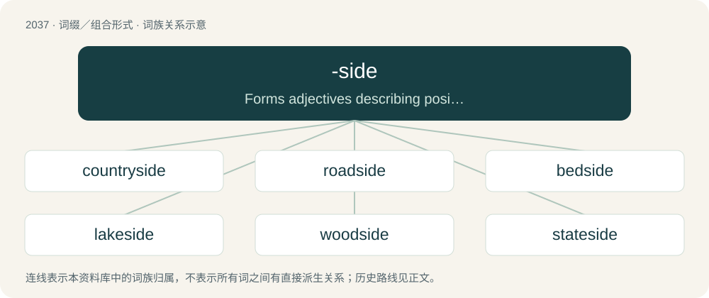

# 2146 · -side — Forms adjectives describing position next to or alongside an object.

[总目录](../00_总目录_按常用程度.md)

**类型**：词缀／组合形式　｜　**来源语言**：见词源记录

## 核心含义与来源

- 核心含义：Forms adjectives describing position next to or alongside an object.
- 英文含义：Forms adjectives describing position next to or alongside an object.
- 词形：-side

**来源记录 1**（后缀／后置成分；Forms adjectives describing position next to or alongside an object.）

From side.

## 词族图

## 单词速览（常用到不常用）

| 单词 | 音标 | 释义 |
|---|---|---|
| [countryside](#w-1) | 英 /ˈkʌn.tɹiˌsaɪd/ | n. 乡下地方, 乡下居民 |
| [roadside](#w-2) | 英 /ˈɹəʊdsaɪd/；美 /ˈɹoʊdsaɪd/ | n. 路旁, 路边；a. 路边的 |
| [bedside](#w-3) | /ˈbɛdˌsaɪd/ | n. 床边；a. 床边的, 临床的 |
| [lakeside](#w-4) | 美 /ˈleɪkˌsaɪd/ | n. 湖边 |
| [woodside](#w-5) |  | 【英文】The side of a wood; the land that borders a wood. |
| [stateside](#w-6) |  | a. 大陆美国的, 美国国内的；adv. 在大陆美国 |
| [poolside](#w-7) | /ˈpuːlsaid/ | n. 游泳池边 ；a. 在游泳池边的 |
| [ringside](#w-8) |  | a. 紧靠比赛场的；n. \[the\]比赛场的外围, 比赛场的前缘 |
| [oceanside](#w-9) |  | 【英文】Located on the coast of an ocean. |
| [waterside](#w-10) |  | n. 水边, 海滨, 湖滨, 河滨 |
| [courtside](#w-11) | /ˈkɔːtsaid/ | n. (网球等的)球场边缘区 |
| [curbside](#w-12) | /ˈk\\\\ːbsaid/ | n. 靠近路缘的人行道部分,路边 |
| [dockside](#w-13) | /ˈdɔksaid/ | a. 码头前沿的 |
| [graveside](#w-14) | /ˈ^reivsaid/ | n. 坟墓边 |
| [trackside](#w-15) | /ˈtræksaid/ | \[铁\]n.轨道旁,线路旁 |
| [surfside](#w-16) |  | \[地名\] \[美国\] 瑟夫赛德 |

## 逐词详解

### 1. countryside

**词性**：名词　｜　**音标**：英 /ˈkʌn.tɹiˌsaɪd/

**中文释义**：n. 乡下地方, 乡下居民

**英文义项**：An area located outside of towns and cities; an area that is not urban or suburban; a rural area. / Such part of a larger area.

**构词拆分**：country + -side

**词源与演化**：

From country + -side.

**例句**：

> We live in the Swedish countryside.

该用例对应义项：Such part of a larger area.

### 2. roadside

**词性**：形容词　｜　**音标**：英 /ˈɹəʊdsaɪd/；美 /ˈɹoʊdsaɪd/

**中文释义**：n. 路旁, 路边；a. 路边的

**英文义项**：Located beside a road (or railway).

**构词拆分**：road + -side

**词源与演化**：

From road + -side.

**例句**：

> The roadside stand did a good business just selling products to people who merely wanted directions.

该用例对应义项：Located beside a road (or railway).

### 3. bedside

**词性**：名词　｜　**音标**：/ˈbɛdˌsaɪd/

**中文释义**：n. 床边；a. 床边的, 临床的

**英文义项**：A position at the side of one's bed. / Any of the side panels of the bed of a truck.

**构词拆分**：bed + -side

**词源与演化**：

From Middle English bedsyde, bedde syde (also as beddes side, beddes syde), equivalent to bed + -side. Compare German Bettseite (“bedside”).

**例句**：

> The doctor stood at her bedside.

该用例对应义项：space by the side of a bed (especially the bed of a sick or dying person)

### 4. lakeside

**词性**：名词　｜　**音标**：美 /ˈleɪkˌsaɪd/

**中文释义**：n. 湖边

**英文义项**：The ground near the edge of a lake; the land adjacent to a lake.

**构词拆分**：lake + -side

**词源与演化**：

From lake + -side.

**例句**：

> We put up at a lakeside hotel for the night.

### 5. woodside

**词性**：名词

**英文义项**：The side of a wood; the land that borders a wood.

**构词拆分**：wood + -side

**词源与演化**：

From wood + -side.

### 6. stateside

**词性**：形容词

**中文释义**：a. 大陆美国的, 美国国内的；adv. 在大陆美国

**英文义项**：In the United States. / In the 48 contiguous states.

**构词拆分**：state + -side

**词源与演化**：

From state + -side.

**例句**：

> They made their stateside debut in the late 1970s.

该用例对应义项：In the United States.

### 7. poolside

**词性**：形容词　｜　**音标**：/ˈpuːlsaid/

**中文释义**：n. 游泳池边 ；a. 在游泳池边的

**英文义项**：By the side of a pool.

**构词拆分**：pool + -side

**词源与演化**：

From pool + -side.

**例句**：

> She was sunbathing on the poolside deckchair.

该用例对应义项：By the side of a pool.

### 8. ringside

**词性**：形容词

**中文释义**：a. 紧靠比赛场的；n. \[the\]比赛场的外围, 比赛场的前缘

**英文义项**：Beside the ring, especially a boxing ring.

**构词拆分**：ring + -side

**词源与演化**：

From ring + -side.

**例句**：

> We got our hands on a pair of ringside tickets for the boxing match.

该用例对应义项：Beside the ring, especially a boxing ring.

### 9. oceanside

**词性**：形容词

**英文义项**：Located on the coast of an ocean.

**构词拆分**：ocean + -side

**词源与演化**：

From ocean + -side.

**例句**：

> We stayed in an oceanside hotel and ate fresh seafood every night, all week long.

该用例对应义项：Located on the coast of an ocean.

### 10. waterside

**词性**：名词

**中文释义**：n. 水边, 海滨, 湖滨, 河滨

**英文义项**：The land bordering a body of water.

**构词拆分**：water + -side

**词源与演化**：

From Middle English water-syde, water side, equivalent to water + -side.

**例句**：

> The upper parts of town enjoy a lovely view across the waterside and harbour to the sparkling bay.

### 11. courtside

**词性**：形容词　｜　**音标**：/ˈkɔːtsaid/

**中文释义**：n. (网球等的)球场边缘区

**英文义项**：Located next to the court of play.

**构词拆分**：court + -side

**词源与演化**：

From court + -side.

**例句**：

> They had courtside seats.

该用例对应义项：Located next to the court of play.

### 12. curbside

**词性**：形容词　｜　**音标**：/ˈk\\\\ːbsaid/

**中文释义**：n. 靠近路缘的人行道部分,路边

**英文义项**：Adjacent to the curb.

**构词拆分**：curb + -side

**词源与演化**：

From curb + -side.

**例句**：

> Airlines now often limit curbside check-in to select passengers.

该用例对应义项：Adjacent to the curb.

### 13. dockside

**词性**：名词　｜　**音标**：/ˈdɔksaid/

**中文释义**：a. 码头前沿的

**英文义项**：The area near a dock, or next to a docked ship.

**构词拆分**：dock + -side

**词源与演化**：

From dock + -side.

### 14. graveside

**词性**：名词　｜　**音标**：/ˈ^reivsaid/

**中文释义**：n. 坟墓边

**英文义项**：The area immediately around a grave.

**构词拆分**：grave + -side

**词源与演化**：

From grave + -side.

**例句**：

> There are a lot of graveside candles in the cemetery.

### 15. trackside

**词性**：形容词　｜　**音标**：/ˈtræksaid/

**中文释义**：\[铁\]n.轨道旁,线路旁

**英文义项**：Located to the side of a track, especially a racetrack or set of railroad tracks.

**构词拆分**：track + -side

**词源与演化**：

From track + -side.

### 16. surfside

**词性**：形容词

**中文释义**：\[地名\] \[美国\] 瑟夫赛德

**英文义项**：Beside the sea.

**构词拆分**：surf + -side

**词源与演化**：

From surf + -side.

**例句**：

> The 12-story condominium building in Surfside, Florida, north of Miami, partially collapsed without warning early on June 24.
