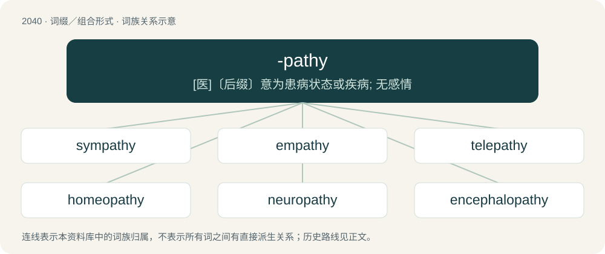

# 2149 · -pathy — \[医\]〔后缀〕意为患病状态或疾病; 无感情

[总目录](../00_总目录_按常用程度.md)

**类型**：词缀／组合形式　｜　**来源语言**：见词源记录

## 核心含义与来源

- 核心含义：\[医\]〔后缀〕意为患病状态或疾病; 无感情
- 英文含义：suffering, feeling, emotion
- 词形：-pathy

**来源记录 1**（后缀／后置成分；suffering, feeling, emotion）

From Ancient Greek πᾰ́θος (pắthos, “suffering”) + English -y.

## 词族图

## 单词速览（常用到不常用）

| 单词 | 音标 | 释义 |
|---|---|---|
| [sympathy](#w-1) | 英 /ˈsɪm.pə.θi/ | n. 同情, 赞同, 怜悯, 慰问, 吊唁；\[医\] 交感\[作用\], 同感\[作用\], 感应, 同情 |
| [empathy](#w-2) | /ˈɛmpəθi/ | n. 移情作用, 共鸣；\[医\] 移情, 神入 |
| [telepathy](#w-3) | /tɛˈlɛp.ə.θi/ | n. 传心(术), 通灵(术), 传心(或通灵)能力；\[医\] 思想交通, 思想感应, 传心 |
| [homeopathy](#w-4) | 英 /ˌhəʊmɪˈɒpəθi/；美 /ˌhoʊmiˈɑpəθi/ | n. 顺势疗法；\[医\] 顺势疗法 |
| [neuropathy](#w-5) | /ˌnjuːˈrɒ.pə.θiː/ | n. 神经病；\[医\] 神经病 |
| [encephalopathy](#w-6) | /ɛnˌsɛfəˈlɒpəθi/ | n. 脑病；\[医\] 脑病 |
| [psychopathy](#w-7) | 英 /saɪˈkɒpəθi/；美 /saɪˈkɑpəθi/ | n. 精神病, 精神变态, 精神疗法；\[医\] 精神变态, 变态人格, 病态人格 |
| [retinopathy](#w-8) | /ˌɹɛtɪnˈɑːpəθi/ | \[医\] 视网膜病 |
| [nephropathy](#w-9) | /niˈfrɔpəθi/ | \[医\] 肾病 |
| [osteopathy](#w-10) | /.ɒstiˈɒpəθi/ | n. 整骨术；\[医\] 骨病, 按骨术, 整骨术 |
| [myopathy](#w-11) | /maiˈɔpəθi/ | n. 肌病；\[医\] 肌病 |

## 逐词详解

### 1. sympathy

**词性**：名词　｜　**音标**：英 /ˈsɪm.pə.θi/

**中文释义**：n. 同情, 赞同, 怜悯, 慰问, 吊唁；\[医\] 交感\[作用\], 同感\[作用\], 感应, 同情

**英文义项**：A feeling of pity or sorrow for the suffering or distress of another. / The formal expression of pity or sorrow for someone else's misfortune.

**构词拆分**：sym- (“acting or considered together”) + -pathy (“feeling”)

**词源与演化**：

Borrowed from Middle French sympathie, from Late Latin sympathīa (“feeling in common”), from Ancient Greek σῠμπᾰ́θειᾰ (sŭmpắtheiă, “fellow feeling”), from σῠμπᾰθής (sŭmpăthḗs, “affected by like feelings; exerting mutual influence, interacting”) + -ῐᾰ (-ĭă, “-y”, nominal suffix). Equivalent to sym- (“acting or considered together”) + -pathy (“feeling”).

**例句**：

> The mayor expressed his sympathy to all the families of the victims.

### 2. empathy

**词性**：名词　｜　**音标**：/ˈɛmpəθi/

**中文释义**：n. 移情作用, 共鸣；\[医\] 移情, 神入

**英文义项**：Identification with or understanding of the thoughts, feelings, or emotional state of another person. / The capacity to understand another person's point of view or the result of such understanding.

**构词拆分**：em- + -pathy

**词源与演化**：

A twentieth-century borrowing from Ancient Greek ἐμπάθεια (empátheia, literally “passion”) (formed from ἐν (en, “in, at”) + πάθος (páthos, “feeling”)), equivalent to em- + -pathy, coined by Edward Bradford Titchener in 1909 to translate German Einfühlung. The modern word in Greek εμπάθεια (empátheia) has an opposite meaning denoting strong negative feelings and prejudice against someone.

**例句**：

> She had a lot of empathy for her neighbor; she knew what it was like to lose a parent too.

该用例对应义项：Identification with or understanding of the thoughts, feelings, or emotional state of another person.

### 3. telepathy

**词性**：名词　｜　**音标**：/tɛˈlɛp.ə.θi/

**中文释义**：n. 传心(术), 通灵(术), 传心(或通灵)能力；\[医\] 思想交通, 思想感应, 传心

**英文义项**：The capability to communicate directly by psychic means; the sympathetic affection of one mind by the thoughts, feelings, or emotions of another at a distance, without communication through the ordinary channels of sensation.

**构词拆分**：tele- + -pathy

**词源与演化**：

From tele- + -pathy.

**例句**：

> Tom can't use telepathy on people he hasn't met in person.

### 4. homeopathy

**词性**：名词　｜　**音标**：英 /ˌhəʊmɪˈɒpəθi/；美 /ˌhoʊmiˈɑpəθi/

**中文释义**：n. 顺势疗法；\[医\] 顺势疗法

**英文义项**：A system of treating diseases with small amounts of substances which, in larger amounts, would produce the observed symptoms.

**构词拆分**：homeo- + -pathy

**词源与演化**：

From German Homöopathie, equivalent to English homeo- + -pathy.

**例句**：

> Homeopathy is considered a pseudoscience and is no more effective than placebos.

### 5. neuropathy

**词性**：名词　｜　**音标**：/ˌnjuːˈrɒ.pə.θiː/

**中文释义**：n. 神经病；\[医\] 神经病

**英文义项**：Any disease of the peripheral nervous system; peripheral neuropathy. / Any disease of the nerves and nervous system, usually and more specifically the peripheral nervous system, thus including both non-neuraxial and neuraxial instances of neural damage or dysfunction but excluding the neuraxis's psychiatric aspects (mental illnesses).

**构词拆分**：neuro- + -pathy

**词源与演化**：

From neuro- + -pathy.

**例句**：

> Long-standing diabetes often causes neuropathy in the retinas, fingertips, and toes.

该用例对应义项：Any disease of the peripheral nervous system; peripheral neuropathy.

### 6. encephalopathy

**词性**：名词　｜　**音标**：/ɛnˌsɛfəˈlɒpəθi/

**中文释义**：n. 脑病；\[医\] 脑病

**英文义项**：Any of various conditions affecting the brain.

**构词拆分**：encephalo- + -pathy

**词源与演化**：

From encephalo- + -pathy.

### 7. psychopathy

**词性**：名词　｜　**音标**：英 /saɪˈkɒpəθi/；美 /saɪˈkɑpəθi/

**中文释义**：n. 精神病, 精神变态, 精神疗法；\[医\] 精神变态, 变态人格, 病态人格

**英文义项**：A personality disorder characterized by impaired empathy and remorse, and bold, disinhibited, and egocentric traits masked by superficial charm and the outward presence of apparent normality. Violent and criminal offenses may be indicative of this disorder. / A mental illness; insanity.

**构词拆分**：psycho- + -pathy

**词源与演化**：

From psycho- + -pathy.

**例句**：

> Tinder is cultivating psychopathy in young people.

### 8. retinopathy

**词性**：名词　｜　**音标**：/ˌɹɛtɪnˈɑːpəθi/

**中文释义**：\[医\] 视网膜病

**英文义项**：Non-inflammatory disease of the retina.

**构词拆分**：retino- + -pathy

**词源与演化**：

From retino- + -pathy.

### 9. nephropathy

**词性**：名词　｜　**音标**：/niˈfrɔpəθi/

**中文释义**：\[医\] 肾病

**英文义项**：Damage to, disease of, or abnormality of the kidneys.

**构词拆分**：nephro- + -pathy

**词源与演化**：

From nephro- + -pathy.

### 10. osteopathy

**词性**：名词　｜　**音标**：/.ɒstiˈɒpəθi/

**中文释义**：n. 整骨术；\[医\] 骨病, 按骨术, 整骨术

**英文义项**：The branch of therapy based on manipulation of bones and muscles. / Any disease of the bones.

**构词拆分**：osteo- + -pathy

**词源与演化**：

From osteo- + -pathy.

### 11. myopathy

**词性**：名词　｜　**音标**：/maiˈɔpəθi/

**中文释义**：n. 肌病；\[医\] 肌病

**英文义项**：Any of several diseases of muscle that are not caused by nerve disorders

**构词拆分**：myo- + -pathy

**词源与演化**：

From myo- + -pathy.
