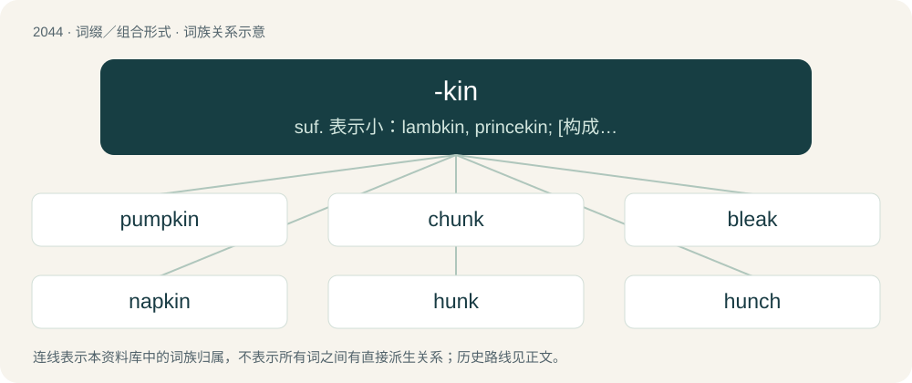

# 2154 · -kin — suf. 表示小：lambkin, princekin; \[构成姓氏\]：Peterkin

[总目录](../00_总目录_按常用程度.md)

**类型**：词缀／组合形式　｜　**来源语言**：见词源记录

## 核心含义与来源

- 核心含义：suf. 表示小：lambkin, princekin; \[构成姓氏\]：Peterkin
- 英文含义：Used to form adjectives expressing resemblance or likeness to, similar to -like.
- 词形：-kin

**来源记录 1**（后缀／后置成分；Used to form adjectives expressing resemblance or likeness to, similar to -like.）

From Middle English -kin, -kinne, -kunne, from Old English cynna, the genitive plural of cynn (“kind, sort, rank”), used in compounds.

## 词族图

## 单词速览（常用到不常用）

| 单词 | 音标 | 释义 |
|---|---|---|
| [pumpkin](#w-1) | 英 /ˈpʌmpkɪn/；美 /ˈpʌm(p).kɪn/ | n. 南瓜 |
| [chunk](#w-2) | /t͡ʃʌŋk/ | n. 大块, 矮胖的人(或物)；\[经\] 定样 |
| [bleak](#w-3) | /bliːk/ | 【英文】A small European river fish (Alburnus alburnus), of the family Cyprinidae. |
| [napkin](#w-4) | /ˈnæpˌkɪn/ | n. 餐巾, 餐巾纸, 尿布 |
| [hunk](#w-5) | 英 /hʌŋk/ | n. 大块；a. 行的, 好的 |
| [hunch](#w-6) | /hʌnt͡ʃ/ | n. 肉峰, 预感, 大块；vt. 弯腰驼背, 预感到, 耸肩；vi. 向前移动, 隆起 |
| [malkin](#w-7) | /ˈmɔːlkɪn/ | n. 邋遢女人 |
| [munchkin](#w-8) | 英 /ˈmʌnʃkɪn/；美 /ˈmʌnt͡ʃkɪn/ | n. 小巧玲珑的人, 忙个不停的人 |
| [bumpkin](#w-9) | /ˈbʌmpkɪn/ | n. 乡下人, 土佬儿 |
| [bodkin](#w-10) | /ˈbɒdkɪn/ | n. 大眼粗针, 锥子 |
| [merkin](#w-11) | 英 /ˈmɜːkɪn/ | \[人名\] 默金 |

## 逐词详解

### 1. pumpkin

**词性**：名词　｜　**音标**：英 /ˈpʌmpkɪn/；美 /ˈpʌm(p).kɪn/

**中文释义**：n. 南瓜

**英文义项**：A domesticated plant, in species Cucurbita pepo, similar in growth pattern, foliage, flower, and fruit to the squash or melon. / The round yellow or orange fruit of this plant.

**词源与演化**：

Alteration of pompion, pumpion (“pumpkin”) with the diminutive -kin, from Middle French pompon, from Latin pepō (whence English pepo), from Ancient Greek πέπων (pépōn, “large melon”), from πέπων (pépōn, “ripe”), from πέπτω (péptō, “ripen”). The first attestation is from 1647. The alternative theory that it may be from Massachusett pôhpukun (“grows forth round”) is false. The automotive sense is by fancied resemblance.

**例句**：

> Pie pumpkins are made into a purée and used for pumpkin pie.

### 2. chunk

**词性**：名词　｜　**音标**：/t͡ʃʌŋk/

**中文释义**：n. 大块, 矮胖的人(或物)；\[经\] 定样

**英文义项**：A part of something that has been separated; a generally squat, thick, irregular piece of something, e.g. wood or stone. / A large or substantial portion of something.

**词源与演化**：

Variant of chuck; or alternatively a diminutive of chump (“chunk; block”) + \*-k (diminutive suffix) (compare hunk from hump, etc.). Also compare Dutch schonk.

**例句**：

> The statue broke into chunks.

该用例对应义项：A part of something that has been separated; a generally squat, thick, irregular piece of something, e.g. wood or stone.

### 3. bleak

**词性**：名词　｜　**音标**：/bliːk/

**英文义项**：A small European river fish (Alburnus alburnus), of the family Cyprinidae.

**构词拆分**：blay + -ock；blay + -kin

**词源与演化**：

From Middle English bleke (“small river fish, bleak, blay”), perhaps an alteration (due to Old English blǣc (“bright”) or Old Norse bleikja) of Old English blǣġe (“bleak, blay, gudgeon”); or perhaps from a diminutive of Middle English \*bleye (“blay”), equivalent to blay + -ock or blay + -kin. See blay.

### 4. napkin

**词性**：名词　｜　**音标**：/ˈnæpˌkɪn/

**中文释义**：n. 餐巾, 餐巾纸, 尿布

**英文义项**：A serviette; a (usually rectangular) piece of cloth or paper used at the table for wiping the mouth and hands for cleanliness while eating. / A nappy (UK), a diaper (American).

**构词拆分**：nape (“cloth”) + -kin (diminutive suffix)

**词源与演化**：

From Middle English napekyn, napkyn, equivalent to nape (“cloth”) + -kin (diminutive suffix).

**例句**：

> Tom wrote his number on a napkin and handed it to Mary.

### 5. hunk

**词性**：名词　｜　**音标**：英 /hʌŋk/

**中文释义**：n. 大块；a. 行的, 好的

**英文义项**：A large or dense piece of something. / An attractive man, especially one who is muscular.

**构词拆分**：hump + -kin

**词源与演化**：

Probably borrowed from West Flemish hunke (“hunk; chunk”), of obscure origin. Probably from an earlier \*humke, \*humpke, a diminutive related to Dutch homp (“hunk; lump”), English hump, equivalent to hump + -kin. The sense of an attractive man is recorded in Australian slang in 1941, in jive talk in 1945.

**用法示例／搭配（非完整句）**：

> a hunk of metal

该用例对应义项：A large or dense piece of something.

### 6. hunch

**词性**：名词　｜　**音标**：/hʌnt͡ʃ/

**中文释义**：n. 肉峰, 预感, 大块；vt. 弯腰驼背, 预感到, 耸肩；vi. 向前移动, 隆起

**英文义项**：A hump; a protuberance. / A stooped or curled posture; a slouch.

**构词拆分**：hump + -kin

**词源与演化**：

Assibilated variant of hunk, of uncertain origin. Alternatively, a derivative of hump, via an earlier Middle English \*hunche, \*humpchin, from \*hump + -chin, -chen (diminutive suffix), equivalent to hump + -kin. In the sense of an intuitive impression, said to be from the old gambling superstition that it brings luck to touch the hump of a hunchback.

**例句**：

> I have a hunch they'll find a way to solve the problem.

该用例对应义项：A theory, idea, or guess; an intuitive impression that something will happen.

### 7. malkin

**词性**：名词　｜　**音标**：/ˈmɔːlkɪn/

**中文释义**：n. 邋遢女人

**英文义项**：A mop, especially one used to clean a baker's oven. / A hare.

**词源与演化**：

From Malde, an early form of Maude or Matilda + -kin (diminutive ending). Compare grimalkin.

### 8. munchkin

**词性**：名词　｜　**音标**：英 /ˈmʌnʃkɪn/；美 /ˈmʌnt͡ʃkɪn/

**中文释义**：n. 小巧玲珑的人, 忙个不停的人

**英文义项**：A child. / A person of very short stature.

**构词拆分**：munch + -kin

**词源与演化**：

Coined by American author L. Frank Baum in 1900 in his novel The Wonderful Wizard of Oz. Perhaps reflective of German Mensch or munch + -kin. Compare Low German Menschken and Low German Minschken. Sense 5 (“donut hole”) is a genericization of the Dunkin' trademark "Munchkins".

**例句**：

> Turn off the TV if you're not using it, my little munchkin.

### 9. bumpkin

**词性**：名词　｜　**音标**：/ˈbʌmpkɪn/

**中文释义**：n. 乡下人, 土佬儿

**英文义项**：A clumsy, unsophisticated person; a yokel. / A short boom or spar used to extend a sail or secure a stay.

**构词拆分**：boom + -kin

**词源与演化**：

From Dutch boomken (“shrub, little tree”), equivalent to boom + -kin. Note that the English word boom is etymologically related to the aforementioned in the sense of "large stem", or "big tree". Compare German Baumke, Bäumchen.

**例句**：

> The little bumpkin bought a big pumpkin.

### 10. bodkin

**词性**：名词　｜　**音标**：/ˈbɒdkɪn/

**中文释义**：n. 大眼粗针, 锥子

**英文义项**：A small sharp pointed tool for making holes in cloth or leather. / A blunt needle used for threading ribbon or cord through a hem or casing.

**词源与演化**：

From Middle English boydekin (“dagger”), apparently from \*boyde, \*boide (of unknown \[Celtic?\] origin) + -kin. Cognate with Scots botkin, boitkin, boikin (“bodkin”).

### 11. merkin

**词性**：名词　｜　**音标**：英 /ˈmɜːkɪn/

**中文释义**：\[人名\] 默金

**英文义项**：A woman's pubic wig. Worn for nude stage appearances and by women, originally after shaving their pubic hair to eliminate lice or for other reasons, now often as a fashion item. / A mop for cleaning cannon.

**构词拆分**：Malde + -kin

**词源与演化**：

First attested in 1617, probably a variant form of malkin, from Malde + -kin.
