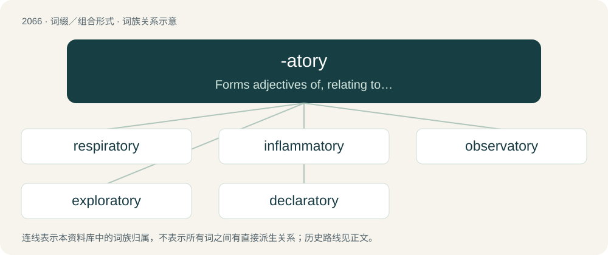

# 2170 · -atory — Forms adjectives of, relating to, or connected with the thing specified

[总目录](../00_总目录_按常用程度.md)

**类型**：词缀／组合形式　｜　**来源语言**：见词源记录

## 核心含义与来源

- 核心含义：Forms adjectives of, relating to, or connected with the thing specified
- 英文含义：Forms adjectives of, relating to, or connected with the thing specified
- 词形：-atory

**多个词源／构词路径**：同一拼写可能有不同来源；以下按词性和含义分别列出。

**来源记录 1**（后缀／后置成分；Forms adjectives of, relating to, or connected with the thing specified）

Borrowed from Latin -atorius. By surface analysis, -ate + -ory.

**来源记录 2**（后缀／后置成分；Forms nouns that represent things or places where a specified activity takes place）

Borrowed from Latin -atorium (neuter of -atorius). By surface analysis, -ate + -ory.

## 词族图

## 单词速览（常用到不常用）

| 单词 | 音标 | 释义 |
|---|---|---|
| [respiratory](#w-1) | 英 /ɹɪˈspɪ.ɹət.ə.ɹi/；美 /ˈɹɛs.pəɹ.əˌtɔɹ.i/ | a. 呼吸的；\[医\] 呼吸的 |
| [inflammatory](#w-2) | 英 /ɪnˈflæmət(ə)ɹi/；/ɪnˈflæməˌtoɹi/ | a. 激动的, 煽动的, 炎症性的；\[医\] 炎的, 炎性的 |
| [observatory](#w-3) | 英 /əbˈzɜːvət(ə)ɹi/；美 /əbˈzɝvətɔɹi/ | n. 天文台, 气象台, 了望台 |
| [exploratory](#w-4) | 英 /ɛkˈsplɒɹ.ə.tə.ɹi/；美 /ɛkˈsploɹ.əˌtoɹ.i/ | a. 探究, 探查, 探察(伤处), 探险, 探测, 勘探, 考察, 钻研, 探索；\[医\] 探察的 |
| [declaratory](#w-5) | 英 /dɛˈklæɹətɹi/ | a. 宣言的；公布的 |

## 逐词详解

### 1. respiratory

**词性**：形容词　｜　**音标**：英 /ɹɪˈspɪ.ɹət.ə.ɹi/；美 /ˈɹɛs.pəɹ.əˌtɔɹ.i/

**中文释义**：a. 呼吸的；\[医\] 呼吸的

**英文义项**：Relating to respiration or the organs of respiration; breathing.

**构词拆分**：respire + -atory

**词源与演化**：

Borrowed from New Latin respīrātōrius, equal to respire + -atory.

**例句**：

> The respiratory therapist administered breathing treatments every six hours, per the doctor's orders.

### 2. inflammatory

**词性**：形容词　｜　**音标**：英 /ɪnˈflæmət(ə)ɹi/；/ɪnˈflæməˌtoɹi/

**中文释义**：a. 激动的, 煽动的, 炎症性的；\[医\] 炎的, 炎性的

**英文义项**：Tending to inflame or provoke somebody. / Relating to, causing, or caused by inflammation.

**构词拆分**：inflame + -atory

**词源与演化**：

From inflame + -atory.

**例句**：

> Sam posted an inflammatory comment to the newsgroup.

该用例对应义项：Tending to inflame or provoke somebody.

### 3. observatory

**词性**：名词　｜　**音标**：英 /əbˈzɜːvət(ə)ɹi/；美 /əbˈzɝvətɔɹi/

**中文释义**：n. 天文台, 气象台, 了望台

**英文义项**：A place where stars, planets and other celestial bodies are observed, usually through a telescope; also place for observing meteorological or other natural phenomena. / A lookout (vantage point with a view of the surrounding area)

**构词拆分**：observe + -atory

**词源与演化**：

Borrowed from French observatoire, equivalent to observe + -atory.

**例句**：

> While living on his island, Brahe built a castle and an observatory.

### 4. exploratory

**词性**：形容词　｜　**音标**：英 /ɛkˈsplɒɹ.ə.tə.ɹi/；美 /ɛkˈsploɹ.əˌtoɹ.i/

**中文释义**：a. 探究, 探查, 探察(伤处), 探险, 探测, 勘探, 考察, 钻研, 探索；\[医\] 探察的

**英文义项**：Serving to explore or investigate.

**构词拆分**：explore + -atory

**词源与演化**：

From explore + -atory.

**例句**：

> Digging an exploratory well in the Gulf of Mexico.

该用例对应义项：serving in or intended for exploration or discovery

### 5. declaratory

**词性**：形容词　｜　**音标**：英 /dɛˈklæɹətɹi/

**中文释义**：a. 宣言的；公布的

**英文义项**：Serving to declare or explain

**构词拆分**：From declare + -atory.

**词源与演化**：

From declare + -atory.
