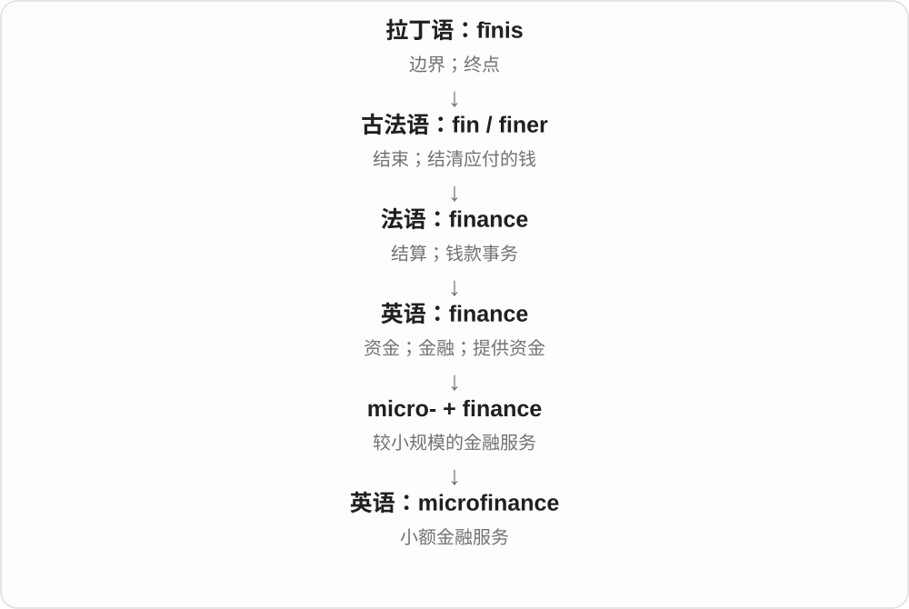
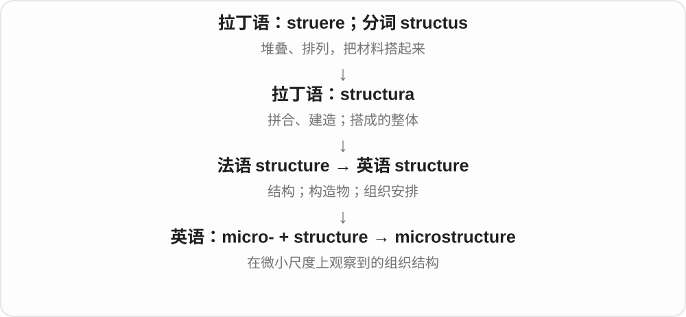
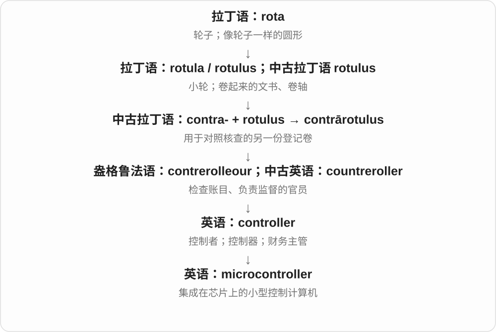
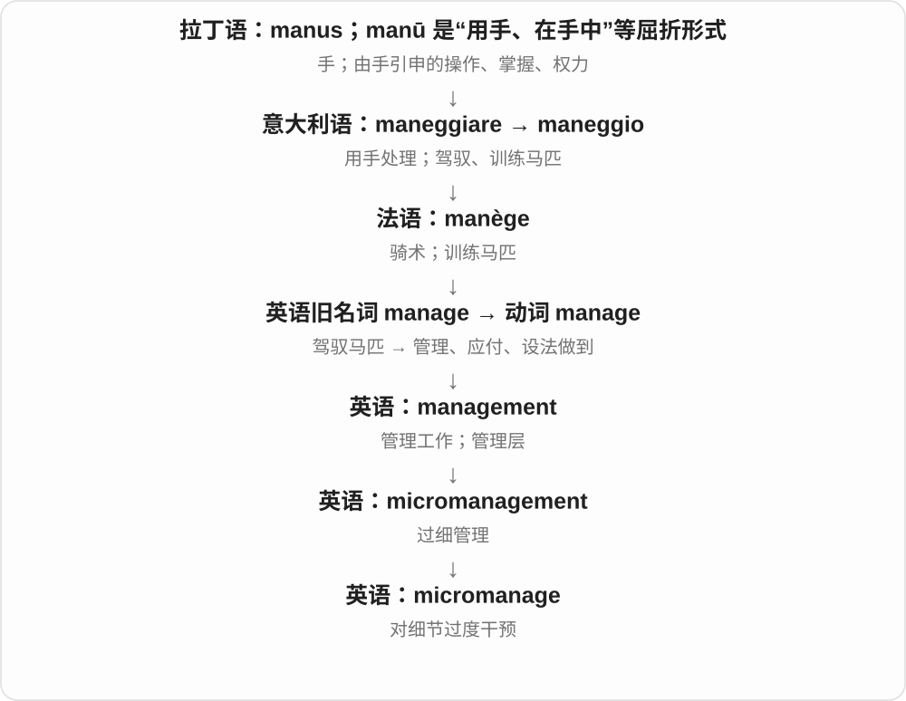
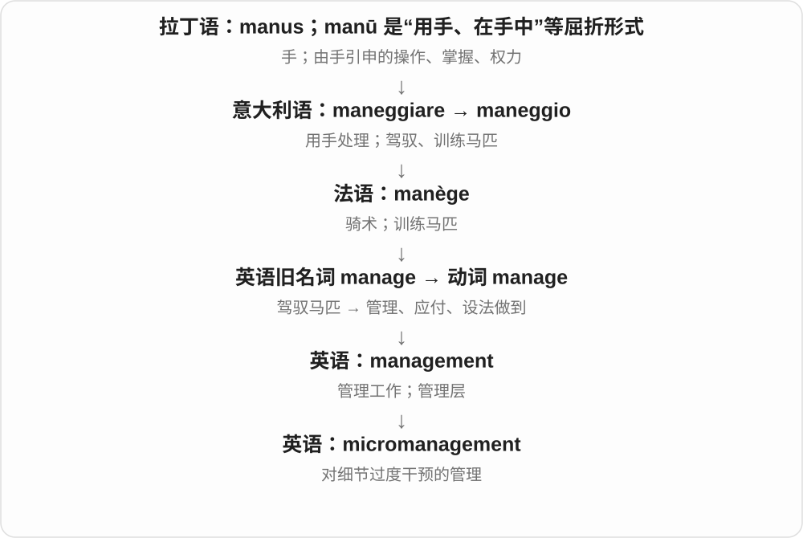
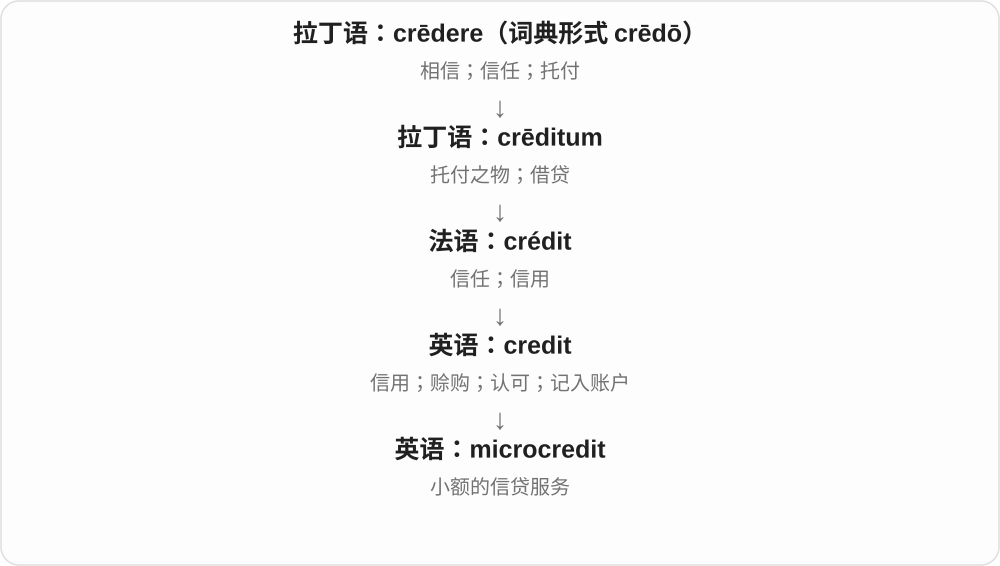

# 2181 · micro- — 微小、微型、小范围；单位中严格为百万分之一

[逐词精讲目录](../00_逐词精讲目录.md) · [总目录](../00_总目录_按常用程度.md)

## 核心词根与来源

先判断是不是单位。单位以外，把小落到具体对象：纤维细、芯片部件小、博客短、酒厂规模小，或经济分析关注个体。不能每个词都套固定百万分之一。

**MICRO-：普通词说小，单位词给精确比例**

microscope 器具 → microscopy 方法；microbiology → microbiological；microsecond 给单位；microbrewery 说规模。

- **观察器具与方法**：microscope · microscopy · microphone · microwave
- **生命科学与结构**：microbiology · microbiologist · microbiological · microarray · microtubule · microsatellite · microorganism · microbiome · microbiota
- **尺寸、材料与单位**：microfiber · microscale · microstructure · microsecond · micrometer
- **计算部件与信息形式**：microchip · microprocessor · microcomputer · microcontroller · microfilm · microblogging
- **小规模、局部范围与管理**：microbrewery · microeconomics · microeconomic · microfinance · microcredit · microclimate · microenvironment · micromanage · micromanagement
- **其他固定领域义**：microcosm · microgravity · micronutrient · microsurgery
- **micro-：百万分之一的单位，与测微仪的另一构词线**：microseconds · micrograms · micrometers
- **micro- + gram：微克单数到复数**：microgram · micrograms

## 词形与演化规律

希腊 mikrós 小 → micro-；后接对象、观察词尾、学科、单位或活动名称。

micro- 远接希腊 mikros 小；现代微秒、微克、微米中约定百万分之一。micrometers 也可指多把测微仪，-meter 是仪器构词成分，另有重音。

micro- 百万分之一，gram 克；microgram 是一克的百万分之一，micrograms 给整个单位名加复数 -s。

## 单词速览（按词族由简到繁）

同一基础词的相关扩展放在一起，先读基础形式，再读扩展；各组之间优先读常用的。具体词源关系见各词讲解。

| 单词 | 音标 | 核心意思 |
|---|---|---|
| [microwave](#w-1) | 英 /ˈmaɪkrəweɪv/；美 /ˈmaɪkroʊweɪv/ | 微波；微波炉；用微波炉加热 |
| [microphone](#w-2) | 英 /ˈmaɪkrəfəʊn/；美 /ˈmaɪkrəfoʊn/ | 麦克风；话筒 |
| [microscope](#w-3) | 英 /ˈmaɪkrəskəʊp/；美 /ˈmaɪkrəskoʊp/ | 显微镜 |
| [microscopy](#w-4) | 英 /maɪˈkrɒskəpi/；美 /maɪˈkrɑːskəpi/ | 显微观察、显微术；相关技术研究 |
| [microbiology](#w-5) | 英 /ˌmaɪkrəʊbaɪˈɒlədʒi/；美 /ˌmaɪkroʊbaɪˈɑːlədʒi/ | 微生物学 |
| [microbiological](#w-15) | 英 /ˌmaɪkrəʊˌbaɪəˈlɒdʒɪkəl/；美 /ˌmaɪkroʊˌbaɪəˈlɑːdʒɪkəl/ | 微生物学的；涉及微生物的 |
| [microbiologist](#w-18) | 英 /ˌmaɪkrəʊbaɪˈɒlədʒɪst/；美 /ˌmaɪkroʊbaɪˈɑːlədʒɪst/ | 微生物学家 |
| [microprocessor](#w-6) | 英 /ˌmaɪkrəʊˈprəʊsesə/；美 /ˌmaɪkroʊˈprɑːsesər/ | 微处理器 |
| [microchip](#w-7) | /ˈmaɪkrəʊtʃɪp/〔英〕；/ˈmaɪkroʊtʃɪp/〔美〕 | 微芯片；给动物植入识别芯片 |
| [microcosm](#w-8) | 英 /ˈmaɪkrəʊkɒzəm/；美 /ˈmaɪkroʊkɑːzəm/ | 缩影；小世界 |
| [microfilm](#w-9) | 英 /ˈmaɪkrəʊfɪlm/；美 /ˈmaɪkroʊfɪlm/ | 缩微胶片；用缩微胶片记录 |
| [microbiome](#w-10) | 英 /ˌmaɪkrəʊˈbaɪəʊm/；美 /ˌmaɪkroʊˈbaɪoʊm/ | 微生物组；某环境中的微生物及其整体系统 |
| [microgram](#w-46) | 英 /ˈmaɪkrəʊɡræm/；美 /ˈmaɪkroʊɡræm/ | 微克 |
| [micrograms](#w-43) | 英 /ˈmaɪkrəʊɡræmz/；美 /ˈmaɪkroʊɡræmz/ | 微克 |
| [microfinance](#w-11) | /ˈmaɪkrəʊˌfaɪnæns/ | 小额金融服务 |
| [microbiota](#w-12) | 英 /ˌmaɪkrəʊbaɪˈəʊtə/；美 /ˌmaɪkroʊbaɪˈoʊtə/ | 微生物群；特定环境中的微生物成员 |
| [microstructure](#w-13) | 英 /ˈmaɪkrəʊˌstrʌktʃə/；美 /ˈmaɪkroʊˌstrʌktʃər/ | 微观结构；显微组织 |
| [microgravity](#w-14) | 英 /ˈmaɪkrəʊˌɡrævɪti/；美 /ˌmaɪkroʊˈɡrævɪti/ | 微重力；近失重环境 |
| [microcontroller](#w-16) | 英 /ˈmaɪkrəʊkənˌtrəʊlə/；美 /ˈmaɪkroʊkənˌtroʊlər/ | 微控制器；单片机 |
| [microfiber](#w-17) | 英 /ˈmaɪkrəʊfaɪbə/；美 /ˈmaɪkroʊfaɪbər/ | 超细纤维；超细纤维织物 |
| [micrometer](#w-20) | 仪器：英 /maɪˈkrɒmɪtə/，美 /maɪˈkrɑːmɪtər/；单位〔美式〕/ˈmaɪkroʊmiːtər/ | 测微器；千分尺；微米〔美式拼写〕 |
| [micrometers](#w-44) | 单位〔美〕/ˈmaɪkroʊˌmiːtɚz/；仪器：英 /maɪˈkrɒmɪtəz/，美 /maɪˈkrɑːmɪtɚz/ | 微米〔美式复数〕；测微仪，千分尺〔复数〕 |
| [microarray](#w-19) | 英 /ˌmaɪkrəʊəˈreɪ/；美 /ˌmaɪkroʊəˈreɪ/ | 微阵列；相关分析芯片或检测 |
| [microorganism](#w-21) | 英 /ˌmaɪkrəʊˈɔːɡənɪzəm/；美 /ˌmaɪkroʊˈɔːrɡənɪzəm/ | 微生物 |
| [microtubule](#w-22) | 英 /ˌmaɪkrəʊˈtjuːbjuːl/；美 /ˌmaɪkroʊˈtuːbjuːl/ | 微管，细胞骨架的一类管状结构 |
| [microcomputer](#w-23) | 美 /ˈmaɪkroʊkəmˌpjuːtər/ | 微型计算机 |
| [microsecond](#w-31) | 英 /ˈmaɪkrəʊˌsekənd/；美 /ˈmaɪkroʊˌsekənd/ | 微秒，即百万分之一秒 |
| [microseconds](#w-45) | 英 /ˈmaɪkrəʊˌsekəndz/；美 /ˈmaɪkroʊˌsɛkəndz/ | 微秒 |
| [micromanage](#w-24) | 英 /ˈmaɪkrəʊˌmænɪdʒ/；美 /ˈmaɪkroʊˌmænɪdʒ/ | 过细管理；对细节过度干预 |
| [micromanagement](#w-35) | /ˌmaɪkrəʊˈmænɪdʒmənt/；美 /ˌmaɪkroʊˈmænɪdʒmənt/ | 过细管理；事事插手的管理 |
| [microeconomic](#w-36) | 英 /ˌmaɪkrəʊˌiːkəˈnɒmɪk/；美 /ˌmaɪkroʊˌekəˈnɑːmɪk/ | 微观经济的；微观经济学的 |
| [microeconomics](#w-25) | 英 /ˌmaɪkrəʊˌiːkəˈnɒmɪks/；美 /ˌmaɪkroʊˌekəˈnɑːmɪks/ | 微观经济学 |
| [microclimate](#w-27) | /ˈmaɪkrəʊklaɪmət/〔英〕；/ˈmaɪkroʊklaɪmət/〔美〕 | 小气候、局地气候 |
| [microenvironment](#w-28) | 英 /ˌmaɪkrəʊɪnˈvaɪrənmənt/；美 /ˌmaɪkroʊɪnˈvaɪrənmənt/ | 微环境；局部小环境 |
| [micronutrient](#w-33) | 英 /ˌmaɪkrəʊˈnjuːtriənt/；美 /ˌmaɪkroʊˈnuːtriənt/ | 微量营养素 |
| [microbrewery](#w-34) | 英 /ˈmaɪkrəʊˌbruːəri/；美 /ˈmaɪkroʊˌbruːəri/ | 小型酿酒厂，通常指小型啤酒酿造企业 |
| [microsatellite](#w-37) | 英 /ˌmaɪkrəʊˈsætəlaɪt/；美 /ˌmaɪkroʊˈsætəlaɪt/ | 微型卫星；微卫星 DNA 短串联重复序列 |
| [microblogging](#w-38) | 英 /ˈmaɪkrəʊblɒɡɪŋ/；美 /ˈmaɪkroʊblɑːɡɪŋ/ | 微博客写作、发布短帖的活动 |
| [microcredit](#w-39) | 英 /ˈmaɪkrəʊˌkredɪt/；美 /ˈmaɪkroʊˌkredɪt/ | 小额信贷 |
| [microscale](#w-41) | 英 /ˈmaɪkrəʊskeɪl/；美 /ˈmaɪkroʊˌskeɪl/ | 微小尺度；在较小尺度上的 |
| [microsurgery](#w-42) | 英 /ˌmaɪkrəʊˈsɜːdʒəri/；美 /ˌmaɪkroʊˈsɜːrdʒəri/ | 显微外科、精细微小结构手术 |

## 逐词讲解

### 1. microwave — 微波；微波炉；用微波炉加热

**音标**：英 /ˈmaɪkrəweɪv/；美 /ˈmaɪkroʊweɪv/

**先抓住这个画面**

原先是一类电磁波；以它加热食物的炉子后来也直接叫同一个名字。

**怎么拆**

micro- 小 + wave 波；micro 表示相对较短的波长，不是说波长一定只有一微米。电器名由 microwave oven 缩短，动词再由设备名形成。

**怎么变成今天的意思**

**希腊 mikros 小 → 组合形式 micro-**  
通常说小；在计量单位前严格表示百万分之一

↓

**英语 micro- + wave → microwave〔电磁波〕**  
短波长电磁波的一类

↓

**microwave oven → 简称 microwave → 动词 microwave**  
微波炉 → 用微波炉加热

put it in the microwave 是放进微波炉；microwave the rice 是用微波炉加热米饭。波本身通常用复数 microwaves 来谈传播或加热。

**常见搭配与例句**

a microwave oven；in the microwave；microwave a meal；microwave signals。

> There is a microwave in the office kitchen.

办公室厨房里有一台微波炉。

> He microwaved the leftover rice for lunch.

他把剩米饭用微波炉加热后当午饭。

**别混淆**

microwave 是设备名时可数，指波时另有科学范围。它与小火 low heat 不是同一种加热描述。

### 2. microphone — 麦克风；话筒

**音标**：英 /ˈmaɪkrəfəʊn/；美 /ˈmaɪkrəfoʊn/

**先抓住这个画面**

把空气里的声音接住，转成可以传输、放大或录下的信号。

**怎么拆**

近代用 micro- “小、微弱” + -phone “声音”构词；早期名称用于听微弱声音的装置，后来用于电声话筒。

**怎么变成今天的意思**

**希腊 phōnḗ〔φωνή〕**  
声音、嗓音；与“说话”的动词相连

↓

**近代组合形式 phono- / -phone**  
以“声音”给技术、设备和语言概念命名

↓

**英语 micro- + -phone → microphone**  
小声音的器具 → 把声音转换为电信号的装置

micro- 在名称里不保证实物很小。麦克风负责拾音、转换，扬声器负责把信号变回声音；很多设备把这两个部件装在一起，功能仍不同。

**常见搭配与例句**

speak into a microphone；a wireless microphone；mute the microphone。

> Please keep the microphone close enough to pick up your voice.

请把麦克风放近一些，让它能收清你的声音。

> The microphone recorded every page rustle.

麦克风把每一次翻页的沙沙声都录下来了。

**别混淆**

megaphone 是让人声传得更远的扩音器；microphone 首先是收进声音，不必自身发出很响的声。

### 3. microscope — 显微镜

**音标**：英 /ˈmaɪkrəskəʊp/；美 /ˈmaɪkrəskoʊp/

**先抓住这个画面**

让小到难以看清的东西显出细节。

**怎么拆**

micro- 小 + -scope 观察仪器，接近代拉丁 microscopium 等造词；并不是古希腊已有现代显微镜。

**怎么变成今天的意思**

**希腊 skopein / skopos**  
观察；观察者、注视的目标；与 skeptesthai 观察、审视同源

↓

**希腊 mikros 小 + 观察词干 → 近代拉丁 microscopium**  
观察微小物体的工具

↓

**英语 microscope**  
显微镜

under a microscope 可以真说在显微镜下观察，也能比喻受到细查。显微镜有多种技术类型，不必把这个词限定成普通光学镜片。

**常见搭配与例句**

under a microscope；an electron microscope；examine with a microscope。

> The students examined the leaf cells under a microscope.

学生用显微镜观察了叶片细胞。

> After the error, every decision came under the microscope.

那次失误之后，每个决定都受到了仔细审查。

**别混淆**

telescope 看遥远对象，microscope 看微小细节；不是只靠镜筒长度来分。

### 4. microscopy — 显微观察、显微术；相关技术研究

**音标**：英 /maɪˈkrɒskəpi/；美 /maɪˈkrɑːskəpi/

**先抓住这个画面**

microscope 是那台显微镜，microscopy 是用它观察、成像的技术和实践。器材和方法分开，读音重音也跟着变。

**怎么拆**

micro- 微小 + -scopy 观察、检查，后半接希腊看、观察的构词路线。不是把整个 microscope 后随手接 y；-scope 偏器具，-scopy 偏观察过程、方法。

**怎么变成今天的意思**

**希腊 mikrós → 英语组合形式 micro-**  
小、微小，用于各领域构词

↓

**micro- + -scopy → microscopy**  
对微小结构的观察、成像及相关技术

light microscopy 光学显微术，electron microscopy 电子显微术，microscopy images 显微图像。

**常见搭配与例句**

light microscopy；electron microscopy；microscopy images。

> The course introduces light microscopy.

这门课介绍光学显微术。

> Microscopy revealed details that were invisible to the naked eye.

显微观察揭示了肉眼看不到的细节。

**别混淆**

microscope 常前重读 /ˈmaɪkrəskəʊp/，microscopy 重读后面的 /krɒs/、/krɑːs/。显微术不只一种仪器或一种成像办法。

### 5. microbiology — 微生物学

**音标**：英 /ˌmaɪkrəʊbaɪˈɒlədʒi/；美 /ˌmaɪkroʊbaɪˈɑːlədʒi/

**先抓住这个画面**

把研究视线缩小，去看细菌、微小真菌等肉眼难见的对象及其活动。

**怎么拆**

micro- “微小” + biology；微小的是研究对象，并不是“小规模做一点生物学”。

**怎么变成今天的意思**

**希腊 légō / lógos**  
选取、收集 → 讲述；话语、说明、道理、计算

↓

**希腊 bíos〔生命〕+ -logía → 新拉丁 biologia**  
近代学术造词：研究生命

↓

**英语 biology**  
研究生物及生命过程；名称经近代科学用法逐渐固定

↓

**英语 micro- + biology → microbiology**  
以微生物及相关对象为中心的生物学研究

它既研究致病微生物，也研究发酵、土壤养分循环等过程。领域中也包含病毒研究，因此不要用“是否独立存活”简单划掉所有病毒相关工作。

**常见搭配与例句**

food microbiology；a microbiology laboratory；research in microbiology。

> The microbiology team studied the organisms involved in making yogurt.

微生物学团队研究了制作酸奶时参与发酵的微生物。

> The water samples were sent to the microbiology laboratory.

水样被送往微生物实验室。

**别混淆**

microbiology 范围比 bacteriology 广；后者专门研究细菌。

### 6. microbiological — 微生物学的；涉及微生物的

**音标**：英 /ˌmaɪkrəʊˌbaɪəˈlɒdʒɪkəl/；美 /ˌmaɪkroʊˌbaɪəˈlɑːdʒɪkəl/

**先抓住这个画面**

不是泛泛说生物，而是把观察对象缩到微生物这一范围。水的 microbiological quality 就是在看相应微生物方面的情况。

**怎么拆**

micro- + biological，形态上也与 microbiology 微生物学、-ical 相关形容词相对应。不是一个特别小的生物学家。

**怎么变成今天的意思**

**希腊 mikrós → 英语组合形式 micro-**  
小、微小，用于各领域构词

↓

**microbiology / micro- + biological → microbiological**  
微生物学相关的性质、检查等

microbiological testing 微生物检测，microbiological analysis 微生物学分析，microbiological quality 微生物方面的质量状况。

**常见搭配与例句**

microbiological testing；microbiological analysis；microbiological quality。

> The laboratory carries out microbiological testing of water samples.

实验室对水样进行微生物检测。

> The report includes both chemical and microbiological analysis.

报告包括化学分析和微生物学分析。

**别混淆**

microbiological 不自动表示发现有害病原体；检测可能研究不同微生物，具体结果要看报告。microbiologist 是人，microbiological 是性质。

### 7. microbiologist — 微生物学家

**音标**：英 /ˌmaɪkrəʊbaɪˈɒlədʒɪst/；美 /ˌmaɪkroʊbaɪˈɑːlədʒɪst/

**先抓住这个画面**

研究肉眼通常看不清的生命，怎样生活、变化并影响周围环境。

**怎么拆**

micro-“微小” + biologist“生物学家”；也对应 microbiology 的 -ist 研究者形式。

**怎么变成今天的意思**

**希腊 bios（βίος）**  
生命、一生、生活方式

↓

**近代构词成分 bio-**  
生命；生物；与生物有关的

↓

**现代 micro-“微小”与生物词族组合**  
微生物及其群体

↓

**英语 microbiology 与 microbiologist 词族**  
微生物学；从事微生物研究的人

microbiologist 可能研究环境中的微生物，也可能研究食品、工业或疾病相关问题。职业范围远不止“用显微镜看细菌”，还会分析遗传信息、代谢和群落关系。

**常见搭配与例句**

an environmental microbiologist；a clinical microbiologist；work as a microbiologist。

> The microbiologist studied organisms collected from seawater.

微生物学家研究了从海水中采集的生物。

> A microbiologist joined the food safety team.

一位微生物学家加入了食品安全团队。

**别混淆**

microbiologist 是微生物研究者；microbiome 是研究对象之一，不能用后者称人。

### 8. microprocessor — 微处理器

**音标**：英 /ˌmaɪkrəʊˈprəʊsesə/；美 /ˌmaɪkroʊˈprɑːsesər/

**先抓住这个画面**

把执行指令和处理数据的核心功能装进很小的芯片里。

**怎么拆**

micro- 小 + processor 处理器；近代电子技术复合词，不是每个里面有 micro 的东西都按百万分之一计算。

**怎么变成今天的意思**

**希腊 mikros 小 → 组合形式 micro-**  
通常说小；在计量单位前严格表示百万分之一

↓

**英语 micro- + processor → microprocessor**  
小型集成电路中的处理器

a microprocessor controls the device 是微处理器控制设备。它能执行程序和处理数据，但整台机器还需要存储、电源及其他部件配合。

**常见搭配与例句**

a microprocessor chip；a powerful microprocessor；controlled by a microprocessor。

> A microprocessor controls the washing machine’s cycle.

微处理器控制洗衣机的运行程序。

> The engineers tested the new microprocessor under different loads.

工程师测试了新微处理器在不同负载下的表现。

**别混淆**

microchip 是芯片统称，microprocessor 强调计算和控制功能；不能把所有芯片都叫处理器。

### 9. microchip — 微芯片；给动物植入识别芯片

**音标**：/ˈmaɪkrəʊtʃɪp/〔英〕；/ˈmaɪkroʊtʃɪp/〔美〕

**先抓住这个画面**

把许多微小电子元件集成在很小的一片材料上；宠物识别芯片也是一种用途。

**怎么拆**

micro- 小 + chip 小片；英语复合词，后来也由名词转成植入识别芯片的动词。

**怎么变成今天的意思**

**希腊 mikros 小 → 组合形式 micro-**  
通常说小；在计量单位前严格表示百万分之一

↓

**英语 micro- + chip → microchip〔名词〕**  
很小的一片集成电子电路

↓

**名词 → 动词 microchip**  
给动物植入识别芯片

a microchip inside the device 是设备里的芯片；a microchipped cat 是植入了识别芯片的猫。宠物识别芯片通常提供可读取的编号，不能一概当成实时定位器。

**常见搭配与例句**

a silicon microchip；a microchip implant；microchip a pet。

> The sensor contains a tiny microchip.

传感器里有一枚微芯片。

> The shelter checks whether each cat has been microchipped.

收容所会检查每只猫是否植入了识别芯片。

**别混淆**

microprocessor 是负责运算和指令处理的一类芯片；microchip 范围更广，也可能承担存储或其他功能。

### 10. microcosm — 缩影；小世界

**音标**：英 /ˈmaɪkrəʊkɒzəm/；美 /ˈmaɪkroʊkɑːzəm/

**先抓住这个画面**

范围虽小，却能看到大社会、大系统里同样的关系和问题。

**怎么拆**

micro- 小 + cosm- 世界，经中世纪拉丁 microcosmus 与法语相关用法传来；并不是必须由现代英语 cosmos 截短构成。

**怎么变成今天的意思**

**希腊 mikros 小 + kosmos 世界 → 中世纪拉丁 microcosmus**  
小世界；早期把人体看成宇宙的缩影

↓

**英语 microcosm；一般小社会义也受法语 microcosme 影响**  
能反映更大整体特点的小范围

a microcosm of society 是社会的缩影；in microcosm 是以缩小形式呈现。重点是反映整体特点，未必是一比一缩小的模型。

**常见搭配与例句**

a microcosm of society；a microcosm of the city；in microcosm。

> The school is a microcosm of the wider community.

这所学校是周围社区的一个缩影。

> The dispute shows the industry’s wider problems in microcosm.

这场争执以小见大，反映了整个行业的问题。

**别混淆**

miniature 强调尺寸小；microcosm 更强调小范围里能看见大整体的结构或规律。

### 11. microfilm — 缩微胶片；用缩微胶片记录

**音标**：英 /ˈmaɪkrəʊfɪlm/；美 /ˈmaɪkroʊfɪlm/

**先抓住这个画面**

把大量书页、报纸拍成很小的影像，集中存到胶片上，阅读时再放大。

**怎么拆**

micro- 小、缩微 + film 胶片，形成档案保存媒介名，也可作动词。不是电影时长特别短就都叫 microfilm。

**怎么变成今天的意思**

**古英语 filmen → 中古英语 filme → film**  
薄皮、薄膜

↓

**film 的摄影分支**  
感光材料薄层、胶片 → 电影作品及拍摄动作

↓

**micro- + film → microfilm**  
缩微 + 胶片 → 缩微记录媒介

newspapers on microfilm 存在缩微胶片上的报纸，a microfilm reader 缩微胶片阅读机；可用于保存、检索历史文献。

**常见搭配与例句**

on microfilm；a microfilm reader；a microfilm copy。

> The library keeps old newspapers on microfilm.

图书馆用缩微胶片保存旧报纸。

> She used a microfilm reader to examine the records.

她用缩微胶片阅读机查看记录。

**别混淆**

microfilm 缩微胶片，short film 短片；前者说记录媒介、缩微影像，后者说电影时长类别。

### 12. microbiome — 微生物组；某环境中的微生物及其整体系统

**音标**：英 /ˌmaɪkrəʊˈbaɪəʊm/；美 /ˌmaɪkroʊˈbaɪoʊm/

**先抓住这个画面**

把一个环境里的微生物放在一起看，还关心它们携带什么、能做什么、怎样相互作用。

**怎么拆**

micro-“微小” + biome；也有把 microbiota 与 genome 看作相关混成来源的分析，词义在研究中有不同界定。

**怎么变成今天的意思**

**希腊 bios（βίος）**  
生命、一生、生活方式

↓

**近代构词成分 bio-**  
生命；生物；与生物有关的

↓

**现代 micro-“微小”与生物词族组合**  
微生物及其群体

↓

**现代 micro- + biome 等构词分析 → microbiome**  
微生物群体；或连同其基因、活动环境的整体

gut microbiome 常指肠道中的微生物系统。有些文献特别强调其基因集合，另一些把微生物、功能和环境一起纳入；所以不能断言 microbiome 永远只等于“全部基因”。读研究时先看作者的定义。

**常见搭配与例句**

the gut microbiome；a soil microbiome；microbiome research。

> The study compared the gut microbiomes of different participants.

研究比较了不同参与者的肠道微生物组。

> Soil conditions can shape the local microbiome.

土壤条件能够影响当地的微生物组。

**别混淆**

microbiota 通常强调微生物成员；microbiome 常采用更整体的系统或遗传材料视角，但实际用法有重叠。

### 13. microgram — 微克

**音标**：英 /ˈmaɪkrəʊɡræm/；美 /ˈmaɪkroʊɡræm/

**先抓住这个画面**

一克若切成一百万个同样重的小份，其中一份的质量就是一微克。它是极小质量的计数单位。

**怎么拆**

micro- 百万分之一 + gram 克 → microgram；micro- 接希腊小的材料，gram 经法语接希腊小重量的名称。

**怎么变成今天的意思**

**希腊小的材料 → micro- 百万分之一**  
现代单位前缀的精确约定

↓

**micro- + gram → microgram → micrograms**  
一微克，再按英语规则变复数

one microgram 是一微克；less than a microgram 是不到一微克；复数见 micrograms。

**常见搭配与例句**

one microgram；less than a microgram；a microgram of material。

> The sample weighed less than a microgram.

这个样品的质量不到一微克。

> One microgram is a millionth of a gram.

一微克是一克的百万分之一。

**别混淆**

毫克 milligram 是千分之一克，微克 microgram 是百万分之一克。数值相同时，毫克对应的质量大一千倍。

### 14. micrograms — 微克

**音标**：英 /ˈmaɪkrəʊɡræmz/；美 /ˈmaɪkroʊɡræmz/

**先抓住这个画面**

把一克分成一百万份，每份是一微克。实验里极少量的物质，质量小到常需要用 micrograms 来数。

**怎么拆**

micro- 百万分之一 + gram 克 → microgram；加复数 -s → micrograms，/m/ 后读 /z/。gram 经法语 gramme，远接希腊小重量的名称。

**怎么变成今天的意思**

**希腊 mikros 小、gramma 小重量的材料 → 现代单位组合**  
micro- 在单位前取百万分之一

↓

**microgram + -s → micrograms**  
1000000 micrograms = 1 gram

a few micrograms 是几微克；a mass of ten micrograms 是十微克的质量。这里在说物质量有多小，不是在说长度。

**常见搭配与例句**

a few micrograms；ten micrograms of material；mass in micrograms。

> The sample contained only a few micrograms of dust.

这个样品里只有几微克灰尘。

> The table lists each mass in micrograms.

表格以微克列出每项质量。

**别混淆**

1000 micrograms = 1 milligram。微克与毫克不是两种拼法，换算差一千倍。

### 15. microfinance — 小额金融服务

**音标**：/ˈmaɪkrəʊˌfaɪnæns/

**先抓住这个画面**

microfinance 像把原本门槛很高的金融服务缩小到更小的资金需求：不仅可能有小额贷款，也可以包括储蓄和其他基本服务。

**怎么拆**

micro-（小）+ finance（金融服务）。是现代组合，不能把古希腊语 micro- 与拉丁语 fin- 当作古代已有的完整词。

**怎么变成今天的意思**

这里“小”主要指服务的资金规模和对象需求，而不是“金融学的一小部分”。这类词说明古典构词成分今天仍能用于命名新事物。

**常见搭配与例句**

a microfinance institution（小额金融机构）；microfinance services（小额金融服务）；a microfinance program（小额金融项目）。

> The organization offers microfinance services to small businesses.

该组织向小企业提供小额金融服务。

> The study compared several microfinance programs.

这项研究比较了几个小额金融项目。

**别混淆**

microcredit 主要指小额信贷；microfinance 范围更广。词本身也不保证某个项目一定低风险或有效。

### 16. microbiota — 微生物群；特定环境中的微生物成员

**音标**：英 /ˌmaɪkrəʊbaɪˈəʊtə/；美 /ˌmaɪkroʊbaɪˈoʊtə/

**先抓住这个画面**

回答的是：在这片皮肤、这段肠道或这团土里，住着哪些微小生物。

**怎么拆**

micro-“微小” + biota“生物总体”，从全部生物缩小到微生物成员。

**怎么变成今天的意思**

**希腊 bios（βίος）**  
生命、一生、生活方式

↓

**近代构词成分 bio-**  
生命；生物；与生物有关的

↓

**现代 micro-“微小”与生物词族组合**  
微生物及其群体

↓

**英语 micro- + biota → microbiota**  
特定环境中的微生物总体

the intestinal microbiota 不是只说一种细菌，而是说肠道的微生物群。不同研究会对纳入的微生物类别作具体界定；它们的组成也会随时间和环境变化，并不是每个人一生不变的一张名单。

**常见搭配与例句**

gut microbiota；skin microbiota；the composition of the microbiota。

> The researchers analyzed the composition of the skin microbiota.

研究者分析了皮肤微生物群的组成。

> The team compared the microbiota of roots and leaves.

团队比较了根和叶片上的微生物群。

**别混淆**

microbiota 说群体成员；a microorganism 说一个微生物个体或一种微生物。

### 17. microstructure — 微观结构；显微组织

**音标**：英 /ˈmaɪkrəʊˌstrʌktʃə/；美 /ˈmaɪkroʊˌstrʌktʃər/

**先抓住这个画面**

microstructure 像把金属放到显微镜下：肉眼看是一块，放大后才看见颗粒、边界和排列。

**怎么拆**

micro- 微小 + structure；micro- 来自希腊语 mikros“小”。

**怎么变成今天的意思**

在材料学中尤其常见。材料成分相近，内部晶粒、相的排列不同，性质仍可能不同。也可用于其他对象的细小内部组织。

**常见搭配与例句**

the microstructure of steel；examine the microstructure；changes in microstructure。

> The microscope revealed the metal’s microstructure.

显微镜显示出了金属的微观组织。

> Heating changed the microstructure of the sample.

加热改变了样品的微观结构。

**别混淆**

composition 问由什么组成；microstructure 问这些成分在微观尺度上怎样排列。

### 18. microgravity — 微重力；近失重环境

**音标**：英 /ˈmaɪkrəʊˌɡrævɪti/；美 /ˌmaɪkroʊˈɡrævɪti/

**先抓住这个画面**

像人和周围东西一起自由下落，彼此之间几乎感觉不到通常的重量。

**怎么拆**

micro- 很小 + gravity；航天常用义指近失重条件，不能把字面的小误讲成空间站附近地球引力几乎消失。

**怎么变成今天的意思**

**拉丁语 gravis**  
重的；分量大、难承受、严肃的

↓

**拉丁语 gravitas → 法语 gravité 或直接借入 → 英语 gravity**  
重量、庄重 → 严重性；重力、引力

↓

**现代英语 micro- + gravity → microgravity**  
极小的表观重量、残余加速度所对应的近失重条件

空间站上的人和舱体一起绕地球自由下落，因此东西看起来漂浮。地面落塔、抛物线飞行也能短暂产生微重力环境；这里的 micro- 不是保证恰好百万分之一。

**常见搭配与例句**

a microgravity environment；microgravity experiments；research in microgravity。

> The team studied how liquids behave in microgravity.

团队研究了液体在微重力环境中的行为。

> A drop tower can provide a few seconds of microgravity for an experiment.

落塔可以为实验提供几秒钟的微重力环境。

**别混淆**

weightlessness 说失重体验；microgravity 提醒真实实验环境常仍有微小扰动。它不表示物体失去质量。

### 19. microcontroller — 微控制器；单片机

**音标**：英 /ˈmaɪkrəʊkənˌtrəʊlə/；美 /ˈmaɪkroʊkənˌtroʊlər/

**先抓住这个画面**

microcontroller 像嵌在设备里的一颗小指挥脑：读取按钮或传感器的信息，再按程序让灯、电机等工作。

**怎么拆**

micro-（微小）+ controller，是现代技术构词。

**怎么变成今天的意思**

常把处理器、存储器和输入输出功能集成在一片芯片上。它能运行控制程序，不能只当成缩小的游戏手柄。

**常见搭配与例句**

program a microcontroller；a microcontroller board；a microcontroller-based device。

> The microcontroller reads the sensor every second.

微控制器每秒读取一次传感器。

> We programmed the microcontroller to switch on the light at dusk.

我们给微控制器编程，让它在黄昏时打开灯。

**别混淆**

microprocessor 侧重处理器；microcontroller 通常还集成控制应用所需的存储器、外设接口。

### 20. microfiber — 超细纤维；超细纤维织物

**音标**：英 /ˈmaɪkrəʊfaɪbə/；美 /ˈmaɪkroʊfaɪbər/

**先抓住这个画面**

先把单根纤维做得很细，再织成布。清洁布、运动用品标签里的 microfiber 通常是在说这种纤维或织物。

**怎么拆**

micro- 细小 + fiber 纤维；英式拼写 microfibre。这里不是给纤维数量乘一个精确百万分之一，而是在命名很细的纤维材料。

**怎么变成今天的意思**

**希腊 mikrós → 英语组合形式 micro-**  
小、微小，用于各领域构词

↓

**一般组合与单位构词分开**  
一般说微型、小规模；SI 单位中严格为百万分之一

↓

**micro- + fiber → microfiber**  
超细纤维，以及相应织物

a microfiber cloth 超细纤维布，a microfiber towel 超细纤维毛巾，microfiber fabric 超细纤维织物。

**常见搭配与例句**

a microfiber cloth；a microfiber towel；microfiber fabric。

> She wiped the screen with a microfiber cloth.

她用超细纤维布擦了屏幕。

> The label says the towel is made from microfiber.

标签说这条毛巾由超细纤维制成。

**别混淆**

microfiber 不等于 microplastic 微塑料，前者按纤维细度、材料形态命名；也不单凭前缀就能判断所有产品尺寸、吸水性完全一样。

### 21. micrometer — 测微器；千分尺；微米〔美式拼写〕

**音标**：仪器：英 /maɪˈkrɒmɪtə/，美 /maɪˈkrɑːmɪtər/；单位〔美式〕/ˈmaɪkroʊmiːtər/

**先抓住这个画面**

同样的拼写可以是一件精密测量工具，也可以是一个长度单位，读音和句子结构能帮助区分。

**怎么拆**

仪器名有法语 micromètre 及 micro- 小 + -meter 测量仪的来源；单位则是计量前缀 micro- 百万分之一 + meter 米，两个构词用途分开。

**怎么变成今天的意思**

**希腊 mikros 小 → 组合形式 micro-**  
通常说小；在计量单位前严格表示百万分之一

↓

**仪器线：micro- + -meter → 法语 micromètre / 英语 micrometer**  
测很小距离的仪器；后来也指精密工量具

↓

**并列单位线：计量 micro- + meter → micrometer**  
米的百万分之一；不是从仪器变成单位

use a micrometer 是用测微器；ten micrometers 是十微米。工具名不表示它只能测一微米，也不能仅凭名字保证某个产品的精度。

**常见搭配与例句**

measure with a micrometer；a micrometer screw；a few micrometers thick。

> She measured the wire’s thickness with a micrometer.

她用千分尺测量了金属丝的粗细。

> The coating is only ten micrometers thick.

这层涂层只有十微米厚。

**别混淆**

英式把单位写作 micrometre，仪器写 micrometer；美式两者同形。仪器常后重音，单位常首重音。

### 22. micrometers — 微米〔美式复数〕；测微仪，千分尺〔复数〕

**音标**：单位〔美〕/ˈmaɪkroʊˌmiːtɚz/；仪器：英 /maɪˈkrɒmɪtəz/，美 /maɪˈkrɑːmɪtɚz/

**先抓住这个画面**

写 five micrometers wide，是宽五微米；写 two micrometers on the bench，可能是工作台上两把千分尺。一个是长度单位，一个是测量工具。

**怎么拆**

单位：micro- 百万分之一 + meter 米 → micrometer；仪器：micro- 小 + -meter 测量仪，经法语等形成 micrometer。两线各加 -s 成 micrometers，重音不同。

**怎么变成今天的意思**

**希腊 mikros 小、metron 测量的材料 → 两条现代构词线**  
仪器名说测微小距离的工具；单位名说米的百万分之一

↓

**两个 micrometer 各加复数 -s → micrometers**  
单位通常重读最前；仪器通常重读第二音节

单位1 micrometer = 1000 nanometers；英国常写 micrometre、micrometres。仪器千分尺则用来精密测量，不因名称相同就固定只能测一微米。

**常见搭配与例句**

five micrometers wide；dimensions in micrometers；two micrometers on the bench。

> The fiber is ten micrometers wide.

这根纤维宽十微米。

> The technician checked both micrometers before measuring the parts.

测量零件前，技术员检查了两把千分尺。

**别混淆**

分清“长度多少”与“有几把仪器”。meter 在两条线里分别是米和测量仪构词成分，不能把工具当单位来换算。

### 23. microarray — 微阵列；相关分析芯片或检测

**音标**：英 /ˌmaɪkrəʊəˈreɪ/；美 /ˌmaɪkroʊəˈreɪ/

**先抓住这个画面**

把许多微小样点按已知位置排成一片，像一张能对应位置读结果的网格。生物研究里常用于比较分子信号。

**怎么拆**

micro- 微小 + array 有序排列、阵列。常见 DNA、蛋白质微阵列把许多分子材料固定在相应位置，不是说只分析一个微小样本点。

**怎么变成今天的意思**

**希腊 mikrós → 英语组合形式 micro-**  
小、微小，用于各领域构词

↓

**micro- + array → microarray**  
排列许多微小反应位置的阵列、分析平台

a DNA microarray DNA 微阵列，microarray analysis 微阵列分析，microarray data 微阵列数据。

**常见搭配与例句**

a DNA microarray；microarray analysis；microarray data。

> The researchers compared gene expression using a microarray.

研究人员用微阵列比较基因表达。

> Each spot on the microarray corresponds to a known target.

微阵列上的每个样点对应一个已知目标。

**别混淆**

microarray 常被称芯片，但不等于计算机 CPU；检测信号与基因表达等问题要按所用阵列设计理解，也不是所有 microarray 都直接测完整基因组序列。

### 24. microorganism — 微生物

**音标**：英 /ˌmaɪkrəʊˈɔːɡənɪzəm/；美 /ˌmaɪkroʊˈɔːrɡənɪzəm/

**先抓住这个画面**

小到通常需要显微镜才能仔细观察的生命个体。

**怎么拆**

micro-“微小” + organism“生物体”；现代科学复合词，不是 micro + organ“微型器官”。

**怎么变成今天的意思**

**希腊语 organon → 拉丁语 organum**  
工具、器具；与 ergon 属同一更早词族

↓

**organism“生物体” + micro- → microorganism**  
微小的生物个体

常见例子包括细菌和酵母。许多微生物参与发酵和分解，并不都致病。

**常见搭配与例句**

soil microorganisms；beneficial microorganisms；culture a microorganism。

> Many microorganisms help break down fallen leaves.

许多微生物帮助分解落叶。

> The laboratory grew the microorganism in a nutrient solution.

实验室在营养液中培养了这种微生物。

**别混淆**

microorganism 是宽泛类别；pathogen 专指能致病的生物或病原体。

### 25. microtubule — 微管，细胞骨架的一类管状结构

**音标**：英 /ˌmaɪkrəʊˈtjuːbjuːl/；美 /ˌmaɪkroʊˈtuːbjuːl/

**先抓住这个画面**

想细胞里面有能搭起、拆开的细小空心支架，也能给细胞内运输提供轨道。它是蛋白质组成的结构，不是一根微型塑料管。

**怎么拆**

micro- 微小 + tubule 小管；tubule 经拉丁 tubulus 小管一线，与 tube 同族。微管由微管蛋白组装，名字的 micro- 不要求直径恰好一微米。

**怎么变成今天的意思**

**希腊 mikrós → 英语组合形式 micro-**  
小、微小，用于各领域构词

↓

**拉丁 tubulus → tubule**  
小管、管状结构

↓

**micro- + tubule → microtubule**  
细胞内蛋白质构成的微小管状骨架

microtubule structure 微管结构，microtubule assembly 微管组装，microtubule networks 微管网络。

**常见搭配与例句**

microtubule structure；microtubule assembly；microtubule networks。

> The diagram shows a network of microtubules inside the cell.

图中展示了细胞内的微管网络。

> The lecture explains how microtubules assemble and disassemble.

讲座解释了微管如何组装和解体。

**别混淆**

microtubule 与 nanotube 不是仅按名字换个大小前缀就成同一种材料。前者是细胞结构名称，后者更广为纳米管材料名称。

### 26. microcomputer — 微型计算机

**音标**：美 /ˈmaɪkroʊkəmˌpjuːtər/

**先抓住这个画面**

想到一台使用微处理器、可以放在桌上的计算机；个人电脑是这类机器最熟悉的例子。

**怎么拆**

micro- 小、微型 + computer，现代英语组合词。现代典型用法指以微处理器为核心的计算机；这个名称更早也用来形容小型计算机，不能把所有早期记录都解释成已经使用微处理器。

**怎么变成今天的意思**

**拉丁 putare**  
修剪、清理；计算、考虑、判断

↓

**拉丁 com- 一起 + putare → computare**  
合起来计算、盘算

↓

**法语 computer／拉丁 computare → 英语 compute**  
计算、求值

↓

**英语 compute + -er → computer**  
先指做计算的人，后指计算机器

↓

**英语 micro- + computer → microcomputer**  
以微处理器为核心的微型计算机

常见于计算机史和硬件分类；早期个人电脑是典型例子。现代个人设备通常不再在日常名称中特意强调 microcomputer。

**常见搭配与例句**

an early microcomputer；a microcomputer system；the microcomputer era。

> The museum displays an early microcomputer with its original keyboard.

博物馆展出了一台配有原装键盘的早期微型计算机。

> The kit uses a microcomputer to read the sensors.

这套装置用微型计算机读取传感器。

**别混淆**

minicomputer 是另一种历史机器类别，不能仅按 micro 比 mini 更小来推断每台机器的具体尺寸。

### 27. microsecond — 微秒，即百万分之一秒

**音标**：英 /ˈmaɪkrəʊˌsekənd/；美 /ˈmaɪkroʊˌsekənd/

**先抓住这个画面**

把一秒平均分成一百万份，其中一份就是一微秒。这个 micro- 有严格数值，不能只笼统说很短。

**怎么拆**

SI 前缀 micro-，10⁻⁶ + second 秒。符号 µs；一毫秒是 1000 微秒，一秒是 1000000 微秒。

**怎么变成今天的意思**

**希腊 mikrós → 英语组合形式 micro-**  
小、微小，用于各领域构词

↓

**一般组合与单位构词分开**  
一般说微型、小规模；SI 单位中严格为百万分之一

↓

**micro- + second → microsecond**  
严格单位：10⁻⁶ 秒

a delay of ten microseconds 十微秒延迟，microsecond timing 微秒级计时，measured in microseconds 以微秒计量。

**常见搭配与例句**

a delay of ten microseconds；measured in microseconds；µs。

> The sensor records the delay in microseconds.

传感器以微秒记录延迟。

> One millisecond is equal to one thousand microseconds.

一毫秒等于一千微秒。

**别混淆**

microsecond 微秒，不是 millisecond 毫秒，也不是 nanosecond 纳秒。micro- 的单位符号是 µ，不拿字母 m 代替，因为 m 已用于 milli-。

### 28. microseconds — 微秒

**音标**：英 /ˈmaɪkrəʊˌsekəndz/；美 /ˈmaɪkroʊˌsɛkəndz/

**先抓住这个画面**

一秒切成一百万份，每一份才是一微秒。它适合描述电子信号、快速计算里非常短的时间。

**怎么拆**

micro- 百万分之一 + second 秒 → microsecond；加复数 -s → microseconds，词尾 /ndz/。micro- 远接希腊 mikros 小。

**怎么变成今天的意思**

**希腊 mikros 小 → 计量 micro- 百万分之一**  
小的材料被赋予明确倍率

↓

**microsecond + -s → microseconds**  
1000000 microseconds = 1 second

a few microseconds 是几微秒；每一微秒都是一百万分之一秒。机器快的场景用它，普通约会时间不用这么细。

**常见搭配与例句**

a few microseconds；a delay of five microseconds；timing in microseconds。

> The two signals arrived five microseconds apart.

两个信号到达的时间相差五微秒。

> The table records each delay in microseconds.

表格用微秒记录每次延迟。

**别混淆**

一毫秒包含一千微秒；一微秒又包含一千纳秒。按单位大小排是毫秒、微秒、纳秒。

### 29. micromanage — 过细管理；对细节过度干预

**音标**：英 /ˈmaɪkrəʊˌmænɪdʒ/；美 /ˈmaɪkroʊˌmænɪdʒ/

**先抓住这个画面**

micromanage 就像把任务交出去后，仍攥着对方的每根手指，规定每一步怎么动。

**怎么拆**

现代可拆 micro- + manage；实际先有 micromanagement，再去掉名词尾部逆构成动词。

**怎么变成今天的意思**

常说 micromanage someone 或 micromanage a project；关注的是过度控制执行过程。

**常见搭配与例句**

micromanage a team；micromanage every detail；stop micromanaging。

> Give the team a clear goal without micromanaging every step.

把目标说清楚就好，别对团队的每一步都指手画脚。

> She trusts her staff and rarely micromanages them.

她信任员工，很少事事干预。

**别混淆**

manage 是管理；micromanage 通常是在批评管理者管得过细。

### 30. micromanagement — 过细管理；事事插手的管理

**音标**：/ˌmaɪkrəʊˈmænɪdʒmənt/；美 /ˌmaɪkroʊˈmænɪdʒmənt/

**先抓住这个画面**

micromanagement 像把显微镜架在每个员工手边，连很小的步骤都要过问，让人没有自主空间。

**怎么拆**

micro-（微小）+ management；英语动词 micromanage 是由这个名词逆构出来的。

**怎么变成今天的意思**

通常带批评意味，问题在于干预到不必要的程度，并不是说所有细节检查都不好。

**常见搭配与例句**

avoid micromanagement；excessive micromanagement；a culture of micromanagement。

> Constant approval requests turned routine work into an exercise in micromanagement.

不断要求请示批准，让日常工作变成了事事受管的流程。

> Clear goals can reduce the need for micromanagement.

目标明确后，就不必事事盯着细节管。

**别混淆**

supervision 是监督；micromanagement 强调过度紧盯细节、削弱执行者自主权。

### 31. microeconomic — 微观经济的；微观经济学的

**音标**：英 /ˌmaɪkrəʊˌiːkəˈnɒmɪk/；美 /ˌmaɪkroʊˌekəˈnɑːmɪk/

**先抓住这个画面**

把镜头拉到消费者、企业、某个市场怎样作选择，而不是先看全国总量。

**怎么拆**

micro- 小、微观 + economic；也可对应 microeconomics 的形容词关系。micro- 来自希腊表示小的构词材料。

**怎么变成今天的意思**

**economic〔经济的〕；micro-〔微观〕**  
两个构词材料组合

↓

**micro- + economic → microeconomic**  
关注个体、企业及具体市场的经济分析

microeconomic analysis 微观经济分析，microeconomic theory 微观经济理论；已有 microeconomics 是学科名词。

**常见搭配与例句**

microeconomic analysis；microeconomic theory；microeconomic factors。

> The course introduces microeconomic analysis of consumer choices.

课程介绍消费者选择的微观经济分析。

> The paper examines microeconomic factors affecting small firms.

论文研究影响小企业的微观经济因素。

**别混淆**

microeconomic 不是小金额的唯一说法；macroeconomic 关注总量等更整体层面。economical 节省的与 economic 经济的另分。

### 32. microeconomics — 微观经济学

**音标**：英 /ˌmaɪkrəʊˌiːkəˈnɒmɪks/；美 /ˌmaɪkroʊˌekəˈnɑːmɪks/

**先抓住这个画面**

把镜头对准一个家庭、一家公司或一个市场，看它们怎样作选择、彼此影响。

**怎么拆**

micro-“小尺度” + economics；小指分析单位，可以研究巨型企业，不是专门研究小钱。

**怎么变成今天的意思**

**希腊 oîkos；相关 oikía**  
家、住处、家庭

↓

**希腊 oikonomía 一系 → 英语 economics**  
资源管理 → 经济学

↓

**英语 micro- + economics → microeconomics**  
考察个体选择与具体市场的学科

为什么涨价后买的人变少、企业怎样决定产量、不同商家如何竞争，都可用微观视角分析。它不代表问题不重要，而是先看具体参与者与机制。

**常见搭配与例句**

study microeconomics；introductory microeconomics；microeconomics of consumer choice。

> Microeconomics examines how consumers respond to changes in prices.

微观经济学研究消费者如何应对价格变化。

> The class used microeconomics to analyse competition between two large firms.

课堂用微观经济学分析两家大企业之间的竞争。

**别混淆**

macro- 与 micro- 区别分析层级。研究一家跨国公司的市场势力，仍可以是 microeconomics。

### 33. microclimate — 小气候、局地气候

**音标**：/ˈmaɪkrəʊklaɪmət/〔英〕；/ˈmaɪkroʊklaɪmət/〔美〕

**先抓住这个画面**

大地区天气气候相近，墙角、院子、山谷却因遮阴、挡风等形成较独特的长期局部条件，这一小块就是 microclimate。

**怎么拆**

micro- 小尺度 + climate，命名局部环境的气候；micro- 不一定小到显微镜才能看。

**怎么变成今天的意思**

**古希腊 klíma〔倾斜、地带〕→ 拉丁 clima → 法语 climat → climate**  
古地理按纬度、日照角度等分带

↓

**micro- + climate → microclimate**  
局部小范围的气候条件

a garden microclimate 花园小气候，a sheltered microclimate 避风小气候，urban microclimates 城市局地气候。

**常见搭配与例句**

a garden microclimate；a sheltered microclimate；urban microclimates。

> The courtyard has a warmer microclimate than the open field.

院子的小气候比开阔田野更温暖。

> Gardeners consider the microclimate before choosing plants.

园丁选植物前会考虑当地的小气候。

**别混淆**

microclimate 与大区域 climate 的区别主要是空间尺度；不是某天持续五分钟的天气就叫一种全新气候。

### 34. microenvironment — 微环境；局部小环境

**音标**：英 /ˌmaɪkrəʊɪnˈvaɪrənmənt/；美 /ˌmaɪkroʊɪnˈvaɪrənmənt/

**先抓住这个画面**

大环境里还有一小块自己的条件：一处阴影、一个细胞周围，都可能与整体不同。

**怎么拆**

micro- 小、局部 + environment。micro 在这里不要求物理尺寸小到显微镜才看见，要看研究尺度。

**怎么变成今天的意思**

**法语 environ 周围、environner 围绕 → environ、environment**  
围起来 → 周围状态、条件

↓

**现代 environment**  
影响人、物的周围条件 → 自然环境；工作与软件运行环境

↓

**micro- + environment → microenvironment**  
局部周围条件 → 微环境

a local microenvironment 局部微环境；生态、材料、生物研究均可见，具体影响由研究对象决定。

**常见搭配与例句**

a local microenvironment；a stable microenvironment；changes in the microenvironment。

> The shaded wall creates a cooler microenvironment for the plants.

背阴墙面为植物形成了较凉的局部环境。

> The experiment tracks changes in the cells’ microenvironment.

实验追踪细胞周围微环境的变化。

**别混淆**

microenvironment 局部条件，microorganism 微生物是生物体；后部名词不同，不能只记 micro。

### 35. micronutrient — 微量营养素

**音标**：英 /ˌmaɪkrəʊˈnjuːtriənt/；美 /ˌmaɪkroʊˈnuːtriənt/

**先抓住这个画面**

需要的量虽少，却仍然是身体必需的。

**怎么拆**

micro-“微小” + nutrient。微小指所需的量，不是说分子特别小，也不是作用很小。

**怎么变成今天的意思**

**拉丁 nūtrīre**  
哺育、喂养、使生长

↓

**拉丁 nūtriēns，词干 nūtrient-**  
正在滋养的

↓

**英语 nutrient：先形容词，后名词**  
提供营养的 → 营养物质

↓

**英语 micro- + nutrient → micronutrient**  
需要量较少的营养素

营养学中主要指维生素和矿物质。看见 micro- 不应把它理解成不重要；少量需求和重要作用可以同时存在。

**常见搭配与例句**

micronutrient intake；micronutrient deficiency；essential micronutrients。

> Iron is an essential micronutrient.

铁是一种必需的微量营养素。

> The study examined micronutrient deficiencies in the region.

研究考察了该地区的微量营养素缺乏情况。

**别混淆**

macronutrients 如蛋白质、脂肪、碳水化合物所需量较大；区分依据不是价值高低。

### 36. microbrewery — 小型酿酒厂，通常指小型啤酒酿造企业

**音标**：英 /ˈmaɪkrəʊˌbruːəri/；美 /ˈmaɪkroʊˌbruːəri/

**先抓住这个画面**

还是商业酿酒厂，只是规模较小，常面向本地顾客。不是在显微镜下酿一百万分之一杯酒。

**怎么拆**

micro- 小规模 + brewery 酿酒厂；brew 酿造 + -ery 场所、行业相关词尾。不同地方对小型酒厂的行业分类标准可能不同，不给这个词强套全球统一产量门槛。

**怎么变成今天的意思**

**希腊 mikrós → 英语组合形式 micro-**  
小、微小，用于各领域构词

↓

**一般组合与单位构词分开**  
一般说微型、小规模；SI 单位中严格为百万分之一

↓

**brew → brewery**  
酿造 → 酿酒厂

↓

**micro- + brewery → microbrewery**  
小规模商业酿酒厂

a local microbrewery 当地小型啤酒厂，a microbrewery tour 小型酿酒厂参观，an independent microbrewery 独立小型酿酒厂。

**常见搭配与例句**

a local microbrewery；a microbrewery tour。

> The town has a small microbrewery near the river.

镇上河边有一家小型啤酒厂。

> The museum describes the history of local microbreweries.

博物馆介绍了当地小型酿酒厂的历史。

**别混淆**

microbrewery 强调企业规模，home brewing 家酿强调家庭或非相同商业场景；craft brewery 又常涉及独立性、制作风格等，不仅凭一个小字互换全部分类。

### 37. microsatellite — 微型卫星；微卫星 DNA 短串联重复序列

**音标**：英 /ˌmaɪkrəʊˈsætəlaɪt/；美 /ˌmaɪkroʊˈsætəlaɪt/

**先抓住这个画面**

航天新闻里看一颗较小卫星；遗传学文章里看 DNA 上短片段反复连排。两种场景里名字一样，讨论对象完全不同。

**怎么拆**

micro- + satellite。航天用小型卫星义，遗传学接 satellite DNA 的命名分支，指短重复单位串联；不是说 DNA 在太空围着细胞运行。

**怎么变成今天的意思**

**希腊 mikrós → 英语组合形式 micro-**  
小、微小，用于各领域构词

↓

**micro- + satellite，航天用法**  
微型人造卫星，具体质量分档看所用分类

↓

**satellite DNA 分支 + micro-**  
短重复单位连续排列的微卫星序列

a microsatellite mission 微型卫星任务，microsatellite markers 微卫星标记，microsatellite repeats 微卫星重复序列。

**常见搭配与例句**

a microsatellite mission；microsatellite markers；microsatellite repeats。

> The mission will carry a small microsatellite into orbit.

这项任务将把一颗微型卫星送入轨道。

> The study uses microsatellite markers to compare the samples.

研究使用微卫星标记比较样本。

**别混淆**

DNA 微卫星不等于小型航天器；航天质量分档又不是一百万分之一颗卫星。看 markers、DNA 还是 orbit、mission 等上下文词。

### 38. microblogging — 微博客写作、发布短帖的活动

**音标**：英 /ˈmaɪkrəʊblɒɡɪŋ/；美 /ˈmaɪkroʊblɑːɡɪŋ/

**先抓住这个画面**

不像长博客一次铺开一大篇，而是以一条条较短更新交流。不同平台规则会变，词义不绑定某一个固定字数。

**怎么拆**

micro- 短小 + blogging 写博客，也可按 microblog + -ing 理解。blog 远由 weblog 截短，后接 -ing 时双写 g。

**怎么变成今天的意思**

**希腊 mikrós → 英语组合形式 micro-**  
小、微小，用于各领域构词

↓

**weblog → blog → blogging**  
网络日志 → 博客 → 写博客活动

↓

**micro- + blogging → microblogging**  
发布较短更新的活动

a microblogging platform 微博客平台，microblogging services 微博客服务，microblogging posts 微博客短帖。

**常见搭配与例句**

a microblogging platform；microblogging services。

> The article compares microblogging with writing a traditional blog.

文章比较了发布短帖和写传统博客。

> The service began as a microblogging platform.

这项服务最初是一个微博客平台。

**别混淆**

microblogging 是活动名词，不等于某个公司的专名。micro- 说篇幅、形式较短，不表示内容价值只剩百万分之一。

### 39. microcredit — 小额信贷

**音标**：英 /ˈmaɪkrəʊˌkredɪt/；美 /ˈmaɪkroʊˌkredɪt/

**先抓住这个画面**

microcredit 是把信贷规模缩小：较小金额的借款，常用于帮助难以获得传统贷款的人开展生产或经营。

**怎么拆**

micro-（小）+ credit（信贷）。这里 micro- 表示规模小，不表示没有还款责任。

**怎么变成今天的意思**

它沿 credit 的借贷义造词，不是“小小的赞扬”。与小生意、社区融资等话题联系密切，效果仍要看具体安排。

**常见搭配与例句**

a microcredit program；access to microcredit；microcredit borrowers；provide microcredit。

> The cooperative launched a microcredit program for local shop owners.

合作社为当地店主推出了小额信贷项目。

> She used microcredit to buy equipment for her repair business.

她用小额贷款为自己的维修生意购买了设备。

**别混淆**

microcredit 重点是小额贷款；microfinance 范围更广，还可能包括储蓄、支付、保险等金融服务。

### 40. microscale — 微小尺度；在较小尺度上的

**音标**：英 /ˈmaɪkrəʊskeɪl/；美 /ˈmaɪkroʊˌskeɪl/

**先抓住这个画面**

把观察窗口缩小，去看很小范围内发生了什么。关键是尺度，不是买了一把特别小的体重秤。

**怎么拆**

micro- 小 + scale 尺度，名词也可作定语。材料、化学、气象等领域的具体小范围不同，不把一个领域的范围直接当所有用法的统一定义。

**怎么变成今天的意思**

**希腊 mikrós → 英语组合形式 micro-**  
小、微小，用于各领域构词

↓

**一般组合与单位构词分开**  
一般说微型、小规模；SI 单位中严格为百万分之一

↓

**micro- + scale → microscale**  
微小尺度，或在这种尺度上进行的

at the microscale 在微小尺度上，microscale structures 微尺度结构，microscale experiments 小尺度或微量实验。

**常见搭配与例句**

at the microscale；microscale structures；microscale experiments。

> The surface looks smooth, but it is rough at the microscale.

表面看起来光滑，在微尺度上却很粗糙。

> The model focuses on microscale changes within the material.

模型关注材料内部的微尺度变化。

**别混淆**

scale 此处是尺度，非鱼鳞、音阶或秤。micro- 的泛指小与单位精确百万分之一分开；microscale 不自动等于所有边长恰好一微米。

### 41. microsurgery — 显微外科、精细微小结构手术

**音标**：英 /ˌmaɪkrəʊˈsɜːdʒəri/；美 /ˌmaɪkroʊˈsɜːrdʒəri/

**先抓住这个画面**

把操作放到很细小的结构尺度上，通常借助放大、精细器具；micro- 在这里提醒尺度小，不是把整个手术缩成一段固定时间。

**怎么拆**

micro- 小、微 + surgery 手术。surgery 更早接希腊手与工作相关组合，经法语传入；现代加 micro- 限定精细尺度。

**怎么变成今天的意思**

**希腊手与工作词族，经法语等 → surgery**  
手的操作 → 外科手术

↓

**micro- + surgery → microsurgery**  
在微小结构上进行的精细操作

microsurgery training 显微外科训练，a microsurgery team 显微外科团队，microsurgery instruments 显微外科器具。

**常见搭配与例句**

microsurgery training；a microsurgery team；microsurgery instruments。

> The course introduced instruments used in microsurgery.

课程介绍了显微外科使用的器具。

> The exhibit explained the development of microsurgery.

展览解释了显微外科的发展。

**别混淆**

microsurgery 说尺度、精细操作，neurosurgery 说神经系统对象；两种分类可有交集，并非必然互斥。

## 这一组要分清什么

microsecond 严格 10⁻⁶ 秒；microbrewery 不以百万分之一家酒厂理解；microsatellite 的 DNA 与航天义分开；microgravity 也不是绝对无重力。

## 串起来练习

The microscale process takes only a few microseconds.

这个微尺度过程只需要几微秒。
