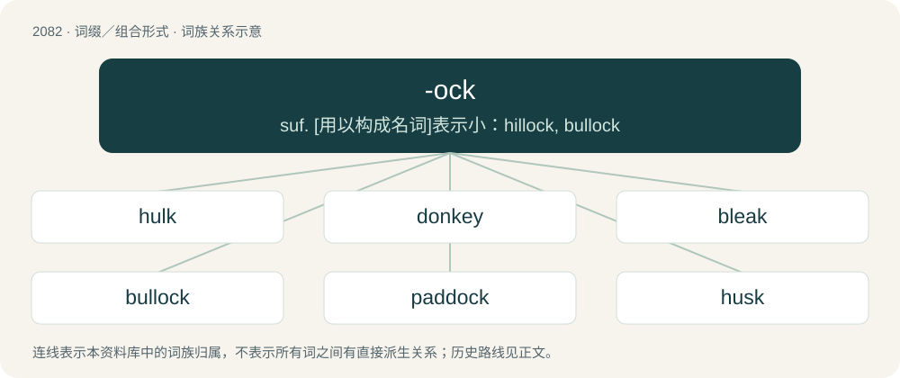

# 2185 · -ock — suf. \[用以构成名词\]表示小：hillock, bullock

[总目录](../00_总目录_按常用程度.md)

**类型**：词缀／组合形式　｜　**来源语言**：见词源记录

## 核心含义与来源

- 核心含义：suf. \[用以构成名词\]表示小：hillock, bullock
- 英文含义：Forming nouns from nouns, originally with a diminutive sense.
- 词形：-ock

**来源记录 1**（后缀／后置成分；Forming nouns from nouns, originally with a diminutive sense.）

From Middle English -ock, -ok, -uk, -uck, from Old English -oc, -uc (diminutive suffix), from Proto-West Germanic \*-uk, from Proto-Germanic \*-ukaz (diminutive suffix). Akin to Old Saxon -ik (diminutive suffix), German -ich, Middle Low German -ken (diminutive suffix), Middle Dutch -kin, Old Norse -kr (diminutive suffix). More at -kin.

## 词族图

## 单词速览（常用到不常用）

| 单词 | 音标 | 释义 |
|---|---|---|
| [hulk](#w-1) | 英 /hʌlk/ | n. 船体, 笨重的船, 废然大物 |
| [donkey](#w-2) | 英 /ˈdɒŋ.ki/；美 /ˈdɑŋ.ki/ | n. 驴子, 笨蛋, 顽固者, 辅助发动机, 辅助泵 |
| [bleak](#w-3) | /bliːk/ | 【英文】A small European river fish (Alburnus alburnus), of the family Cyprinidae. |
| [bullock](#w-4) | /ˈbʊlək/ | n. 阉牛 |
| [paddock](#w-5) | 英 /ˈpædək/；美 /ˈpædək/ | 【英文】A frog. |
| [husk](#w-6) | 英 /hʌsk/ | n. 外壳, 皮, 无价值之物；vt. 剥...的壳, 削皮 |
| [maggot](#w-7) | /ˈmæɡət/ | n. 狂想, 空想, 蛆；\[医\] 蛆 |
| [buttock](#w-8) | 英 /ˈbʌtək/；美 /ˈbʌtək/ | n. 半边臀部, 屁股, 船尾突出部；vt. 过背摔 |
| [hillock](#w-9) | 英 /ˈhɪl.ək/ | n. 小丘, 小高处, 土堆；\[医\] 丘, 阜 |
| [shuck](#w-10) | /ʃʌk/ | n. 壳, 外皮, 牡蛎壳；v. 剥去, 脱去 |
| [tussock](#w-11) | 英 /ˈtʌs.ək/ | n. 草丛 |

## 逐词详解

### 1. hulk

**词性**：名词　｜　**音标**：英 /hʌlk/

**中文释义**：n. 船体, 笨重的船, 废然大物

**英文义项**：A non-functional but floating ship, usually stripped of equipment and rigging, and often put to other uses such as accommodation or storage. / A large structure with a dominating presence.

**构词拆分**：hole/hollow + -ock

**词源与演化**：

From Middle English hulk, hulke, holke (“hut; shed for hogs; type of ship; husk, pod, shell; large, clumsy person; a giant”) (probably reinforced by Middle Dutch hulk, huelc, and Middle Low German hulk, holk, hollek (“freighter, cargo ship, barge”)), from Old English hulc (“light ship; heavy, clumsy ship; cabin, hovel, hut”), from Proto-West Germanic \*huluk, \*hulik, from Proto-Germanic \*hulukaz, \*hulikaz (“something hollowed or dug out, cavity”), equivalent to hole/hollow + -ock. Cognate with Old High German holcho (“cargo or transport ship, barge”) (whence Middle High German holche, modern German Holk), Old Norse hólkr (“metal tube, ring”), dialectal Norwegian holk, hylke (“wooden barrel”), Middle English holken (“to dig out, gouge”). Relation to Medieval Latin hulcus (“ship”) is uncertain, as Old English may have borrowed from Latin or vice versa, but the form holcas rather points to borrowing from Ancient Greek ὁλκάς (holkás, “ship being towed; cargo ship, ship used for trading, holcad”) (compare Ancient Greek ἕλκω (hélkō, “to drag”), possibly from Proto-Indo-European \*selk- (“to draw, pull”)). See more at the Old English entry hulc. The verb is derived from the noun.

**例句**：

> Karl turned into a green humanoid named Hulk.

### 2. donkey

**词性**：名词　｜　**音标**：英 /ˈdɒŋ.ki/；美 /ˈdɑŋ.ki/

**中文释义**：n. 驴子, 笨蛋, 顽固者, 辅助发动机, 辅助泵

**英文义项**：A domestic animal, Equus asinus asinus, similar to a horse. / A stubborn person.

**词源与演化**：

The origin is uncertain. Originally a slang term from the late eighteenth century. Perhaps from Middle English \*donekie (“a miniature dun horse”), a double diminutive of Middle English don, dun, dunne (a name for a dun horse), equivalent to modern English dun (“brownish grey colour”) + -ock (diminutive suffix) + -ie (diminutive suffix), or similarly formed from the given name Duncan. Compare Middle English donning (“a dun horse”), English dunnock. Became more common than the original term ass due to the latter's homophony and partial merger with arse (compare similar development between coney and rabbit).

**例句**：

> The horsepower of a car matters not, with a donkey in control.

### 3. bleak

**词性**：名词　｜　**音标**：/bliːk/

**英文义项**：A small European river fish (Alburnus alburnus), of the family Cyprinidae.

**构词拆分**：blay + -ock；blay + -kin

**词源与演化**：

From Middle English bleke (“small river fish, bleak, blay”), perhaps an alteration (due to Old English blǣc (“bright”) or Old Norse bleikja) of Old English blǣġe (“bleak, blay, gudgeon”); or perhaps from a diminutive of Middle English \*bleye (“blay”), equivalent to blay + -ock or blay + -kin. See blay.

### 4. bullock

**词性**：名词　｜　**音标**：/ˈbʊlək/

**中文释义**：n. 阉牛

**英文义项**：A castrated bull; an ox.

**构词拆分**：bull + -ock (diminutive suffix)

**词源与演化**：

From Middle English bullok, from Old English bulluc, from Proto-West Germanic \*bulluk, corresponding to bull + -ock (diminutive suffix). Compare Old Dutch bullok (“bullock”).

### 5. paddock

**词性**：名词　｜　**音标**：英 /ˈpædək/；美 /ˈpædək/

**英文义项**：A frog. / A toad.

**构词拆分**：pad (“(Britain, dialectal) frog; toad”) + -ock (suffix forming nouns, originally with diminutive senses)

**词源与演化**：

From Middle English paddok, paddoke (“frog; toad”) \[and other forms\], from pad, pade (“frog; toad”) + -ok (diminutive suffix). Pad, pade is derived from Old English \*pada, \*padda, padde, from Proto-West Germanic \*paddā, from Proto-Germanic \*paddǭ (“toad”); further etymology uncertain, possibly ultimately from Proto-Indo-European \*bʰew- (“to swell”). The English word is analysable as pad (“(Britain, dialectal) frog; toad”) + -ock (suffix forming nouns, originally with diminutive senses). Sense 2 (“sledge”) is probably from the supposed resemblance of the object to a frog or toad.

**例句**：

> Cold as a paddock.

该用例对应义项：A frog.

### 6. husk

**词性**：名词　｜　**音标**：英 /hʌsk/

**中文释义**：n. 外壳, 皮, 无价值之物；vt. 剥...的壳, 削皮

**英文义项**：The dry, leafy or stringy exterior of certain vegetables or fruits, which must be removed before eating the meat inside. / Any form of useless, dried up, and subsequently worthless exterior of something.

**构词拆分**：hose + -ock

**词源与演化**：

From Middle English huske, husk (“husk”). Perhaps from Old English \*husuc, \*hosuc (“little covering, sheath”), diminutive of hosu (“pod, shell, husk”), from Proto-West Germanic \*hosā, from Proto-Germanic \*husǭ (“covering, shell, leggings”), from Proto-Indo-European \*kawəs- / kawes- (“cover”). If so, equivalent to hose + -ock. Alternatively from Middle Low German hûs(e)ken, hü̂seken (“little house, sheath”), Middle Dutch husekijn (“little house, core of fruit, case”), diminutive of hûs (“house”). Compare Dutch huisje, German Häuschen, both also used for “snailshell”.

**例句**：

> His attorney was a dried-up husk of a man.

该用例对应义项：Any form of useless, dried up, and subsequently worthless exterior of something.

### 7. maggot

**词性**：名词　｜　**音标**：/ˈmæɡət/

**中文释义**：n. 狂想, 空想, 蛆；\[医\] 蛆

**英文义项**：A soft, legless larva of a fly or other dipteran insect, that often eats decomposing organic matter. / A worthless, obnoxious or contemptible person.

**构词拆分**：made + -ock

**词源与演化**：

From Middle English magot, magat, maked, probably a metathetic alteration of maddock, maðek (“worm", "maggot”), originally a diminutive form of a base represented by Old English maþa (Scots mathe), from Proto-West Germanic \*maþō, from Proto-Germanic \*maþô, from the Proto-Indo-European root \*mat, which was used in insect names, equivalent to made + -ock. Near-cognates include Dutch made, German Made and Swedish mask, Icelandic maðkur (“worm, grub, maggot”). The use of maggot to mean a fanciful or whimsical thing derives from the folk belief that a whimsical or crotchety person had maggots in their brain.

**例句**：

> Drop and give me fifty, maggot.

该用例对应义项：A worthless, obnoxious or contemptible person.

### 8. buttock

**词性**：名词　｜　**音标**：英 /ˈbʌtək/；美 /ˈbʌtək/

**中文释义**：n. 半边臀部, 屁股, 船尾突出部；vt. 过背摔

**英文义项**：Each of the two large fleshy halves of the posterior part of the body between the base of the back, the perineum, and the top of the legs. / The convexity of a ship behind, under the stern.

**构词拆分**：butt + -ock (diminutive suffix)

**词源与演化**：

Inherited from Middle English buttok, probably from Old English buttuc (“end; end piece”; also, “short piece of land”). Attested with its current anatomical meaning since 1300. A diminutive form of what is presumably the Old English precursor of butt + -ock (diminutive suffix).

**例句**：

> My younger sister has a tattoo on her right buttock.

### 9. hillock

**词性**：名词　｜　**音标**：英 /ˈhɪl.ək/

**中文释义**：n. 小丘, 小高处, 土堆；\[医\] 丘, 阜

**英文义项**：A small hill.

**构词拆分**：hill + -ock

**词源与演化**：

From Middle English hillok, equivalent to hill + -ock.

**例句**：

> I went to the top of the hillock and looked about me.

### 10. shuck

**词性**：动词　｜　**音标**：/ʃʌk/

**中文释义**：n. 壳, 外皮, 牡蛎壳；v. 剥去, 脱去

**英文义项**：To remove the shuck from (walnuts, oysters, etc.). / To remove (any outer covering).

**构词拆分**：shell + -ock (diminutive suffix)；shell + -k (diminutive suffix)

**词源与演化**：

Origin unknown. Possibly a dialectal survival of unrecorded Middle English \*schulk(e), \*schullok (“small shell”); either from Old English \*sċylluc, \*sċylloc, diminutive of Old English sċyll (“shell”), or alternatively created in Middle English from Middle English schulle, schelle (“shell, husk, pod”) + -ok, making it equivalent to shell + -ock (diminutive suffix) or shell + -k (diminutive suffix).

**例句**：

> I will shuck my clothes and dive naked into the pool.

该用例对应义项：To remove (any outer covering).

### 11. tussock

**词性**：名词　｜　**音标**：英 /ˈtʌs.ək/

**中文释义**：n. 草丛

**英文义项**：A tuft or clump of green grass or similar verdure, forming a small hillock. / Tussock grass.

**构词拆分**：tusk + -ock (diminutive suffix)

**词源与演化**：

Uncertain. Likely from or related to tusk + -ock (diminutive suffix). Compare Middle High German zūsach (“thicket”), a derivative of Middle High German zūse (“lock of hair”). Compare also Scottish Gaelic dosag (“little tuft”).
