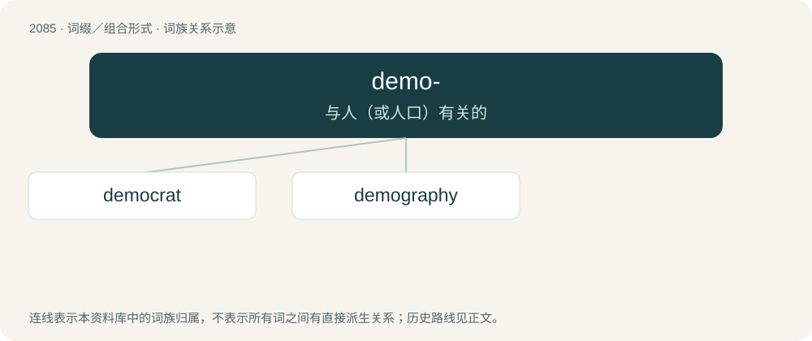

# 2189 · demo- — 与人（或人口）有关的

[总目录](../00_总目录_按常用程度.md)

**类型**：词缀／组合形式　｜　**来源语言**：见词源记录

## 核心含义与来源

- 核心含义：与人（或人口）有关的
- 英文含义：people
- 词形：demo-

**来源记录 1**（前缀／前置成分；people）

From Ancient Greek δημο- (dēmo-), from δῆμος (dêmos, “people”).

## 词族图

## 单词速览（常用到不常用）

| 单词 | 音标 | 释义 |
|---|---|---|
| [democrat](#w-1) | 英 /ˈdɛməkɹæt/；美 /ˈdɪməkɹæt/ | n. 民主人士, 民主主义者, 民主党党员；\[经\] 民主党 |
| [demography](#w-2) | 英 /dɪˈmɒɡɹəfi/ | n. 人口统计学；\[医\] 人口学, 人口统计学 |

## 逐词详解

### 1. democrat

**词性**：名词　｜　**音标**：英 /ˈdɛməkɹæt/；美 /ˈdɪməkɹæt/

**中文释义**：n. 民主人士, 民主主义者, 民主党党员；\[经\] 民主党

**英文义项**：A supporter of democracy; an advocate of democratic politics (originally (historical) as opposed to the aristocrats in Revolutionary France). / Someone who rules a representative democracy.

**构词拆分**：demo- + -crat

**词源与演化**：

From French démocrate, from démocratie (modelled on aristocrate (“aristocrat”)), equivalent to demo- + -crat.

**例句**：

> I don't support the Democratic Party, but I am a small "d" democrat.

### 2. demography

**词性**：名词　｜　**音标**：英 /dɪˈmɒɡɹəfi/

**中文释义**：n. 人口统计学；\[医\] 人口学, 人口统计学

**英文义项**：The study of the characteristics of human populations, especially with regards to their makeup and fluctuations and the social causes behind these. / The study of the structure and population dynamics of other lifeforms, such as mammals, insects, plants, etc.

**构词拆分**：demo- (“people”) + -graphy (“written representation of”)

**词源与演化**：

From demo- (“people”) + -graphy (“written representation of”) (From Ancient Greek δῆμος (dêmos, “people”) and Ancient Greek -γραφία (-graphía), from γραφή (graphḗ, “writing, drawing, description”)).

**例句**：

> Due to its geography and demography, conquering Panjshir by force is considered extremely difficult.
