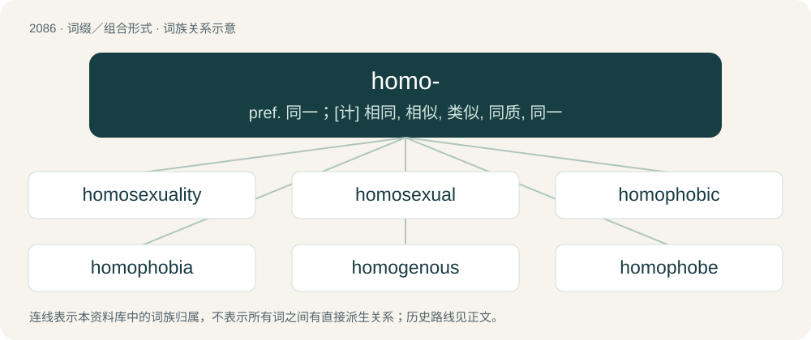

# 2190 · homo- — pref. 同一；\[计\] 相同, 相似, 类似, 同质, 同一

[总目录](../00_总目录_按常用程度.md)

**类型**：词缀／组合形式　｜　**来源语言**：见词源记录

## 核心含义与来源

- 核心含义：pref. 同一；\[计\] 相同, 相似, 类似, 同质, 同一
- 英文含义：Same, identical.
- 词形：homo-

**多个词源／构词路径**：同一拼写可能有不同来源；以下按词性和含义分别列出。

**来源记录 1**（前缀／前置成分；Same, identical.）

From Ancient Greek ὁμός (homós, “same”). By surface analysis, hom- + -o-.

**来源记录 2**（前缀／前置成分；Of or pertaining to homosexuality or same-sex relations.）

Back-formation from homosexual, ultimately from Ancient Greek ὁμός (homós, “same”).

**来源记录 3**（前缀／前置成分；Used to form the names of compounds derived from simpler ones by addition of a methylene group.）

Back-formation from homologue, ultimately from Ancient Greek ὁμός (homós, “same”).

## 词族图

## 单词速览（常用到不常用）

| 单词 | 音标 | 释义 |
|---|---|---|
| [homosexuality](#w-1) | 英 /ˌhəʊmə(ʊ)sɛkʃʊˈælɪti/；美 /ˌhoʊməˌsɛkʃuˈælɪti/ | n. 同性恋；\[医\] 同性性欲, 同性恋爱 |
| [homosexual](#w-2) | /ˌhɒməʊˈsɛksjuːəl/ | a. 同性恋的；n. 同性恋者 |
| [homophobic](#w-3) | 英 /ˈhəʊ.məˌfəʊ.bɪk/；美 /ˈhoʊ.məˌfoʊ.bɪk/ | a. 害怕同性恋的 |
| [homophobia](#w-4) | 英 /ˌhəʊ.məˈfəʊ.bi.ə/；美 /ˌhoʊ.məˈfoʊ.bi.ə/ | n. 对同性恋的憎恶（或恐惧） |
| [homogenous](#w-5) | 英 /həˈmɒd͡ʒɪnəs/；美 /həˈmɑd͡ʒɪnəs/ | a. 同质的, 相似的；\[医\] 同源的, 纯系的, 同质的 |
| [homophobe](#w-6) | 英 /ˈhəʊ.məˌfəʊb/；美 /ˈhoʊ.məˌfoʊb/ | n. 憎恶同性恋的人 |
| [homozygous](#w-7) | /ˌhəʊməʊˈzaɪɡəs/ | \[医\] 纯合的, 同型\[接合\]的 |
| [homoerotic](#w-8) | 英 /ˌhəʊməʊəˈɹɒtɪk/；美 /ˌhoʊmoʊəˈɹɑtɪk/ | \[医\] 同性恋爱的 |
| [homocysteine](#w-9) | /,həuməuˈsistiːin/ | \[化\] 高半胱氨酸；\[医\] 高半胱氨酸 |
| [homolog](#w-10) | 英 /ˈhɒməlɒɡ/；美 /ˈhɑːməlɑːɡ/ | n. 相当或相同的事物, 相同器官, 同族体；\[化\] 同系物; 同系化合物 |
| [homomorphism](#w-11) | /,hɔməˈmɔːfizm/ | \[计\] 同态；\[化\] 异质同晶; 异质同晶现象; 同态 |

## 逐词详解

### 1. homosexuality

**词性**：名词　｜　**音标**：英 /ˌhəʊmə(ʊ)sɛkʃʊˈælɪti/；美 /ˌhoʊməˌsɛkʃuˈælɪti/

**中文释义**：n. 同性恋；\[医\] 同性性欲, 同性恋爱

**英文义项**：The state of being sexually and romantically attracted primarily or exclusively to persons of the same sex, sometimes (potentially offensive) restricted to same-sex attraction between males. / Sexual activity with a person of the same sex, sometimes (potentially offensive) restricted to same-sex sex between males.

**构词拆分**：homosexual + -ity；homo- + sexuality

**词源与演化**：

From homosexual + -ity, equivalent to homo- + sexuality and after the model of German Homosexualität, coined by journalist Karl Maria Kertbeny in 1869, and French homosexualité, attested in 1891.

**例句**：

> Is it still allowed to think that homosexuality is a sin?

### 2. homosexual

**词性**：形容词　｜　**音标**：/ˌhɒməʊˈsɛksjuːəl/

**中文释义**：a. 同性恋的；n. 同性恋者

**英文义项**：Sexually and/or romantically attracted to members of the same sex, such as a man who is attracted to other men or a woman who is attracted to other women; gay. (Typically used in the sense of sole/exclusive attraction.) / Between two people of the same sex; gay.

**构词拆分**：homo- + -sexual

**词源与演化**：

Borrowed from German homosexual, from homo- (“same”) + sexual (“relating to sex or sexuality”), coined by Karl Maria Kertbeny in 1868, and popularized in Richard von Krafft-Ebing's Psychopathia Sexualis (2nd ed. 1887, in German) and Charles Gilbert Chaddock's 1892 English translation thereof (compare bisexual), displacing the slightly older term Uranian. Equivalent to homo- + -sexual.

**例句**：

> Most western countries have repealed laws against homosexual activity between consenting adults.

该用例对应义项：Between two people of the same sex; gay.

### 3. homophobic

**词性**：形容词　｜　**音标**：英 /ˈhəʊ.məˌfəʊ.bɪk/；美 /ˈhoʊ.məˌfoʊ.bɪk/

**中文释义**：a. 害怕同性恋的

**英文义项**：Exhibiting homophobia; characteristic of homophobes. / Inconvenient, annoying, irritating.

**构词拆分**：homo- + -phobic

**词源与演化**：

From homo- (“homosexual”) + -phobic.

**例句**：

> My bus left right as I got to the station. It's so homophobic of the driver to not wait for me!

该用例对应义项：Inconvenient, annoying, irritating.

### 4. homophobia

**词性**：名词　｜　**音标**：英 /ˌhəʊ.məˈfəʊ.bi.ə/；美 /ˌhoʊ.məˈfoʊ.bi.ə/

**中文释义**：n. 对同性恋的憎恶（或恐惧）

**英文义项**：Hatred, fear, aversion, or prejudice towards homosexuals. / Hatred, fear, aversion, or prejudice towards LGBTQ people in general.

**构词拆分**：homo- + -phobia；homo- (short for and prefix of homosexual) + -phobia

**词源与演化**：

From homo- (short for and prefix of homosexual) + -phobia. Coined by American psychologist George Weinberg in 1971 in Society and the Healthy Homosexual.

**例句**：

> Racism and homophobia are still major problems in professional football.

### 5. homogenous

**词性**：形容词　｜　**音标**：英 /həˈmɒd͡ʒɪnəs/；美 /həˈmɑd͡ʒɪnəs/

**中文释义**：a. 同质的, 相似的；\[医\] 同源的, 纯系的, 同质的

**英文义项**：Having the same genetic structure; exhibiting homogeny.

**构词拆分**：homo- + gene + -ous

**词源与演化**：

From homo- + gene + -ous.

**例句**：

> The English teacher's passive-aggressive behavior promotes a homogenous and exclusive environment.

### 6. homophobe

**词性**：名词　｜　**音标**：英 /ˈhəʊ.məˌfəʊb/；美 /ˈhoʊ.məˌfoʊb/

**中文释义**：n. 憎恶同性恋的人

**英文义项**：One who is prejudiced against homosexual people, or LGBTQ people in general; one who exhibits homophobia.

**构词拆分**：homo- + -phobe

**词源与演化**：

Back-formation from homophobia, equivalent to homo- + -phobe (notice in Greek it would refer to a self-hater).

**例句**：

> His father is a raging homophobe.

### 7. homozygous

**词性**：形容词　｜　**音标**：/ˌhəʊməʊˈzaɪɡəs/

**中文释义**：\[医\] 纯合的, 同型\[接合\]的

**英文义项**：Of an organism in which both copies of a given gene have the same allele

**构词拆分**：From homo- + -zygous.

**词源与演化**：

From homo- + -zygous.

### 8. homoerotic

**词性**：形容词　｜　**音标**：英 /ˌhəʊməʊəˈɹɒtɪk/；美 /ˌhoʊmoʊəˈɹɑtɪk/

**中文释义**：\[医\] 同性恋爱的

**英文义项**：Arousing a homosexual desire. / Pertaining to homosexual love or desire

**构词拆分**：homo- + erotic

**词源与演化**：

From homo- + erotic.

**例句**：

> Good banter really elevates a homoerotic swordfight.

### 9. homocysteine

**词性**：名词　｜　**音标**：/,həuməuˈsistiːin/

**中文释义**：\[化\] 高半胱氨酸；\[医\] 高半胱氨酸

**英文义项**：An amino acid which is monitored in the blood to estimate risk of cardiovascular disease.

**构词拆分**：From homo- + cysteine.

**词源与演化**：

From homo- + cysteine.

### 10. homolog

**词性**：名词　｜　**音标**：英 /ˈhɒməlɒɡ/；美 /ˈhɑːməlɑːɡ/

**中文释义**：n. 相当或相同的事物, 相同器官, 同族体；\[化\] 同系物; 同系化合物

**英文义项**：A phoneme, morpheme, or word shared by two languages or dialects, via cognation or naturalization. / One of a group of similar DNA sequences that share a common ancestry, or the peptides or proteins that they encode; the counterpart gene or protein in another taxon evolved from a common ancestor (molecularly it may be either identical or similar).

**构词拆分**：homo- + -log

**词源与演化**：

Borrowed from French homologue, From Ancient Greek ὁμόλογος (homólogos, “agreeing, of one mind”), equivalent to homo- + -log.

**例句**：

> TP53 is the human homolog of murine Trp53.

该用例对应义项：One of a group of similar DNA sequences that share a common ancestry, or the peptides or proteins that they encode; the counterpart gene or protein in another taxon evolved from a common ancestor (molecularly it may be either identical or similar).

### 11. homomorphism

**词性**：名词　｜　**音标**：/,hɔməˈmɔːfizm/

**中文释义**：\[计\] 同态；\[化\] 异质同晶; 异质同晶现象; 同态

**英文义项**：A structure-preserving map between two algebraic structures of the same type, such as groups, rings, or vector spaces. / A similar appearance of two unrelated organisms or structures, as for example with fish and whales.

**构词拆分**：From homo- + morphism.

**词源与演化**：

From homo- + morphism.

**例句**：

> A field homomorphism is a map from one field to another one which is additive, multiplicative, zero-preserving, and unit-preserving.

该用例对应义项：A structure-preserving map between two algebraic structures of the same type, such as groups, rings, or vector spaces.
