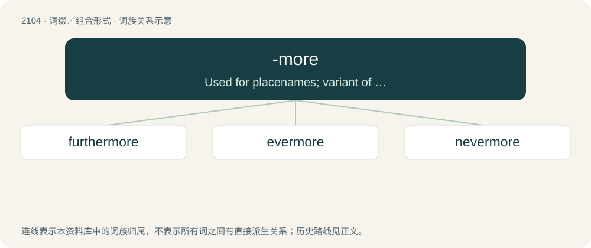

# 2212 · -more — Used for placenames; variant of moor.

[总目录](../00_总目录_按常用程度.md)

**类型**：词缀／组合形式　｜　**来源语言**：见词源记录

## 核心含义与来源

- 核心含义：Used for placenames; variant of moor.
- 英文含义：Used for placenames; variant of moor.
- 词形：-more

**来源记录 1**（后缀／后置成分；Used for placenames; variant of moor.）

Identical with moor.

## 词族图

## 单词速览（常用到不常用）

| 单词 | 音标 | 释义 |
|---|---|---|
| [furthermore](#w-1) | 英 /ˈfɜː(ɹ).ðə(ɹ)ˌmɔː(ɹ)/；美 /ˈfɝ.ðɚˌmoɹ/ | adv. 此外, 而且 |
| [evermore](#w-2) | 英 /ˌɛvəˈmɔː/；美 /ˌɛvɚˈmoɹ/ | adv. 永远, 经常, 从此以后 |
| [nevermore](#w-3) | /.nevəˈmɒː/ | adv. 决不再 |

## 逐词详解

### 1. furthermore

**词性**：副词　｜　**音标**：英 /ˈfɜː(ɹ).ðə(ɹ)ˌmɔː(ɹ)/；美 /ˈfɝ.ðɚˌmoɹ/

**中文释义**：adv. 此外, 而且

**英文义项**：In addition; besides; further; what's more (i.e. to denote additional information).

**构词拆分**：further + -more

**词源与演化**：

From Middle English furthermore, forthermore, forthermar (also as forther mo), equivalent to further + -more.

**例句**：

> He skillfully took charge of the event, and furthermore, he stayed late after it to clean up.

该用例对应义项：In addition; besides; further; what's more (i.e. to denote additional information).

### 2. evermore

**词性**：副词　｜　**音标**：英 /ˌɛvəˈmɔː/；美 /ˌɛvɚˈmoɹ/

**中文释义**：adv. 永远, 经常, 从此以后

**英文义项**：Always; forever; eternally. / At any time in the future.

**构词拆分**：ever + -more

**词源与演化**：

From Middle English evermore (written as two words before 14th century), equivalent to ever + -more.

**例句**：

> Lead a blameless life evermore.

该用例对应义项：at any future time; in the future

### 3. nevermore

**词性**：副词　｜　**音标**：/.nevəˈmɒː/

**中文释义**：adv. 决不再

**英文义项**：Never again; at no time in the future.

**构词拆分**：never + -more

**词源与演化**：

From Middle English nevermore, from the Old English phrase nǣfre mā. Equivalent to never + -more.

**例句**：

> Quoth the raven, nevermore!

该用例对应义项：at no time hereafter
