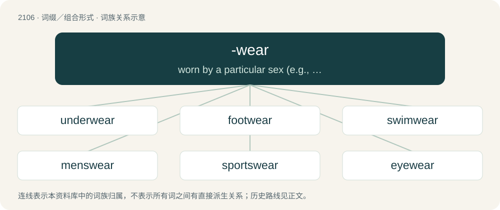

# 2214 · -wear — worn by a particular sex (e.g., menswear, womenswear) or age of person (e.g., kidswear).

[总目录](../00_总目录_按常用程度.md)

**类型**：词缀／组合形式　｜　**来源语言**：见词源记录

## 核心含义与来源

- 核心含义：worn by a particular sex (e.g., menswear, womenswear) or age of person (e.g., kidswear).
- 英文含义：worn by a particular sex (e.g., menswear, womenswear) or age of person (e.g., kidswear).
- 词形：-wear

**来源记录 1**（后缀／后置成分；worn by a particular sex (e.g., menswear, womenswear) or age of person (e.g., kidswear).）

From the noun wear (“clothing”).

## 词族图

## 单词速览（常用到不常用）

| 单词 | 音标 | 释义 |
|---|---|---|
| [underwear](#w-1) | 英 /ˈʌndəwɛə/；美 /ˈʌndɚˌwɛɹ/ | n. 内衣 |
| [footwear](#w-2) | /ˈfʊtwɛə(ɹ)/ | n. 鞋类, 靴类 |
| [swimwear](#w-3) | /ˈswɪmweə(r)/ | n. 游泳衣 |
| [menswear](#w-4) | 美 /ˈmɛnz.wɛɚ/ | n. 男服 |
| [sportswear](#w-5) | /ˈspɒːtswєə/ | n. 运动装, 休闲服 |
| [eyewear](#w-6) | /ˈaɪweə(r)/ | \[医\]护目镜 |
| [streetwear](#w-7) |  | 【英文】urban fashion; clothing that can be worn on the street |
| [outerwear](#w-8) | /ˈajtəweə(r)/ | n. 外衣, 外套 |
| [knitwear](#w-9) | /ˈnit,weə/ | n. 针织品 |
| [headwear](#w-10) | /ˈhɛdˌweə(ɹ)/ | n. 头饰, 吊索 |
| [womenswear](#w-11) |  | n. 妇女服装 |
| [workwear](#w-12) | 英 /ˈwɜːkwɛə/；美 /ˈwɝkwɛɹ/ | n. 工作服 |
| [sleepwear](#w-13) | /ˈsliːpwєə/ | n. 睡衣裤 |
| [nightwear](#w-14) | 英 /ˈnaɪt.wɛə/；美 /ˈnaɪt.wɛ(ə)ɹ/ | n. 睡衣 |
| [activewear](#w-15) | /ˈæktiv,wεə/ | n. 运动服（等于active wear） |
| [shapewear](#w-16) | /ʃeɪpˈwɜːr/ | 塑身内衣 |
| [beachwear](#w-17) | /ˈbiːtʃweə(r)/ | n. 海滩装(包括游泳衣裤,短裤,浴衣等) |

## 逐词详解

### 1. underwear

**词性**：名词　｜　**音标**：英 /ˈʌndəwɛə/；美 /ˈʌndɚˌwɛɹ/

**中文释义**：n. 内衣

**英文义项**：Clothes worn next to the skin, underneath outer clothing. / Underpants (boxers, briefs, panties, etc) and often bras.

**构词拆分**：under- + -wear

**词源与演化**：

From under- + -wear. Compare Dutch ondergoed, German Unterwäsche, Swedish underkläder.

**例句**：

> The only evidence was the traces of semen stuck to the underwear.

### 2. footwear

**词性**：名词　｜　**音标**：/ˈfʊtwɛə(ɹ)/

**中文释义**：n. 鞋类, 靴类

**英文义项**：Accesories or clothing that is worn on the foot; a shoe, sandal, etc.

**构词拆分**：foot + -wear

**词源与演化**：

From foot + -wear.

**例句**：

> The footwear the murderer left at the crime scene was a red herring.

### 3. swimwear

**词性**：名词　｜　**音标**：/ˈswɪmweə(r)/

**中文释义**：n. 游泳衣

**英文义项**：Items of clothing appropriate for swimming.

**构词拆分**：swim + -wear

**词源与演化**：

From swim + -wear.

**例句**：

> Tom is a designer of swimwear.

### 4. menswear

**词性**：名词　｜　**音标**：美 /ˈmɛnz.wɛɚ/

**中文释义**：n. 男服

**英文义项**：Men's clothing (and accessories), particularly in a retail context.

**构词拆分**：men + -s- + -wear

**词源与演化**：

From men + -s- + -wear.

**例句**：

> Shirts can be found in the menswear department.

### 5. sportswear

**词性**：名词　｜　**音标**：/ˈspɒːtswєə/

**中文释义**：n. 运动装, 休闲服

**英文义项**：Casual clothing that is comfortable to wear when exercising or partaking in sport; activewear.

**构词拆分**：sports + -wear

**词源与演化**：

From sports + -wear.

**例句**：

> Sportswear is frequently worn as everyday wear by many college students.

### 6. eyewear

**词性**：名词　｜　**音标**：/ˈaɪweə(r)/

**中文释义**：\[医\]护目镜

**英文义项**：A vision aid or similar device worn over the eyes, such as eyeglasses, contact lenses, or protective goggles.

**构词拆分**：eye + -wear

**词源与演化**：

From eye + -wear.

**例句**：

> Almost all patients require corrective eyewear after cataract surgery.

### 7. streetwear

**词性**：名词

**英文义项**：urban fashion; clothing that can be worn on the street

**构词拆分**：street + -wear

**词源与演化**：

From street + -wear.

**例句**：

> I am designing a line of streetwear.

### 8. outerwear

**词性**：名词　｜　**音标**：/ˈajtəweə(r)/

**中文释义**：n. 外衣, 外套

**英文义项**：Clothing (such as a dress) worn over one's underwear. / Clothing (such as a raincoat) worn over one's clothes when outdoors.

**构词拆分**：outer + -wear

**词源与演化**：

From outer + -wear.

**例句**：

> Please refrain from blocking unoccupied seats with baggage or outerwear, so that passengers boarding may take the seats.

### 9. knitwear

**词性**：名词　｜　**音标**：/ˈnit,weə/

**中文释义**：n. 针织品

**英文义项**：knitted garments

**构词拆分**：knit + -wear

**词源与演化**：

From knit + -wear.

**例句**：

> Fashion company Betabrand saw that knitwear was a hot style in sneakers and wanted to quickly jump on the trend.

### 10. headwear

**词性**：名词　｜　**音标**：/ˈhɛdˌweə(ɹ)/

**中文释义**：n. 头饰, 吊索

**英文义项**：Clothing or other items worn on the head.

**构词拆分**：head + -wear

**词源与演化**：

From head + -wear. Piecewise doublet of chefwear.

**例句**：

> A turban is a piece of cloth-based headwear worn by people in various cultures, often also serving as a religious observance.

### 11. womenswear

**词性**：名词

**中文释义**：n. 妇女服装

**英文义项**：Women's clothing (and accessories), particularly in a retail context.

**构词拆分**：women + -s- + -wear

**词源与演化**：

From women + -s- + -wear.

### 12. workwear

**词性**：名词　｜　**音标**：英 /ˈwɜːkwɛə/；美 /ˈwɝkwɛɹ/

**中文释义**：n. 工作服

**英文义项**：Clothes designed to be worn while working, especially in a physically demanding job.

**构词拆分**：work + -wear

**词源与演化**：

From work + -wear.

### 13. sleepwear

**词性**：名词　｜　**音标**：/ˈsliːpwєə/

**中文释义**：n. 睡衣裤

**英文义项**：garments designed to be worn in bed; nightclothes

**构词拆分**：sleep + -wear

**词源与演化**：

From sleep + -wear.

### 14. nightwear

**词性**：名词　｜　**音标**：英 /ˈnaɪt.wɛə/；美 /ˈnaɪt.wɛ(ə)ɹ/

**中文释义**：n. 睡衣

**英文义项**：Clothes worn at nighttime or in bed, such as pyjamas

**构词拆分**：night + -wear

**词源与演化**：

From night + -wear.

### 15. activewear

**词性**：名词　｜　**音标**：/ˈæktiv,wεə/

**中文释义**：n. 运动服（等于active wear）

**英文义项**：Casual clothing that is comfortable to wear when exercising or partaking in sport; sportswear.

**构词拆分**：active + -wear

**词源与演化**：

From active + -wear.

### 16. shapewear

**词性**：名词　｜　**音标**：/ʃeɪpˈwɜːr/

**中文释义**：塑身内衣

**英文义项**：Foundation garments, designed to hold a part of the body in a particular form.

**构词拆分**：shape + -wear

**词源与演化**：

From shape + -wear.

### 17. beachwear

**词性**：名词　｜　**音标**：/ˈbiːtʃweə(r)/

**中文释义**：n. 海滩装(包括游泳衣裤,短裤,浴衣等)

**英文义项**：Clothing suitable for wearing on the beach, though not necessarily for swimming in.

**构词拆分**：beach + -wear

**词源与演化**：

From beach + -wear.
