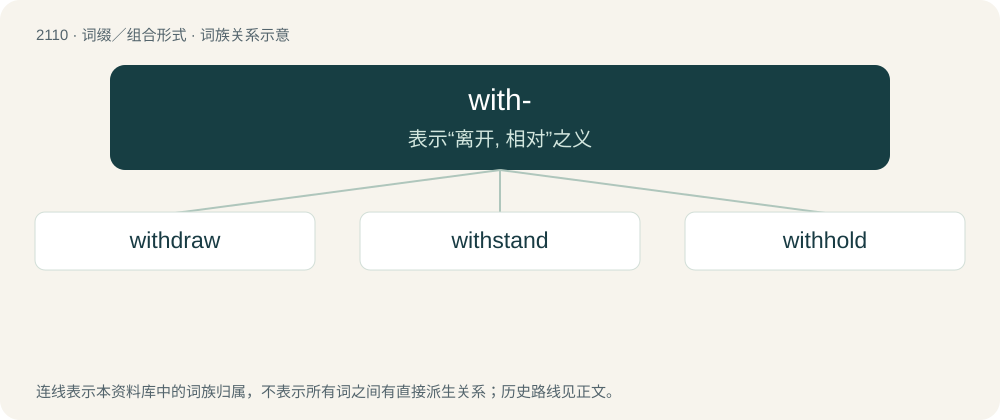

# 2217 · with- — 表示“离开, 相对”之义

[总目录](../00_总目录_按常用程度.md)

**类型**：词缀／组合形式　｜　**来源语言**：见词源记录

## 核心含义与来源

- 核心含义：表示“离开, 相对”之义
- 英文含义：Prefix meaning "against", "in opposition to".
- 词形：with-

**来源记录 1**（前缀／前置成分；Prefix meaning "against", "in opposition to".）

From Middle English with-, from Old English wiþ- (“against, away”, prefix), from Proto-West Germanic \*wiþi-, from Proto-Germanic \*wiþi- (“counter-, anti-, gain-, with-”), related to Old English wiþ (“with, by, near, against, beside, at, through, for, in return, opposite, towards, to”, preposition). Cognate with Old Frisian with-, Old Saxon with-, Danish ved-, Swedish vid-, Faroese við-, Icelandic við-. Related also to English wither-, and Dutch weder- (“back”), German wider- (“against”), German wieder- (“again”). More at with.

## 词族图

## 单词速览（常用到不常用）

| 单词 | 音标 | 释义 |
|---|---|---|
| [withdraw](#w-1) | 英 /wɪðˈdɹɔː/；美 /wɪðˈdɹɔ/ | vt. 撤回, 取回, 撤消, 使撤退, 拉开, 移开；vi. 撤退, 离开 |
| [withstand](#w-2) | /wɪðˈstænd/ | vt. 抵住, 顶住, 经得起 |
| [withhold](#w-3) | 英 /wɪθˈhəʊld/；美 /wɪθˈhoʊld/ | vt. 使停止, 扣留, 保留, 拒给；vi. 克制, 忍住 |

## 逐词详解

### 1. withdraw

**词性**：动词　｜　**音标**：英 /wɪðˈdɹɔː/；美 /wɪðˈdɹɔ/

**中文释义**：vt. 撤回, 取回, 撤消, 使撤退, 拉开, 移开；vi. 撤退, 离开

**英文义项**：To draw or pull (something) away or back from its original position or situation. / To remove (someone or (reflexive, archaic) oneself) from a position or situation; specifically (military), to remove (soldiers) from a battle or position where they are stationed.

**构词拆分**：with- + draw

**词源与演化**：

From Middle English withdrawen, withdrauen (“to depart, leave, move away; (reflexive) to go away; (reflexive) to leave someone’s service; (often reflexive) to draw back or retreat (from a battlefield or dangerous place), withdraw; to abandon, desert; to go, go forth; to move; of the sea, water, etc.: to (cause to) ebb, recede, subside; to disappear; to slacken, wane; (often reflexive) to cease, stop; to desist, refrain; (reflexive) to go back on, recant; to avoid, eschew; to bring under control, contain, suppress; to curb, curtail; to delay, put off; to demur, refuse; to carry or take away, deprive of, remove; to contract, draw away or in, retract; to deny, refuse; to revoke; to withhold; to divert; to separate; to adopt, borrow, imitate”) \[and other forms\], from with- (prefix meaning ‘away; back’) + drawen, drauen (“to drag, pull, tow, tug, draw \[and other senses\]”) (ultimately from Proto-Indo-European \*dʰregʰ- (“to drag, pull; to run”)); see further at with- and draw. The English word is analysable as with- + draw.

**用法示例／搭配（非完整句）**：

> to withdraw false charges

该用例对应义项：To take back (a comment, something written, etc.); to recant, to retract.

### 2. withstand

**词性**：动词　｜　**音标**：/wɪðˈstænd/

**中文释义**：vt. 抵住, 顶住, 经得起

**英文义项**：To resist or endure (something) successfully. / To oppose (something) forcefully.

**构词拆分**：with- (“against”) + stand

**词源与演化**：

From Middle English withstanden, from Old English wiþstandan, from Proto-West Germanic \*wiþistandan (“to withstand, resist”), equivalent to with- (“against”) + stand. Cognate with Old Frisian withstanda (“to resist”). Compare also Dutch weerstaan (“to withstand, repel”), German widerstehen (“to withstand, resist, defy”), Russian противостоять (protivostojatʹ, “to withstand”).

**例句**：

> Morality is mostly a matter of how much temptation you can withstand.

### 3. withhold

**词性**：动词　｜　**音标**：英 /wɪθˈhəʊld/；美 /wɪθˈhoʊld/

**中文释义**：vt. 使停止, 扣留, 保留, 拒给；vi. 克制, 忍住

**英文义项**：To keep (a physical object that one has obtained) to oneself rather than giving it back to its owner. / To keep (information, assent, etc.) to oneself rather than revealing it.

**构词拆分**：with- + hold

**词源与演化**：

From Middle English withholden. Equivalent to with- + hold.

**例句**：

> I’ll withhold from asking about it.

该用例对应义项：To stay back, to refrain.
