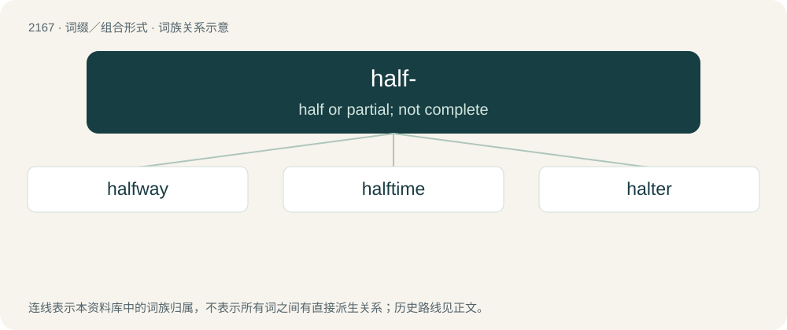

# 2272 · half- — half or partial; not complete

[总目录](../00_总目录_按常用程度.md)

**类型**：词缀／组合形式　｜　**来源语言**：见词源记录

## 核心含义与来源

- 核心含义：half or partial; not complete
- 英文含义：half or partial; not complete
- 词形：half-

**来源记录 1**（前缀／前置成分；half or partial; not complete）

From Middle English half-, from Old English healf-, from Proto-Germanic \*halba- (“half-”), from \*halbaz (“half”). Cognate with Dutch half- (“half-”), German halb- (“half-”), Swedish halv- (“half-”), Icelandic hálf- (“half-”). More at half.

## 词族图

## 单词速览（常用到不常用）

| 单词 | 音标 | 释义 |
|---|---|---|
| [halfway](#w-1) | 英 /hɑːfˈweɪ/；美 /ˌhæfˈweɪ/ | a. 中途的, 不彻底的, 部分的；adv. 半路地, 在中途, 在半途 |
| [halftime](#w-2) |  | n. 中场休息 |
| [halter](#w-3) | 英 /ˈhɒltə/；美 /ˈhɔltɚ/ | n. 缰绳, 笼头；\[法\] 绞刑, 绞索 |

## 逐词详解

### 1. halfway

**词性**：形容词　｜　**音标**：英 /hɑːfˈweɪ/；美 /ˌhæfˈweɪ/

**中文释义**：a. 中途的, 不彻底的, 部分的；adv. 半路地, 在中途, 在半途

**英文义项**：Middle; midway; being in the middle of the way or distance.

**构词拆分**：half- + way

**词源与演化**：

From Middle English halfwey, from Old English healfweġ (“half-way”), equivalent to half- + way. Compare partway. Cognate with Saterland Frisian hoolfwais (“halfway”), Dutch halfweg (“halfway”), German halbwegs (“halfway”), Danish halvvejs (“halfway”), Swedish halvvägs (“halfway”).

**例句**：

> John blacked out at the halfway point of the marathon.

该用例对应义项：Middle; midway; being in the middle of the way or distance.

### 2. halftime

**词性**：名词

**中文释义**：n. 中场休息

**英文义项**：The halftime show, the primary light entertainment of a game, after the second quarter, when players can physically recover, coaches can give players a pep talk, bets can be doubled, etc.

**构词拆分**：half- + time

**词源与演化**：

From half- + time.

**例句**：

> The referee blows his whistle for halftime.

### 3. halter

**词性**：动词　｜　**音标**：英 /ˈhɒltə/；美 /ˈhɔltɚ/

**中文释义**：n. 缰绳, 笼头；\[法\] 绞刑, 绞索

**英文义项**：To place a halter on.

**构词拆分**：half- + -ter

**词源与演化**：

From Middle English halter, helter, helfter, from Old English hælfter, hælftre (“halter”), from Proto-West Germanic \*halftrijā (“harness”), from Proto-Indo-European \*(s)kelH- (“to cut”), equivalent to half- + -ter. Cognate with Scots helter (“halter”), Dutch halfter, halster (“halter”), Low German halfter, helchter, halter (“halter”), German Halfter (“halter, holster”).

**例句**：

> What do you mean, you didn't halter the horses when we stopped for the night?

该用例对应义项：To place a halter on.
