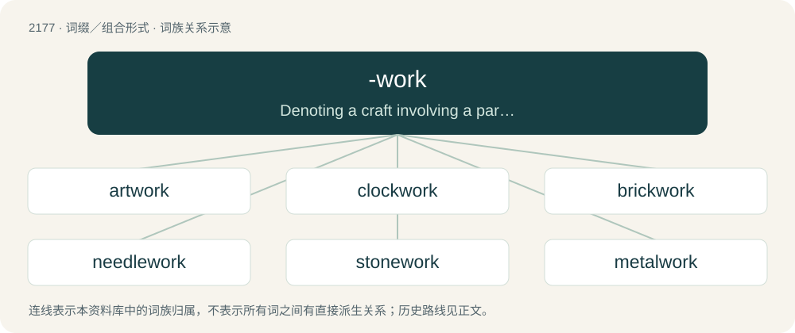

# 2278 · -work — Denoting a craft involving a particular material, tool, or practitioner

[总目录](../00_总目录_按常用程度.md)

**类型**：词缀／组合形式　｜　**来源语言**：见词源记录

## 核心含义与来源

- 核心含义：Denoting a craft involving a particular material, tool, or practitioner
- 英文含义：Denoting a craft involving a particular material, tool, or practitioner
- 词形：-work

**来源记录 1**（后缀／后置成分；Denoting a craft involving a particular material, tool, or practitioner）

From Middle English -work, -werk, from Old English -weorc, -ġeweorc, equivalent to English work. Compare also Saterland Frisian -werk, Dutch -werk, German -werk, Norwegian -verk.

## 词族图

## 单词速览（常用到不常用）

| 单词 | 音标 | 释义 |
|---|---|---|
| [artwork](#w-1) | 英 /ˈɑːtˌwɜːk/；美 /ˈɑɹtˌwɝk/ | n. 插图, 艺术作品；\[计\] 原图 |
| [clockwork](#w-2) | 英 /ˈklɒkwɜːk/；美 /ˈklɑkwɝk/ | n. 钟表装置, 发条装置；\[电\] 时钟开关 |
| [brickwork](#w-3) | 美 /ˈbɹɪk.wɝk/ | n. 砖建筑物, 砌砖；\[机\] 砌砖工作 |
| [needlework](#w-4) | 英 /ˈniː.dəl.wɜːk/；美 /ˈniː.dəl.wɚk/ | n. 刺绣, 缝纫 |
| [stonework](#w-5) | /ˈstəjnw\\\\ːk/ | n. 石造物, 建筑物的石造部分, 石方工程, 石细工, 石匠工场, 石铺 |
| [metalwork](#w-6) | /ˈmetəlwəːk/ | n. 金属制品, 金属加工；\[机\] 金工 |
| [camerawork](#w-7) | 英 /ˈkæmɹəwɜːk/；美 /ˈkæmɹəˌwɝk/ | n. 摄影技巧 |
| [ironwork](#w-8) | /ˈaiənwəːk/ | n. 铁制品 |

## 逐词详解

### 1. artwork

**词性**：名词　｜　**音标**：英 /ˈɑːtˌwɜːk/；美 /ˈɑɹtˌwɝk/

**中文释义**：n. 插图, 艺术作品；\[计\] 原图

**英文义项**：A painting, drawing, sculpture or other piece of creative, visual art. / Artistic work.

**构词拆分**：art + -work

**词源与演化**：

From art + -work.

**例句**：

> A myriad of Hellenic artworks reflects the perceptions of the citizens of Ancient Greece.

该用例对应义项：A painting, drawing, sculpture or other piece of creative, visual art.

### 2. clockwork

**词性**：名词　｜　**音标**：英 /ˈklɒkwɜːk/；美 /ˈklɑkwɝk/

**中文释义**：n. 钟表装置, 发条装置；\[电\] 时钟开关

**英文义项**：A mechanism powered by a coiled spring and regulated by some form of escapement; the power is transmitted through toothed gearwheels and used to drive a mechanical clock, toy, or other device. / The action of behaving mechanically in the manner of a clock.

**构词拆分**：clock + -work

**词源与演化**：

From clock + -work.

**例句**：

> The universe confuses me and I cannot imagine how this clockwork can exist without a clockmaker.

### 3. brickwork

**词性**：名词　｜　**音标**：美 /ˈbɹɪk.wɝk/

**中文释义**：n. 砖建筑物, 砌砖；\[机\] 砌砖工作

**英文义项**：A structure, or portion of a structure, that is made out of bricks. / The quality of the construction of a brick structure.

**构词拆分**：From brick + -work.

**词源与演化**：

From brick + -work.

**例句**：

> Ziri needs to remove the ivy without damaged the brickwork.

### 4. needlework

**词性**：名词　｜　**音标**：英 /ˈniː.dəl.wɜːk/；美 /ˈniː.dəl.wɚk/

**中文释义**：n. 刺绣, 缝纫

**英文义项**：The art or process of working with a needle especially in embroidery or needlepoint. / The product of such art or process.

**构词拆分**：needle + -work

**词源与演化**：

From needle + -work.

**例句**：

> Victorian ladies were expected to excel at needlework, and everybody read a lot.

### 5. stonework

**词性**：名词　｜　**音标**：/ˈstəjnw\\\\ːk/

**中文释义**：n. 石造物, 建筑物的石造部分, 石方工程, 石细工, 石匠工场, 石铺

**英文义项**：Constructions made of stone. / The skill of constructing with stone.

**构词拆分**：stone + -work

**词源与演化**：

From Middle English stonewerk, stonwerk, ston-werke, stoonwerk, from Old English stānweorc; equivalent to stone + -work.

**例句**：

> The stonework is starting to crumble.

### 6. metalwork

**词性**：名词　｜　**音标**：/ˈmetəlwəːk/

**中文释义**：n. 金属制品, 金属加工；\[机\] 金工

**英文义项**：Objects made of metal. / The act of shaping metal, metalworking.

**构词拆分**：metal + -work

**词源与演化**：

From metal + -work.

**例句**：

> The local blacksmith made all the metalwork for this reconstructed old house.

该用例对应义项：Objects made of metal.

### 7. camerawork

**词性**：名词　｜　**音标**：英 /ˈkæmɹəwɜːk/；美 /ˈkæmɹəˌwɝk/

**中文释义**：n. 摄影技巧

**英文义项**：Skill or technique involving the use of a camera, especially a video camera.

**构词拆分**：camera + -work (suffix denoting a craft involving a particular material or tool)

**词源与演化**：

From camera + -work (suffix denoting a craft involving a particular material or tool).

### 8. ironwork

**词性**：名词　｜　**音标**：/ˈaiənwəːk/

**中文释义**：n. 铁制品

**英文义项**：Anything made wholly or largely of iron, especially when used for decoration. / An ironworks.

**构词拆分**：iron + -work

**词源与演化**：

From Middle English ironwerk, irynwerk, equivalent to iron + -work.

**例句**：

> The houses had much ornamental ironwork.

该用例对应义项：work made of iron (gratings or rails or railings etc)
