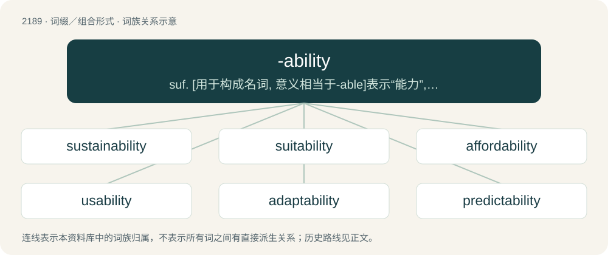

# 2292 · -ability — suf. \[用于构成名词, 意义相当于-able\]表示“能力”, “可能性”, “倾向性”, “适宜性”

[总目录](../00_总目录_按常用程度.md)

**类型**：词缀／组合形式　｜　**来源语言**：见词源记录

## 核心含义与来源

- 核心含义：suf. \[用于构成名词, 意义相当于-able\]表示“能力”, “可能性”, “倾向性”, “适宜性”
- 英文含义：Forms a noun from a verb or an adjective by changing from -able; ability, inclination or suitability for a specified function or condition.
- 词形：-ability

**来源记录 1**（后缀／后置成分；Forms a noun from a verb or an adjective by changing from -able; ability, inclination or suitability for a specified function or condition.）

From Middle English -ablete, -iblete, -abilite, -ibilite, from Middle French -ableté, -ibleté, -abilité, -ibilité, from Latin -abilitas, -ibilitas, from -abilis (“able”) or -ibilis (“able”) + -tas. Equivalent to -able + -ity. See ability.

## 词族图

## 单词速览（常用到不常用）

| 单词 | 音标 | 释义 |
|---|---|---|
| [sustainability](#w-1) | 英 /səˌsteɪnəˈbɪlɪti/；美 /səˌsteɪnəˈbɪləti/ | n. 持续性, 能维持性, 永续性 |
| [suitability](#w-2) | 英 /ˌsjuːtəˈbɪlɪti/；美 /ˌsutəˈbɪləti/ | n. 适合, 适当；\[医\] 适合性, 适应性 |
| [affordability](#w-3) | /əˌfɔdɚˈbɪlətɪ/ | n. 支付能力；负担能力；可购性 |
| [usability](#w-4) | /ˌjuːzəˈbɪlɪti/ | n. 可用性；\[化\] 工艺性 |
| [adaptability](#w-5) | 英 /əˌdæptəˈbɪlɪti/；美 /əˌdæptəˈbɪləti/ | n. 适应性；\[计\] 自适应性; 适应性 |
| [predictability](#w-6) | /pɹəˌdɪktəˈbɪlɪti/ | n. 可预言；\[电\] 可预测性 |
| [respectability](#w-7) | /ɹɪˌspɛktəˈbɪlɪti/ | n. 可敬, 有社会地位, 高尚, 体面, 习俗 |
| [readability](#w-8) | 英 /ˌɹiːdəˈbɪlɪti/；美 /ˌɹidəˈbɪləti/ | n. 易读, 可读性；\[计\] 可读性 |
| [scalability](#w-9) | 英 /ˌskeɪ.ləˈbɪl.ɪ.ti/ | \[计\] 可伸缩性 |
| [desirability](#w-10) | /di.zairəˈbiliti/ | n. 值得想望, 可取；\[经\] 合意性, 可用性 |
| [survivability](#w-11) | /ˌsəvɚɪvəˈbɪlɪtɪ/ | 残存性, 生存性, 耐受性 |
| [dependability](#w-12) | /di.pendəˈbiliti/ | n. 可信任性, 可靠性 |
| [deniability](#w-13) | 英 /dɪˌnaɪ(j)əˈbɪlɪti/ | n. 推诿不知情的本领；否认本领 |
| [marketability](#w-14) | /.mɑːkitəˈbiliti/ | n. 可销售, 市场性；\[经\] 变现性, 销路, 适销性 |
| [traceability](#w-15) | /ˌtɹeɪsəˈbɪlɪti/ | n. 可描绘, 可描写,可追溯 |
| [favorability](#w-16) |  | 【英文】The quality or degree of being viewed favorably |
| [playability](#w-17) |  | n. playable（可游戏的, 宜玩的）的变形 |
| [repeatability](#w-18) |  | \[计\] 可重复性, 再现性；\[化\] 实验室内复验性; 重复性 |
| [excitability](#w-19) | /ik.saitəˈbiliti/ | n. 易兴奋性, 兴奋性, 激动性；\[医\] 应激性, 刺激感受性, 兴奋性 |
| [enforceability](#w-20) |  | \[法\] 强制性 |
| [believability](#w-21) | /bi.liːvəˈbiləti/ | n. 可信度 |
| [maintainability](#w-22) |  | \[计\] 可维修性; 可维护性；\[化\] 保养性能; 运转的可靠性 |
| [manoeuvrability](#w-23) | /mə,nuːvrəˈbiliti/ | n. 机动性, 操纵的灵敏性 |
| [serviceability](#w-24) | /ˌsɜː(ɹ)vɪsəˈbɪlɪti/ | \[计\] 服务能力, 可服务性, 可维修性, 可用性；\[化\] 操作上的可靠性; 使用可靠性 |
| [reusability](#w-25) |  | \[计\] 可重用性 |
| [tolerability](#w-26) |  | n. 可忍性, 尚可 |
| [livability](#w-27) | /,livəˈbiliti/ | n. (牲畜)存活率 |
| [notability](#w-28) | 美 /ˌnoʊ.təˈbɪl.ə.ti/ | n. 显著, 著名, 著名人物 |
| [workability](#w-29) | /.wəːkəˈbiliti/ | n. 可使用性；\[化\] 加工性; 可加工性; 可使用性; 施工性能 |

## 逐词详解

### 1. sustainability

**词性**：名词　｜　**音标**：英 /səˌsteɪnəˈbɪlɪti/；美 /səˌsteɪnəˈbɪləti/

**中文释义**：n. 持续性, 能维持性, 永续性

**英文义项**：A means of configuring civilization and human activity so that society, its members and its economies are able to meet their needs and express their greatest potential in the present, while preserving biodiversity and natural ecosystems, planning and acting for the ability to maintain these necessary resources for future generations. / The ability to sustain a business in the long term, which is a state that is partly dependent on, but broader than, profitability today or in the short term; it involves aspects of a plausible path toward eventual profitability (as applies to a startup) and ecologic sustainability (for example, the long-term dependence of the timber/lumber industry on forest preservation and renewal, or of fisheries on viable fish stocks).

**构词拆分**：sustain + -ability

**词源与演化**：

From sustain + -ability.

**例句**：

> The making of buggy whips is the proverbial exemplar of a business without sustainability in the face of technological change.

该用例对应义项：The ability to sustain a business in the long term, which is a state that is partly dependent on, but broader than, profitability today or in the short term; it involves aspects of a plausible path toward eventual profitability (as applies to a startup) and ecologic sustainability (for example, the long-term dependence of the timber/lumber industry on forest preservation and renewal, or of fisheries on viable fish stocks).

### 2. suitability

**词性**：名词　｜　**音标**：英 /ˌsjuːtəˈbɪlɪti/；美 /ˌsutəˈbɪləti/

**中文释义**：n. 适合, 适当；\[医\] 适合性, 适应性

**英文义项**：The quality of being suitable.

**构词拆分**：suit + -ability

**词源与演化**：

From suit + -ability.

**例句**：

> An important requirement is suitability for long trips.

该用例对应义项：the quality of having the properties that are right for a specific purpose

### 3. affordability

**词性**：名词　｜　**音标**：/əˌfɔdɚˈbɪlətɪ/

**中文释义**：n. 支付能力；负担能力；可购性

**英文义项**：The extent or degree to which something is affordable, as measured by its cost relative to the amount that the purchaser is able to pay. / A desirable degree of that characteristic: synonym of inexpensiveness.

**构词拆分**：afford + -ability

**词源与演化**：

From afford + -ability.

**例句**：

> First-time home buyers are feeling the squeeze of higher interest rates with mortgage affordability at its worst level for 16 years.

该用例对应义项：The extent or degree to which something is affordable, as measured by its cost relative to the amount that the purchaser is able to pay.

### 4. usability

**词性**：名词　｜　**音标**：/ˌjuːzəˈbɪlɪti/

**中文释义**：n. 可用性；\[化\] 工艺性

**英文义项**：The state or condition of being usable. / The degree to which an object, device, software application, etc. is easy to use with no specific training.

**构词拆分**：usable + -ity；use + -ability

**词源与演化**：

From usable + -ity or use + -ability.

**例句**：

> Usability testing should include feedback from users with disabilities.

### 5. adaptability

**词性**：名词　｜　**音标**：英 /əˌdæptəˈbɪlɪti/；美 /əˌdæptəˈbɪləti/

**中文释义**：n. 适应性；\[计\] 自适应性; 适应性

**英文义项**：The quality of being adaptable; a quality that renders adaptable. / Variability in respect to, or under the influence of, external conditions; susceptibility of an organism to that variation whereby it becomes suited to or fitted for its conditions of environment; the capacity of an organism to be modified by circumstances.

**构词拆分**：adaptable + -ity + adapt + -ability；adaptable + -ity；adapt + -ability

**词源与演化**：

From adaptable + -ity or adapt + -ability.

**例句**：

> The adaptability of humans in difficult circumstances is nothing short of amazing.

### 6. predictability

**词性**：名词　｜　**音标**：/pɹəˌdɪktəˈbɪlɪti/

**中文释义**：n. 可预言；\[电\] 可预测性

**英文义项**：The characteristic of being predictable.

**构词拆分**：predict + -ability

**词源与演化**：

From predict + -ability.

**例句**：

> Predictability is a disadvantage of normality.

### 7. respectability

**词性**：名词　｜　**音标**：/ɹɪˌspɛktəˈbɪlɪti/

**中文释义**：n. 可敬, 有社会地位, 高尚, 体面, 习俗

**英文义项**：The quality of being respectable. / The class of respectable people.

**构词拆分**：respect + -ability

**词源与演化**：

From respect + -ability.

**例句**：

> He has an air of respectability about him.

### 8. readability

**词性**：名词　｜　**音标**：英 /ˌɹiːdəˈbɪlɪti/；美 /ˌɹidəˈbɪləti/

**中文释义**：n. 易读, 可读性；\[计\] 可读性

**英文义项**：The property of being capable of being read; legibility. / The property of being easy or engaging to read.

**构词拆分**：readable + -ity；read + -ability

**词源与演化**：

From readable + -ity or read + -ability.

**例句**：

> The book had a clever plot, but lacked readability.

该用例对应义项：The property of being easy or engaging to read.

### 9. scalability

**词性**：名词　｜　**音标**：英 /ˌskeɪ.ləˈbɪl.ɪ.ti/

**中文释义**：\[计\] 可伸缩性

**英文义项**：The property of being scalable.

**构词拆分**：scale + -ability；scalable + -ity

**词源与演化**：

From scale + -ability or scalable + -ity.

**例句**：

> Some products may not have the scalability or the demand here in this country.

### 10. desirability

**词性**：名词　｜　**音标**：/di.zairəˈbiliti/

**中文释义**：n. 值得想望, 可取；\[经\] 合意性, 可用性

**英文义项**：The state of being desirable.

**构词拆分**：desirable + -ity；desire + -ability

**词源与演化**：

Morphologically desirable + -ity and desire + -ability.

**例句**：

> Scads of online daters constantly check their desirability.

### 11. survivability

**词性**：名词　｜　**音标**：/ˌsəvɚɪvəˈbɪlɪtɪ/

**中文释义**：残存性, 生存性, 耐受性

**英文义项**：The condition of being survivable / A measure of the extent to which something is survivable

**构词拆分**：survive + -ability

**词源与演化**：

From survive + -ability.

**例句**：

> 5000 years of the Space Age have awarded humanity the prize of a much larger living space and a higher survivability rating.

### 12. dependability

**词性**：名词　｜　**音标**：/di.pendəˈbiliti/

**中文释义**：n. 可信任性, 可靠性

**英文义项**：The characteristic of being dependable; the ability to be depended upon.

**构词拆分**：depend + -ability

**词源与演化**：

From depend + -ability.

**例句**：

> Dependability is part of our entrepreneurial culture.

### 13. deniability

**词性**：名词　｜　**音标**：英 /dɪˌnaɪ(j)əˈbɪlɪti/

**中文释义**：n. 推诿不知情的本领；否认本领

**英文义项**：The condition of being deniable. / The extent to which something is deniable.

**构词拆分**：deny + -ability

**词源与演化**：

From deny + -ability.

**例句**：

> The plausible deniability associated with hacking has ushered in an era of cyber warfare.

### 14. marketability

**词性**：名词　｜　**音标**：/.mɑːkitəˈbiliti/

**中文释义**：n. 可销售, 市场性；\[经\] 变现性, 销路, 适销性

**英文义项**：The likelihood that something will sell; market appeal.

**构词拆分**：market + -ability

**词源与演化**：

From market + -ability.

**例句**：

> This is a beautiful house with high marketability.

该用例对应义项：The likelihood that something will sell; market appeal.

### 15. traceability

**词性**：名词　｜　**音标**：/ˌtɹeɪsəˈbɪlɪti/

**中文释义**：n. 可描绘, 可描写,可追溯

**英文义项**：The ability to trace (identify and measure) all the stages that led to a particular point in a process that consists of a chain of interrelated events

**构词拆分**：trace + -ability；traceable + -ity

**词源与演化**：

From trace + -ability, also analyzable as traceable + -ity.

**例句**：

> The products are subject to stringent traceability rules.

### 16. favorability

**词性**：名词

**英文义项**：The quality or degree of being viewed favorably / Something which is favorable

**构词拆分**：favorable + -ity；favor + -ability

**词源与演化**：

From favorable + -ity or favor + -ability.

### 17. playability

**词性**：名词

**中文释义**：n. playable（可游戏的, 宜玩的）的变形

**英文义项**：The state or property of being playable. / The quality and enjoyability of a game's gameplay.

**构词拆分**：play + -ability；playable + -ity

**词源与演化**：

From play + -ability or playable + -ity.

**例句**：

> Mutant Chickens from Mars has great graphics, but the playability is lacking.

该用例对应义项：The quality and enjoyability of a game's gameplay.

### 18. repeatability

**词性**：名词

**中文释义**：\[计\] 可重复性, 再现性；\[化\] 实验室内复验性; 重复性

**英文义项**：The absence of variation amongst multiple measurements taken under the same conditions. / The degree to which a machine can move its parts to the same position (location) repeatedly, which is closely (and mathematically) related to its precision and accuracy.

**构词拆分**：repeat + -ability

**词源与演化**：

From repeat + -ability.

### 19. excitability

**词性**：名词　｜　**音标**：/ik.saitəˈbiliti/

**中文释义**：n. 易兴奋性, 兴奋性, 激动性；\[医\] 应激性, 刺激感受性, 兴奋性

**英文义项**：The state of being excitable / A measure of how easy something is to excite

**构词拆分**：excite + -ability

**词源与演化**：

From excite + -ability.

### 20. enforceability

**词性**：名词

**中文释义**：\[法\] 强制性

**英文义项**：The quality of being enforceable.

**构词拆分**：enforce + -ability

**词源与演化**：

From enforce + -ability.

### 21. believability

**词性**：名词　｜　**音标**：/bi.liːvəˈbiləti/

**中文释义**：n. 可信度

**英文义项**：The state or quality of being believable.

**构词拆分**：believe + -ability

**词源与演化**：

From believe + -ability.

### 22. maintainability

**词性**：名词

**中文释义**：\[计\] 可维修性; 可维护性；\[化\] 保养性能; 运转的可靠性

**英文义项**：The ease with which something can be maintained.

**构词拆分**：maintain + -ability

**词源与演化**：

From maintain + -ability.

**例句**：

> The maintainability and the operational readiness of a number of these craft are actually suspect.

### 23. manoeuvrability

**词性**：名词　｜　**音标**：/mə,nuːvrəˈbiliti/

**中文释义**：n. 机动性, 操纵的灵敏性

**英文义项**：The quality of being manoeuvrable; ability to be manoeuvred. / Ability to manoeuvre; ability to carry out a manoeuvre or strategic plan.

**构词拆分**：manoeuvre + -ability

**词源与演化**：

From manoeuvre + -ability.

**例句**：

> My manoeuvrability is limited. I don't have many options left.

该用例对应义项：Ability to manoeuvre; ability to carry out a manoeuvre or strategic plan.

### 24. serviceability

**词性**：名词　｜　**音标**：/ˌsɜː(ɹ)vɪsəˈbɪlɪti/

**中文释义**：\[计\] 服务能力, 可服务性, 可维修性, 可用性；\[化\] 操作上的可靠性; 使用可靠性

**英文义项**：The property of being serviceable, of being useful for some function. / The property of being able to be serviced.

**构词拆分**：serviceable + -ity；service + -ability

**词源与演化**：

From serviceable + -ity or service + -ability.

**例句**：

> The train had poor serviceability; its mechanical parts were hard to access.

该用例对应义项：The property of being able to be serviced.

### 25. reusability

**词性**：名词

**中文释义**：\[计\] 可重用性

**英文义项**：The property or degree of being reusable.

**构词拆分**：reuse + -ability

**词源与演化**：

From reuse + -ability.

### 26. tolerability

**词性**：名词

**中文释义**：n. 可忍性, 尚可

**英文义项**：The quality or state of being tolerable.

**构词拆分**：tolerate + -ability

**词源与演化**：

From tolerate + -ability.

### 27. livability

**词性**：名词　｜　**音标**：/,livəˈbiliti/

**中文释义**：n. (牲畜)存活率

**英文义项**：The property of being livable.

**构词拆分**：live + -ability

**词源与演化**：

From live + -ability.

**例句**：

> The livability of the shack was questioned, but the old man had lived there for 50 years.

该用例对应义项：The property of being livable.

### 28. notability

**词性**：名词　｜　**音标**：美 /ˌnoʊ.təˈbɪl.ə.ti/

**中文释义**：n. 显著, 著名, 著名人物

**英文义项**：The quality or state of being notable or eminent. / A notable or eminent person or thing.

**构词拆分**：notable + -ity；note + -ability

**词源与演化**：

From notable + -ity; alternatively, may be analyzed as note + -ability.

### 29. workability

**词性**：名词　｜　**音标**：/.wəːkəˈbiliti/

**中文释义**：n. 可使用性；\[化\] 加工性; 可加工性; 可使用性; 施工性能

**英文义项**：The ease with which something can be worked or fashioned. / The quality of being workable; practical capacity to succeed.

**构词拆分**：work + -ability

**词源与演化**：

From work + -ability.

**例句**：

> I dispute the workability of the new plan.

该用例对应义项：The quality of being workable; practical capacity to succeed.
