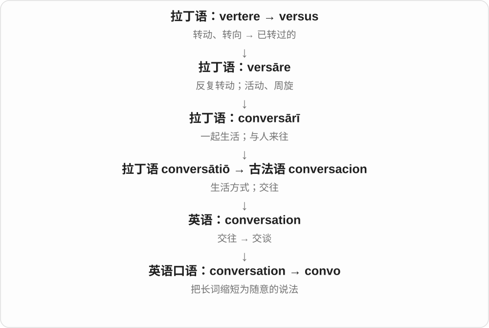

# 2304 · -o — 口语昵称、人物称呼与截短模式

[逐词精讲目录](../00_逐词精讲目录.md) · [总目录](../00_总目录_按常用程度.md)

## 核心词根与来源

这里没有一个统一的圆形、零、小东西义。-o 能让表达随意，感情色彩由词基和场景决定；长词截短也未必每次都真的新加一个 -o。

**-O：把语气拉到随意一边，褒贬还要看基础词**

kiddo、doggo 亲昵；cheapo、wacko 可贬；convo、distro 配合截短；servo 的技术义另看。

- **亲昵与口语人物称呼**：kiddo · doggo · rando · weirdo · dumbo · sicko · wacko · wino · pinko · psycho
- **截短、事物与风格**：combo · convo · journo · distro · servo · aggro · cheapo · preggo
- **感叹和道别**：cheerio · neato

## 词形与演化规律

完整词或截短词干 + 口语 -o；有时双写末尾辅音，有时保留截短后已有结尾。具体词逐个分辨。

## 单词速览（按词族由简到繁）

同一基础词的相关扩展放在一起，先读基础形式，再读扩展；各组之间优先读常用的。具体词源关系见各词讲解。

| 单词 | 音标 | 核心意思 |
|---|---|---|
| [combo](#w-1) | 英 /ˈkɒmbəʊ/；美 /ˈkɑːmboʊ/ | 组合、小乐队；套餐；连招 |
| [psycho](#w-2) | 英 /ˈsaɪkəʊ/；美 /ˈsaɪkoʊ/ | “疯子、变态”等贬称〔口语，常冒犯〕 |
| [weirdo](#w-3) | 英 /ˈwɪədəʊ/；美 /ˈwɪrdoʊ/ | 怪人〔口语，可带贬意〕 |
| [kiddo](#w-4) | 英 /ˈkɪdəʊ/；美 /ˈkɪdoʊ/ | 小家伙；孩子〔亲昵口语称呼〕 |
| [convo](#w-6) | 英 /ˈkɒnvəʊ/；美 /ˈkɑːnvoʊ/ | 聊天、谈话〔口语〕 |
| [servo](#w-8) | 英 /ˈsɜːvəʊ/；美 /ˈsɜːrvoʊ/ | 伺服机构、伺服电机；加油站〔澳大利亚口语，另线〕 |
| [doggo](#w-9) | 英 /ˈdɒɡəʊ/；美 /ˈdɔːɡoʊ/，也读 /ˈdɑːɡoʊ/ | 狗狗〔亲昵、网络口语〕；lie doggo 隐伏不动 |
| [dumbo](#w-12) | 英 /ˈdʌmbəʊ/；美 /ˈdʌmboʊ/ | 笨蛋、傻瓜〔贬义口语〕 |
| [sicko](#w-17) | 英 /ˈsɪkəʊ/；美 /ˈsɪkoʊ/ | 变态、恶心的人〔侮辱称呼〕 |
| [aggro](#w-20) | 英 /ˈæɡrəʊ/；美 /ˈæɡroʊ/ | 麻烦、烦扰；挑衅、攻击性行为；强攻的〔口语、游戏〕 |
| [distro](#w-21) | 英 /ˈdɪstrəʊ/；美 /ˈdɪstroʊ/ | 软件发行版〔尤指 Linux〕；分发或分销组织〔依语境〕 |
| [wacko](#w-25) | 英 /ˈwækəʊ/；美 /ˈwækoʊ/ | 古怪的、荒唐的；怪人〔带揶揄或贬义〕 |
| [rando](#w-27) | 英 /ˈrændəʊ/；美 /ˈrændoʊ/ | 陌生人、不相关的路人〔口语，可能轻蔑〕 |
| [journo](#w-28) | 英 /ˈdʒɜːnəʊ/；美 /ˈdʒɜːrnoʊ/ | 记者〔非正式、略带熟人语气〕 |
| [cheerio](#w-29) | 英 /ˈtʃɪəriəʊ/；美 /ˈtʃɪrioʊ/，也有末尾重读的形式 | 再见〔主要英式口语，略带旧式或轻快语气〕 |
| [cheapo](#w-44) | 英 /ˈtʃiːpəʊ/；美 /ˈtʃiːpoʊ/ | 便宜货、廉价的；小气鬼〔名词，口语〕 |
| [preggo](#w-46) | 英 /ˈpreɡəʊ/；美 /ˈpreɡoʊ/ | 怀孕的〔非常随意的口语〕 |
| [wino](#w-47) | 英 /ˈwaɪnəʊ/；美 /ˈwaɪnoʊ/ | 酒鬼〔俚语，通常带贬义〕 |
| [neato](#w-49) | 英 /ˈniːtəʊ/；美 /ˈniːtoʊ/ | 真棒、挺酷〔玩笑式、略旧的口语〕 |
| [pinko](#w-51) | 英 /ˈpɪŋkəʊ/；美 /ˈpɪŋkoʊ/ | 左倾分子、亲社会主义者〔贬称〕 |

## 逐词讲解

### 1. combo — 组合、小乐队；套餐；连招

**音标**：英 /ˈkɒmbəʊ/；美 /ˈkɑːmboʊ/

**先抓住这个画面**

几样东西搭在一起：小乐队几个人一组，套餐几种食物一组，游戏几下有效衔接成连招。

**怎么拆**

combination 截短并配 -o 口语结尾，常先见于小乐队等用法，再扩到组合套餐、动作连段。不是 com + bo 两个正式词根。

**怎么变成今天的意思**

**combination 的口语缩短 → combo**  
组合，常见小乐队称呼

↓

**现代场景扩展**  
食品组合、套餐；动作组合、游戏连招

a jazz combo 爵士小乐队，a combo meal 套餐，a winning combo 好用组合，perform a combo 打出连招。

**常见搭配与例句**

a jazz combo；a combo meal；a winning combo；perform a combo。

> A jazz combo played in the café.

一支爵士小乐队在咖啡馆演奏。

> She ordered a combo meal with a drink.

她点了一份配饮料的套餐。

**别混淆**

combo 较口语，combination 更一般、正式；游戏连招通常强调有效衔接，不是随便按很多次键就一定算。

### 2. psycho — “疯子、变态”等贬称〔口语，常冒犯〕

**音标**：英 /ˈsaɪkəʊ/；美 /ˈsaɪkoʊ/

**先抓住这个画面**

说话人把一个让他害怕、愤怒或无法理解的人，粗暴地压成一个带攻击性的标签。

**怎么拆**

由 psychotic、psychopath 等词截短，或与口语人物词尾 -o 相结合；这里是独立俚语，不等于中性的构词成分 psycho-。

**怎么变成今天的意思**

**希腊 psyche（ψυχή）**  
生命、灵魂、心灵；在不同思想传统中含义有变化

↓

**英语 psychotic／psychopath 等词的口语截短**  
精神健康或人格相关术语被粗略缩短

↓

**英语 psycho**  
对人的贬称；不精确的口语标签

影视台词里的 psycho 常是辱骂，不是准确诊断。学习它主要是为了听懂语气。psycho- 在 psychology、psychoanalysis 等长词里通常只表示心灵或心理，不能因此把所有这类词都理解成骂人。

**常见搭配与例句**

call someone a psycho；use psycho as an insult。

> The editor removed the word “psycho” because it turned a description into an insult.

编辑删去了 psycho 一词，因为它把描述变成了辱骂。

> The film uses “psycho” as a hostile label, not as a precise diagnosis.

影片把 psycho 当作敌意标签使用，并非精确的诊断名称。

**别混淆**

psycho 的口语攻击性与 psych“给自己鼓劲”等普通搭配不同，也不能替代任何专业诊断名。

### 3. weirdo — 怪人〔口语，可带贬意〕

**音标**：英 /ˈwɪədəʊ/；美 /ˈwɪrdoʊ/

**先抓住这个画面**

把 weird 这种评价贴到人身上，叫成一个怪家伙。语气可玩笑也可伤人，依关系和场合。

**怎么拆**

weird + 人物后缀 -o，现代口语人物名词。-o 不是零，也不表示物体圆形。

**怎么变成今天的意思**

**古英语 wyrd → 中古英语、苏格兰语 weird 等**  
命运、定数；与发生、成为的旧词族有关

↓

**命运女神、Weird Sisters 等文学传统 → 英语 weird**  
超自然、神秘；后来常指古怪、不寻常

↓

**weird + -o → weirdo**  
被认为古怪的人

a weirdo 一个怪人，call someone a weirdo 叫某人怪家伙。可被自嘲使用，但不是对陌生人的中性正式称呼。

**常见搭配与例句**

a complete weirdo；call someone a weirdo；a lovable weirdo。

> The character proudly calls himself a weirdo.

这个角色很得意地自称怪人。

> She hated being called a weirdo at school.

她讨厌在学校被人叫怪人。

**别混淆**

weirdo 人物、weird 形容性质；someone acts weirdly 不一定就该给对方贴身份标签。

### 4. kiddo — 小家伙；孩子〔亲昵口语称呼〕

**音标**：英 /ˈkɪdəʊ/；美 /ˈkɪdoʊ/

**先抓住这个画面**

像对熟悉的孩子说一声“小家伙”，有亲近、鼓励的味道；也可能同辈打趣。

**怎么拆**

kid + -o，-o 在这里构成亲昵、口语人物称呼，双写 d。

**怎么变成今天的意思**

**古诺尔斯语 kið → 中古英语 kide → kid**  
小山羊

↓

**现代 kid**  
小孩的口语称呼；另有开玩笑、逗弄的动词用法

↓

**kid + -o → kiddo**  
孩子、朋友的亲昵称呼

Hey, kiddo! 嗨，小家伙，Good job, kiddo! 干得好，小家伙。是否亲近或居高临下取决于关系和语气。

**常见搭配与例句**

Hey, kiddo!；Good job, kiddo!；listen, kiddo。

> “Good morning, kiddo,” her grandfather said.

爷爷说：“早上好，小家伙。”

> You did a great job, kiddo.

小家伙，你做得很棒。

**别混淆**

kiddo 通常直接称呼更自然，正式报告里写 children 更合适；不与 kidnap 的后部混为一谈。

### 5. convo — 聊天、谈话〔口语〕

**音标**：英 /ˈkɒnvəʊ/；美 /ˈkɑːnvoʊ/

**先抓住这个画面**

把 conversation 剪短，像熟人之间说“聊两句”，少了正式感。

**怎么拆**

conversation 的截短形式，加常见口语词尾 -o；不是古拉丁语里另有一个 convo。

**怎么变成今天的意思**

多见于聊天、社交媒体和很随意的叙述。正式报告里通常写 conversation。

**常见搭配与例句**

a quick convo；a good convo；have a convo。

> We had a quick convo before the meeting.

开会前我们简单聊了几句。

> Thanks for the convo—it helped me see the problem differently.

谢谢刚才那番聊天，让我换了个角度看问题。

**别混淆**

convo 是语体随意，不代表谈话内容一定不重要。

### 6. servo — 伺服机构、伺服电机；加油站〔澳大利亚口语，另线〕

**音标**：英 /ˈsɜːvəʊ/；美 /ˈsɜːrvoʊ/

**先抓住这个画面**

模型或机器里的 servo 常负责按控制要求转动、定位。澳大利亚口语说去 the servo，则通常是去加油站。

**怎么拆**

技术义截短 servomotor、servomechanism 等，不能直接说 serv + 口语 -o。澳大利亚加油站义则由 service station 截取词干配 -o，恰好同形。

**怎么变成今天的意思**

**servomotor / servomechanism → servo**  
长技术词截短：伺服电机、机构

↓

**service station 截短配 -o → servo**  
澳大利亚口语的加油站

a small servo 小型伺服电机，servo control 伺服控制，stop at the servo 在加油站停一下〔澳口语〕。

**常见搭配与例句**

a small servo；servo control；stop at the servo。

> The model uses a small servo to move the arm.

模型用一个小型伺服电机带动机械臂。

> “We’ll stop at the servo,” our Australian host said.

“我们在加油站停一下。”我们的澳大利亚东道主说。

**别混淆**

servo 不是任何电机的随意同义词；去加油站的地域口语与技术缩称分开。servomotor 中的 servo- 也不是服务员的昵称。

### 7. doggo — 狗狗〔亲昵、网络口语〕；lie doggo 隐伏不动

**音标**：英 /ˈdɒɡəʊ/；美 /ˈdɔːɡoʊ/，也读 /ˈdɑːɡoʊ/

**先抓住这个画面**

在宠物照片下叫一声 doggo，像说可爱的狗狗。旧搭配 lie doggo 却是躲着不动、别引人注意，不必真的在谈一只狗。

**怎么拆**

名词 dog + -o，双写 g，带昵称语气。旧副词 doggo 见于 lie/play doggo，可能同源，但新旧用法的先后联系不硬说成唯一确定路线。

**怎么变成今天的意思**

**现代英语的口语 -o 构词模式**  
把词变成昵称、人物称呼或随意表达；不只有一个固定感情色彩

↓

**dog + -o → doggo 名词**  
亲昵、网络语中的狗

↓

**旧搭配 lie doggo**  
隐伏不动、不引人注意的另一用法

a sleepy doggo 困困的狗狗，a photo of a doggo 狗狗照片；lie doggo 暂时躲着不动。

**常见搭配与例句**

a sleepy doggo；a photo of a doggo；lie doggo。

> She posted a photo of a sleepy doggo.

她发了一张困困狗狗的照片。

> The characters decide to lie doggo until the search is over.

故事人物决定隐伏不动，等搜寻结束。

**别混淆**

doggo 适合随意、可爱化语气，不是更正式的狗种名称。lie doggo 不能一字一字译成躺一只狗。

### 8. dumbo — 笨蛋、傻瓜〔贬义口语〕

**音标**：英 /ˈdʌmbəʊ/；美 /ˈdʌmboʊ/

**先抓住这个画面**

把 dumb 的愚蠢评价变成一个人的称呼。它可以出现在玩笑里，也能伤人，不能当正式描述能力的中性词。

**怎么拆**

dumb 愚蠢的 + -o 人物称呼。dumb 单独的 b 不发音，dumbo 通行读音里却有 /b/，别把原词的静音机械照搬。

**怎么变成今天的意思**

**现代英语的口语 -o 构词模式**  
把词变成昵称、人物称呼或随意表达；不只有一个固定感情色彩

↓

**dumb + -o → dumbo**  
带愚蠢评价的人物称呼

call someone a dumbo 叫某人笨蛋，feel like a dumbo 觉得自己像个傻瓜。Dumbo 首字母大写还可作虚构角色名，具体专名另看语境。

**常见搭配与例句**

call someone a dumbo；feel like a dumbo。

> He felt like a dumbo after finding the key in his pocket.

他在自己口袋里找到钥匙后，觉得自己像个傻瓜。

> The teacher explained that calling a classmate a dumbo was hurtful.

老师解释说，叫同学笨蛋会伤人。

**别混淆**

dumbo 是说话人的贬低评价，不是智力或疾病分类。玩笑能否接受取决于关系和语境，正式表达可直接指出哪一步出了错。

### 9. sicko — 变态、恶心的人〔侮辱称呼〕

**音标**：英 /ˈsɪkəʊ/；美 /ˈsɪkoʊ/

**先抓住这个画面**

骂别人趣味、行为扭曲得令人恶心；这不是对普通生病者的中性称呼。

**怎么拆**

sick 的病态、扭曲评价义 + 人物后缀 -o。整个词带侮辱、贬低语气，不是疾病分类名称。

**怎么变成今天的意思**

**古英语 sēoc → 中古英语 sik、sike → sick**  
患病、不适

↓

**现代 sick**  
生病；恶心、厌烦；有病的贬称及很棒的俚语等分支

↓

**sick + -o → sicko**  
病态、扭曲的人这一贬称

call someone a sicko 骂某人变态；影视对白中常带强烈厌恶，不宜当普通 sick person 的缩略。

**常见搭配与例句**

call someone a sicko；a twisted sicko；the word sicko。

> The character calls the villain a sicko.

角色骂反派是个变态。

> She objected when he used the insult sicko.

他用 sicko 这个侮辱词时，她表示反对。

**别混淆**

sick person 生病的人，sicko 侮辱行为、趣味扭曲的人；换一个后缀，语气和指向差很大。

### 10. aggro — 麻烦、烦扰；挑衅、攻击性行为；强攻的〔口语、游戏〕

**音标**：英 /ˈæɡrəʊ/；美 /ˈæɡroʊ/

**先抓住这个画面**

现实里 aggro 可能是让人头疼的折腾，也可能是挑衅找事；游戏里拉到 aggro，则常说敌人的攻击注意转到了你身上。

**怎么拆**

aggr- 截短词干配 -o，与 aggravation 烦扰、aggression/aggressive 攻击性都有联系；资料对最初截自哪一个分析不同，不强定唯一原词。

**怎么变成今天的意思**

**aggravation 与 aggression/aggressive 等相互影响**  
烦扰、攻击性这一组相关语义

↓

**截取 aggr- + -o → aggro**  
口语烦扰、挑衅；再形成游戏中的仇恨、强攻等用法

avoid the aggro 避免麻烦，get aggro 变得咄咄逼人，draw aggro 吸引敌方攻击注意，an aggro deck 强攻型卡组。

**常见搭配与例句**

avoid the aggro；get aggro；draw aggro；an aggro deck。

> We took the train to avoid the aggro of parking.

我们坐了火车，省去停车的麻烦。

> In the game, the defender drew aggro away from the other players.

游戏里，防御角色把敌方攻击注意从其他玩家身上引开了。

**别混淆**

aggro 的游戏仇恨值不是现实里某人一定恨你；口语麻烦也不必发展成暴力。先看人物冲突、办事折腾还是游戏机制。

### 11. distro — 软件发行版〔尤指 Linux〕；分发或分销组织〔依语境〕

**音标**：英 /ˈdɪstrəʊ/；美 /ˈdɪstroʊ/

**先抓住这个画面**

同样围绕 Linux，一个发行版把系统组件、工具、安装方式等打包整理成可交给用户的一套，技术口语叫 distro。

**怎么拆**

distribution 截短配 -o；另有 distributor 分销者截短的同形词。不是英语正式词根 dis + tro，后半也不表示三。

**怎么变成今天的意思**

**distribution 发行、分发**  
整理成可交付的一套；也指分发行为

↓

**截短配 -o → distro**  
技术口语发行版；另由 distributor 截短可指分销者

a Linux distro 一个 Linux 发行版，try a different distro 换一个发行版，a lightweight distro 轻量发行版。

**常见搭配与例句**

a Linux distro；a lightweight distro；try a different distro。

> This Linux distro includes a simple installation tool.

这个 Linux 发行版附带一个简便的安装工具。

> The article compares three lightweight distros.

文章比较了三个轻量发行版。

**别混淆**

distro 不等于 Linux 内核本身，通常是一套发行组合。技术版号、软件包与独立发行版也不是同一个层级的词。

### 12. wacko — 古怪的、荒唐的；怪人〔带揶揄或贬义〕

**音标**：英 /ˈwækəʊ/；美 /ˈwækoʊ/

**先抓住这个画面**

像在说这个点子怪得离谱，或给人贴一个怪人的标签。语气可能玩笑，也可能明显不尊重。

**怎么拆**

wacky 古怪、滑稽的，截取 wack- 配 -o。词尾可造人物称呼，整个词也可作形容词，并非每个 -o 都只能是名词。

**怎么变成今天的意思**

**现代英语的口语 -o 构词模式**  
把词变成昵称、人物称呼或随意表达；不只有一个固定感情色彩

↓

**wacky 的 wack- + -o → wacko**  
古怪、荒唐的；带这种评价的人

a wacko idea 荒唐点子，a wacko character 古怪角色，describe someone as a wacko 把某人称作怪人。

**常见搭配与例句**

a wacko idea；a wacko character；a wacko。

> The comedy is full of wacko ideas.

这部喜剧里尽是稀奇古怪的点子。

> The review describes the character as a lovable wacko.

评论把这个角色形容为一个可爱的怪人。

**别混淆**

wacko 不是精神健康诊断，形容一个方案离谱与给人贬低标签也有语气差别；正式讨论可直接说具体哪里不合理。

### 13. rando — 陌生人、不相关的路人〔口语，可能轻蔑〕

**音标**：英 /ˈrændəʊ/；美 /ˈrændoʊ/

**先抓住这个画面**

不是特意找来的熟人，而是随便冒出来一个不认识的人；说 some rando 常有“不知哪来的谁”那种口气。

**怎么拆**

random 截取词基配口语人物词尾 -o，形成人物称呼。另有运动领域同形缩写，本页先记日常陌生人用法。

**怎么变成今天的意思**

**古法语 randon、randir → 中古英语 randoun、randon**  
疾冲、奔跑、冲劲

↓

**at random 等说法 → random 形容词**  
不朝特定方向 → 无固定目的、随机

↓

**random 的词基 + -o → rando**  
不特定、无关的人 → 陌生路人称呼

some rando 不知哪来的某个人，a rando online 网上一个陌生人，a group of randos 一群不认识的人。

**常见搭配与例句**

some rando；a rando online；a group of randos。

> Some rando joined the group chat by mistake.

一个不认识的人误进了群聊。

> I would not trust a rando online with that decision.

这个决定我不会随便交给网上一个陌生人。

**别混淆**

rando 很口语，也可能不礼貌；stranger 较中性，random 本身通常是形容词，不是所有语境都可换成 rando。

### 14. journo — 记者〔非正式、略带熟人语气〕

**音标**：英 /ˈdʒɜːnəʊ/；美 /ˈdʒɜːrnoʊ/

**先抓住这个画面**

把长职业名 journalist 缩短、再接一个口语尾巴，像聊天时随口叫记者，不是另一种资格证。

**怎么拆**

journalist 的截短词干 journ- + -o，-o 常见于非正式昵称、人物词。不是 journal 完整名词后直接加一个表示工作的 o。

**怎么变成今天的意思**

**journalist → journ-**  
把职业长词缩短

↓

**journ- + -o → journo**  
非正式记者称呼

a local journo 当地记者，a sports journo 体育记者，a veteran journo 资深记者；在英式、澳大利亚等口语中容易遇见。

**常见搭配与例句**

a local journo；a sports journo；a veteran journo。

> A local journo asked us about the new library.

一位当地记者问我们新图书馆的事。

> She began as a sports journo before moving into radio.

她先做体育记者，后来转入广播。

**别混淆**

journo 比 journalist 随意，可亲近也可轻蔑，取决于语气；不说明人一定不专业。正式署名通常用 journalist、reporter 等。

### 15. cheerio — 再见〔主要英式口语，略带旧式或轻快语气〕

**音标**：英 /ˈtʃɪəriəʊ/；美 /ˈtʃɪrioʊ/，也有末尾重读的形式

**先抓住这个画面**

挥挥手、轻快地道别，像说好啦，回头见。熟悉它是为了听懂语气，不是每次正式告别都要换成长一点的 goodbye。

**怎么拆**

cheer 或 cheery 愉快的 + -o，形成感叹式表达。多用于告别，也可能在旧式、特定场景作问候或祝酒。

**怎么变成今天的意思**

**现代英语的口语 -o 构词模式**  
把词变成昵称、人物称呼或随意表达；不只有一个固定感情色彩

↓

**cheer / cheery + -o → cheerio**  
轻快的口头表达，通常用于告别

say cheerio 说再见，a cheerful cheerio 轻快的一声再见。早餐麦圈品牌 Cheerios 是专名，不把商标复数直接当再见。

**常见搭配与例句**

say cheerio；Cheerio, see you tomorrow!。

> “Cheerio, see you tomorrow!” he called.

“再见，明天见！”他喊道。

> She waved and said cheerio before getting on the bus.

她挥手说了声再见，然后上了公交车。

**别混淆**

cheerio 是告别表达，cheers 还常用于感谢、祝酒等，不能在所有句子里直接互换。cheerio 的香肠等地域同形义不用于一般告别。

### 16. cheapo — 便宜货、廉价的；小气鬼〔名词，口语〕

**音标**：英 /ˈtʃiːpəʊ/；美 /ˈtʃiːpoʊ/

**先抓住这个画面**

说物品时可指便宜、简陋的那款，说人时可能嫌对方太抠。共同用 cheap 的低价或吝啬分支，但评价对象不同。

**怎么拆**

cheap + -o，口语词尾；作形容词、物品名词或人物贬称。价格低的基础义不必自动包含质量坏透了。

**怎么变成今天的意思**

**现代英语的口语 -o 构词模式**  
把词变成昵称、人物称呼或随意表达；不只有一个固定感情色彩

↓

**cheap + -o → cheapo**  
口语低价、廉价品；另一评价是小气的人

a cheapo camera 廉价相机，a cheapo version 便宜版本，call someone a cheapo 说某人小气。

**常见搭配与例句**

a cheapo camera；a cheapo version；a cheapo。

> I used a cheapo camera for the experiment.

我用一台便宜相机做了这个实验。

> The shop sells a cheapo version without the extra accessories.

店里卖一个不带额外配件的便宜版本。

**别混淆**

cheapo 比 inexpensive 随意，有时嫌简陋，有时只是自嘲预算低。称人 cheapo 带贬义，不是节俭者的中性职业名。

### 17. preggo — 怀孕的〔非常随意的口语〕

**音标**：英 /ˈpreɡəʊ/；美 /ˈpreɡoʊ/

**先抓住这个画面**

朋友聊天或社交媒体可能用来轻松地说怀孕了。词义不难，关键是语体：它比 pregnant 随意得多。

**怎么拆**

pregnant 截取 preg- 配 -o，双写 g。不是把 pregnant 完整词尾换成一个表示怀孕的新词根。

**怎么变成今天的意思**

**现代英语的口语 -o 构词模式**  
把词变成昵称、人物称呼或随意表达；不只有一个固定感情色彩

↓

**pregnant 截短 + -o → preggo**  
非常随意的怀孕表达

say someone is preggo 用很随意的方式说某人怀孕；正式说明通常用 pregnant。

**常见搭配与例句**

I’m preggo〔极随意〕；pregnant〔普通、正式均常见〕。

> The character texts her friend, “I’m preggo!”

角色给朋友发消息：“我怀孕啦！”

> The editor replaced preggo with pregnant in the formal announcement.

编辑把正式公告里的随意表达 preggo 改成了 pregnant。

**别混淆**

preggo 不说明孕期、健康状况或个人态度；意大利语 prego 的拼写、来源和用法又不同，不是英语怀孕一词的来源。

### 18. wino — 酒鬼〔俚语，通常带贬义〕

**音标**：英 /ˈwaɪnəʊ/；美 /ˈwaɪnoʊ/

**先抓住这个画面**

把人贴上老喝酒、喝得失控的标签，口气不客气；不是爱品葡萄酒者的中性职业名。

**怎么拆**

wine + 人物名词尾 -o，形成俚语称呼。另有粒子物理学同形 wino，来自 W 与 -ino 的命名，读音、来源另辨，不并入酒义。

**怎么变成今天的意思**

**拉丁 vīnum → 早期日耳曼语借词 → 古英语 wīn → wine**  
葡萄酒；英语保留早期借入的酒名

↓

**wine + -o → wino**  
常饮酒者的贬义俚称

a wino 常见于小说、旧报道或人物对白，可能带污名。阅读知道意思即可，称呼真实的人更宜用具体、尊重的说法。

**常见搭配与例句**

a wino；the word wino；a character called a wino。

> The narrator dismisses the old man as a wino.

叙述者轻蔑地把老人叫作酒鬼。

> The editor replaced wino with a more respectful description.

编辑把 wino 换成了更尊重人的描述。

**别混淆**

wine lover 爱酒者中性得多，wino 通常贬义；不要把所有喝葡萄酒的人都叫 wino。

### 19. neato — 真棒、挺酷〔玩笑式、略旧的口语〕

**音标**：英 /ˈniːtəʊ/；美 /ˈniːtoʊ/

**先抓住这个画面**

看到一个小巧有趣的东西，随口感叹挺棒啊。用的是 neat 很棒的口语义，不是在检查桌面有没有擦干净。

**怎么拆**

neat 的口语很棒义 + -o，形成感叹表达。美式连读的 /t/ 可听成较轻的闪音，但拼写仍是 t。

**怎么变成今天的意思**

**现代英语的口语 -o 构词模式**  
把词变成昵称、人物称呼或随意表达；不只有一个固定感情色彩

↓

**neat + -o → neato**  
表示赞赏的玩笑式感叹

a neato little gadget 挺酷的小玩意，Neato! 真棒！常带随意、俏皮或略旧的语感。

**常见搭配与例句**

Neato!；a neato little gadget。

> “Neato!” she said when the model lit up.

模型亮起来时，她说：“真棒！”

> He showed us a neato little folding lamp.

他给我们看了一盏挺酷的小折叠灯。

**别混淆**

neato 不是整洁程度的正式等级，也不适合拿来替换所有正式评价。neat 的纯饮酒等其他义不能一股脑套入此词。

### 20. pinko — 左倾分子、亲社会主义者〔贬称〕

**音标**：英 /ˈpɪŋkəʊ/；美 /ˈpɪŋkoʊ/

**先抓住这个画面**

说话人拿红色比共产主义，再把较浅的 pink 用来贬称左倾的人；这是带立场的标签，不是中性的政治测量。

**怎么拆**

pink 政治比喻义 + -o 人物词尾。粉红比红浅，形成较温和、未必彻底共产主义的联想；实际使用常只是在骂对方左倾。

**怎么变成今天的意思**

**英语 pink 花名**  
石竹属花卉的名称；更早来源不确定

↓

**花名 → 颜色名 pink**  
其中常见的浅红、粉红色

↓

**颜色比喻**  
较浅的红色 → 某些政治语境里的温和左倾

↓

**pink + -o → pinko**  
对左倾人物的贬称

call someone a pinko 给某人扣左倾帽子，a pinko intellectual 左倾知识分子〔说话人贬意〕。常见于特定时代的政治争论。

**常见搭配与例句**

call someone a pinko；a pinko intellectual〔贬称〕。

> The columnist dismissed the professor as a pinko.

专栏作者把教授贬称为左倾分子。

> In the film, the word pinko reveals the speaker’s political hostility.

片中的 pinko 暴露了说话人的政治敌意。

**别混淆**

leftist 范围宽、语气看上下文；pinko 明显带嘲讽、敌意，不宜当作对方自我认同的正式名称。

## 这一组要分清什么

-o 不总表可爱；servo 技术义是长词截短；lingo 远源和借入路线不完全确定；campo 常见草原义属于借词，不由英语这个词尾制造。

## 串起来练习

The kiddo posted a photo of a doggo, then said cheerio.

那个孩子发了一张狗狗照片，然后说了声再见。
