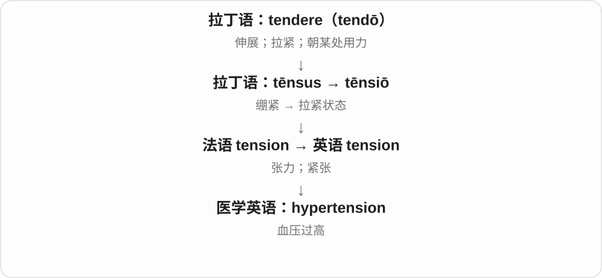
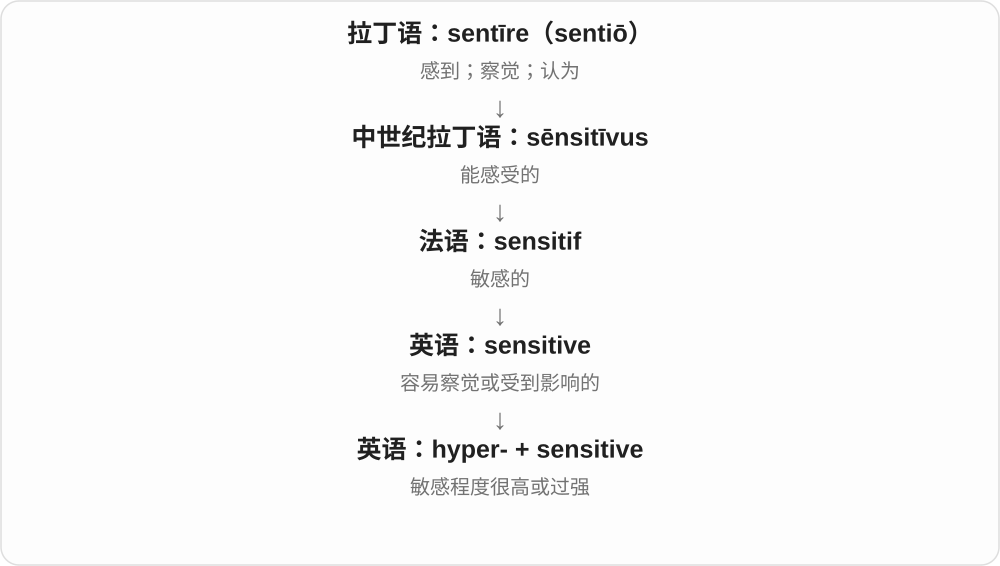

# 2338 · hyper- — 超过；过量；在上

[逐词精讲目录](../00_逐词精讲目录.md) · [总目录](../00_总目录_按常用程度.md)

## 核心词根与来源

来自希腊 hyper，表示在上、越过、超过。现代常见 hyper- 表过量，如 hyperactive；但 hyperlink、hypertext 等沿超文本概念发展，不能都硬译成“过度”。hyper 单独作口语形容词多缩自 hyperactive。

**HYPER = OVER / BEYOND / EXCESSIVE**

想象一个旋钮被拧过通常范围：活跃过头、反应过强、某项数值过高。另一些科技词把“超出”用来表示超出传统文本或普通空间的范围。

- **精力和反应过强**：hyper, hyperactive, hyperactivity, hypersensitive, hypersensitivity
- **数值、组织或生理过程过度**：hypertension, hypertrophy, hyperthyroidism, hyperglycemia, hyperpigmentation, hyperventilation, hyperventilate, hyperthermia
- **经济、速度与科技**：hyperinflation, hypersonic, hyperlink, hypertext, hyperdrive, hyperspace, hypermarket
- **夸张及几何术语**：hyperbole, hyperbolic, hyperbola

## 词形与演化规律

hyper- 常表示过量或超出，hypo- 常表示不足或在下。hyperglycemia 中 -emia 表血液状态，hyperthyroidism 中 -ism 表状态；这些现代术语使用古典构词材料，不代表整词在古希腊时代已经存在。

## 单词速览（按词族由简到繁）

同一基础词的相关扩展放在一起，先读基础形式，再读扩展；各组之间优先读常用的。具体词源关系见各词讲解。

| 单词 | 音标 | 核心意思 |
|---|---|---|
| [hyper](#w-1) | 英 /ˈhaɪpə/；美 /ˈhaɪpər/ | 亢奋的；特别兴奋活跃的〔口语〕 |
| [hypertension](#w-2) | 英 /ˌhaɪpəˈtenʃən/；美 /ˌhaɪpərˈtenʃən/ | 高血压 |
| [hyperbola](#w-23) | 英 /haɪˈpɜːbələ/；美 /haɪˈpɜːrbələ/ | 双曲线 |
| [hyperbolic](#w-3) | 英 /ˌhaɪpəˈbɒlɪk/；美 /ˌhaɪpərˈbɑːlɪk/ | 夸张的；双曲线的；双曲几何的 |
| [hyperbole](#w-4) | 英 /haɪˈpɜːbəli/；美 /haɪˈpɜːrbəli/ | 夸张法；夸大说法 |
| [hyperactive](#w-7) | /ˌhaɪpərˈæktɪv/ | 过度活跃的；活动过多的 |
| [hyperactivity](#w-5) | /ˌhaɪpərækˈtɪvəti/ | 活动过度；过度活跃 |
| [hypersensitive](#w-13) | 英 /ˌhaɪpəˈsensətɪv/；美 /ˌhaɪpərˈsensətɪv/ | 高度敏感的；反应过强的 |
| [hypersensitivity](#w-6) | 英 /ˌhaɪpəsensəˈtɪvəti/；美 /ˌhaɪpərsensəˈtɪvəti/ | 过度敏感；超敏反应 |
| [hypertrophy](#w-8) | 英 /haɪˈpɜːtrəfi/；美 /haɪˈpɜrtrəfi/ | 肥大；组织或器官体积增大 |
| [hyperspace](#w-9) | 英 /ˈhaɪpəspeɪs/；美 /ˈhaɪpərspeɪs/ | 超空间；高维空间；科幻中的超空间 |
| [hyperinflation](#w-10) | 英 /ˌhaɪpərɪnˈfleɪʃən/；美 /ˌhaɪpərɪnˈfleɪʃən/ | 恶性通货膨胀；极端快速的物价上涨 |
| [hypertext](#w-11) | 英 /ˈhaɪpətekst/；美 /ˈhaɪpərtekst/ | 超文本 |
| [hypersonic](#w-12) | 英 /ˌhaɪpəˈsɒnɪk/；美 /ˌhaɪpərˈsɑnɪk/ | 高超声速的 |
| [hyperlink](#w-14) | 英 /ˈhaɪpəlɪŋk/；美 /ˈhaɪpərlɪŋk/ | 超链接；给……加超链接 |
| [hyperthermia](#w-15) | 英 /ˌhaɪpəˈθɜːmiə/；美 /ˌhaɪpərˈθɜːrmiə/ | 体温过高；特定治疗语境中的热疗 |
| [hyperthyroidism](#w-16) | 英 /ˌhaɪpəˈθaɪrɔɪdɪzəm/；美 /ˌhaɪpərˈθaɪrɔɪdɪzəm/ | 甲状腺功能亢进；甲亢 |
| [hyperglycemia](#w-17) | 英 /ˌhaɪpəɡlaɪˈsiːmiə/；美 /ˌhaɪpərɡlaɪˈsiːmiə/ | 高血糖 |
| [hyperdrive](#w-18) | 英 /ˈhaɪpədraɪv/；美 /ˈhaɪpərdraɪv/ | 超空间驱动装置〔科幻〕；极高速运转状态〔比喻〕 |
| [hypermarket](#w-19) | 英 /ˈhaɪpəˌmɑːkɪt/；美 /ˈhaɪpɚˌmɑːrkɪt/ | 大型综合超市；大卖场 |
| [hyperpigmentation](#w-20) | 英 /ˌhaɪpəpɪɡmenˈteɪʃən/；美 /ˌhaɪpərpɪɡmenˈteɪʃən/ | 色素沉着过多；色素加深 |
| [hyperventilate](#w-22) | 英 /ˌhaɪpəˈventɪleɪt/；美 /ˌhaɪpərˈventəleɪt/ | 过度换气；呼吸过快过深 |
| [hyperventilation](#w-21) | 英 /ˌhaɪpəventɪˈleɪʃən/；美 /ˌhaɪpərventəˈleɪʃən/ | 过度通气 |

## 逐词讲解

### 1. hyper — 亢奋的；特别兴奋活跃的〔口语〕

**音标**：英 /ˈhaɪpə/；美 /ˈhaɪpər/

**先抓住这个画面**

像把精力旋钮拧得过高，坐不住、话多、情绪很兴奋。

**怎么拆**

常见形容词用法缩自 hyperactive；更早的构词材料是希腊 hyper，表示超过、过量。

**怎么变成今天的意思**

**希腊 hyper**  
在上；越过；过量

↓

**英语 hyper-**  
超过通常范围；超出

↓

**hyperactive → hyper**  
过度活跃的 → 口语缩写“特别亢奋”

The kids are hyper today 是说孩子们今天特别兴奋、闹腾。口语里的 hyper 常是当时状态的轻松描述，不是正式诊断某种疾病。

**常见搭配与例句**

feel hyper；get hyper；be really hyper。

> I felt strangely hyper after the exciting news.

听到这个令人兴奋的消息后，我整个人兴奋得有点停不下来。

> The children were too hyper to sit through the long speech.

孩子们太兴奋了，没法安静坐着听完那场长讲话。

**别混淆**

hyper 比 happy 多了精力过盛、过分兴奋的感觉。一个人说自己 hyper，并不自动等于患有 ADHD。

### 2. hypertension — 高血压

**音标**：英 /ˌhaɪpəˈtenʃən/；美 /ˌhaɪpərˈtenʃən/

**先抓住这个画面**

hypertension 说的是血管里的压力偏高，像管道里承受的压力超过正常范围。

**怎么拆**

hyper-（过高）+ tension；这里 tension 采用压力的医学用法，不是情绪紧张。

**怎么变成今天的意思**

这是医学术语。紧张情绪可以影响某次测量，但 hypertension 本身不能翻译成“过于紧张”。

**常见搭配与例句**

hypertension research；a diagnosis of hypertension；pulmonary hypertension。

> The study followed adults with hypertension.

这项研究追踪了患有高血压的成年人。

> Her doctor explained what the diagnosis of hypertension meant.

医生向她解释了高血压这一诊断的含义。

**别混淆**

hypertension 是高血压；hypotension 是低血压。hyper- 高，hypo- 低。

### 3. hyperbola — 双曲线

**音标**：英 /haɪˈpɜːbələ/；美 /haɪˈpɜːrbələ/

**先抓住这个画面**

一条曲线分成两支，分别向相反方向展开。

**怎么拆**

经新拉丁 hyperbola 借入希腊几何用语；与 hyperbole 同远源，但英语走了独立的数学借词路线。

**怎么变成今天的意思**

**古希腊语：bállein〔βάλλειν〕；bolḗ〔βολή〕**  
扔、放；投掷动作

↓

**古希腊 hypér- + bolḗ → hyperbolḗ**  
扔过头 → 过量；夸大

↓

**古希腊数学用法 → 新拉丁 hyperbola → 英语 hyperbola**  
几何学中的双曲线；另一路专业借词

可用“到两个定点的距离差的绝对值不变”定义。不是两条随便弯曲的线，也不是夸张修辞。

**常见搭配与例句**

the branches of a hyperbola；a rectangular hyperbola。

> The graph of xy equals one is a hyperbola.

xy 等于 1 的图像是一条双曲线。

> Draw both branches of the hyperbola.

画出这条双曲线的两支。

**别混淆**

hyperbole 是夸张法；hyperbola 是几何曲线，末尾 /lə/ 不同。

### 4. hyperbolic — 夸张的；双曲线的；双曲几何的

**音标**：英 /ˌhaɪpəˈbɒlɪk/；美 /ˌhaɪpərˈbɑːlɪk/

**先抓住这个画面**

日常是把话说过头；数学里则是另一条专业命名线。

**怎么拆**

修辞义经拉丁 hyperbolicus 追到希腊 hyperbolikós；数学义对应 hyperbola + -ic。两条相关支线不能互相硬译。

**怎么变成今天的意思**

**古希腊语：bállein〔βάλλειν〕；bolḗ〔βολή〕**  
扔、放；投掷动作

↓

**古希腊 hypér- + bolḗ → hyperbolḗ**  
扔过头 → 过量；夸大

↓

**希腊 hyperbolikós → 拉丁 hyperbolicus → 英语 hyperbolic**  
夸张的

↓

**并列数学支线：新拉丁 hyperbola → 英语 hyperbola / hyperbolic**  
双曲线及相关数学性质

hyperbolic praise 是过火的称赞；hyperbolic functions 是数学中的双曲函数，毫无“夸大”的评价。

**常见搭配与例句**

hyperbolic language；hyperbolic functions；hyperbolic geometry。

> The review’s hyperbolic praise made me suspicious.

评论里过火的赞美让我起了疑心。

> This chapter introduces the hyperbolic sine function.

这一章介绍双曲正弦函数。

**别混淆**

hyperbolic 的修辞义相当于 exaggerated；数学语境需要直接认术语。

### 5. hyperbole — 夸张法；夸大说法

**音标**：英 /haɪˈpɜːbəli/；美 /haɪˈpɜːrbəli/

**先抓住这个画面**

把事实的刻度故意推过头，让感受更鲜明。

**怎么拆**

希腊 hyper-“超过” + bolē“投掷”形成 hyperbolē，经拉丁借入；结尾不是 bowl，而读 /bəli/。

**怎么变成今天的意思**

**古希腊语：bállein〔βάλλειν〕；bolḗ〔βολή〕**  
扔、放；投掷动作

↓

**古希腊 hypér- + bolḗ → hyperbolḗ**  
扔过头 → 过量；夸大

↓

**拉丁 hyperbolē → 中古英语 yperbole → hyperbole**  
修辞上的明显夸张

“等了一万年”通常不是骗人，而是明显夸张地表达等得久。理解时要区分修辞夸张和以假乱真的陈述。

**常见搭配与例句**

use hyperbole；a piece of hyperbole；rhetorical hyperbole。

> “I have a mountain of work” is an example of hyperbole.

“我的工作堆成了山”就是夸张的例子。

> Her speech relied on hyperbole rather than precise figures.

她的演讲依靠夸张表达，而不是精确数字。

**别混淆**

a lie 通常试图让人把假话当事实；hyperbole 常故意夸张到大家知道不应照字面信。

### 6. hyperactive — 过度活跃的；活动过多的

**音标**：/ˌhaɪpərˈæktɪv/

**先抓住这个画面**

不只是动得起来，而是活动量高到难以停下来或超过情境所需。

**怎么拆**

hyper- 过度 + active 活跃的；是英语利用前缀组成的词。

**怎么变成今天的意思**

**希腊 hyper**  
在上；越过；过量

↓

**英语 hyper-**  
超过通常范围；超出

↓

**hyper- + active → hyperactive**  
活跃程度过高的

a hyperactive child 描述活动过多的孩子；a hyperactive imagination 可比喻想象特别活跃、停不下来。临床语境和日常夸张用法需要分开，不靠一个形容词判断具体诊断。

**常见搭配与例句**

hyperactive behavior；a hyperactive imagination；an unusually hyperactive period。

> The novel follows a child with a hyperactive imagination.

小说讲述了一个想象力异常活跃的孩子。

> The report describes hyperactive behavior in several different settings.

报告描述了在几种不同环境中出现的过度活跃行为。

**别混淆**

active 往往中性或正面，hyperactive 多了超过通常程度这一层。hyperactivity 是相应名词。

### 7. hyperactivity — 活动过度；过度活跃

**音标**：/ˌhaɪpərækˈtɪvəti/

**先抓住这个画面**

hyperactivity 像活动量越过了通常合适的范围，很难安静或停下来。

**怎么拆**

hyper-（过度）+ activity。

**怎么变成今天的意思**

可以描述行为，也可描述系统或器官活动过强。临床是否有具体诊断，不能凭这个词或一次活跃表现判断。

**常见搭配与例句**

levels of hyperactivity；signs of hyperactivity；neural hyperactivity。

> The study tracked changes in hyperactivity over time.

研究追踪了活动过度的表现如何随时间变化。

> The article discusses hyperactivity in a network of neurons.

文章讨论了一组神经元网络的过度活跃。

**别混淆**

activity 是中性活动；hyperactivity 指程度过高，不是普通“精力旺盛”的同义词。

### 8. hypersensitive — 高度敏感的；反应过强的

**音标**：英 /ˌhaɪpəˈsensətɪv/；美 /ˌhaɪpərˈsensətɪv/

**先抓住这个画面**

别人几乎没注意到的一点变化，在这里却引起很强反应；hyper- 把敏感程度往上推。

**怎么拆**

hyper-（超过通常程度）+ sensitive。

**怎么变成今天的意思**

可说人对批评的反应，也可在技术、生理语境说对某种刺激特别敏感。是否属于异常要看具体语境。

**常见搭配与例句**

hypersensitive to criticism；a hypersensitive detector；hypersensitive skin。

> He became hypersensitive to even mild criticism.

他变得连轻微批评也难以承受。

> The experiment required a hypersensitive detector.

这个实验需要一个高度灵敏的探测器。

**别混淆**

sensitive 未必过头；hypersensitive 常强调程度异常高。不要把它当成夸人特别体贴的常规词。

### 9. hypersensitivity — 过度敏感；超敏反应

**音标**：英 /ˌhaɪpəsensəˈtɪvəti/；美 /ˌhaɪpərsensəˈtɪvəti/

**先抓住这个画面**

像感应器的灵敏度开得太大，一点刺激就引起明显反应。

**怎么拆**

hyper- 过度 + sensitivity 敏感性；现代也可与 hypersensitive + -ity 对应理解。

**怎么变成今天的意思**

**希腊 hyper**  
在上；越过；过量

↓

**英语 hyper-**  
超过通常范围；超出

↓

**hyper- + sensitivity → hypersensitivity**  
超出通常程度的敏感或反应

hypersensitivity to criticism 是对批评过度敏感；医学中的 drug hypersensitivity 指对药物的超敏反应。这两种场景共享“反应过强”的直觉，但心理感受与免疫机制不是同一回事。

**常见搭配与例句**

hypersensitivity to something；drug hypersensitivity；a hypersensitivity reaction。

> His hypersensitivity to criticism made teamwork difficult.

他对批评过度敏感，让团队合作变得困难。

> The paper reviews drug hypersensitivity reactions.

论文综述了药物超敏反应。

**别混淆**

sensitivity 是敏感性，hypersensitivity 强调过度或异常。不能把免疫学的超敏反应简单说成人太玻璃心。

### 10. hypertrophy — 肥大；组织或器官体积增大

**音标**：英 /haɪˈpɜːtrəfi/；美 /haɪˈpɜrtrəfi/

**先抓住这个画面**

先想成原有的细胞变大，像同样数量的砖块每块都膨大，而不是单纯添更多砖。

**怎么拆**

近代术语，由 hyper- 过度与希腊 trophē 营养、成长材料组成；词典也记录法语 hypertrophie 借入路线。

**怎么变成今天的意思**

**希腊 hyper 过度 + trophē 营养、生长**  
近代医学构词材料

↓

**法语 hypertrophie／英语 hypertrophy**  
组织或器官因组成细胞变大而肥大

muscle hypertrophy 是肌肉肥大，常见于运动科学；cardiac hypertrophy 是心肌肥大。这个词描述增大的现象，具体意义要看组织和原因，不能单凭词形判定一定有益或有害。

**常见搭配与例句**

muscle hypertrophy；cardiac hypertrophy；cellular hypertrophy。

> The lecture explains the difference between hypertrophy and an increase in cell number.

讲座解释了肥大与细胞数量增加之间的区别。

> The study measured muscle hypertrophy after a period of training.

研究测量了一段训练之后的肌肉体积增长。

**别混淆**

hypertrophy 重点是细胞变大；hyperplasia 则是细胞数量增多。它也不等于普通说的肥胖或组织里积了液体。

### 11. hyperspace — 超空间；高维空间；科幻中的超空间

**音标**：英 /ˈhaɪpəspeɪs/；美 /ˈhaɪpərspeɪs/

**先抓住这个画面**

跳出熟悉的三维空间去设想更多维度；科幻又把这种超出常规的空间当成旅行通道。

**怎么拆**

hyper-“超出” + space；hyper- 是希腊来源的构词成分。

**怎么变成今天的意思**

**拉丁语 spatium**  
空间、范围、距离；也指一段时间，远源尚有不同解释

↓

**古法语 espace / 盎格鲁法语 space → 中古英语 space → 现代 space**  
空间、间隔、时间段；后来包括太空和抽象活动领域

↓

**英语 hyper- + space → hyperspace**  
超出通常三维概念的空间；科幻进一步用于特殊旅行领域

数学语境可指超过三维的空间，也有更具体的技术用法；科幻中的 enter hyperspace 通常依作品设定，不是已经验证的航行技术。

**常见搭配与例句**

enter hyperspace；travel through hyperspace；a hyperspace model。

> The novel allows ships to travel through hyperspace.

这部小说设定飞船可以通过超空间航行。

> The lecturer used hyperspace to describe a space with more than three dimensions.

讲师用 hyperspace 描述超过三个维度的空间。

**别混淆**

outer space 是天体之间的外层空间；hyperspace 不只是更远的太空。

### 12. hyperinflation — 恶性通货膨胀；极端快速的物价上涨

**音标**：英 /ˌhaɪpərɪnˈfleɪʃən/；美 /ˌhaɪpərɪnˈfleɪʃən/

**先抓住这个画面**

不是商品偶尔贵一点，而是价格涨得很快，手里的钱迅速失去购买力。

**怎么拆**

hyper- 过度 + inflation 通货膨胀；inflation 的历史有吹胀的意象，这里用在货币与价格现象上。

**怎么变成今天的意思**

**希腊 hyper**  
在上；越过；过量

↓

**英语 hyper-**  
超过通常范围；超出

↓

**hyper- + inflation → hyperinflation**  
通胀达到极端程度

during hyperinflation 描述恶性通胀时期；hyperinflation eroded savings 是说积蓄的购买力被迅速侵蚀。这个词比日常“物价涨了”强得多，不应给任何小幅涨价都贴上这个标签。

**常见搭配与例句**

a period of hyperinflation；hyperinflation eroded savings；rapid price increases。

> The history book describes how hyperinflation disrupted daily life.

历史书描述了恶性通胀如何打乱日常生活。

> During hyperinflation, prices changed so quickly that printed menus became outdated.

恶性通胀期间，价格变化太快，印好的菜单很快就过时了。

**别混淆**

inflation 是一般通胀，hyperinflation 是其极端状态；它也不同于 deflation 通货紧缩。

### 13. hypertext — 超文本

**音标**：英 /ˈhaɪpətekst/；美 /ˈhaɪpərtekst/

**先抓住这个画面**

文字不必沿一条线读到底，可以顺着链接跳到相关内容。

**怎么拆**

hyper-“超出” + text；Ted Nelson 在 1965 年发表的论文中使用了这一名称，讨论相互连接的材料。不是“特别大的字体”。

**怎么变成今天的意思**

**拉丁 texere，分词 textus**  
编织；织成的

↓

**后期及中世纪拉丁 textus → 古法语 texte**  
从织成的结构，比喻为写成的文字

↓

**中古英语 text → 英语 text**  
文本、正文；后来也指短信

↓

**英语 hyper- + text；Ted Nelson 的早期信息系统构想**  
超出单一连续顺序、彼此关联的材料

↓

**英语 hypertext**  
通过链接连接内容的文本组织方式

网页中的链接让你从一个词跳到解释页，就是熟悉的超文本体验。它强调阅读路径的连接结构，不要求所有段落按页面上的顺序读。

**常见搭配与例句**

hypertext links；a hypertext document；hypertext fiction。

> The glossary uses hypertext links to connect related terms.

词汇表用超文本链接把相关术语连起来。

> Readers can follow different paths through the hypertext story.

读者可以沿不同路径阅读这篇超文本故事。

**别混淆**

hyperlink 是一次连接；hypertext 是借这些连接组织起来的内容。hypermedia 则把图片、音视频等也纳入这种连接方式。

### 14. hypersonic — 高超声速的

**音标**：英 /ˌhaɪpəˈsɒnɪk/；美 /ˌhaɪpərˈsɑnɪk/

**先抓住这个画面**

先越过音速，再进入远高于音速的飞行范围。

**怎么拆**

hyper- 超过 + sonic 声音、声速相关的；在空气动力学里形成特定速度范围的术语。

**怎么变成今天的意思**

**希腊 hyper**  
在上；越过；过量

↓

**英语 hyper-**  
超过通常范围；超出

↓

**hyper- + sonic → hypersonic**  
远高于声速的

hypersonic flight 通常指约五倍当地音速及以上的飞行范围；hypersonic research 研究相应气动、加热等问题。这里 sonic 指声速参照，不是声音特别响。

**常见搭配与例句**

hypersonic flight；hypersonic speeds；hypersonic research。

> The team studies airflow at hypersonic speeds.

团队研究高超声速条件下的气流。

> The exhibit explains why heating is important in hypersonic flight.

展览解释了为什么高超声速飞行中加热效应很重要。

**别混淆**

supersonic 是超声速，范围比 hypersonic 广；ultrasonic 是超声波，主要说频率超出人耳范围，不是飞行速度。

### 15. hyperlink — 超链接；给……加超链接

**音标**：英 /ˈhaɪpəlɪŋk/；美 /ˈhaɪpərlɪŋk/

**先抓住这个画面**

文本里开了一扇小门，点一下，就能跳到另一处内容。

**怎么拆**

常分析为 hyper- + link，也可看作 hypertext + link 的缩合；沿超文本概念发展，不是“过度连接”。

**怎么变成今天的意思**

**希腊 hyper**  
在上；越过；过量

↓

**英语 hyper-**  
超过通常范围；超出

↓

**hypertext 与 link 的构词联系**  
超出线性文本的关联

↓

**英语 hyperlink**  
可跳往另一内容位置的链接

click a hyperlink 是点击超链接；insert a hyperlink 是插入超链接。链接可指向另一个页面，也可指向同页某处；可点击的载体不必只是文字，也可能是图片。

**常见搭配与例句**

insert a hyperlink；click a hyperlink；a broken hyperlink；hyperlink text。

> The document contains a hyperlink to the full report.

文档中有一个指向完整报告的超链接。

> Click the hyperlink to jump to the references section.

点击超链接即可跳到参考资料部分。

**别混淆**

hyperlink 是连接及跳转关系；URL 是资源地址。显示的链接文字可能只是几个字，与实际目标地址不同。

### 16. hyperthermia — 体温过高；特定治疗语境中的热疗

**音标**：英 /ˌhaɪpəˈθɜːmiə/；美 /ˌhaɪpərˈθɜːrmiə/

**先抓住这个画面**

身体的温度高出了正常范围；在另一些医疗句子里，则是在说有控制地加热身体组织的治疗。

**怎么拆**

近代医学拉丁语 hyper-“超过”+ therm-“热”+ -ia“状态”，借入英语。hyper- 与 hypothermia 的 hypo-“低于”方向不同。

**怎么变成今天的意思**

**希腊来源 hyper-、therm-、-ia**  
超过 + 热 + 状态

↓

**近代拉丁 hyperthermia → 英语 hyperthermia**  
异常高体温

↓

**特定医疗用法**  
人工加热身体全部或部分组织的治疗

高温暴露报道中的 hyperthermia 通常是在说身体过热。肿瘤治疗文章中的 hyperthermia 则可能指热疗，靠上下文区分。它不能在所有医学句子里直接换成普通的 fever。

**常见搭配与例句**

heat-related hyperthermia；the risk of hyperthermia；hyperthermia treatment。

> The report discusses hyperthermia during periods of extreme heat.

报告讨论了极端高温期间的体温过高问题。

> The article reviews hyperthermia as an additional cancer treatment.

文章评述了作为辅助癌症治疗手段的热疗。

**别混淆**

hypothermia 是体温过低；hyperthermia 是过高。医学上 fever 常涉及体温调节设定点升高，而过热语境中的 hyperthermia 并不等于这种机制。

### 17. hyperthyroidism — 甲状腺功能亢进；甲亢

**音标**：英 /ˌhaɪpəˈθaɪrɔɪdɪzəm/；美 /ˌhaɪpərˈθaɪrɔɪdɪzəm/

**先抓住这个画面**

把甲状腺想成生产激素的小工厂，这里说它的产出超过身体所需。

**怎么拆**

hyper- 过度 + thyroid 甲状腺 + -ism 状态；现代医学构词，不能把 -ism 一律译成主义。

**怎么变成今天的意思**

**希腊 hyper**  
在上；越过；过量

↓

**英语 hyper-**  
超过通常范围；超出

↓

**hyper- + thyroid + -ism → hyperthyroidism**  
甲状腺活动过强所形成的状态

hyperthyroidism 常用日常说法 an overactive thyroid 解释。核心是甲状腺激素产生过多，不只是甲状腺看起来较大，也不是人特别兴奋就能由词义判断出来。

**常见搭配与例句**

be diagnosed with hyperthyroidism；an overactive thyroid；research into hyperthyroidism。

> The leaflet explains hyperthyroidism in everyday language.

这份说明用日常语言解释甲状腺功能亢进。

> The study compares thyroid hormone levels in people with and without hyperthyroidism.

研究比较了甲亢患者与非甲亢人群的甲状腺激素水平。

**别混淆**

hyperthyroidism 是甲亢，hypothyroidism 是甲状腺功能减退。hyper- 与 hypo- 只差几个字母，方向却相反。

### 18. hyperglycemia — 高血糖

**音标**：英 /ˌhaɪpəɡlaɪˈsiːmiə/；美 /ˌhaɪpərɡlaɪˈsiːmiə/

**先抓住这个画面**

血液中的葡萄糖这个数值偏高；像仪表上的读数越过正常范围。

**怎么拆**

hyper- 过高 + glyc- 糖 + -emia 血液状态；亦可理解为 hyper- + glycemia。英式常写 hyperglycaemia。

**怎么变成今天的意思**

**希腊 hyper**  
在上；越过；过量

↓

**英语 hyper-**  
超过通常范围；超出

↓

**hyper- + glycemia → hyperglycemia**  
血中葡萄糖水平过高

high blood sugar 是它的日常说法。hyperglycemia 描述血糖状态，diabetes 则是糖尿病这一疾病名称，二者有关但不能在每句话里互换。

**常见搭配与例句**

high blood sugar；an episode of hyperglycemia；monitor for hyperglycemia。

> The chart uses the term hyperglycemia for high blood sugar.

图表用 hyperglycemia 表示高血糖。

> The paper examines hyperglycemia in hospitalized patients.

论文研究了住院患者中的高血糖情况。

**别混淆**

hypoglycemia 是低血糖，前缀 hypo- 与 hyper- 指相反方向。-emia 表血液状态，不是把糖本身变成某个器官。

### 19. hyperdrive — 超空间驱动装置〔科幻〕；极高速运转状态〔比喻〕

**音标**：英 /ˈhaɪpədraɪv/；美 /ˈhaɪpərdraɪv/

**先抓住这个画面**

科幻飞船启动一种超越普通航行方式的驱动；日常则借它形容一下子进入全速状态。

**怎么拆**

hyper- 超越 + drive 驱动；科幻含义与 hyperspace 超空间的想象相连。

**怎么变成今天的意思**

**希腊 hyper**  
在上；越过；过量

↓

**英语 hyper-**  
超过通常范围；超出

↓

**hyper- + drive → hyperdrive**  
超越普通航行的虚构驱动装置

↓

**比喻用法**  
活动或思维进入极快状态

the ship’s hyperdrive 是飞船的虚构超空间驱动；go into hyperdrive 可以说工作、宣传或思绪突然加速。它不是现实航空工程中任意高速发动机的通称。

**常见搭配与例句**

engage the hyperdrive；the hyperdrive fails；go into hyperdrive。

> In the story, the crew repairs the damaged hyperdrive.

故事里，船员修好了受损的超空间驱动装置。

> Preparations went into hyperdrive as the opening day approached.

随着开幕日临近，各项准备工作进入了全速推进状态。

**别混淆**

hypersonic 是现实速度术语，hyperdrive 通常是科幻设定或比喻。不能因为同有 hyper- 就把两者当成同一种技术。

### 20. hypermarket — 大型综合超市；大卖场

**音标**：英 /ˈhaɪpəˌmɑːkɪt/；美 /ˈhaɪpɚˌmɑːrkɪt/

**先抓住这个画面**

把买菜、买日用品和买许多百货合在一个特别大的卖场里。

**怎么拆**

hyper- 超过通常规模 + market；英语形式仿法语 hypermarché，法语 marché 也属于 market 这一族。

**怎么变成今天的意思**

**拉丁语 merx，属格 mercis**  
货物、商品

↓

**拉丁语 mercari**  
做买卖、交易

↓

**拉丁语 mercatus → 北部古法语 market / 古法语 marchiet**  
交易；市场

↓

**中古英语 market〔也承接晚期古英语形式〕**  
集市；买卖的范围

↓

**法语 hypermarché → 英语仿译 hypermarket**  
超大型综合零售商店

通常比一般食品超市商品种类更广，可能同时卖家电、衣物和食品。重点是大规模综合经营，不必死记一种全球统一面积线。

**常见搭配与例句**

a suburban hypermarket；a hypermarket chain。

> The hypermarket sells groceries, clothing, and electrical appliances.

这家大卖场出售食品、服装和电器。

> A new hypermarket opened on the edge of town.

镇边开了一家新的大型综合超市。

**别混淆**

supermarket 主要让人想到食品与日常用品；hypermarket 往往把更多百货也合进大卖场。

### 21. hyperpigmentation — 色素沉着过多；色素加深

**音标**：英 /ˌhaɪpəpɪɡmenˈteɪʃən/；美 /ˌhaɪpərpɪɡmenˈteɪʃən/

**先抓住这个画面**

某些区域的颜色比周围更深，像色素在那里多积了一层。

**怎么拆**

hyper- 过多 + pigmentation 色素沉着；pigmentation 上接 pigment 色素，不是 pig 猪。

**怎么变成今天的意思**

**希腊 hyper**  
在上；越过；过量

↓

**英语 hyper-**  
超过通常范围；超出

↓

**hyper- + pigmentation → hyperpigmentation**  
色素沉着增多，形成较深的颜色

在皮肤语境里，hyperpigmentation 常指某些斑片比周围颜色深，涉及黑色素增加。这个词描述颜色变化，不单独指明原因，也不等于皮肤上所有发红、凸起或疤痕。

**常见搭配与例句**

areas of hyperpigmentation；skin hyperpigmentation；changes in pigmentation。

> The dermatologist noted several areas of hyperpigmentation.

皮肤科医生记录了几处色素加深区域。

> The article distinguishes hyperpigmentation from other changes in skin color.

文章把色素沉着过多与其他皮肤颜色变化区分开来。

**别混淆**

pigmentation 是色素形成或沉着，hyperpigmentation 多了过量、加深的意思；并非把任何深肤色都当作异常。

### 22. hyperventilate — 过度换气；呼吸过快过深

**音标**：英 /ˌhaɪpəˈventɪleɪt/；美 /ˌhaɪpərˈventəleɪt/

**先抓住这个画面**

把过度通气从一个名词，变成某人正在发生的呼吸动作。

**怎么拆**

hyper- + ventilate 通气；医学动词形成较晚，也有受较早名词影响的分析，不把形态对应当作唯一时间顺序。

**怎么变成今天的意思**

**希腊 hyper**  
在上；越过；过量

↓

**英语 hyper-**  
超过通常范围；超出

↓

**英语 ventilation／ventilate 的通气词族**  
空气交换；使通气

↓

**hyper- + ventilate → hyperventilate**  
过度通气；以过快过深的方式呼吸

begin to hyperventilate 是开始过度换气；新闻评论里也可能夸张地说有人对消息 hyperventilate，表示反应过度。不过医学场景仍应按呼吸状态理解。

**常见搭配与例句**

begin to hyperventilate；be hyperventilating；hyperventilate over something〔比喻〕。

> The scene shows the frightened character beginning to hyperventilate.

这一幕表现出受惊的角色开始呼吸过快过深。

> The columnist accused commentators of hyperventilating over a minor announcement.

专栏作者批评评论员们对一则小公告反应过度。

**别混淆**

breathe 是一般呼吸，pant 常说喘气；hyperventilate 更具体，不是所有喘气的万能同义词。

### 23. hyperventilation — 过度通气

**音标**：英 /ˌhaɪpəventɪˈleɪʃən/；美 /ˌhaɪpərventəˈleɪʃən/

**先抓住这个画面**

呼吸带走空气的速度或量超过身体当时所需，二氧化碳也被过多带走。

**怎么拆**

hyper- 过度 + ventilation 通气；名词出现较早，不能一律画成现代 hyperventilate 动词的后造词。

**怎么变成今天的意思**

**希腊 hyper**  
在上；越过；过量

↓

**英语 hyper-**  
超过通常范围；超出

↓

**hyper- + ventilation → hyperventilation**  
过度通气

↓

**肺部生理用法**  
呼吸过度，常表现为过快、过深

hyperventilation 常表现为快速而较深的呼吸，可使血中二氧化碳降低。它可能与情绪或其他身体因素相关，词义不是“紧张”本身；也不等于空气进入得越多就越有益。

**常见搭配与例句**

an episode of hyperventilation；signs of hyperventilation；hyperventilation and carbon dioxide levels。

> The textbook explains how hyperventilation affects carbon dioxide levels.

教材解释了过度通气如何影响二氧化碳水平。

> The clinician asked about earlier episodes of hyperventilation.

临床医生询问了以前是否出现过过度通气。

**别混淆**

ventilation 是通气，hyperventilation 是过度通气；普通运动后呼吸加快不能只凭快这一个特征就套用完整概念。

## 这一组要分清什么

hyper- 与 hypo- 的方向常相反。hypersonic 说高速飞行，hyperdrive 通常是科幻驱动；hyperlink 的“超”不是过度。临床词的拆分帮助读懂名称，不单独构成诊断。

## 串起来练习

The hyperactive character clicks every hyperlink and imagines a spaceship with a hyperdrive.

这个精力过盛的角色点开每个超链接，脑中还想象着一艘装有超空间驱动的飞船。
