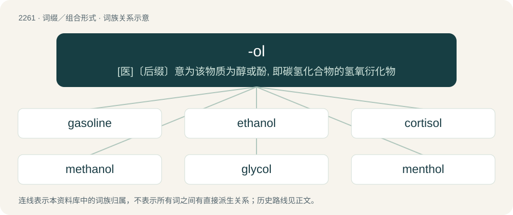

# 2365 · -ol — \[医\]〔后缀〕意为该物质为醇或酚, 即碳氢化合物的氢氧衍化物

[总目录](../00_总目录_按常用程度.md)

**类型**：词缀／组合形式　｜　**来源语言**：见词源记录

## 核心含义与来源

- 核心含义：\[医\]〔后缀〕意为该物质为醇或酚, 即碳氢化合物的氢氧衍化物
- 英文含义：An alcohol or phenol.
- 词形：-ol

**来源记录 1**（后缀／后置成分；Indicating an oily substance）

From Latin oleum (“oil, olive oil”), from Ancient Greek ἔλαιον (élaion, “olive oil”).

## 词族图

## 单词速览（常用到不常用）

| 单词 | 音标 | 释义 |
|---|---|---|
| [gasoline](#w-1) | 英 /ˈɡæs.ə.liːn/；美 /ɡæsˈlin/ | n. 汽油；\[化\] 汽油 |
| [ethanol](#w-2) | 英 /ˈɛθ.ə.nɒl/；美 /ˈɛθ.ə.nɑl/ | n. 乙醇, 酒精；\[化\] 乙醇 |
| [cortisol](#w-3) | 英 /ˈkɔː.tɪ.sɒl/；美 /ˈkoɹ.tɪˌsɔl/ | n. 皮质醇, 氢化可的松；\[化\] 皮质醇; 皮质甾醇; 氢化可的松 |
| [methanol](#w-4) | /ˈmɛθənɒl/ | n. 甲醇；\[化\] 甲醇 |
| [glycol](#w-5) | /ˈɡlaɪ̯.kɒl/ | n. 乙二醇；\[化\] 二醇; 乙二醇 |
| [menthol](#w-6) | /ˈmɛnθɒl/ | n. 薄荷醇；\[化\] 薄荷醇; ┮醇 |
| [glycerol](#w-7) | 英 /ˈɡlɪs.ə.rɒl/；美 /ˈɡlɪs.ə.rɔl/ | n. 甘油, 丙三醇；\[化\] 甘油 |
| [retinol](#w-8) | /ˈrɛ.tən̩ɑl/ | \[医\] 维生素A醇, 维生素A1, 瑞叮醇, 松香油 |
| [inositol](#w-9) | 英 /ʌɪˈnəʊ.sɪ.tɒl/；美 /ɪˈnoʊ.səˌtɒl/ | n. 肌醇；\[化\] 肌醇 |
| [propranolol](#w-10) | 英 /pɹəʊˈpɹan.ə.lɒl/；美 /pɹoʊˈpɹæn.əˌlɔl/ | \[化\] 普萘洛尔; 萘心安; 心得安 |
| [thiol](#w-11) | /ˈθaɪˌɒl/ | n. \[化\]硫醇 |
| [diol](#w-12) | /ˈdaɪ.ɒl/ | n. \[化\]二醇 |
| [cannabidiol](#w-13) | 英 /kan.əb.ɪˈdʌɪ.ɒl/；美 /kæn.əb.ɪˈdaɪ.ɔl/ | \[化\] 大麻二酚；\[医\] 大麻二酚 |
| [haloperidol](#w-14) | 英 /ˌhæ.lə(ʊ)ˈpɛ.ɹɪ.dɒl/；美 /ˌhæ.loʊˈpɛ.ɹɪˌdɔl/ | \[化\] 氟哌啶醇; 氟哌丁苯 |

## 逐词详解

### 1. gasoline

**词性**：名词　｜　**音标**：英 /ˈɡæs.ə.liːn/；美 /ɡæsˈlin/

**中文释义**：n. 汽油；\[化\] 汽油

**英文义项**：A flammable liquid consisting of a mixture of refined petroleum hydrocarbons, mainly used as a motor fuel; petrol. / Any specific kind of this fuel.

**构词拆分**：gas + -ol + -ine；gas + -ol

**词源与演化**：

From gas + -ol (suffix used in the names of oils) + -ine (suffix used in the names of derivatives). So called because it was originally used in the manufacture and enrichment of domestic gases, such as air gas. Some sources suggest that the name originated from the brand name Cazeline, a petroleum-derived lighting oil, from the surname of the man who first marketed it in 1862, John Cassell, and the suffix –eline, from Greek ἔλαιον (élaion, “oil, olive oil”), from ἐλαία (elaía, “olive”). Gasolene is found from 1863, and gasoline from 1864.

**例句**：

> You can't put gasoline in this car. This car takes diesel fuel.

该用例对应义项：A flammable liquid consisting of a mixture of refined petroleum hydrocarbons, mainly used as a motor fuel; petrol.

### 2. ethanol

**词性**：名词　｜　**音标**：英 /ˈɛθ.ə.nɒl/；美 /ˈɛθ.ə.nɑl/

**中文释义**：n. 乙醇, 酒精；\[化\] 乙醇

**英文义项**：A simple aliphatic alcohol formally derived from ethane by replacing one hydrogen atom with a hydroxyl group: CH₃-CH₂-OH. / Specifically, this form of alcohol as a fuel.

**构词拆分**：ethyl + alcohol + ethane + -ol；ethane + -ol

**例句**：

> Methanol has the same effects as ethanol, but also makes people blind.

### 3. cortisol

**词性**：名词　｜　**音标**：英 /ˈkɔː.tɪ.sɒl/；美 /ˈkoɹ.tɪˌsɔl/

**中文释义**：n. 皮质醇, 氢化可的松；\[化\] 皮质醇; 皮质甾醇; 氢化可的松

**英文义项**：A glucocorticoid steroid hormone produced by the adrenal cortex that mediates various metabolic processes (such as gluconeogenesis), has anti-inflammatory and immunosuppressive properties, and whose levels in the blood may become elevated in response to physical or psychological stress. / Stress.

**构词拆分**：cortisone + -ol

**词源与演化**：

From cortisone + -ol.

### 4. methanol

**词性**：名词　｜　**音标**：/ˈmɛθənɒl/

**中文释义**：n. 甲醇；\[化\] 甲醇

**英文义项**：The simplest aliphatic alcohol, CH₃OH; a colourless, toxic, inflammable liquid, used as a solvent, antifreeze, in the chemical industry, and in the preparation of methylated spirit.

**构词拆分**：methane + -ol

**词源与演化**：

From methane + -ol. French chemists Jean-Baptiste Dumas and Eugene Peligot, after determining methanol's chemical structure, introduced "methylene" from the Ancient Greek μέθυ (méthu, “wine”) + ὕλη (húlē, “wood, material”) with the intention of highlighting its origins, "alcohol made from wood (substance)".

**例句**：

> Methanol has the same effects as ethanol, but also makes people blind.

### 5. glycol

**词性**：名词　｜　**音标**：/ˈɡlaɪ̯.kɒl/

**中文释义**：n. 乙二醇；\[化\] 二醇; 乙二醇

**英文义项**：Any aliphatic diol. / A thick, colourless liquid, C₂H₄(OH)₂, of a sweetish taste, produced artificially from certain ethylene compounds and used as an antifreeze; ethylene glycol.

**词源与演化**：

From Ancient Greek γλῠκῠ́ς (glŭkŭ́s, “sweet”) + English -ol.

### 6. menthol

**词性**：名词　｜　**音标**：/ˈmɛnθɒl/

**中文释义**：n. 薄荷醇；\[化\] 薄荷醇; ┮醇

**英文义项**：A cyclic monoterpene alcohol; the major component of the essential oil of peppermint; used in pharmaceutical preparations as an antitussive and antipruritic agent, as a nasal decongestant, and in menthol cigarettes. / A menthol cigarette.

**词源与演化**：

From Latin mentha (“mint”) + -ol.

**例句**：

> I like the crisp taste of menthol cigarettes.

### 7. glycerol

**词性**：名词　｜　**音标**：英 /ˈɡlɪs.ə.rɒl/；美 /ˈɡlɪs.ə.rɔl/

**中文释义**：n. 甘油, 丙三醇；\[化\] 甘油

**英文义项**：1,2,3-trihydroxy-propane or propan-1,2,3-triol; a trihydric alcohol / A syrupy sweet liquid obtained as a by-product in the manufacture of soap from animal or vegetable oils and fats; it is used as an antifreeze, a plasticizer, and a food sweetener and in the manufacture of dynamite, cosmetics etc.

**构词拆分**：glycerine + -ol

**词源与演化**：

From glycerine + -ol.

**例句**：

> Fats are broken down into fatty acids and glycerol.

### 8. retinol

**词性**：名词　｜　**音标**：/ˈrɛ.tən̩ɑl/

**中文释义**：\[医\] 维生素A醇, 维生素A1, 瑞叮醇, 松香油

**英文义项**：A fat-soluble carotenoid vitamin (vitamin A), present in fish oils and green vegetables, essential to normal vision and to bone development.

**构词拆分**：From retina + -ol.

**词源与演化**：

From retina + -ol.

### 9. inositol

**词性**：名词　｜　**音标**：英 /ʌɪˈnəʊ.sɪ.tɒl/；美 /ɪˈnoʊ.səˌtɒl/

**中文释义**：n. 肌醇；\[化\] 肌醇

**英文义项**：A simple carbocyclic sugar (hexahydroxycyclohexane; chemical formula: C₆H₁₂O₆) which occurs in animal and plant tissue. Once treated as part of the vitamin B complex, but is not a vitamin as it can be synthesized by the body.

**构词拆分**：inosite + -ol；inosite + -ol (“an alcohol”)；Ancient Greek ἰνός (inós, genitive singular of ἴς (ís, “sinew, tendon”)) + -ite

**词源与演化**：

From its former name inosite + -ol (“an alcohol”), from Ancient Greek ἰνός (inós, genitive singular of ἴς (ís, “sinew, tendon”)) + -ite.

### 10. propranolol

**词性**：名词　｜　**音标**：英 /pɹəʊˈpɹan.ə.lɒl/；美 /pɹoʊˈpɹæn.əˌlɔl/

**中文释义**：\[化\] 普萘洛尔; 萘心安; 心得安

**英文义项**：A synthetic compound which acts as a beta blocker and is used mainly in the treatment of cardiac arrhythmia.

**构词拆分**：isopropyl + propanol + -ol

**词源与演化**：

From (iso)pro(pyl) + pr(op)anol + -ol.

### 11. thiol

**词性**：名词　｜　**音标**：/ˈθaɪˌɒl/

**中文释义**：n. \[化\]硫醇

**英文义项**：A univalent organic radical (-SH) containing a sulphur and a hydrogen atom; a compound containing such a radical.

**构词拆分**：thio- + -ol

**词源与演化**：

From thio- + -ol.

**例句**：

> Methanethiol is an organic sulfur compound containing an alkyl or aryl group and a thiol group.

### 12. diol

**词性**：名词　｜　**音标**：/ˈdaɪ.ɒl/

**中文释义**：n. \[化\]二醇

**英文义项**：any organic compound having two hydroxy functional groups

**构词拆分**：di- + -ol

**词源与演化**：

From di- + -ol.

### 13. cannabidiol

**词性**：名词　｜　**音标**：英 /kan.əb.ɪˈdʌɪ.ɒl/；美 /kæn.əb.ɪˈdaɪ.ɔl/

**中文释义**：\[化\] 大麻二酚；\[医\] 大麻二酚

**英文义项**：A nonintoxicating cannabinoid found in the hemp plant Cannabis sativa.

**构词拆分**：cannabis + -i- + di- + -ol

**词源与演化**：

From cannab(is) + -i- + di- + -ol.

### 14. haloperidol

**词性**：名词　｜　**音标**：英 /ˌhæ.lə(ʊ)ˈpɛ.ɹɪ.dɒl/；美 /ˌhæ.loʊˈpɛ.ɹɪˌdɔl/

**中文释义**：\[化\] 氟哌啶醇; 氟哌丁苯

**英文义项**：A synthetic antidepressant drug, with the chemical formula C₂₁H₂₃ClFNO₂, used in the treatment of psychotic conditions.

**构词拆分**：halo- + (pi)perid(ine) + -ol

**词源与演化**：

From halo- + (pi)perid(ine) + -ol. By surface analysis, halo- + -peridol.

**例句**：

> Dr. Jackson gave Tom some haloperidol.
