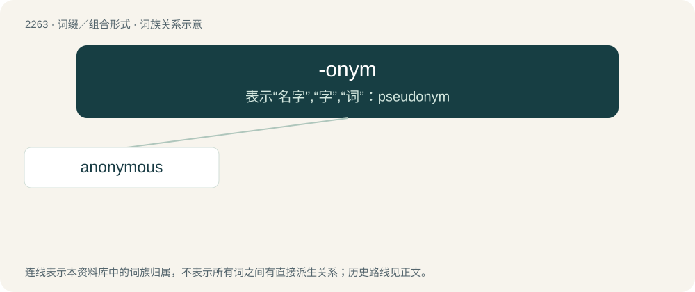

# 2366 · -onym — 表示“名字”,“字”,“词”：pseudonym

[总目录](../00_总目录_按常用程度.md)

**类型**：词缀／组合形式　｜　**来源语言**：见词源记录

## 核心含义与来源

- 核心含义：表示“名字”,“字”,“词”：pseudonym
- 英文含义：Word.
- 词形：-onym

**来源记录 1**（后缀／后置成分；Word.）

From international scientific vocabulary, reflecting a New Latin combining form, from Ancient Greek ὄνυμα (ónuma), Doric and Aeolic dialectal form of ὄνομα (ónoma, “name”); compare also -onymy § Etymology.

## 词族图

## 单词速览（常用到不常用）

| 单词 | 音标 | 释义 |
|---|---|---|
| [anonymous](#w-1) | 英 /əˈnɒn.ə.məs/；美 /əˈnɑ.nə.məs/ | a. 姓氏不详的, 无名的, 无特色的；\[计\] 无记录 |

## 逐词详解

### 1. anonymous

**词性**：形容词　｜　**音标**：英 /əˈnɒn.ə.məs/；美 /əˈnɑ.nə.məs/

**中文释义**：a. 姓氏不详的, 无名的, 无特色的；\[计\] 无记录

**英文义项**：Lacking a name; not named, for example an animal not assigned to any species . / Without any name acknowledged of a person responsible.

**构词拆分**：anonym + -ous；an- + -onym + -ous

**词源与演化**：

Borrowed into English around 1600 from Late Latin anonymus, from Ancient Greek ᾰ̓νώνῠμος (ănṓnŭmos, “without name”), from ᾰ̓ν- (ăn-, “un-”) with ὄνῠμᾰ (ónŭmă), Aeolic and Doric dialectal form of ὄνομᾰ (ónomă, “name”). English equivalent anonym + -ous, its full etymology being an- + -onym + -ous.

**例句**：

> No customer personal data will be retained unless it is rendered anonymous.

该用例对应义项：Of unknown name; whose name is withheld
