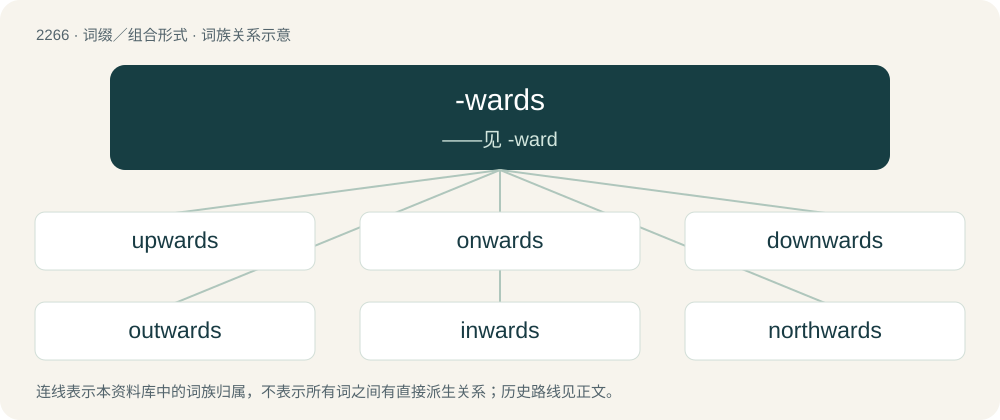

# 2369 · -wards — ——见 -ward

[总目录](../00_总目录_按常用程度.md)

**类型**：词缀／组合形式　｜　**来源语言**：见词源记录

## 核心含义与来源

- 核心含义：——见 -ward
- 英文含义：Forming adjectives and adverbs denoting course or direction to, or motion or tendency toward, as in "backwards", "towards", etc.
- 词形：-wards

**来源记录 1**（后缀／后置成分；Forming adjectives and adverbs denoting course or direction to, or motion or tendency toward, as in "backwards", "towards", etc.）

From Middle English -wardes, from Old English -weardes, a variant of -weard; equivalent to -ward + -s (adverbial suffix). Cognate with German -wärts, Dutch -waarts.

## 词族图

## 单词速览（常用到不常用）

| 单词 | 音标 | 释义 |
|---|---|---|
| [upwards](#w-1) | 英 /ˈʌpwədz/；美 /ˈʌpwɚdz/ | adv. 以上, 向上 |
| [onwards](#w-2) | /ˈɔnwəːdz/ | adv. 向前, 在前面 |
| [downwards](#w-3) | 英 /ˈdaʊnwədz/；美 /ˈdaʊnwɚdz/ | adv. 向下 |
| [outwards](#w-4) | 英 /ˈaʊtwədz/；美 /ˈaʊtwɚdz/ | adv. 向外地 |
| [inwards](#w-5) | 英 /ˈɪnwədz/；美 /ˈɪnwɚdz/ | adv. 在内部, 向中心, 向内, 内里；\[经\] 进口税 |
| [northwards](#w-6) | /ˈnɔːθwədz/ | adv. 向北方 |
| [eastwards](#w-7) | /ˈiːstwədz/ | adv. 向东方地 |
| [southwards](#w-8) | /ˈsajθwədz/ | adv. 在南方 |
| [westwards](#w-9) | /ˈwestwədz/ | adv. 向西 |

## 逐词详解

### 1. upwards

**词性**：副词　｜　**音标**：英 /ˈʌpwədz/；美 /ˈʌpwɚdz/

**中文释义**：adv. 以上, 向上

**英文义项**：Towards a (higher) position closer to the sky than the ground. / To a higher figure or amount.

**构词拆分**：up + -wards

**词源与演化**：

From Middle English upwardes, from Old English upweardes, equivalent to up + -wards. Cognate with Dutch opwaarts (“upwards”), German aufwärts (“upwards”).

**例句**：

> The balloon drifted upwards into the sky.

该用例对应义项：Towards a (higher) position closer to the sky than the ground.

### 2. onwards

**词性**：副词　｜　**音标**：/ˈɔnwəːdz/

**中文释义**：adv. 向前, 在前面

**英文义项**：Onward.

**构词拆分**：on + -wards

**词源与演化**：

From on + -wards.

**例句**：

> She looked him in the eye unwaveringly from the first word onwards.

### 3. downwards

**词性**：副词　｜　**音标**：英 /ˈdaʊnwədz/；美 /ˈdaʊnwɚdz/

**中文释义**：adv. 向下

**英文义项**：Towards a lower place; towards what is below. / Towards something which is lower in order, smaller, inferior, etc.

**构词拆分**：From down + -wards.

**词源与演化**：

From down + -wards.

**例句**：

> After the rise in oil prices, the economy headed downwards.

该用例对应义项：Towards something which is lower in order, smaller, inferior, etc.

### 4. outwards

**词性**：副词　｜　**音标**：英 /ˈaʊtwədz/；美 /ˈaʊtwɚdz/

**中文释义**：adv. 向外地

**英文义项**：From the interior toward the exterior; in an outward direction.

**构词拆分**：outward + -s；out + -wards

**词源与演化**：

From Middle English outwardes, from Old English ūtweardes; equivalent to outward + -s or out + -wards. Cognate with German auswärts.

**例句**：

> His body type is born balanced! Wide shoulders, slim waist, belly not popping outwards.

### 5. inwards

**词性**：副词　｜　**音标**：英 /ˈɪnwədz/；美 /ˈɪnwɚdz/

**中文释义**：adv. 在内部, 向中心, 向内, 内里；\[经\] 进口税

**英文义项**：Towards the inside.

**构词拆分**：in + -wards

**词源与演化**：

From in + -wards.

**例句**：

> Its massive gravity well tugs many asteroids from the outer belt inwards.

### 6. northwards

**词性**：副词　｜　**音标**：/ˈnɔːθwədz/

**中文释义**：adv. 向北方

**英文义项**：northward; in a northerly direction

**构词拆分**：north + -wards

**词源与演化**：

From north + -wards.

**例句**：

> If Algeria does nothing, the Sahara desert will continue to expand northwards.

### 7. eastwards

**词性**：副词　｜　**音标**：/ˈiːstwədz/

**中文释义**：adv. 向东方地

**英文义项**：eastward.

**构词拆分**：From east + -wards.

**词源与演化**：

From east + -wards.

**例句**：

> A band of rain, heading eastwards, will reach all parts by the end of the day.

### 8. southwards

**词性**：副词　｜　**音标**：/ˈsajθwədz/

**中文释义**：adv. 在南方

**英文义项**：In a southerly direction; towards the south.

**构词拆分**：south + -wards

**词源与演化**：

From south + -wards.

**例句**：

> I told Yaroslav that I took the train southwards from Cairo to Aswan, Egypt.

### 9. westwards

**词性**：副词　｜　**音标**：/ˈwestwədz/

**中文释义**：adv. 向西

**英文义项**：westward, towards the west

**构词拆分**：From west + -wards.

**词源与演化**：

From west + -wards.

**例句**：

> We traveled westwards for 100 miles.
