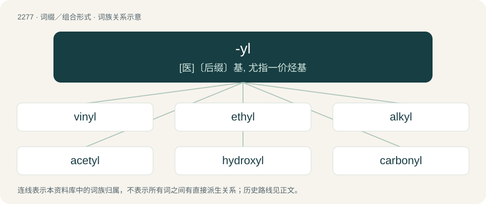

# 2381 · -yl — \[医\]〔后缀〕基, 尤指一价烃基

[总目录](../00_总目录_按常用程度.md)

**类型**：词缀／组合形式　｜　**来源语言**：见词源记录

## 核心含义与来源

- 核心含义：\[医\]〔后缀〕基, 尤指一价烃基
- 英文含义：A univalent radical or functional group formed from a given molecule. Thus propyl from propane, benzyl from benzene, and so forth.
- 词形：-yl

## 词族图

## 单词速览（常用到不常用）

| 单词 | 音标 | 释义 |
|---|---|---|
| [vinyl](#w-1) | 英 /ˈvaɪ.nɪl/ | n. 乙烯基；\[化\] 乙烯基 |
| [ethyl](#w-2) | 英 /ˈɛθaɪl/；美 /ˈɛθəl/ | \[化\] 乙基；\[医\] 乙基 |
| [alkyl](#w-3) | /ˈælkaɪl/ | n. 烷基, 烃基；a. 烷基的, 烃基的 |
| [acetyl](#w-4) | 英 /əˈsiːtaɪl/；美 /ˈæsətɪl/ | n. 乙酰(基)；\[化\] 乙酰; 乙酰基 |
| [hydroxyl](#w-5) | /haiˈdrɒksi/ | n. 氢氧根；\[医\] 羟\[基\], 氢氧基 |
| [carbonyl](#w-6) | /ˈkɑː(ɹ)bənɪl/ | \[医\] 羰基, 碳酰 |
| [butyl](#w-7) | /ˈbjuːtɪl/ | n. 丁基；\[医\] 丁基 |
| [acyl](#w-8) | 英 /ˈæ.sɪl/ | n. \[化\]酰基 |
| [phenyl](#w-9) | 英 /ˈfiː.naɪl/；美 /ˈfɛn.l̩/ | n. 苯基；\[化\] 苯基 |
| [aryl](#w-10) | /ˈæɹaɪl/ | \[机\] 芳香基 |
| [benzoyl](#w-11) | /ˈbɛnzəʊ.ɪl/ | n. \[化\]苯(甲)酰 |
| [benzyl](#w-12) | /ˈbɛnzɪl/ | n. 苯甲基；\[化\] 苄基; 苯甲基 |
| [allyl](#w-13) | /ˈælaɪl/ | n. \[化\]烯丙基 |

## 逐词详解

### 1. vinyl

**词性**：名词　｜　**音标**：英 /ˈvaɪ.nɪl/

**中文释义**：n. 乙烯基；\[化\] 乙烯基

**英文义项**：The univalent radical CH₂=CH−, derived from ethylene. / Any of various compounds and substances containing the vinyl radical, especially various tough, flexible, shiny plastics.

**词源与演化**：

From Latin vīnum (“wine”) + English -yl. Derived from Latin vīnum because ethyl alcohol is the ordinary alcohol present in wine.

**例句**：

> Many DJs prefer vinyl to CDs.

该用例对应义项：Phonograph records as a medium.

### 2. ethyl

**词性**：名词　｜　**音标**：英 /ˈɛθaɪl/；美 /ˈɛθəl/

**中文释义**：\[化\] 乙基；\[医\] 乙基

**英文义项**：The univalent hydrocarbon radical, C₂H₅, formally derived from ethane by the loss of a hydrogen atom.

**词源与演化**：

From German Ethyl, from Ether + -yl.

**例句**：

> Manufacturers add ethyl butyrate to their orange juice to make it taste fresher.

### 3. alkyl

**词性**：名词　｜　**音标**：/ˈælkaɪl/

**中文释义**：n. 烷基, 烃基；a. 烷基的, 烃基的

**英文义项**：Any of a series of univalent radicals of the general formula CₙH₂ₙ₊₁ derived from aliphatic hydrocarbons. In other words, an alkane minus one hydrogen atom.

**构词拆分**：alcohol + -yl

**词源与演化**：

From alc(ohol) + -yl.

**例句**：

> Methanethiol is an organic sulfur compound containing an alkyl or aryl group and a thiol group.

### 4. acetyl

**词性**：名词　｜　**音标**：英 /əˈsiːtaɪl/；美 /ˈæsətɪl/

**中文释义**：n. 乙酰(基)；\[化\] 乙酰; 乙酰基

**英文义项**：The univalent radical CH₃CO- derived from acetic acid.

**构词拆分**：acet- + -yl；aceto- + -yl

### 5. hydroxyl

**词性**：名词　｜　**音标**：/haiˈdrɒksi/

**中文释义**：n. 氢氧根；\[医\] 羟\[基\], 氢氧基

**英文义项**：A univalent radical or functional group (–OH) in organic chemistry; present in alcohols, phenols, carboxylic acids and certain other classes of compounds.

**构词拆分**：hydrogen + oxygen + -yl

**词源与演化**：

From a blend of hydrogen + oxygen + -yl.

**例句**：

> Tyrosine is similar in structure to phenylalanine, with the important distinction that the latter contains a hydroxyl group in its side chain.

### 6. carbonyl

**词性**：名词　｜　**音标**：/ˈkɑː(ɹ)bənɪl/

**中文释义**：\[医\] 羰基, 碳酰

**英文义项**：A divalent functional group, (-CO-), characteristic of aldehydes, ketones, carboxylic acids, amides, carboxylic acid anhydrides, carbonyl halides, esters and others. / Any compound of a metal with carbon monoxide, such as nickel carbonyl, Ni(CO)₄.

**构词拆分**：carbon + -yl

**词源与演化**：

From carbon + -yl.

### 7. butyl

**词性**：名词　｜　**音标**：/ˈbjuːtɪl/

**中文释义**：n. 丁基；\[医\] 丁基

**英文义项**：Any of four isomeric univalent hydrocarbon radicals, C₄H₉, formally derived from butane by the loss of a hydrogen atom. / A synthetic rubber made by the polymerization of isobutylene.

**构词拆分**：but- + -yl

**词源与演化**：

From but- + -yl.

### 8. acyl

**词性**：名词　｜　**音标**：英 /ˈæ.sɪl/

**中文释义**：n. \[化\]酰基

**英文义项**：Any of class of organic radicals, RCO-, formed by the removal of a hydroxyl group from a carboxylic acid.

**词源与演化**：

Ultimately from Latin ac(eō) + -yl.

**例句**：

> An example of the acyl group is the acetyl group.

该用例对应义项：any group or radical of the form RCO- where R is an organic group

### 9. phenyl

**词性**：名词　｜　**音标**：英 /ˈfiː.naɪl/；美 /ˈfɛn.l̩/

**中文释义**：n. 苯基；\[化\] 苯基

**英文义项**：A univalent hydrocarbon radical, C₆H₅ (benzene minus one hydrogen atom), and the basis of an immense number of aromatic derivatives.

**构词拆分**：phen- + -yl

**词源与演化**：

Borrowed from French phényle, derived from the root of Ancient Greek φαίνω (phaínō, “to shine”) plus ὕλη (húlē, “wood; material, substance”). Equivalent to phen- + -yl.

### 10. aryl

**词性**：名词　｜　**音标**：/ˈæɹaɪl/

**中文释义**：\[机\] 芳香基

**英文义项**：Any univalent organic radical derived from an aromatic hydrocarbon by removing a hydrogen atom.

**构词拆分**：aromatic + -yl

**词源与演化**：

From aromatic + -yl.

**例句**：

> Methanethiol is an organic sulfur compound containing an alkyl or aryl group and a thiol group.

### 11. benzoyl

**词性**：名词　｜　**音标**：/ˈbɛnzəʊ.ɪl/

**中文释义**：n. \[化\]苯(甲)酰

**英文义项**：A univalent radical formally derived from benzoic acid, C₆H₅CO-, by removal of the hydroxyl group.

**构词拆分**：benzoic + -yl

**词源与演化**：

From benzoic + -yl.

### 12. benzyl

**词性**：名词　｜　**音标**：/ˈbɛnzɪl/

**中文释义**：n. 苯甲基；\[化\] 苄基; 苯甲基

**英文义项**：The univalent radical C₆H₅-CH₂- related to toluene and benzoic acid

**构词拆分**：benz- + -yl

**词源与演化**：

From benz- + -yl.

**例句**：

> Do you know what benzyl acetate smells like?

### 13. allyl

**词性**：名词　｜　**音标**：/ˈælaɪl/

**中文释义**：n. \[化\]烯丙基

**英文义项**：The univalent radical, CH₂=CH-CH₂-, existing especially in oils of garlic and mustard.

**词源与演化**：

From Latin allium (“garlic”) + English -yl.
