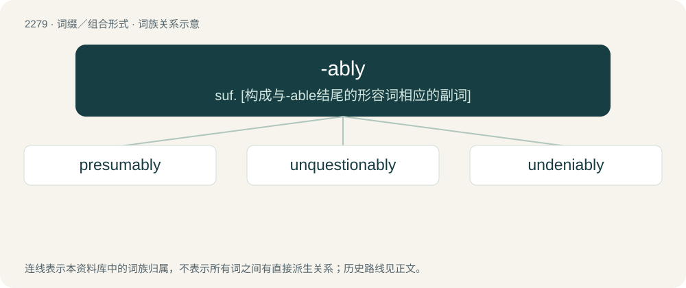

# 2382 · -ably — suf. \[构成与-able结尾的形容词相应的副词\]

[总目录](../00_总目录_按常用程度.md)

**类型**：词缀／组合形式　｜　**来源语言**：见词源记录

## 核心含义与来源

- 核心含义：suf. \[构成与-able结尾的形容词相应的副词\]
- 英文含义：Used to form adverbs corresponding to adjectives that end in -able.
- 词形：-ably

**来源记录 1**（后缀／后置成分；Used to form adverbs corresponding to adjectives that end in -able.）

From -able + -ly.

## 词族图

## 单词速览（常用到不常用）

| 单词 | 音标 | 释义 |
|---|---|---|
| [presumably](#w-1) | 英 /pɹɪˈzjuːməbli/；美 /pɹɪˈzuːməbli/ | adv. 推测上, 大概 |
| [unquestionably](#w-2) | 英 /ʌnˈkwɛs.t͡ʃən.ə.bli/；/ʌnˈkwes.t͡ʃən.ə.blɪ/ | adv. 毫无疑问, 不成问题, 无可非议, 确实 |
| [undeniably](#w-3) |  | adv. 确凿无疑地；不可否认地 |

## 逐词详解

### 1. presumably

**词性**：副词　｜　**音标**：英 /pɹɪˈzjuːməbli/；美 /pɹɪˈzuːməbli/

**中文释义**：adv. 推测上, 大概

**英文义项**：Able to be sensibly presumed.

**构词拆分**：presume + -ably；presumable + -ly

**词源与演化**：

From presume + -ably, presumable + -ly.

**例句**：

> Presumably, he will attend the opening.

该用例对应义项：Able to be sensibly presumed.

### 2. unquestionably

**词性**：副词　｜　**音标**：英 /ʌnˈkwɛs.t͡ʃən.ə.bli/；/ʌnˈkwes.t͡ʃən.ə.blɪ/

**中文释义**：adv. 毫无疑问, 不成问题, 无可非议, 确实

**英文义项**：Without question; beyond doubt; indubitably. / OK, right-on

**构词拆分**：unquestionable + -ly；un- + question + -ably

**词源与演化**：

From unquestionable + -ly or un- + question + -ably.

**例句**：

> Fred Winter is unquestionably the jockey to follow.

该用例对应义项：without question

### 3. undeniably

**词性**：副词

**中文释义**：adv. 确凿无疑地；不可否认地

**英文义项**：In an undeniable manner, or to an undeniable extent. / Used as a modal adverb to assert that the indicated statement is undeniable.

**构词拆分**：undeniable + -ly；un- + deny + -ably

**词源与演化**：

From undeniable + -ly, equivalent to un- + deny + -ably.

**例句**：

> The third movie was undeniably the best.

该用例对应义项：Used as a modal adverb to assert that the indicated statement is undeniable.
