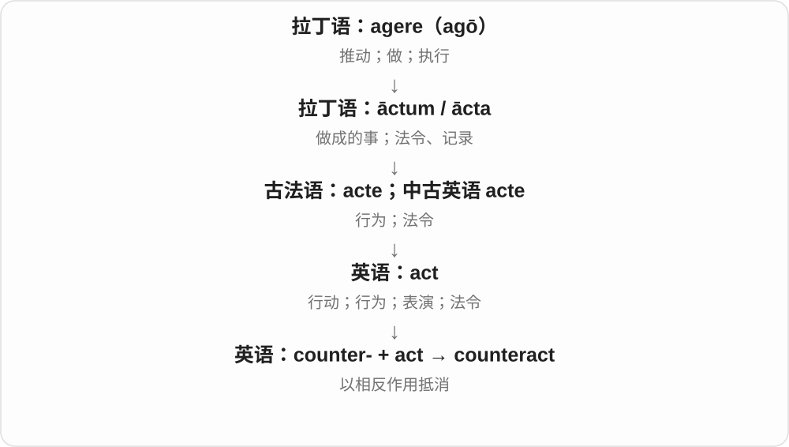
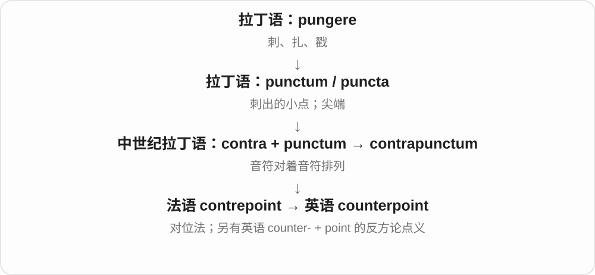
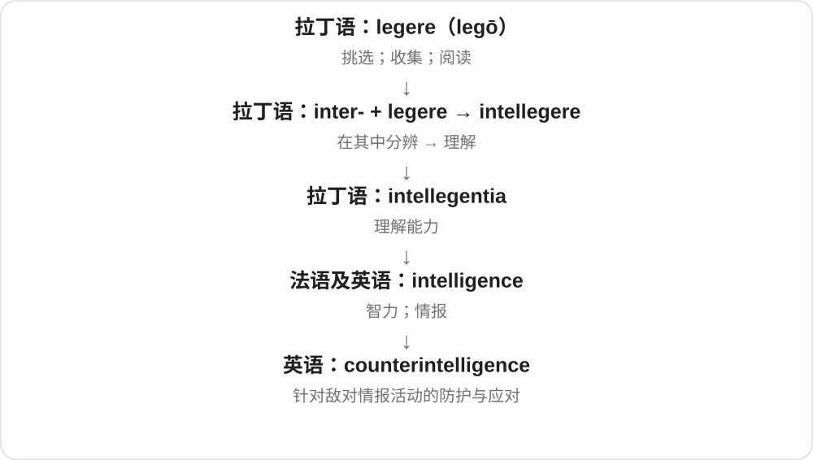
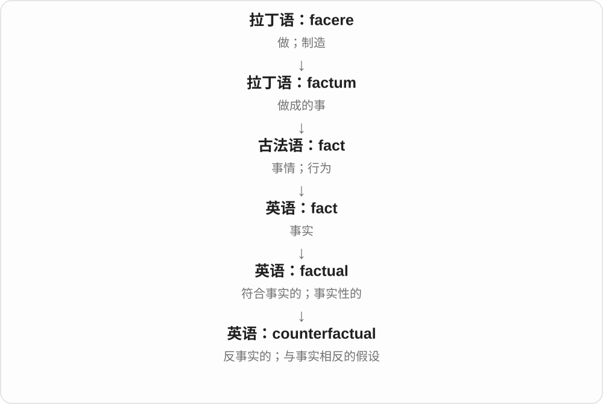
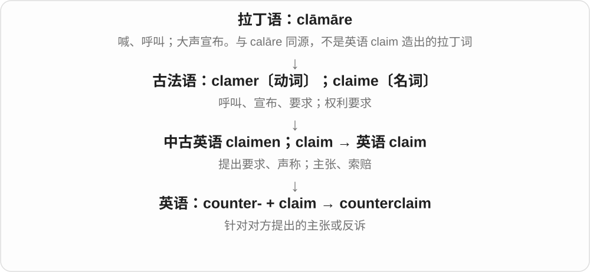

# 2396 · counter- — 对面、反向、抵消、回应，前缀不只一种中文

[逐词精讲目录](../00_逐词精讲目录.md) · [总目录](../00_总目录_按常用程度.md)

## 核心词根与来源

先看两边的关系：相对应、朝反向、抵消效果、回应攻击，都是对面这一画面的不同发展。逐词选合适中文。

**COUNTER-：朝相反方向，也能站到对应位置**

counterpart 对应者；counteract 抵消；counterexample 反例；counterpunch 反击。

- **对应位置和主体**：counterpart · counterparty
- **抵消、平衡与效果**：counteract · counterbalance · counterweight · counterproductive
- **思想、推理和主张**：counterintuitive · counterexample · counterfactual · counterclaim · counterpoint
- **方向与回应行动**：counterclockwise · counterpunch · countermeasure · counterstrike · counterintelligence
- **文化取向**：counterculture · countercultural
- **counter- 对应 + part → counterparts**：counterparts

## 词形与演化规律

拉丁 contrā 经法语 contre 等 → counter-；接名词、动词、形容词形成相应复合词。

counterpart 经法语 contrepartie 相对的副本、对应部分，现代复数常说不同机构、情境中职责对应的人或物，不必是对手。

## 单词速览（按词族由简到繁）

同一基础词的相关扩展放在一起，先读基础形式，再读扩展；各组之间优先读常用的。具体词源关系见各词讲解。

| 单词 | 音标 | 核心意思 |
|---|---|---|
| [counterpart](#w-1) | 英 /ˈkaʊntəpɑːt/；美 /ˈkaʊntərpɑːrt/ | 对应的人、物；职能相当者 |
| [counterparts](#w-21) | 英 /ˈkaʊntəpɑːts/；美 /ˈkaʊntɚpɑːrts/ | 对应的人；职位相当者；对应事物〔复数〕 |
| [counterparty](#w-12) | 英 /ˈkaʊntəpɑːti/；美 /ˈkaʊntərpɑːrti/ | 交易对方；合同另一方 |
| [counteract](#w-2) | 英 /ˌkaʊntərˈækt/；美 /ˌkaʊntərˈækt/ | 抵消；抵制某种作用 |
| [counterpoint](#w-3) | 英 /ˈkaʊntəpɔɪnt/；美 /ˈkaʊntərpɔɪnt/ | 对位法；形成对照的事物；使成对照 |
| [counterproductive](#w-4) | 英 /ˌkaʊntəprəˈdʌktɪv/；美 /ˌkaʊntərprəˈdʌktɪv/ | 适得其反的、产生反效果的 |
| [counterbalance](#w-5) | 英 /ˌkaʊntəˈbæləns/；美 /ˌkaʊntərˈbæləns/ | 抵消、制衡；平衡重、抗衡力量 |
| [counterintuitive](#w-6) | 英 /ˌkaʊntərɪnˈtjuːɪtɪv/；美 /ˌkaʊntərɪnˈtuːɪtɪv/ | 违反直觉的、乍想出乎意料的 |
| [counterweight](#w-7) | 英 /ˈkaʊntəweɪt/；美 /ˈkaʊntərweɪt/ | 配重；平衡、制衡因素 |
| [counterintelligence](#w-8) | 英 /ˌkaʊntərɪnˈtelɪdʒəns/；美同 | 反情报；反间谍工作 |
| [counterclockwise](#w-9) | 英 /ˌkaʊntəˈklɒkwaɪz/；美 /ˌkaʊntərˈklɑːkwaɪz/ | 逆时针地、逆时针的〔美式常见〕 |
| [counterculture](#w-10) | 英 /ˈkaʊntəkʌltʃə/；美 /ˈkaʊntərkʌltʃər/ | 反主流文化 |
| [countercultural](#w-18) | 英 /ˌkaʊntəˈkʌltʃərəl/；美 /ˌkaʊntərˈkʌltʃərəl/ | 反主流文化的 |
| [countermeasure](#w-13) | 英 /ˈkaʊntəmeʒə/；美 /ˈkaʊntərmeʒər/ | 对策；应对措施；反制措施 |
| [counterfactual](#w-14) | /ˌkaʊntɚˈfæktʃuəl/ | 反事实的；与事实相反的假设 |
| [counterclaim](#w-15) | 英 /ˈkaʊntəkleɪm/；美 /ˈkaʊntərkleɪm/ | 反主张；反诉；提出反诉 |
| [counterexample](#w-16) | 英 /ˈkaʊntərɪɡzɑːmpəl/；美 /ˈkaʊntərɪɡzæmpəl/ | 反例 |
| [counterpunch](#w-19) | 英 /ˈkaʊntəpʌntʃ/；美 /ˈkaʊntərpʌntʃ/ | 还击的一拳；反击 |
| [counterstrike](#w-20) | 英 /ˈkaʊntəstraɪk/；美 /ˈkaʊntərstraɪk/ | 反击；进行反击 |

## 逐词讲解

### 1. counterpart — 对应的人、物；职能相当者

**音标**：英 /ˈkaʊntəpɑːt/；美 /ˈkaʊntərpɑːrt/

**先抓住这个画面**

你在一家公司负责财务，对面公司做相同工作的那个人，就是你的 counterpart。位置在另一边，角色却可以对应。

**怎么拆**

counter- 对面、对应 + part，早期有法律文书相对应副本等用法，并与法语 contrepartie 相关。后来广泛说功能、位置相对应的人物。

**怎么变成今天的意思**

**拉丁 contrā → 法语 contre、相关 counter- 形式**  
在对面、相反、反对

↓

**英语 counter- 的扩展**  
反向、抵消、回应；也表示位置、职能相对应

↓

**中古英语 conterpart 等 → counterpart**  
对应部分、文书副本 → 对应者

her French counterpart 她在法国的同职者，a digital counterpart 某物的数字对应版本，meet one’s counterpart 会见相应职务的人。

**常见搭配与例句**

a counterpart in；one’s counterpart。

> The director met her counterpart from the other museum.

馆长会见了另一家博物馆的相应负责人。

> The digital version has features that its printed counterpart lacks.

数字版本具备纸质对应版本没有的功能。

**别混淆**

counterpart 不自动是 opponent 对手；也不要求两个对应物在所有细节上完全相同。

### 2. counterparts — 对应的人；职位相当者；对应事物〔复数〕

**音标**：英 /ˈkaʊntəpɑːts/；美 /ˈkaʊntɚpɑːrts/

**先抓住这个画面**

两所学校各有一位校长，他们在不同地方承担相当职责，就是彼此的 counterparts。重点是角色对应，不是两人必须相像或对立。

**怎么拆**

counterpart + -s → counterparts。经法语 contrepartie，含 contre 相对、面对与 partie 部分、副本；英语较早用于文书副本，后来发展出对应部分、对应者。

**怎么变成今天的意思**

**法语 contrepartie → 英语 counterpart 文书副本**  
可以相对核对、相互对应的部分

↓

**对应部分 → 不同场合的同等角色 → counterparts**  
现代可说人、机构、器物等

their counterparts abroad 是他们在国外的同行、对应职位者；digital counterparts 是对应的数字版本；human counterparts 是相应的人类角色。

**常见搭配与例句**

their counterparts abroad；digital counterparts；counterparts in another city。

> The teachers shared ideas with their counterparts in another city.

老师们与另一座城市的同行交流想法。

> The digital maps closely resemble their printed counterparts.

数字地图与相应的纸质地图很相似。

**别混淆**

counterparts 不自动等于对手。两位对应职位者可以合作，也可以竞争；counter- 在这里保留相对、对应这一层关系。

### 3. counterparty — 交易对方；合同另一方

**音标**：英 /ˈkaʊntəpɑːti/；美 /ˈkaʊntərpɑːrti/

**先抓住这个画面**

你站在交易的一边，与你签这笔交易的另一边，就是你的 counterparty。

**怎么拆**

counter- 相对、另一边 + party 一方。party 在这里用合同、交易参与方的意思，不是聚会，也不一定是政党。

**怎么变成今天的意思**

**法语 partie → 英语 party**  
部分、一方 → 一组人、交易参与方

↓

**counter- + party → counterparty**  
相对的一方 → 交易对方

the counterparty to a contract 合同另一方，counterparty risk 常说交易对方可能不履约的风险；对方可以是人或机构。

**常见搭配与例句**

a trading counterparty；the counterparty to the agreement；counterparty risk。

> The bank asked for details of the counterparty to the agreement.

银行要求提供协议另一方的详细资料。

> Each counterparty received a copy of the signed contract.

合同各方都收到了一份签署后的合同。

**别混淆**

counterparty 只指出这笔关系中的对方，不代表敌人；它也不是聚会上站在柜台边的人。

### 4. counteract — 抵消；抵制某种作用

**音标**：英 /ˌkaʊntərˈækt/；美 /ˌkaʊntərˈækt/

**先抓住这个画面**

counteract 像一股力向左推，另一股力向右顶，用相反作用削弱前者。

**怎么拆**

counter-（相反、对抗）+ act。

**怎么变成今天的意思**

可以抵消不良影响、趋势或物理作用。未必完全抵消，程度还需句子说明。

**常见搭配与例句**

counteract the effects；counteract a tendency；counteract a force。

> The weights help counteract the pull of the cable.

这些配重帮助抵消缆绳的拉力。

> Regular breaks can counteract the monotony of a long task.

定时休息能减轻长时间任务带来的单调感。

**别混淆**

react 是作出反应；counteract 明确要顶住或削弱原来的作用。

### 5. counterpoint — 对位法；形成对照的事物；使成对照

**音标**：英 /ˈkaʊntəpɔɪnt/；美 /ˈkaʊntərpɔɪnt/

**先抓住这个画面**

两条有自己走向的旋律同时前进，却能彼此配合。普通表达里，也像两个不同声音摆在一起，形成对照。

**怎么拆**

音乐义经法语 contrepoint 来自中世纪拉丁语 contrapunctum，contra“相对” + punctum“点、音符”；“相反论点”也有英语 counter- + point 的独立构词分析。

**怎么变成今天的意思**

音乐的重点是各声部既相互配合又保留旋律性；a counterpoint to 在普通文章里表示一种有意味的反差。古旧“绗缝被罩”另经法语相关缝刺词形成，不是音乐转义。

**常见搭配与例句**

in counterpoint；a counterpoint to；provide a counterpoint。

> The two melodies move in counterpoint.

两条旋律以对位方式同时展开。

> Her calm voice provided a counterpoint to the noisy room.

她平静的声音与喧闹的房间形成了鲜明对照。

**别混淆**

contrast 直接说差异；counterpoint 常强调两个独立成分放在一起后相互映照。

### 6. counterproductive — 适得其反的、产生反效果的

**音标**：英 /ˌkaʊntəprəˈdʌktɪv/；美 /ˌkaʊntərprəˈdʌktɪv/

**先抓住这个画面**

本想催快，结果把人催乱、做得更慢；不只是没帮上忙，而是把目标往反方向推。

**怎么拆**

counter- 对抗、相反 + productive，整体表示产生与所希望相反的效果。不是 counter 柜台产出的东西。

**怎么变成今天的意思**

**拉丁 prōdūcere、product- → productīvus、法语 productif 等 → productive**  
带出来、产生 → 能产出、能带来结果的

↓

**counter- + productive → counterproductive**  
效果与目标相反

a counterproductive policy 适得其反的政策，counterproductive pressure 反起坏作用的压力，prove counterproductive 结果适得其反。

**常见搭配与例句**

prove counterproductive；counterproductive pressure；a counterproductive approach。

> Constant criticism can be counterproductive.

不断批评可能适得其反。

> Rushing the repair proved counterproductive.

抢着赶工修理，结果反而坏了事。

**别混淆**

unproductive 可以只是没有成果，counterproductive 更突出坏了原本想办好的事；是否反效果要结合目标看。

### 7. counterbalance — 抵消、制衡；平衡重、抗衡力量

**音标**：英 /ˌkaʊntəˈbæləns/；美 /ˌkaʊntərˈbæləns/

**先抓住这个画面**

一边太重，就在另一边放一个相应力量。也可一项好处抵消某项坏处，不必真搬砝码。

**怎么拆**

counter- 相对、抵消 + balance，构成名词和动词。counter 在这里不是柜台，也不是数东西的计数器。

**怎么变成今天的意思**

**拉丁语 bilanx〔双盘的〕、相关 bilancia → 法语 balance → 中古英语 balaunce**  
bi- 两 + lanx 盘，双盘秤

↓

**英语 balance**  
称量、平衡；协调、收支差额、余额等

↓

**counter- + balance → counterbalance**  
相对力量、平衡重；用它抵消、制衡

counterbalance a risk 抵消风险，a counterbalance to something 对某物的制衡，a counterbalance weight 平衡重。

**常见搭配与例句**

counterbalance the effect；a counterbalance to；a counterbalance weight。

> The lower price counterbalanced the longer journey.

较低价格抵消了路程更长的不利之处。

> The heavy base acts as a counterbalance to the long arm.

沉重底座给长臂提供平衡重量。

**别混淆**

counterbalance 强调相对力量抵消或制衡，rebalance 调整整体分配使重新协调；不保证一定完全消掉另一项影响。

### 8. counterintuitive — 违反直觉的、乍想出乎意料的

**音标**：英 /ˌkaʊntərɪnˈtjuːɪtɪv/；美 /ˌkaʊntərɪnˈtuːɪtɪv/

**先抓住这个画面**

脑中第一反应觉得应该这样，结果或办法偏偏朝另一个方向，就是 counterintuitive。重点是和直觉不一致。

**怎么拆**

counter- 与……相反 + intuitive 直觉的；前缀作用于整个形容词。

**怎么变成今天的意思**

**拉丁 contrā → 法语 contre、相关 counter- 形式**  
在对面、相反、反对

↓

**英语 counter- 的扩展**  
反向、抵消、回应；也表示位置、职能相对应

↓

**counter- + intuitive**  
与直觉方向相反

a counterintuitive result 违反直觉的结果，a counterintuitive approach 乍想反常的方法；可写 seem counterintuitive。

**常见搭配与例句**

a counterintuitive result；seem counterintuitive。

> At first, her solution seemed counterintuitive.

起初，她的解决办法似乎违背直觉。

> The result is counterintuitive, but the measurements are clear.

结果虽然违背直觉，测量数据却很清楚。

**别混淆**

counterintuitive 不表示一定错误，也不表示一定高明；是否可靠仍要看实际依据。

### 9. counterweight — 配重；平衡、制衡因素

**音标**：英 /ˈkaʊntəweɪt/；美 /ˈkaʊntərweɪt/

**先抓住这个画面**

天平另一端加一块重物，使两边平衡；组织或观点也能成为彼此的制衡。

**怎么拆**

counter- 相对、抵消 + weight，先是平衡另一负荷的重量，再作抽象制衡比喻。

**怎么变成今天的意思**

**古英语 wiht、gewiht → 中古英语 weight → weight**  
重量；与 weigh 称重同族

↓

**现代 weight**  
重的量 → 影响力、重要性；也指训练负重

↓

**counter- + weight → counterweight**  
抵消一侧重量的配重 → 制衡因素

a crane counterweight 起重机配重，a counterweight to power 权力的制衡因素。

**常见搭配与例句**

a counterweight to；a crane counterweight；act as a counterweight。

> The crane uses a counterweight for balance.

起重机用配重保持平衡。

> The committee acts as a counterweight to the director’s power.

委员会起到制衡主管权力的作用。

**别混淆**

counterweight 不只是额外增加重量，关键是平衡另一侧；counterargument 则是回应、反对的论点。

### 10. counterintelligence — 反情报；反间谍工作

**音标**：英 /ˌkaʊntərɪnˈtelɪdʒəns/；美同

**先抓住这个画面**

counterintelligence 的重点是发现并应对对方的情报活动，保护己方信息与安全。

**怎么拆**

counter-（对抗）+ intelligence（情报）。

**怎么变成今天的意思**

这里 intelligence 取情报义，绝不是“反对聪明”。词汇学习中把它与一般搜集信息区分即可。

**常见搭配与例句**

counterintelligence work；a counterintelligence unit；counterintelligence training。

> The historian studied wartime counterintelligence.

历史学家研究了战时反情报工作。

> The report reviews the agency’s counterintelligence role.

报告回顾了该机构的反情报职责。

**别混淆**

intelligence 侧重情报工作整体；counterintelligence 特别针对对方的情报活动。

### 11. counterclockwise — 逆时针地、逆时针的〔美式常见〕

**音标**：英 /ˌkaʊntəˈklɒkwaɪz/；美 /ˌkaʊntərˈklɑːkwaɪz/

**先抓住这个画面**

面向普通钟面，从 12 向 9、6、3 的方向转；和通常指针方向反过来。

**怎么拆**

counter- 相反、逆向 + clockwise 顺时针，前缀作用于整个方向词。counter 在此不是柜台或计数器。

**怎么变成今天的意思**

**中世纪拉丁 clocca 及法语、荷兰语相关钟铃词**  
铃、钟；更远常联系拟声和凯尔特词

↓

**中古英语 clokke → clock**  
报时钟 → 各种时钟、计时；动词记录时间、速度

↓

**counter- + clockwise → counterclockwise**  
与顺时针相反的方向

turn counterclockwise 逆时针转，a counterclockwise rotation 逆时针旋转。美式常见，也通用于其他英语语境。

**常见搭配与例句**

turn counterclockwise；a counterclockwise rotation。

> The arrow points counterclockwise around the circle.

箭头沿圆圈指向逆时针方向。

> The wheel began to rotate counterclockwise.

轮子开始逆时针转动。

**别混淆**

counterclockwise 与 anticlockwise 意思相同、地区偏好不同；方向先确定面对哪一面，不凭词长短决定速度。

### 12. counterculture — 反主流文化

**音标**：英 /ˈkaʊntəkʌltʃə/；美 /ˈkaʊntərkʌltʃər/

**先抓住这个画面**

一群人不只是另有爱好，而是在生活方式或价值观上顶着主流走。

**怎么拆**

counter-“对抗” + culture。

**怎么变成今天的意思**

**拉丁 colere；分词 cultus**  
耕作、照料；居住；尊敬、崇奉

↓

**拉丁 cultūra → 中古法语 culture 及英语借词**  
耕作、培养

↓

**英语 culture**  
培养 → 修养、群体生活方式；生物培养

↓

**英语 counter- + culture → counterculture**  
与主流规范相对立的文化取向或群体

重点是与主流价值发生对立。一个音乐圈可以只是 subculture；当它明确挑战主流生活准则时，才更接近 counterculture。

**常见搭配与例句**

the counterculture movement；a counterculture scene。

> The magazine became a voice of the counterculture.

这本杂志成了反主流文化的一种声音。

> Their communal lifestyle was part of a wider counterculture.

他们的集体生活方式属于更广泛的反主流文化。

**别混淆**

subculture 强调大社会中的小文化；counterculture 额外强调反对、挑战主流。

### 13. countercultural — 反主流文化的

**音标**：英 /ˌkaʊntəˈkʌltʃərəl/；美 /ˌkaʊntərˈkʌltʃərəl/

**先抓住这个画面**

在习惯与价值观上，刻意往主流相反的一侧站。

**怎么拆**

counter- + cultural，或 counterculture + -al。

**怎么变成今天的意思**

**拉丁 colere；分词 cultus**  
耕作、照料；居住；尊敬、崇奉

↓

**拉丁 cultūra → 中古法语 culture 及英语借词**  
耕作、培养

↓

**英语 culture**  
培养 → 修养、群体生活方式；生物培养

↓

**英语 counter- + culture → counterculture；对应 countercultural**  
反主流文化 → 体现这种取向的

常修饰 movement、art、ideas。不是任何奇怪或少见的行为都叫 countercultural，重点在于对主流规范的挑战。

**常见搭配与例句**

countercultural ideas；a countercultural movement。

> The band became known for its countercultural lyrics.

乐队因反主流文化的歌词而出名。

> Their countercultural lifestyle challenged accepted ideas about work.

他们的反主流生活方式挑战了人们对工作的通常看法。

**别混淆**

unconventional 只说不落俗套；countercultural 更强调与主流价值的关系。

### 14. countermeasure — 对策；应对措施；反制措施

**音标**：英 /ˈkaʊntəmeʒə/；美 /ˈkaʊntərmeʒər/

**先抓住这个画面**

对面出现一个问题，我方安排一个动作去抵消它。

**怎么拆**

counter-“对抗、抵消” + measure“措施”。

**怎么变成今天的意思**

**拉丁 mētīrī，分词 mēnsus**  
测量、量出大小

↓

**拉丁 mēnsūra → 古法语 mesure → 英语名词 measure**  
尺寸、分量、衡量的标准

↓

**英语 counter- + measure → countermeasure**  
应对威胁、纠正问题的措施

给系统加一道验证以应对攻击，就是 countermeasure；它不必是军事反击，也可以是预防性措施。这里 measure 用的是“办法”，不是测量动作。

**常见搭配与例句**

a countermeasure against；effective countermeasures；develop countermeasures。

> The team introduced a countermeasure against repeated login attacks.

团队增加了一项应对反复登录攻击的措施。

> Better drainage was proposed as a countermeasure against flooding.

有人提议改善排水，作为防洪对策。

**别混淆**

measurement 是测量；countermeasure 是处理风险或问题的手段，不是“反向测量”。

### 15. counterfactual — 反事实的；与事实相反的假设

**音标**：/ˌkaʊntɚˈfæktʃuəl/

**先抓住这个画面**

已经下雨了，你却问“如果今天没下雨，我们会怎样”：这是把事实换掉后考察另一条可能路线。

**怎么拆**

counter-（与……相反）+ factual（事实的）。

**怎么变成今天的意思**

它常用于推理、历史讨论和条件句，不意味着说话者在撒谎，而是明确进入假设。

**常见搭配与例句**

a counterfactual scenario；counterfactual reasoning；a counterfactual conditional。

> The essay explores a counterfactual history without that invention.

文章探讨了假如没有那项发明的另一种历史。

> “If I had left earlier” introduces a counterfactual situation.

If I had left earlier 引出了一个与实际不同的假设情境。

**别混淆**

false claim 把假的说成真；counterfactual 通常公开承认这是与事实不符的设想。

### 16. counterclaim — 反主张；反诉；提出反诉

**音标**：英 /ˈkaʊntəkleɪm/；美 /ˈkaʊntərkleɪm/

**先抓住这个画面**

对方说“你欠我”，你不只回答“不欠”，还反过来提出“其实你欠我”的独立要求。

**怎么拆**

counter-“相对、反向” + claim，英语内部构词。

**怎么变成今天的意思**

法律语境常指被告向原告提出的独立请求；一般讨论中也能指反向主张。这里只用来理解词义，具体程序随制度而异。

**常见搭配与例句**

file a counterclaim；a claim and counterclaim；bring a counterclaim。

> The company denied the allegation and filed a counterclaim.

公司否认指控，并提起反诉。

> The debate became a series of claims and counterclaims.

辩论变成了一连串主张和反主张。

**别混淆**

denial 只是否认；counterclaim 还提出了自己的相反要求或主张。

### 17. counterexample — 反例

**音标**：英 /ˈkaʊntərɪɡzɑːmpəl/；美 /ˈkaʊntərɪɡzæmpəl/

**先抓住这个画面**

有人说所有天鹅都白，你拿出一只黑天鹅：它不是只提出异议，而是用一个具体实例反驳全部如此的断言。

**怎么拆**

counter- 反驳、相反 + example 实例，构成用来推翻某种普遍断言的具体例子。

**怎么变成今天的意思**

**拉丁 contrā → 法语 contre、相关 counter- 形式**  
在对面、相反、反对

↓

**英语 counter- 的扩展**  
反向、抵消、回应；也表示位置、职能相对应

↓

**counter- + example → counterexample**  
反驳普遍断言的实例

provide a counterexample 给出反例，find a counterexample 找到反例，a counterexample to a claim 某断言的反例。

**常见搭配与例句**

provide a counterexample；a counterexample to。

> A black swan is a counterexample to the claim that all swans are white.

黑天鹅是所有天鹅都白这一说法的反例。

> Can you find a counterexample to this rule?

你能找到这条规则的反例吗？

**别混淆**

反驳所有情形都如此，一个有效反例就足够；但不能因此随便推翻只说通常、大多数的统计说法。

### 18. counterpunch — 还击的一拳；反击

**音标**：英 /ˈkaʊntəpʌntʃ/；美 /ˈkaʊntərpʌntʃ/

**先抓住这个画面**

对手先出拳，你回应的一拳就是 counterpunch；讨论竞争、辩论时，也能借来形容还击。

**怎么拆**

counter- 回应、反击 + punch 一拳，既可名词，也可动词，指回应对手进攻的反击。

**怎么变成今天的意思**

**拉丁 contrā → 法语 contre、相关 counter- 形式**  
在对面、相反、反对

↓

**英语 counter- 的扩展**  
反向、抵消、回应；也表示位置、职能相对应

↓

**counter- + punch → counterpunch**  
回应进攻的一拳或反击

land a counterpunch 一记反击打中，a sharp counterpunch 有力反击；从拳击扩展到竞争行动。

**常见搭配与例句**

land a counterpunch；a sharp counterpunch。

> The boxer landed a counterpunch in the final round.

拳手在最后一回合打中一记反击。

> The company’s reply was a sharp counterpunch in the public debate.

公司在公开争论中的答复是一记有力反击。

**别混淆**

counterpunch 突出回应先前攻势，punch 则只说一拳，不规定谁先出手。

### 19. counterstrike — 反击；进行反击

**音标**：英 /ˈkaʊntəstraɪk/；美 /ˈkaʊntərstraɪk/

**先抓住这个画面**

对方先出手，自己再打回去；counter- 表对抗、回应，不是柜台或计数器。

**怎么拆**

counter- 对抗 + strike 打击，形成反击的名词、动词。游戏标题可能借用这一概念，普通词义不限游戏。

**怎么变成今天的意思**

**古英语 strīcan → 中古英语 striken → strike**  
轻擦、抚过、移动等旧义

↓

**counter- + strike → counterstrike**  
针对已有打击的反击

launch a counterstrike 发动反击，a rapid counterstrike 迅速反击，也见于棋类、策略等比喻语境。

**常见搭配与例句**

a rapid counterstrike；launch a counterstrike；prepare a counterstrike。

> In the novel, the first attack is followed by a counterstrike.

小说中，第一次进攻后紧接着一轮反击。

> The chess player prepared a counterstrike on the other side of the board.

棋手准备在棋盘另一侧发起反击。

**别混淆**

counterstrike 强调回应一次攻击，strike 本身未必是回应；counterargument 是反驳论点，不能所有讨论都说实际打击。

## 这一组要分清什么

counterpart 不一定敌手；counterintuitive 不一定错；反例针对的断言范围要看清。

## 串起来练习

Her counterpart offered a counterexample to the apparently intuitive claim.

与她同职的对方人员，给那个看似符合直觉的说法举了一个反例。
