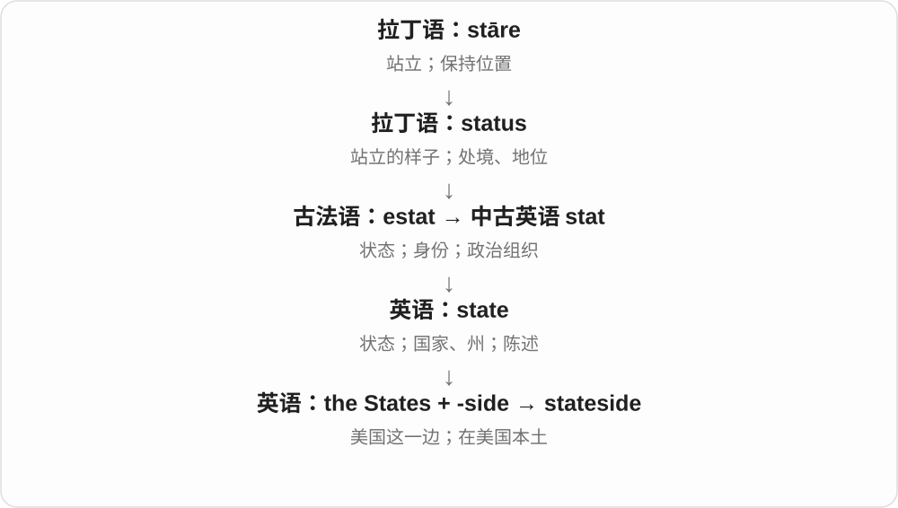

# 2400 · -side — 在某物旁边、某一地带或一侧，形成地点名称

[逐词精讲目录](../00_逐词精讲目录.md) · [总目录](../00_总目录_按常用程度.md)

## 核心词根与来源

side 是能独立使用的词，也常作复合词后部。多数位置直观，已经固定的词仍要看实际用法。

**SIDE：以一个对象为参照，指出旁边或相应地带**

dockside、graveside 与 roadside、bedside 等同样从参照物找位置；countryside 等再记固定范围。

- **路、码头、场地等旁边**：roadside · dockside · curbside · trackside · ringside · courtside
- **生活、悼念与水域位置**：bedside · graveside · lakeside · poolside · oceanside · waterside
- **固定地带与地区视角**：countryside · stateside

## 词形与演化规律

side 承古英语 sīde；dock 码头、grave 坟墓、road 路、bed 床等作前部参照物。

## 单词速览（按词族由简到繁）

同一基础词的相关扩展放在一起，先读基础形式，再读扩展；各组之间优先读常用的。具体词源关系见各词讲解。

| 单词 | 音标 | 核心意思 |
|---|---|---|
| [countryside](#w-1) | /ˈkʌntrisaɪd/ | 乡村地区；乡间 |
| [roadside](#w-2) | 英 /ˈrəʊdsaɪd/；美 /ˈroʊdsaɪd/ | 路边；路旁的 |
| [bedside](#w-3) | /ˈbedsaɪd/ | 床边；床边的 |
| [lakeside](#w-4) | /ˈleɪksaɪd/ | 湖边、湖畔；湖边的 |
| [stateside](#w-6) | /ˈsteɪtsaɪd/ | 在美国本土的；回美国本土 |
| [poolside](#w-7) | /ˈpuːlsaɪd/ | 游泳池边；池边的、在池边 |
| [ringside](#w-8) | /ˈrɪŋsaɪd/ | 拳击台边；紧邻比赛场地的；近距离观察位置 |
| [oceanside](#w-9) | 英 /ˈəʊʃənsaɪd/；美 /ˈoʊʃənsaɪd/ | 海边、洋岸地区；海边的 |
| [waterside](#w-10) | 英 /ˈwɔːtəsaɪd/；美 /ˈwɔːtərsaɪd/ | 水边；滨水的 |
| [courtside](#w-11) | 英 /ˈkɔːtsaɪd/；美 /ˈkɔːrtsaɪd/ | 球场边；在球场边的 |
| [curbside](#w-12) | 英 /ˈkɜːbsaɪd/；美 /ˈkɜːrbsaɪd/ | 路边；路缘一侧；路边进行的 |
| [dockside](#w-13) | 英 /ˈdɒksaɪd/；美 /ˈdɑːksaɪd/ | 码头边、船坞旁的区域；码头边的 |
| [graveside](#w-14) | /ˈɡreɪvsaɪd/ | 墓旁、墓边；墓边举行的 |
| [trackside](#w-15) | /ˈtræksaɪd/ | 轨道旁；跑道、赛道旁的 |

## 逐词讲解

### 1. countryside — 乡村地区；乡间

**音标**：/ˈkʌntrisaɪd/

**先抓住这个画面**

镜头离开城市街区，出现田野、村庄、林地组成的乡间景观。

**怎么拆**

country（乡间）+ side（地区、地带），不是一个国家的某个边境侧面。

**怎么变成今天的意思**

**country〔乡间〕；side**  
并列构词成分

↓

**countryside**  
城镇以外的乡村地区

the surrounding countryside 周边乡间，walk in the countryside 在乡间散步。通常不可数，不拿它来计数三个主权国家。

**常见搭配与例句**

the surrounding countryside；in the countryside；open countryside。

> We spent the weekend walking in the countryside.

我们周末在乡间散步。

> The train passed through green countryside.

火车驶过绿意盎然的乡间。

**别混淆**

countryside 明确乡间，country 可是国家；a beautiful country 和 beautiful countryside 不一定指同一层面的对象。

### 2. roadside — 路边；路旁的

**音标**：英 /ˈrəʊdsaɪd/；美 /ˈroʊdsaɪd/

**先抓住这个画面**

不在道路正中，而在道路边缘一带：停车处、花草或小摊都能在那里。

**怎么拆**

road 道路 + side 侧边，复合为路旁地带，也能修饰名词。

**怎么变成今天的意思**

**road 道路；side 侧边**  
并列构词部分

↓

**roadside**  
路边地带、路旁的

at the roadside 在路边，a roadside café 路边咖啡馆，roadside assistance 道路救援。

**常见搭配与例句**

at the roadside；a roadside stall；roadside assistance。

> We stopped at a roadside café.

我们在一家路边咖啡馆停了下来。

> Wildflowers grew along the roadside.

路边长着野花。

**别混淆**

roadside 位置在路边，roadway 车行道或路面范围；roadside café 不代表咖啡馆建在车道正中。

### 3. bedside — 床边；床边的

**音标**：/ˈbedsaɪd/

**先抓住这个画面**

床旁伸手可及、坐着陪伴的位置；家具、灯和照料活动都能与它连用。

**怎么拆**

bed 床 + side 边，形成床边位置名词及修饰语。不限医院病床。

**怎么变成今天的意思**

**bed 床；side 边**  
并列构词部分

↓

**bedside**  
床旁位置及相关的

a bedside table 床头柜，a bedside lamp 床头灯；at someone’s bedside 在某人床边；bedside manner 指医护与患者相处的态度。

**常见搭配与例句**

a bedside lamp；a bedside table；at the bedside；bedside manner。

> She left a glass of water on the bedside table.

她在床头柜上放了一杯水。

> He sat at his father’s bedside and read aloud.

他坐在父亲床边，大声读书。

**别混淆**

bedside 床旁，不等于 bedtime 就寝时间；bedside lamp 不要求只在 bedtime 才能开。

### 4. lakeside — 湖边、湖畔；湖边的

**音标**：/ˈleɪksaɪd/

**先抓住这个画面**

不在水中央，而在湖的边上；可以说地点，也可以形容建在那个位置的房屋。

**怎么拆**

lake 湖 + side 边，形成名词、形容词。

**怎么变成今天的意思**

**古英语 lacu〔溪流、水池等〕；法语 lac〔接拉丁语 lacus〕**  
本族与借入的水体名词背景

↓

**中古英语 lake、lac → lake**  
形式、意义相互影响或合流，现代常指湖

↓

**lake + side → lakeside**  
湖边；位于湖边的

a lakeside cottage 湖边小屋，a lakeside walk 湖畔散步，at the lakeside 在湖边。

**常见搭配与例句**

a lakeside cottage；a lakeside village；at the lakeside。

> They rented a lakeside cottage for the summer.

他们租了一间湖边小屋过夏天。

> We had lunch at a lakeside café.

我们在湖畔咖啡馆吃了午饭。

**别混淆**

lakeside 湖边位置，lakeview 强调看得见湖；一间能看见湖的房间未必紧挨岸边。

### 5. stateside — 在美国本土的；回美国本土

**音标**：/ˈsteɪtsaɪd/

**先抓住这个画面**

说话人把海外与美国这一边作对照：人在美国本土，或回到美国本土，可以说 stateside。

**怎么拆**

states 指 the United States，接 -side“这一边”。

**怎么变成今天的意思**

常见于军旅或海外生活语境，也可用于普通旅行。它不是“某个州的一侧”，而是已经固定下来的美国指称。

**常见搭配与例句**

back stateside；return stateside；a stateside assignment。

> After two years abroad, she was happy to be back stateside.

在海外生活两年后，她很高兴回到美国本土。

> He accepted a stateside assignment.

他接受了一项在美国本土的工作安排。

**别混淆**

stateside 带口语或特定语境色彩；in the United States 更中性。它不等于在任意州内。

### 6. poolside — 游泳池边；池边的、在池边

**音标**：/ˈpuːlsaɪd/

**先抓住这个画面**

位置就在池子旁边，常见于旅馆、休闲活动；side 是边，不是分给一半游泳池。

**怎么拆**

pool 池 + side 边，形成地点、性质表达。at the poolside、a poolside chair 都围绕池旁位置。

**怎么变成今天的意思**

**古英语 pōl → 中古英语 pool 等 → pool〔水体〕**  
水潭、积水；现代也简称游泳池

↓

**pool + side → poolside**  
池边地点；位于池边的

a poolside chair 池边椅，a poolside café 池边咖啡馆，relax by the poolside 在池边休息。

**常见搭配与例句**

a poolside chair；a poolside café；relax by the poolside。

> We had lunch at a poolside café.

我们在池边咖啡馆吃了午饭。

> She left her towel on a poolside chair.

她把毛巾留在了池边椅上。

**别混淆**

poolside 在池边，不保证在水里；a poolside meal 是池边用餐，不是漂在池中吃饭。

### 7. ringside — 拳击台边；紧邻比赛场地的；近距离观察位置

**音标**：/ˈrɪŋsaɪd/

**先抓住这个画面**

坐在比赛围台的边上，看动作特别近；看一件事的第一现场，也能比喻有 ringside view。

**怎么拆**

ring 比赛围台 + side 边，组成位置名词和修饰语。接圆圈、围合场地这条 ring，不接电话铃声。

**怎么变成今天的意思**

**古英语 hring → 中古英语 ryng → ring**  
圆环、圆圈；环形围合的区域

↓

**ring + side → ringside**  
比赛台旁；比喻近距离见证的位置

a ringside seat 拳击台边座位，a ringside view 近距离视角，sit at ringside 坐在拳击台旁。

**常见搭配与例句**

a ringside seat；a ringside view；at ringside。

> They paid extra for ringside seats.

他们加钱买了拳击台边的座位。

> Her job gave her a ringside view of the negotiations.

她的工作让她能近距离见证谈判。

**别混淆**

ringside 强调贴近比赛台或事件现场，不是坐在电话旁；现代拳击台通常是方形，名称保留旧围圈背景。

### 8. oceanside — 海边、洋岸地区；海边的

**音标**：英 /ˈəʊʃənsaɪd/；美 /ˈoʊʃənsaɪd/

**先抓住这个画面**

位置在海洋岸边一带，side 是旁边，不是 ocean 的右半边；也常见于海边城市、旅馆名称。

**怎么拆**

ocean 海洋 + side 边，现代复合词。ocean 较早接希腊 Ōkeanós 等海流、海洋名称，oceanside 则在英语里组合。

**怎么变成今天的意思**

**海洋名称词族 → ocean**  
海洋

↓

**ocean + side → oceanside**  
海边地区；海边的

an oceanside hotel 海边旅馆，an oceanside town 海边小镇，walk along the oceanside 沿海边散步。

**常见搭配与例句**

an oceanside hotel；an oceanside town；an oceanside path。

> They stayed in an oceanside hotel.

他们住在海边一家旅馆。

> An oceanside path led to the village.

一条海边小路通向村庄。

**别混淆**

oceanside 在海边较宽泛，oceanfront 较强调直接面向海的一线位置；宣传名称仍需按实际地点理解。

### 9. waterside — 水边；滨水的

**音标**：英 /ˈwɔːtəsaɪd/；美 /ˈwɔːtərsaɪd/

**先抓住这个画面**

沿水的边缘待着、走着，重点是紧靠水旁。

**怎么拆**

water + side，中古英语有 water-syde 等相应形式。side 取边、旁，不是支持哪一方的立场。

**怎么变成今天的意思**

**water；side**  
并列组合部分

↓

**waterside**  
水边；位于水旁的

a waterside path 水边小路，waterside cafes 临水咖啡馆；自然环境和城市环境都能用。

**常见搭配与例句**

a waterside path；a waterside cafe；at the waterside。

> A narrow waterside path led to the village.

一条水边窄路通往村庄。

> They sat at a waterside cafe.

他们坐在一家临水咖啡馆。

**别混淆**

waterside 泛说水边位置，waterfront 常让人想到临水地带、城区界面；两者可重叠，不划绝对边界。

### 10. courtside — 球场边；在球场边的

**音标**：英 /ˈkɔːtsaɪd/；美 /ˈkɔːrtsaɪd/

**先抓住这个画面**

座位或人就在比赛场地边上，离球员很近。

**怎么拆**

court“球场” + side“旁边”；可作名词、形容词或副词。

**怎么变成今天的意思**

**拉丁 cohors，词干 cohort-；后期缩约为 cors / cort-**  
围起来的地方；聚集在其中的队伍，hort- 与 hortus“园地”相关

↓

**古法语 cort / curt**  
庭院；宫廷、君主及其随从

↓

**中古英语 court → 英语 court**  
宫廷、法庭、院落、球场；争取好感

↓

**英语 court + side → courtside**  
比赛场地旁的区域或位置

常见 courtside seats、sit courtside。主要是篮球、网球等 court 类场地，不是泛指所有运动场边。

**常见搭配与例句**

courtside seats；sit courtside；a courtside interview。

> They watched the match from courtside seats.

他们坐在场边座位观看比赛。

> The reporter interviewed the player courtside.

记者在球场边采访了那位球员。

**别混淆**

sideline 是边线或边线附近；courtside 强调紧邻球场的位置。

### 11. curbside — 路边；路缘一侧；路边进行的

**音标**：英 /ˈkɜːbsaɪd/；美 /ˈkɜːrbsaɪd/

**先抓住这个画面**

就在车道与人行道交接的边缘附近。

**怎么拆**

英语 curb“路缘” + side“旁边”。这是现代复合词；英国英语常见相应拼写 kerbside。

**怎么变成今天的意思**

**拉丁 curvus；动词 curvare**  
弯的；使弯曲

↓

**古法语 courbe → 英语 curb**  
弯曲物；控制马匹的颏链或颏带等

↓

**英语 curb 的不同支线**  
控制、抑制；围边框架，后来也指路缘

↓

**英语 curb + side → curbside**  
路缘旁边；在路边进行的

curbside pickup 常指顾客到店门附近路边取货，店员把货送到车旁；不是把包裹随意扔在路上。curbside recycling 则是把回收物放在指定路边位置收集。

**常见搭配与例句**

curbside pickup；curbside recycling；wait at the curbside。

> The shop offers curbside pickup for online orders.

这家店为网上订单提供路边取货服务。

> Residents leave their recycling bins at the curbside on collection day.

居民在回收日把回收箱放在路缘旁。

**别混淆**

roadside 泛指道路旁边；curbside 更贴近有路缘的城市街道边界或相应服务场景。

### 12. dockside — 码头边、船坞旁的区域；码头边的

**音标**：英 /ˈdɒksaɪd/；美 /ˈdɑːksaɪd/

**先抓住这个画面**

货物从船上卸下，在码头边堆放、转运，那一片近码头的区域可以叫 dockside。

**怎么拆**

dock 码头、船坞 + side 旁边，按位置形成复合词，也可放在另一名词前修饰。

**怎么变成今天的意思**

**古英语 sīde → side**  
侧边、旁边等位置

↓

**名词 + side 的地点组合**  
dockside 码头边；graveside 墓旁；其他词各自固定范围

at the dockside 在码头边，dockside warehouses 码头仓库，dockside workers 码头工人。

**常见搭配与例句**

at the dockside；dockside warehouses。

> The cargo waited at the dockside.

货物等在码头边。

> The old dockside warehouses became studios.

码头边的旧仓库改成了工作室。

**别混淆**

dock 是船停靠等设施，dockside 重点是它旁边的区域；两者在具体地点中可能重叠，侧重点不同。

### 13. graveside — 墓旁、墓边；墓边举行的

**音标**：/ˈɡreɪvsaɪd/

**先抓住这个画面**

人站在墓边悼念、举行仪式，那个紧邻坟墓的位置就是 graveside。grave 取坟墓义。

**怎么拆**

grave 坟墓 + side 旁边。组合后常见于葬礼、悼念的地点或修饰语。

**怎么变成今天的意思**

**古英语 sīde → side**  
侧边、旁边等位置

↓

**grave + side → graveside**  
坟墓旁边的位置、在那里进行的活动

at the graveside 在墓旁，a graveside service 墓边葬礼仪式。

**常见搭配与例句**

at the graveside；a graveside service。

> The family gathered at the graveside.

家人聚在墓旁。

> A short graveside service followed.

随后举行了一场简短的墓边仪式。

**别混淆**

graveside 是一座墓旁的区域，graveyard 是墓地。grave 作形容词的严重、严肃义，在这里不是构词基础。

### 14. trackside — 轨道旁；跑道、赛道旁的

**音标**：/ˈtræksaɪd/

**先抓住这个画面**

站在跑道、铁轨或赛道的边上，side 说明相对位置。

**怎么拆**

track + side，现代既可名词性指边旁地带，也可作修饰语，具体哪种轨道要看语境。

**怎么变成今天的意思**

**法语 trac 踪迹 → 中古英语 trak → track**  
足迹、行经路线；更早可能日耳曼来源，路线未定

↓

**现代 track**  
轨迹、跑道、轨道 → 追踪；音乐录音的一轨、一首

↓

**track + side → trackside**  
轨道或赛道的边旁

trackside signals 铁路轨旁信号，trackside spectators 赛道旁观众。

**常见搭配与例句**

trackside signals；trackside spectators；a trackside camera。

> A trackside camera recorded the finish.

赛道旁摄像机记录了冲线。

> Engineers checked the trackside signals.

工程师检查了轨旁信号。

**别混淆**

trackside 在旁边，on track 在轨道上或比喻进展正常；两个位置关系不同。

## 这一组要分清什么

countryside 固定说乡村、乡野，不只是国家某一边；stateside 常从海外视角说在美国、回美国等。

## 串起来练习

We left the roadside and walked toward the dockside warehouses.

我们离开路边，走向码头旁的仓库。
