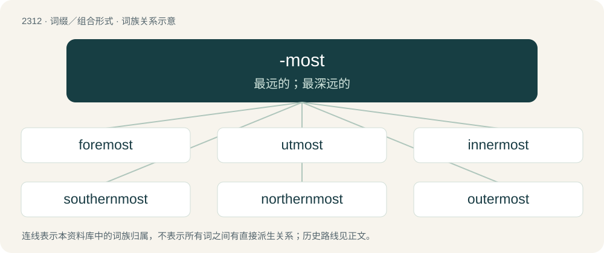

# 2410 · -most — 最远的；最深远的

[总目录](../00_总目录_按常用程度.md)

**类型**：词缀／组合形式　｜　**来源语言**：见词源记录

## 核心含义与来源

- 核心含义：最远的；最深远的
- 英文含义：Furthest; -est; used to form superlatives of certain adjectives, especially directional and inherently-comparative ones.
- 词形：-most

**来源记录 1**（后缀／后置成分；Furthest; -est; used to form superlatives of certain adjectives, especially directional and inherently-comparative ones.）

From Middle English -most(e), from earlier -mest, from Old English -(e)mest, from Proto-Germanic \*-umistaz, from the comparative suffix \*-umô (from Proto-Indo-European \*-mHo-) + the regular superlative suffix \*-istaz (whence English -est). The Middle English form is due to conflation with the originally unrelated superlative most. See foremost for more.

## 词族图

## 单词速览（常用到不常用）

| 单词 | 音标 | 释义 |
|---|---|---|
| [foremost](#w-1) | 英 /ˈfɔː.məʊst/ | a. 最初的, 最重要的；adv. 在最前 |
| [utmost](#w-2) | 英 /ˈʌtməʊ̯st/；美 /ˈʌtmoʊ̯st/ | n. 极限, 最大限度, 极度；a. 极度的, 最远的 |
| [innermost](#w-3) | 美 /ˈɪnɚmoʊst/ | a. 内心的, 秘密的, 最深处的 |
| [southernmost](#w-4) | /ˈsʌð(ə)nməjst/ | a. 最南的 |
| [northernmost](#w-5) | 英 /ˈnɔː.ðənˌməʊst/；美 /ˈnɔɹ.ðɚnˌmoʊst/ | a. 最北的 |
| [outermost](#w-6) | 美 /ˈaʊtɚmoʊst/ | a. 最外面的, 最远离中心的 |
| [uppermost](#w-7) | 英 /ˈʌpəməʊst/；美 /ˈʌpɚˌmoʊst/ | a. 最高的, 最上面的；adv. 在最上面, 在最高处 |
| [topmost](#w-8) | 英 /tɒpˈməʊst/；美 /tɑpˈmoʊst/ | a. 最高的, 顶端的 |
| [easternmost](#w-9) | /ˈiːstənməust/ | a. 最东部的 |
| [westernmost](#w-10) | /ˈwestənməust/ | a. 最西的 |
| [rightmost](#w-11) |  | \[计\] 最右边的 |
| [upmost](#w-12) | 美 /ˈʌpmoʊst/ | a. 最高的, 最上面的 |

## 逐词详解

### 1. foremost

**词性**：形容词　｜　**音标**：英 /ˈfɔː.məʊst/

**中文释义**：a. 最初的, 最重要的；adv. 在最前

**英文义项**：Positioned in front of (all) others in space, most forward. / Coming before (all) others in time.

**构词拆分**：fore + -most

**词源与演化**：

From Old English formest, fyrmest (“earliest, first, most prominent”), from Proto-Germanic \*frumistaz, from the locative stem \*fur-, \*fr- + the superlative suffix \*-umistaz, stem ultimately from Proto-Indo-European \*pr-. The suffix \*-umistaz was a compound suffix, created from the rarer comparative suffix \*-umô (as in Old English fruma) + the regular superlative suffix \*-istaz (English -est); \*-umô in turn is from Proto-Indo-European \*-mHo-. Cognate with Old Frisian formest, Gothic 𐍆𐍂𐌿𐌼𐌹𐍃𐍄𐍃 (frumists). See for, first and Old English fruma for more. Partially cognate to primus, from Proto-Indo-European \*pr- + Latin superlative suffix -imus, from Proto-Indo-European \*-mHo-. A comparative former was back-formed analogically, leaving the m from \*-umô in place. Later the Old English suffix complex -(u)m-est was conflated with the word most through folk etymology, so that the word is now interpreted as fore + -most.

**例句**：

> Foremost among the workers’ grievances was the company’s failure to address the many safety issues in the plant.

该用例对应义项：Of the highest rank or position; of the greatest importance; of the highest priority.

### 2. utmost

**词性**：形容词　｜　**音标**：英 /ˈʌtməʊ̯st/；美 /ˈʌtmoʊ̯st/

**中文释义**：n. 极限, 最大限度, 极度；a. 极度的, 最远的

**英文义项**：The most extreme; greatest, ultimate.

**构词拆分**：out + -most

**词源与演化**：

From Middle English utmost, utemest \[and other forms\], from Old English ūtmest, ūtemest \[and other forms\], from ūt, ūte (“out; outdoors, outside”) + -mest (suffix meaning ‘furthest’, used to form superlatives of some adjectives) (and conflated with most). Ūt is derived from Proto-Germanic \*ūt (“out, outward”), from Proto-Indo-European \*úd (“out, outward”). Equivalent to out + -most.

**用法示例／搭配（非完整句）**：

> the utmost misery or happiness

该用例对应义项：The most extreme; greatest, ultimate.

### 3. innermost

**词性**：名词　｜　**音标**：美 /ˈɪnɚmoʊst/

**中文释义**：a. 内心的, 秘密的, 最深处的

**英文义项**：That which is innermost; the core.

**构词拆分**：inner + -most

**词源与演化**：

From Middle English innermost, innermest, in-nermast, alteration (due to Middle English inner, innere (“inner”)) of Old English innemest (“innermost”), equivalent to inner + -most.

**例句**：

> Phelps thrust away the precious document into the innermost pocket of his coat.

### 4. southernmost

**词性**：形容词　｜　**音标**：/ˈsʌð(ə)nməjst/

**中文释义**：a. 最南的

**英文义项**：Farthest south.

**构词拆分**：southern + -most

**词源与演化**：

From southern + -most.

**例句**：

> South Africa is the southernmost country in Africa.

该用例对应义项：Farthest south.

### 5. northernmost

**词性**：形容词　｜　**音标**：英 /ˈnɔː.ðənˌməʊst/；美 /ˈnɔɹ.ðɚnˌmoʊst/

**中文释义**：a. 最北的

**英文义项**：Farthest north.

**构词拆分**：northern + -most

**词源与演化**：

From northern + -most.

**例句**：

> Alaska is the northernmost American state.

该用例对应义项：Farthest north.

### 6. outermost

**词性**：名词　｜　**音标**：美 /ˈaʊtɚmoʊst/

**中文释义**：a. 最外面的, 最远离中心的

**英文义项**：That which is outermost.

**构词拆分**：outer + -most

**词源与演化**：

From Middle English uttermost, uttirmest, uttermast, outemast, alteration (due to Middle English outre (“outer”)) of Old English ūtemest, ȳtemest (“outermost”), equivalent to outer + -most. Doublet of uttermost.

**例句**：

> The Sun's corona is the outermost part of the Sun's atmosphere.

### 7. uppermost

**词性**：形容词　｜　**音标**：英 /ˈʌpəməʊst/；美 /ˈʌpɚˌmoʊst/

**中文释义**：a. 最高的, 最上面的；adv. 在最上面, 在最高处

**英文义项**：At or nearest the top of something. / Of top rank, importance, etc.

**构词拆分**：upper + -most

**词源与演化**：

From Middle English upper-moste; equivalent to upper + -most.

**例句**：

> She couldn't reach the bowls on the uppermost shelf, so she made do with a mug.

该用例对应义项：At or nearest the top of something.

### 8. topmost

**词性**：形容词　｜　**音标**：英 /tɒpˈməʊst/；美 /tɑpˈmoʊst/

**中文释义**：a. 最高的, 顶端的

**英文义项**：At or nearest to the top; uppermost; being the very highest. / Of greatest status, esteem, or prestige; best.

**构词拆分**：top + -most

**词源与演化**：

From top + -most.

**例句**：

> On the topmost step.

该用例对应义项：at or nearest to the top

### 9. easternmost

**词性**：形容词　｜　**音标**：/ˈiːstənməust/

**中文释义**：a. 最东部的

**英文义项**：Farthest east.

**构词拆分**：eastern + -most

**词源与演化**：

From eastern + -most.

**例句**：

> Cyprus is currently the easternmost country in the European Union.

该用例对应义项：Farthest east.

### 10. westernmost

**词性**：形容词　｜　**音标**：/ˈwestənməust/

**中文释义**：a. 最西的

**英文义项**：Farthest west.

**构词拆分**：western + -most

**词源与演化**：

From western + -most.

**例句**：

> Zeeland is the westernmost province of the Netherlands.

该用例对应义项：Farthest west.

### 11. rightmost

**词性**：形容词

**中文释义**：\[计\] 最右边的

**英文义项**：Furthest to the right.

**构词拆分**：right + -most

**词源与演化**：

From right + -most.

**例句**：

> Start with the rightmost one and work towards the left.

该用例对应义项：Furthest to the right.

### 12. upmost

**词性**：形容词　｜　**音标**：美 /ˈʌpmoʊst/

**中文释义**：a. 最高的, 最上面的

**英文义项**：Uppermost.

**构词拆分**：up + -most

**词源与演化**：

From Middle English upmest; equivalent to up + -most.
