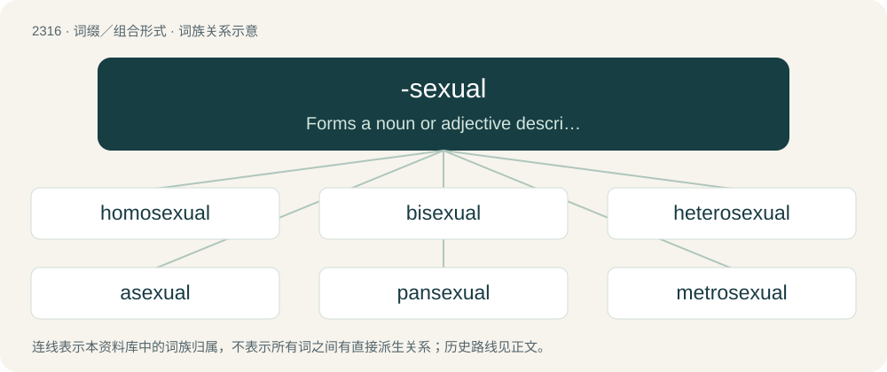

# 2413 · -sexual — Forms a noun or adjective describing a state or style of sexuality.

[总目录](../00_总目录_按常用程度.md)

**类型**：词缀／组合形式　｜　**来源语言**：见词源记录

## 核心含义与来源

- 核心含义：Forms a noun or adjective describing a state or style of sexuality.
- 英文含义：Forms a noun or adjective describing a state or style of sexuality.
- 词形：-sexual

**来源记录 1**（后缀／后置成分；Forms a noun or adjective describing a state or style of sexuality.）

From sexual.

## 词族图

## 单词速览（常用到不常用）

| 单词 | 音标 | 释义 |
|---|---|---|
| [homosexual](#w-1) | /ˌhɒməʊˈsɛksjuːəl/ | a. 同性恋的；n. 同性恋者 |
| [bisexual](#w-2) | 英 /baɪˈsɛk.ʃʊ.əl/；美 /baɪˈsɛk.ʃ(əw).əl/ | a. 两性的, 雌雄同体的；\[医\] 两性的 |
| [heterosexual](#w-3) | 英 /ˌhɛtəɹəˈsɛkʃuəl/；美 /ˌhɛtəɹəˈsɛkʃuəl/ | a. 异性的, 异性爱的；n. 异性恋的人 |
| [asexual](#w-4) | 英 /eɪˈsɛk.ʃuː.əl/；美 /eɪˈsɛk.ʃu.əl/ | a. 无性的, 无性生殖的；\[医\] 无性的 |
| [pansexual](#w-5) | 美 /pænˈsɛk.ʃu.əl/ | a. 泛性(论)的 |
| [metrosexual](#w-6) | /ˌmɛtɹəˈsɛkʃuəl/ | n. 都市玉男, 城市魅男, 都市美直男 |

## 逐词详解

### 1. homosexual

**词性**：形容词　｜　**音标**：/ˌhɒməʊˈsɛksjuːəl/

**中文释义**：a. 同性恋的；n. 同性恋者

**英文义项**：Sexually and/or romantically attracted to members of the same sex, such as a man who is attracted to other men or a woman who is attracted to other women; gay. (Typically used in the sense of sole/exclusive attraction.) / Between two people of the same sex; gay.

**构词拆分**：homo- + -sexual

**词源与演化**：

Borrowed from German homosexual, from homo- (“same”) + sexual (“relating to sex or sexuality”), coined by Karl Maria Kertbeny in 1868, and popularized in Richard von Krafft-Ebing's Psychopathia Sexualis (2nd ed. 1887, in German) and Charles Gilbert Chaddock's 1892 English translation thereof (compare bisexual), displacing the slightly older term Uranian. Equivalent to homo- + -sexual.

**例句**：

> Most western countries have repealed laws against homosexual activity between consenting adults.

该用例对应义项：Between two people of the same sex; gay.

### 2. bisexual

**词性**：形容词　｜　**音标**：英 /baɪˈsɛk.ʃʊ.əl/；美 /baɪˈsɛk.ʃ(əw).əl/

**中文释义**：a. 两性的, 雌雄同体的；\[医\] 两性的

**英文义项**：Sexually attracted to both opposite-sex and same-sex individuals. (Compare pansexual.) / Of flowers: having both pollen and seeds.

**构词拆分**：bi- + -sexual

**词源与演化**：

From bi- + -sexual, via the French bisexuel (bi-, sexuel). Attested since 1792 as a synonym in botany for "hermaphroditic" ("having male and female parts"). First used of sexuality in Richard von Krafft-Ebing's 1886 Psychopathia Sexualis (in German) and Charles Gilbert Chaddock's 1892 English translation thereof, due to the theory that people were naturally attracted to the opposite sex and so the brain or mind of a person attracted to "both" sexes (or to the same sex) must be partly of another sex and thus "hermaphroditic".

**例句**：

> Midrash and Zohar present Adam as hermaphroditic or bisexual.

该用例对应义项：Hermaphroditic/intersex, being both male and female, or alternating between being male and being female.

### 3. heterosexual

**词性**：形容词　｜　**音标**：英 /ˌhɛtəɹəˈsɛkʃuəl/；美 /ˌhɛtəɹəˈsɛkʃuəl/

**中文释义**：a. 异性的, 异性爱的；n. 异性恋的人

**英文义项**：Sexually attracted to members of the opposite sex. / Between two people of different sex.

**构词拆分**：hetero- + -sexual

**词源与演化**：

From hetero- + -sexual. Earliest citation from 1892, in C.G. Craddock's translation of Krafft-Ebbing's Psychopathia Sexualis.

**例句**：

> Bonobos often use sexual behavior, sometimes homosexual, sometimes heterosexual, for social negotiation.

### 4. asexual

**词性**：形容词　｜　**音标**：英 /eɪˈsɛk.ʃuː.əl/；美 /eɪˈsɛk.ʃu.əl/

**中文释义**：a. 无性的, 无性生殖的；\[医\] 无性的

**英文义项**：Non-sexual in nature, unmarked by sexual activity. / Not experiencing sexual attraction; lacking interest in or desire for sex.

**构词拆分**：a- + -sexual

**词源与演化**：

From a- (“lacking, without”) + -sexual. Piecewise doublet of unsexual.

**例句**：

> Tom and Mary are both asexual, which makes their relationship easier.

### 5. pansexual

**词性**：形容词　｜　**音标**：美 /pænˈsɛk.ʃu.əl/

**中文释义**：a. 泛性(论)的

**英文义项**：Sexually attracted to people regardless of gender or sex. / Sexually attracted to everyone.

**构词拆分**：pan- + -sexual

**词源与演化**：

From pan- + -sexual. First attested in 1926 (with pansexualism attested since 1917), as a descriptor of the psychological theory that all human activity is based on sexuality. Used to describe a sexual orientation since at least the 1970s.

### 6. metrosexual

**词性**：名词　｜　**音标**：/ˌmɛtɹəˈsɛkʃuəl/

**中文释义**：n. 都市玉男, 城市魅男, 都市美直男

**英文义项**：A man — typically urban, heterosexual, and affluent — who is concerned with personal appearance, such as personal grooming, fashion, and aesthetics in general. / A heterosexual man who is seen, sociologically, as having attributes common to homosexuals.

**构词拆分**：metro- + -sexual

**词源与演化**：

Blend of metropolitan + heterosexual, equivalent to metro- + -sexual. Coined by British writer Mark Simpson in 1994, it enjoyed a brief popularity in the early 2000s.
