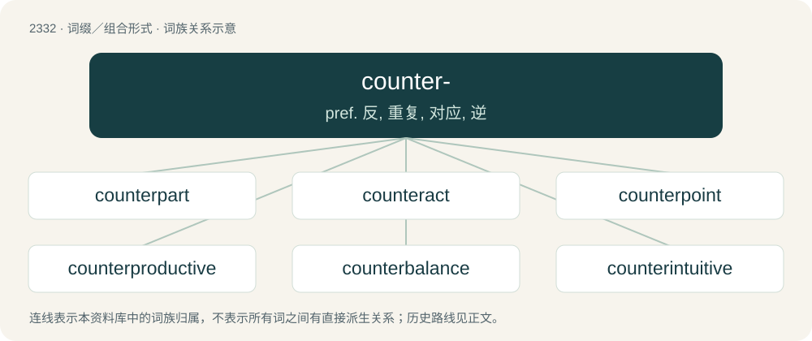

# 2431 · counter- — pref. 反, 重复, 对应, 逆

[总目录](../00_总目录_按常用程度.md)

**类型**：词缀／组合形式　｜　**来源语言**：见词源记录

## 核心含义与来源

- 核心含义：pref. 反, 重复, 对应, 逆
- 英文含义：In opposition to.
- 词形：counter-

**来源记录 1**（前缀／前置成分；In opposition to.）

From Middle English counter-, cownter-, countre-, from Anglo-Norman countre-, from Old French contre, ultimately from Latin contra (“against”). Doublet of contra-.

## 词族图

## 单词速览（常用到不常用）

| 单词 | 音标 | 释义 |
|---|---|---|
| [counterpart](#w-1) | 英 /ˈkaʊntəˌpɑːt/；美 /ˈkaʊntɚˌpɑɹt/ | n. 副本, 复本, 配对物, 相应物；\[经\] 副本, 正副二份中之一 |
| [counteract](#w-2) | /ˈkaʊntəɹˌækt/ | vt. 抵消, 阻碍, 中和；\[法\] 抵抗, 阻碍, 抵销 |
| [counterpoint](#w-3) | /ˈkaʊntə(ɹ)ˌpɔɪnt/ | n. 对位法, 旋律配合, 复调 |
| [counterproductive](#w-4) | /ˌkaʊntəpɹəˈdʌktɪv/ | a. 反生产的；使达不到预期目标的 |
| [counterbalance](#w-5) | 英 /ˌkaʊntəˈbæləns/；美 /ˌkaʊntɚˈbæləns/ | vt. 使平均, 使平衡, 使弥补；n. 平衡量, 平衡力, 势均力敌 |
| [counterintuitive](#w-6) | 英 /ˌkaʊntəɹɪnˈtjuːɪtɪv/；美 /ˌkaʊntəɹɪnˈtuɪtɪv/ | a. 违反直觉的 |
| [counterweight](#w-7) | /ˈkauntəweit/ | n. 平衡物, 平衡力, 秤锤；\[机\] 配重 |
| [counterintelligence](#w-8) | /ˈkauntərin,telidʒəns/ | n. 反情报；\[法\] 反情报 |
| [counterclockwise](#w-9) | /.kauntəˈklɒkwaiz/ | a. 反时针方向的；adv. 反时针方向 |
| [counterculture](#w-10) | /ˈkaʊn.tə(ɹ)ˌkʌl.t͡ʃə(ɹ)/ | n. 反主流文化 |
| [counterinsurgency](#w-11) | /ˈkauntərinˈsəːdʒənsi/ | n. 反暴动 |
| [counterparty](#w-12) | /ˈkauntə,pɑːti/ | 合同的一方; 对手方 |
| [countermeasure](#w-13) | 英 /ˈkaʊ̯ntəmɛʒə/；美 /ˈkaʊ̯ntɚmɛʒɚ/ | n. 对策, 反抗手段, 反措施；\[法\] 对策, 反对手段, 抵制措施 |
| [counterfactual](#w-14) | 英 /ˌkaʊn.tə(ɹ)ˈfæk.tʃu.əl/ | a. \[逻\]反事实的( 指在不同条件下有可能发生但违反现存事实的) |
| [counterclaim](#w-15) | /ˈkauntəkleim/ | v. 反诉；n. 反诉, 反索赔 |
| [counterexample](#w-16) | /ˈkauntərigˈzɑːmpl/ | n. 反例证 |
| [counterrevolutionary](#w-17) |  | a. 反革命的；n. 反革命分子 |
| [countercultural](#w-18) | /,kaʊntəˈkʌltʃərəl/ | a. 反主流文化的, 反正统文化的 |
| [counterpunch](#w-19) | /ˈkauntə,pʌntʃ/ | n. 反击,回击,(拳击的)迎击 |
| [counterstrike](#w-20) |  | \[法\] 反击 |

## 逐词详解

### 1. counterpart

**词性**：名词　｜　**音标**：英 /ˈkaʊntəˌpɑːt/；美 /ˈkaʊntɚˌpɑɹt/

**中文释义**：n. 副本, 复本, 配对物, 相应物；\[经\] 副本, 正副二份中之一

**英文义项**：Either of two parts that fit together or otherwise complement one another. / A duplicate of a legal document.

**构词拆分**：counter- + part

**词源与演化**：

From Middle English conterpart, countre parte (“duplicate of a legal document”), equivalent to counter- + part. Compare Old French contrepartie, itself from contre (“facing, opposite”) (from Latin contra (“against”)) + partie (“copy of a person or thing”) (originally past participle of partīre (“to divide”)).

**例句**：

> The two companies are working together with their respective counterparts in Asia.

该用例对应义项：One who or that which has corresponding functions or characteristics.

### 2. counteract

**词性**：名词　｜　**音标**：/ˈkaʊntəɹˌækt/

**中文释义**：vt. 抵消, 阻碍, 中和；\[法\] 抵抗, 阻碍, 抵销

**英文义项**：An action performed in opposition to another action.

**构词拆分**：counter- + act

**词源与演化**：

From counter- + act.

**例句**：

> To counteract calcification, do mental gymnastics at Tatoeba.

### 3. counterpoint

**词性**：名词　｜　**音标**：/ˈkaʊntə(ɹ)ˌpɔɪnt/

**中文释义**：n. 对位法, 旋律配合, 复调

**英文义项**：A melody added to an existing one, especially one added to provide harmony whilst each retains its simultaneous identity; a composition consisting of such contrapuntal melodies. / Any similar contrasting element in a work of art.

**构词拆分**：counter- + point

**词源与演化**：

Inherited from Middle English \[Term?\], from Middle French contrepoint, from Medieval Latin contrāpūnctum. Equivalent to counter- + point.

**例句**：

> This piece is a virtuosic display of the composer's mastery of counterpoint and orchestration.

### 4. counterproductive

**词性**：形容词　｜　**音标**：/ˌkaʊntəpɹəˈdʌktɪv/

**中文释义**：a. 反生产的；使达不到预期目标的

**英文义项**：More of a hindrance than a help.

**构词拆分**：counter- + productive

**词源与演化**：

From counter- + productive.

**例句**：

> ... Otherwise it is (or will be) hard to avoid a counterproductive situation.

### 5. counterbalance

**词性**：动词　｜　**音标**：英 /ˌkaʊntəˈbæləns/；美 /ˌkaʊntɚˈbæləns/

**中文释义**：vt. 使平均, 使平衡, 使弥补；n. 平衡量, 平衡力, 势均力敌

**英文义项**：To apply weight in order to balance an opposing weight. / To match or equal in effect when applying opposing force.

**构词拆分**：counter- + balance

**词源与演化**：

From counter- + balance.

**例句**：

> The defenders' knowledge of the terrain roughly counterbalances the attackers' superior equipment.

该用例对应义项：To match or equal in effect when applying opposing force.

### 6. counterintuitive

**词性**：形容词　｜　**音标**：英 /ˌkaʊntəɹɪnˈtjuːɪtɪv/；美 /ˌkaʊntəɹɪnˈtuɪtɪv/

**中文释义**：a. 违反直觉的

**英文义项**：Contrary to intuition or common sense.

**构词拆分**：counter- + intuitive

**词源与演化**：

From counter- + intuitive. Coined by Noam Chomsky in 1955 as “counter-intuitive”.

**例句**：

> Now I have to admit, when I read this, this sounded totally wrong and counterintuitive.

### 7. counterweight

**词性**：名词　｜　**音标**：/ˈkauntəweit/

**中文释义**：n. 平衡物, 平衡力, 秤锤；\[机\] 配重

**英文义项**：A heavy mass of often iron or concrete, mechanically linked in opposition to a load which is to be raised and lowered, with the intent of reducing the amount of work which must be done to effect the raising and lowering. Counterweights are used, for example, in cable-hauled elevators and some kinds of movable bridges (e.g. a bascule bridge). / A counterbalance.

**构词拆分**：counter- + weight

**词源与演化**：

From counter- + weight.

**例句**：

> When the elevator goes up, the counterweight goes down.

### 8. counterintelligence

**词性**：名词　｜　**音标**：/ˈkauntərin,telidʒəns/

**中文释义**：n. 反情报；\[法\] 反情报

**英文义项**：counterespionage

**构词拆分**：counter- + intelligence

**词源与演化**：

From counter- + intelligence.

### 9. counterclockwise

**词性**：形容词　｜　**音标**：/.kauntəˈklɒkwaiz/

**中文释义**：a. 反时针方向的；adv. 反时针方向

**英文义项**：Moving or located in the direction of rotation opposite from clockwise.

**构词拆分**：counter- + clock + -wise

**词源与演化**：

From counter- + clock + -wise.

**例句**：

> Rotating it clockwise will tighten it, while rotating it counterclockwise will loosen it.

### 10. counterculture

**词性**：名词　｜　**音标**：/ˈkaʊn.tə(ɹ)ˌkʌl.t͡ʃə(ɹ)/

**中文释义**：n. 反主流文化

**英文义项**：Any culture whose values and lifestyles are opposed to those of the established mainstream culture, especially to Western culture.

**构词拆分**：counter- + culture

**词源与演化**：

From counter- + culture.

### 11. counterinsurgency

**词性**：名词　｜　**音标**：/ˈkauntərinˈsəːdʒənsi/

**中文释义**：n. 反暴动

**英文义项**：Any political or military action taken to defeat insurgency, especially during guerrilla warfare.

**构词拆分**：counter- + insurgency

**词源与演化**：

From counter- + insurgency.

**例句**：

> The United States will continue to pursue a military and civilian counterinsurgency strategy in Afghanistan.

该用例对应义项：Any political or military action taken to defeat insurgency, especially during guerrilla warfare.

### 12. counterparty

**词性**：名词　｜　**音标**：/ˈkauntə,pɑːti/

**中文释义**：合同的一方; 对手方

**英文义项**：The other party to a financial transaction.

**构词拆分**：counter- + party

**词源与演化**：

From counter- + party.

**例句**：

> We can't leave the counterparty any loopholes.

### 13. countermeasure

**词性**：名词　｜　**音标**：英 /ˈkaʊ̯ntəmɛʒə/；美 /ˈkaʊ̯ntɚmɛʒɚ/

**中文释义**：n. 对策, 反抗手段, 反措施；\[法\] 对策, 反对手段, 抵制措施

**英文义项**：Any action taken to counteract or correct another. / Any of the devices and techniques used to impair the operational effectiveness of an enemy.

**构词拆分**：counter- + measure

**词源与演化**：

From counter- + measure.

### 14. counterfactual

**词性**：形容词　｜　**音标**：英 /ˌkaʊn.tə(ɹ)ˈfæk.tʃu.əl/

**中文释义**：a. \[逻\]反事实的( 指在不同条件下有可能发生但违反现存事实的)

**英文义项**：Contrary to known or agreed facts; untrue. / Of or in comparison to a hypothetical state of the world.

**构词拆分**：counter- + factual

**词源与演化**：

From counter- + factual.

### 15. counterclaim

**词性**：名词　｜　**音标**：/ˈkauntəkleim/

**中文释义**：v. 反诉；n. 反诉, 反索赔

**英文义项**：A suit filed by a defendant against a plaintiff secondary to the original complaint. / A claim (assertion) that counters (disputes) another.

**构词拆分**：counter- + claim

**词源与演化**：

From counter- + claim.

### 16. counterexample

**词性**：名词　｜　**音标**：/ˈkauntərigˈzɑːmpl/

**中文释义**：n. 反例证

**英文义项**：An example that counters a general rule; an exception to a general rule; a specific instance of the falsity of (and falsifiability of) any proposed universal applicability of a rule or statement.

**构词拆分**：counter- + example

**词源与演化**：

From counter- + example.

**例句**：

> All you need is one counterexample to disprove a theory.

### 17. counterrevolutionary

**词性**：名词

**中文释义**：a. 反革命的；n. 反革命分子

**英文义项**：Marked by opposition or antipathy to a current or earlier revolution.

**构词拆分**：counter- + revolutionary

**词源与演化**：

From counter- + revolutionary. Originally applied to thinkers who opposed themselves to the 1789 French Revolution.

**例句**：

> The Central Committee branded Tom a counterrevolutionary.

### 18. countercultural

**词性**：形容词　｜　**音标**：/,kaʊntəˈkʌltʃərəl/

**中文释义**：a. 反主流文化的, 反正统文化的

**英文义项**：Of or pertaining to a counterculture.

**构词拆分**：counterculture + -al；counter- + cultural

**词源与演化**：

From counter- + cultural or counterculture + -al.

### 19. counterpunch

**词性**：名词　｜　**音标**：/ˈkauntə,pʌntʃ/

**中文释义**：n. 反击,回击,(拳击的)迎击

**英文义项**：A punch delivered in response to a previous punch by somebody else, such as an opponent in a boxing match: a return blow, a retaliatory blow.

**构词拆分**：counter- + punch

**词源与演化**：

From counter- + punch.

### 20. counterstrike

**词性**：名词

**中文释义**：\[法\] 反击

**英文义项**：The tactic of counterattacking.

**构词拆分**：counter- + strike

**词源与演化**：

From counter- + strike. Compare counterstroke.
