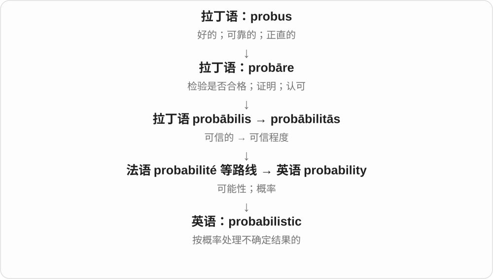
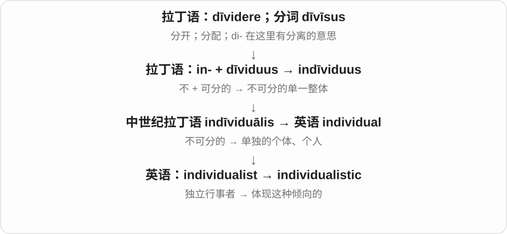
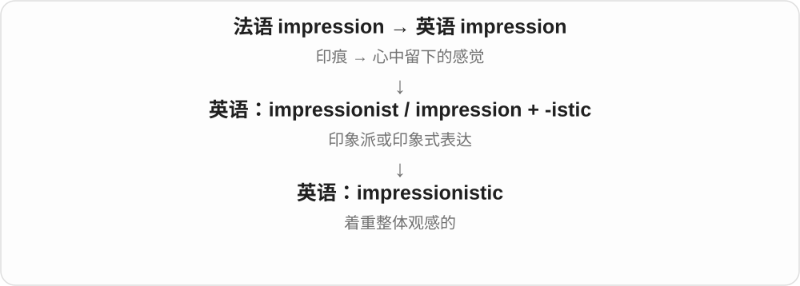

# 2439 · -istic — 相关思想、风格、行为或领域的性质；具体关系由整词决定

[逐词精讲目录](../00_逐词精讲目录.md) · [总目录](../00_总目录_按常用程度.md)

## 核心词根与来源

有些是 -ist 再加 -ic，有些按已有词族重分析成 -istic。看前半真实来源和整词用法，再判断是中性领域词还是带评价的形容词。

**-ISTIC：常与 -ist、-ism 词族相连，不是一句固定中文**

ritualistic 看仪式程式，minimalistic 看风格，imperialistic 看思想政策，cannibalistic 看行为。

- **风格、艺术与表达**：minimalistic · surrealistic · futuristic · stylistic · impressionistic · journalistic
- **思想、社会与评价**：imperialistic · jingoistic · idealistic · materialistic · individualistic · moralistic · legalistic
- **行为、程式与倾向**：ritualistic · masochistic · cannibalistic · paternalistic · animalistic
- **领域与方法**：holistic · mechanistic · probabilistic · relativistic · pluralistic · simplistic

## 词形与演化规律

常联系希腊 -istikos、拉丁 -isticus、法语 -istique 的传统；现代可分析 -ist + -ic，或整体 -istic 的扩展。

## 单词速览（按词族由简到繁）

同一基础词的相关扩展放在一起，先读基础形式，再读扩展；各组之间优先读常用的。具体词源关系见各词讲解。

| 单词 | 音标 | 核心意思 |
|---|---|---|
| [futuristic](#w-2) | 英 /ˌfjuːtʃəˈrɪstɪk/；美 /ˌfjuːtʃəˈrɪstɪk/ | 有未来风格的；像未来世界的 |
| [holistic](#w-3) | 英 /həˈlɪstɪk/；美 /hoʊˈlɪstɪk/ | 整体的；通盘考虑的 |
| [simplistic](#w-4) | /sɪmˈplɪstɪk/ | 过分简单化的 |
| [journalistic](#w-5) | 英 /ˌdʒɜːnəˈlɪstɪk/；美 /ˌdʒɜːrnəˈlɪstɪk/ | 新闻工作的；新闻报道风格的 |
| [idealistic](#w-6) | 英、美 /ˌaɪdiəˈlɪstɪk/ | 理想主义的；抱有很高理想的 |
| [stylistic](#w-7) | /staɪˈlɪstɪk/ | 风格上的；文体的 |
| [materialistic](#w-8) | 英 /məˌtɪəriəˈlɪstɪk/；美 /məˌtɪriəˈlɪstɪk/ | 过分看重金钱、财物的；唯物论的〔特定语境〕 |
| [relativistic](#w-10) | 英 /ˌrelətɪˈvɪstɪk/；美 /ˌrelətəˈvɪstɪk/ | 相对论的；相对主义的〔随领域〕 |
| [probabilistic](#w-11) | 英 /ˌprɒbəbɪˈlɪstɪk/；美 /ˌprɑːbəbɪˈlɪstɪk/ | 概率性的；用概率表达的 |
| [individualistic](#w-12) | /ˌɪndɪvɪdʒuəˈlɪstɪk/ | 强调个人独立的；富有个人风格的 |
| [ritualistic](#w-13) | /ˌrɪtʃuəˈlɪstɪk/ | 仪式性的；按固定程式反复进行的 |
| [mechanistic](#w-16) | /ˌmekəˈnɪstɪk/ | 机制性的；机械论的；机械式的 |
| [pluralistic](#w-17) | 英 /ˌplʊərəˈlɪstɪk/；美 /ˌplʊrəˈlɪstɪk/ | 多元的；多元主义的 |
| [minimalistic](#w-18) | /ˌmɪnɪməˈlɪstɪk/ | 极简风格的；与极简主义有关的 |
| [masochistic](#w-19) | /ˌmæsəˈkɪstɪk/ | 受虐倾向的；喜欢自讨苦吃的〔口语夸张〕 |
| [paternalistic](#w-21) | 英 /pəˌtɜːnəˈlɪstɪk/；美 /pəˌtɜːrnəˈlɪstɪk/ | 家长式的、以保护为由替人作主的 |
| [impressionistic](#w-22) | 英 /ɪmˌpreʃəˈnɪstɪk/；美 /ɪmˌpreʃəˈnɪstɪk/ | 印象派风格的；凭总体感受描绘的 |
| [moralistic](#w-23) | 英 /ˌmɒrəˈlɪstɪk/；美 /ˌmɔːrəˈlɪstɪk/ | 爱作道德评判的；道德说教味浓的 |
| [legalistic](#w-24) | /ˌliːɡəˈlɪstɪk/ | 拘泥法律条文的；过分重视规则字面的 |
| [animalistic](#w-25) | /ˌænɪməˈlɪstɪk/ | 像动物的；体现强烈本能的 |
| [imperialistic](#w-26) | 英 /ɪmˌpɪəriəˈlɪstɪk/；美 /ɪmˌpɪriəˈlɪstɪk/ | 帝国主义的；奉行扩张、支配政策的 |
| [cannibalistic](#w-27) | /ˌkænɪbəˈlɪstɪk/ | 同类相食的；食人的〔人类语境〕 |
| [jingoistic](#w-32) | 英 /ˌdʒɪŋɡəʊˈɪstɪk/；美 /ˌdʒɪŋɡoʊˈɪstɪk/ | 好战民族主义的；盲目、激进爱国主义的 |
| [surrealistic](#w-33) | /səˌrɪəˈlɪstɪk/，也见 /səˌriːəˈlɪstɪk/ | 超现实主义的；梦幻怪诞的 |

## 逐词讲解

### 1. futuristic — 有未来风格的；像未来世界的

**音标**：英 /ˌfjuːtʃəˈrɪstɪk/；美 /ˌfjuːtʃəˈrɪstɪk/

**先抓住这个画面**

看起来像人们想象的未来，不代表它已经准确预测了未来。

**怎么拆**

future 的词干 futur- + -istic，形成未来风格、未来派的形容词；也与 futurist 词族有关。

**怎么变成今天的意思**

**拉丁语 futūrus → 古法语 futur → 中古英语 future**  
将要存在、将来的

↓

**英语 future**  
未来；将来的；以后可能发生的

↓

**future + -istic → futuristic**  
未来 → 带想象中未来风格的

a futuristic building 未来感建筑，a futuristic design 未来风格设计；科幻服装、车辆等也常用。

**常见搭配与例句**

a futuristic design；a futuristic city；futuristic technology。

> The station has a futuristic roof of glass and steel.

车站有一座玻璃与钢构成、充满未来感的屋顶。

> The film is set in a futuristic city.

电影以一座想象中的未来城市为背景。

**别混淆**

future 将来的，futuristic 像未来、充满未来感；今天建成的建筑也可以 futuristic。

### 2. holistic — 整体的；通盘考虑的

**音标**：英 /həˈlɪstɪk/；美 /hoʊˈlɪstɪk/

**先抓住这个画面**

看一件事时，不只盯住一块零件，还看各部分怎样互相影响。

**怎么拆**

与现代 holism“整体论”一起形成的形容词，接希腊 hólos“整个”。可按 hol- + -istic 记；不是英语 holy“神圣的”加后缀。

**怎么变成今天的意思**

**希腊 hólos**  
整个、完整的

↓

**现代英语 hol- + -ism → holism**  
整体论；斯穆茨在二十世纪用此词表述相关理论

↓

**英语 holism → holistic**  
从整体及各部分联系来看的

a holistic approach to education 会把知识、情绪、环境等联系起来考虑；在医疗语境里也可指兼顾身体、心理与生活处境。核心是整体及其联系，不是“想到的项目越多越好”。

**常见搭配与例句**

a holistic approach；a holistic view；holistic assessment。

> The team took a holistic view of cost, reliability and user experience.

团队把成本、可靠性和用户体验联系起来作整体考虑。

> The school uses a holistic assessment rather than relying on one test score.

学校采用综合整体评估，而不只依赖一次考试分数。

**别混淆**

comprehensive 强调涵盖面广；holistic 更强调各部分组成的整体与相互关系。

### 3. simplistic — 过分简单化的

**音标**：/sɪmˈplɪstɪk/

**先抓住这个画面**

问题有好几层，却硬说只有一个原因；简单过头，漏掉了该考虑的东西。

**怎么拆**

simple 的词干 simpl- + -istic，形成现代形容词。常带批评，不只是更长一点的 simple。

**怎么变成今天的意思**

**拉丁语 simplex → 古法语 simple → 中古英语 symple**  
一重、一层；不复杂

↓

**英语 simple**  
简单、朴素、不加修饰；某些语境也可贬称头脑简单

↓

**simple + -istic → simplistic**  
简单 → 忽视复杂性的过度简单化

a simplistic explanation 过分简单化的解释；a simplistic solution 把问题看得太简单的解决办法。通常质疑其省掉了关键因素。

**常见搭配与例句**

a simplistic view；a simplistic explanation；overly simplistic。

> Blaming one person is a simplistic explanation for the failure.

把失败全怪在一个人身上，是过分简单化的解释。

> The article rejects a simplistic division between good and bad technology.

文章反对把技术简单分成好坏两类。

**别混淆**

simple 可以是优点，simplistic 常是缺点。语言讲得简单清楚，不等于内容肤浅。

### 4. journalistic — 新闻工作的；新闻报道风格的

**音标**：英 /ˌdʒɜːnəˈlɪstɪk/；美 /ˌdʒɜːrnəˈlɪstɪk/

**先抓住这个画面**

用来说明记者工作遵循的规范、使用的手法和写作风格。

**怎么拆**

journal + -istic，也可从 journalist + -ic 认形，表示职业、活动相关。不是自动夸文章有权威，而是说明所属范围或风格。

**怎么变成今天的意思**

**拉丁 diurnālis、diurnus〔每日的〕→ 法语 jornel、journal**  
一天、每日事项、记录

↓

**经中古英语及后续法语借入 → journal**  
日记、账簿、刊物；不同用法有不同传入阶段

↓

**journal + -istic／journalist + -ic → journalistic**  
与新闻工作、报道方式有关

journalistic standards 新闻专业规范，journalistic ethics 新闻伦理，a journalistic style 新闻报道文风。

**常见搭配与例句**

journalistic standards；journalistic ethics；a journalistic style。

> The editor insisted on high journalistic standards.

编辑坚持较高的新闻专业规范。

> The book combines research with a clear journalistic style.

这本书把研究与清楚的新闻报道文风结合起来。

**别混淆**

journalistic 相关新闻工作，academic 学术的；journal article 学术期刊文章也未必是 journalistic writing。

### 5. idealistic — 理想主义的；抱有很高理想的

**音标**：英、美 /ˌaɪdiəˈlɪstɪk/

**先抓住这个画面**

眼睛盯着“最希望实现的样子”，热心追求它，有时也把困难想得太轻。

**怎么拆**

英语 idealist + -ic，形成描述态度和观点的形容词。不要省掉 -ist-，直接把它当 ideal“最合适的”的长拼法。

**怎么变成今天的意思**

**英语 idealist**  
坚持理想的人

↓

**idealist + -ic → idealistic**  
具有理想主义态度的

↓

**日常评价**  
理想高远；有时不够顾及现实限制

an idealistic proposal 可以有美好的目标，却尚未解决钱从哪里来、谁来执行等问题。词本身既可肯定热忱，也可含“不够现实”的保留；不会自动表示计划已经是最优解。

**常见搭配与例句**

an idealistic young teacher；an idealistic vision；idealistic goals；an idealistic proposal。

> The idealistic volunteers wanted every child to have access to books.

这些满怀理想的志愿者希望每个孩子都能读到书。

> Her proposal was idealistic, but the budget question remained unanswered.

她的提议充满理想色彩，但预算问题仍未得到回答。

**别混淆**

ideal 是理想、合适的；idealistic 是理想主义的。an ideal solution 与 an idealistic solution 的评价并不一样。

### 6. stylistic — 风格上的；文体的

**音标**：/staɪˈlɪstɪk/

**先抓住这个画面**

讨论的不是内容真假，而是怎么写、怎么表现、采用了什么风格。

**怎么拆**

style 的 styl- 形式 + -istic 的形容词构形，与 stylist 词族对应。重音落在 lis，不是把 stylish 多加几个字母仍全是漂亮的。

**怎么变成今天的意思**

**拉丁 stilus → 法语 stile、estile → 中古英语 stile**  
写字尖笔 → 写作、表达方式

↓

**英语 style**  
风格、款式、方式；设计造型、冠以称呼等

↓

**style 词族 → stylistic**  
风格 → 与表达风格有关的

stylistic differences 风格差异，a stylistic choice 风格选择，stylistic analysis 文体分析；中性分析词，不自动夸好。

**常见搭配与例句**

stylistic differences；a stylistic choice；stylistic analysis。

> The two translations have clear stylistic differences.

两份译文在风格上有明显差异。

> The repetition is a deliberate stylistic choice.

这种重复是有意作出的文体选择。

**别混淆**

stylistic 风格方面，stylish 有品味；a stylistic choice 可能有人喜欢、有人不喜欢，不表示它必定时髦。

### 7. materialistic — 过分看重金钱、财物的；唯物论的〔特定语境〕

**音标**：英 /məˌtɪəriəˈlɪstɪk/；美 /məˌtɪriəˈlɪstɪk/

**先抓住这个画面**

评判生活总盯着买了什么、挣了多少，日常就容易被说 materialistic。

**怎么拆**

material + -istic，也可结合 materialist 和形容词 -ic 认形。日常评价与哲学含义并存，不靠词尾替人判断价值观。

**怎么变成今天的意思**

**拉丁 māteria → 晚期拉丁 māteriālis**  
木材、材料、物质 → 物质的、材料的

↓

**法语及中古英语 → material**  
物质的、重要的；材料、布料、资料等用法

↓

**material + -istic → materialistic**  
物质至上的；哲学语境亦可唯物论的

a materialistic attitude 重物质的态度，a materialistic society 物质至上的社会。常带批评意味。

**常见搭配与例句**

a materialistic attitude；materialistic values；a materialistic lifestyle。

> She worried that the children were becoming too materialistic.

她担心孩子们变得太看重物质。

> The novel criticizes the materialistic values of the city.

小说批评了城市里物质至上的价值观。

**别混淆**

material 物质的往往中性，materialistic 日常多说过分重物质；material possessions 财物不必写成 materialistic possessions。

### 8. relativistic — 相对论的；相对主义的〔随领域〕

**音标**：英 /ˌrelətɪˈvɪstɪk/；美 /ˌrelətəˈvɪstɪk/

**先抓住这个画面**

物理书里通常在说相对论效应、模型；哲学讨论里也可描述相对主义的看法。

**怎么拆**

可从 relativist + -ic 或 relative + -istic 分析。现代相对论相关用法已固定，不能只按相对地这个副词来理解。

**怎么变成今天的意思**

**拉丁 referre → relātus → 晚期拉丁 relātīvus**  
带回、联系、涉及 → 相联系的

↓

**法语 relatif → 英语 relative**  
相对、相关的；与自己有亲属关系的人

↓

**relativist + -ic／relative + -istic → relativistic**  
与相对论或相对主义相关，依领域分义

relativistic effects 相对论效应，relativistic physics 相对论物理学，a relativistic view 相对主义观点〔看哲学语境〕。

**常见搭配与例句**

relativistic effects；relativistic physics；a relativistic model。

> The model includes relativistic effects.

模型包含相对论效应。

> The lecture compares classical and relativistic physics.

讲座比较经典物理学与相对论物理学。

**别混淆**

relativistic 技术形容词，relative 普通相对、相关形容词；relative speed 相对速度与 relativistic effects 不是同一个短语含义。

### 9. probabilistic — 概率性的；用概率表达的

**音标**：英 /ˌprɒbəbɪˈlɪstɪk/；美 /ˌprɑːbəbɪˈlɪstɪk/

**先抓住这个画面**

不只给一个铁定答案，而是把不同结果发生的可能性也放进模型。

**怎么拆**

由 probability / probabilism 词族加 -istic 形成；技术语境主要联系 probability“概率”。

**怎么变成今天的意思**

probabilistic forecast 可描述多种天气结果的可能性；probabilistic model 用概率分布表示不确定性，不保证每次预测正确。

**常见搭配与例句**

a probabilistic model；probabilistic reasoning；a probabilistic forecast。

> The system uses a probabilistic model to rank possible explanations.

系统用概率模型给不同解释排序。

> A probabilistic forecast shows more than one possible outcome.

概率预测会展示不止一种可能结果。

**别混淆**

probable 是某件事很可能；probabilistic 是分析方法使用概率，不等于模型只研究高概率事件。

### 10. individualistic — 强调个人独立的；富有个人风格的

**音标**：/ˌɪndɪvɪdʒuəˈlɪstɪk/

**先抓住这个画面**

一幅画、一种生活方式或一套观念，都很明显地把个人选择放在中心，可以说 individualistic。

**怎么拆**

individualist + -ic；也可按 individual + -istic 分析，表示这种倾向的形容词。

**怎么变成今天的意思**

它比 individual 多了一层倾向评价。individual work 是个人作业；an individualistic style 是很有个人风格的样式。

**常见搭配与例句**

an individualistic approach；an individualistic culture；individualistic art。

> His individualistic approach produced an unusual design.

他独立而有个人风格的做法带来了一个不同寻常的设计。

> The essay discusses individualistic values in the novel.

这篇文章讨论了小说中强调个人自主的价值观。

**别混淆**

individual 只说个别、单独；individualistic 说强调独立或有强烈个人特点。

### 11. ritualistic — 仪式性的；按固定程式反复进行的

**音标**：/ˌrɪtʃuəˈlɪstɪk/

**先抓住这个画面**

动作有固定顺序，像在完成一套仪式，就是 ritualistic。它可以是真正宗教仪式，也可以是每天重复的郑重小习惯。

**怎么拆**

ritual 仪式 + -istic；也可联系 ritualist、ritualism 这组词。ritual 更早接拉丁 rītuālis、rītus 仪式。

**怎么变成今天的意思**

**拉丁 rītus、rītuālis → ritual**  
仪式、仪式相关

↓

**ritual + -istic → ritualistic**  
具有仪式、固定程式特征的

ritualistic movements 仪式性动作，a ritualistic routine 固定程式，ritualistic behaviour 仪式般行为。是否宗教、是否负面，依对象、语境。

**常见搭配与例句**

ritualistic movements；a ritualistic routine。

> The ceremony included a series of ritualistic movements.

典礼包含一系列仪式性动作。

> He made coffee with an almost ritualistic care.

他冲咖啡时认真得近乎在举行仪式。

**别混淆**

ritualistic 不必意味着毫无意义；habitual 只说习惯性，ritualistic 往往更突出一套程式、仪式感。

### 12. mechanistic — 机制性的；机械论的；机械式的

**音标**：/ˌmekəˈnɪstɪk/

**先抓住这个画面**

想把事情拆成几个环节，说明前一步怎样推动后一步。

**怎么拆**

mechanical 或 mechanism 的 mechan- 词干 + -istic；既有哲学机械论用法，也有一般机制解释的用法。

**怎么变成今天的意思**

**古希腊语 mekhane；多里斯方言 makhana**  
工具、装置，也可指巧妙办法；更远来源有争议

↓

**英语 mechanical／mechanism 的 mechan- + -istic → mechanistic**  
机制、机械 → 用机制解释的；机械论的

a mechanistic explanation 可以是很有价值的因果解释，例如说明分子怎样相互作用。评论人的行为时，mechanistic view 也可能批评把人看得过于简单、像机器。不能一律译成呆板。

**常见搭配与例句**

a mechanistic explanation；mechanistic evidence；a mechanistic view。

> The experiment provides evidence for a mechanistic explanation.

实验为一种机制性解释提供了证据。

> The critic rejected a mechanistic view of human creativity.

评论者反对用机械论看待人的创造力。

**别混淆**

mechanical 常说机械装置或行为呆板；mechanistic 常说解释方式。科学里的机制性证据不等于“只研究齿轮”。

### 13. pluralistic — 多元的；多元主义的

**音标**：英 /ˌplʊərəˈlɪstɪk/；美 /ˌplʊrəˈlɪstɪk/

**先抓住这个画面**

环境中容得下不止一种传统、信仰或声音，各部分可以保留差异而参与共同生活。

**怎么拆**

英语 plural + -istic，与 pluralism 相应；形容词表达具有多元主义特点，而不是语法复数的普通同义词。

**怎么变成今天的意思**

**拉丁 plūs，属格 plūris**  
更多；比较意义上的数量增加

↓

**拉丁 pluralis → 古法语 plurel／直接借拉丁 → 中古英语 plural**  
属于多个的 → 语法复数；不止一个

↓

**英语 plural + -istic → pluralistic**  
具有多元并存特点的

a pluralistic society 通常谈群体与观点的并存；a pluralistic approach 可说允许多种方法或解释。它不保证现实中各方已经拥有完全相等的影响。

**常见搭配与例句**

a pluralistic society；a pluralistic approach；pluralistic values。

> The university serves a pluralistic community with many traditions.

这所大学服务于一个拥有多种传统的多元社区。

> The researchers adopted a pluralistic approach that combined several methods.

研究人员采取了结合多种方法的多元研究路径。

**别混淆**

plural 在语法里指复数；pluralistic 常说社会或思想体系多元，不能拿来修饰普通的 books 复数形式。

### 14. minimalistic — 极简风格的；与极简主义有关的

**音标**：/ˌmɪnɪməˈlɪstɪk/

**先抓住这个画面**

把颜色、线条、装饰减到很少，让主要结构显出来，是 minimalistic 常描述的设计感觉。少，不等于随便漏做。

**怎么拆**

minimal 最少、最低限度 + -istic，联系 minimalism 极简主义这一词族。不同艺术、设计领域的极简做法各有背景。

**怎么变成今天的意思**

**minimal 最小限度 → minimalism**  
以削减、简化为显著特征的风格、思想

↓

**minimal + -istic → minimalistic**  
极简风格相关的性质

a minimalistic design 极简设计，minimalistic furniture 极简风格家具。minimalist 也很常作形容词，两者在风格描述中经常交叠。

**常见搭配与例句**

a minimalistic design；minimalistic furniture。

> The room has a minimalistic design with few decorations.

房间采用极简设计，装饰很少。

> She prefers minimalistic furniture with clean lines.

她喜欢线条干净的极简风格家具。

**别混淆**

minimal 是数量、程度最少或很小；minimalistic 常是风格。a minimal change 细微变化，不必成为极简主义作品。

### 15. masochistic — 受虐倾向的；喜欢自讨苦吃的〔口语夸张〕

**音标**：/ˌmæsəˈkɪstɪk/

**先抓住这个画面**

本义联系从受苦、受虐中获得满足的倾向；口语也会夸张说，明知事情折磨人却还偏去做，简直自讨苦吃。

**怎么拆**

联系 masochist + -ic 或 Masoch 名称词干 + -istic。masochism 的历史命名取自作家 Sacher-Masoch 的姓，与其作品主题相关，并非普通拉丁词根。

**怎么变成今天的意思**

**Sacher-Masoch 的姓名 → 德语 Masochismus 等术语**  
取人名形成心理、性行为相关名称

↓

**masochist／Masoch 词干 → masochistic**  
相应性质；再有口语夸张扩展

a masochistic tendency 受虐倾向，a masochistic sense of humour 自嘲、自讨苦吃式幽默〔依语境〕。口语夸张不自动构成专业心理判断。

**常见搭配与例句**

a masochistic tendency；a masochistic streak。

> The critic describes the fictional character as masochistic.

评论者把那个虚构角色描述为有受虐倾向。

> Rewriting the same page for the tenth time felt almost masochistic.

同一页重写第十遍，简直像在自讨苦吃。

**别混淆**

masochistic 的满足方向在承受苦痛；sadistic 则联系使别人受苦得到满足。日常抱怨难工作时的夸张，与严格术语用途分开。

### 16. paternalistic — 家长式的、以保护为由替人作主的

**音标**：英 /pəˌtɜːnəˈlɪstɪk/；美 /pəˌtɜːrnəˈlɪstɪk/

**先抓住这个画面**

摆出“我知道什么对你最好”的管理姿态。

**怎么拆**

paternalist／paternalism 一族加形容词成分 -ic，表示具有家长主义特征。

**怎么变成今天的意思**

**拉丁 pater／patris**  
父亲

↓

**英语 paternal → paternalism／paternalist**  
父亲式态度 → 家长主义

↓

**英语 paternalistic**  
具有这种替人作主倾向的

a paternalistic employer 可能照顾员工很多，同时觉得员工应该接受他的安排。这个词指出权力与自主的关系，不是单纯夸老板和蔼；具体措施是否适当仍需结合场景判断。

**常见搭配与例句**

a paternalistic attitude；paternalistic management；a paternalistic approach。

> The company moved away from a paternalistic style of management.

公司逐渐摆脱了家长式管理风格。

> Her advice was intended to help, but it sounded paternalistic.

她的建议本意是帮忙，听起来却像在替别人作主。

**别混淆**

paternal 可以只是父亲般关爱；paternalistic 往往增加“替别人决定”的意味。patronizing 则更突出交流中的优越姿态。

### 17. impressionistic — 印象派风格的；凭总体感受描绘的

**音标**：英 /ɪmˌpreʃəˈnɪstɪk/；美 /ɪmˌpreʃəˈnɪstɪk/

**先抓住这个画面**

不给你完整测量表，而是用几笔把当时的氛围、光色和感受带出来。

**怎么拆**

impressionist + -ic，或 impression + -istic；艺术风格义扩展到一般叙述方式。

**怎么变成今天的意思**

an impressionistic account 可能生动，却未必系统、全面。用于批评研究时，常暗示缺少扎实资料。

**常见搭配与例句**

an impressionistic sketch；an impressionistic account。

> The essay gives an impressionistic account of life in the city.

这篇文章以印象式笔法描绘城市生活。

> Her use of light gives the scene an impressionistic quality.

她对光线的处理让画面带有印象派的味道。

**别混淆**

impressionistic 强调印象式描绘；impressive 只是令人赞叹，没有相同的艺术含义。

### 18. moralistic — 爱作道德评判的；道德说教味浓的

**音标**：英 /ˌmɒrəˈlɪstɪk/；美 /ˌmɔːrəˈlɪstɪk/

**先抓住这个画面**

一开口就把复杂事情变成“好人该怎样、坏人怎样”，让听者觉得是在受训，而非被理解。

**怎么拆**

可按 moralist + -ic 分析；也有 moral + -istic 的形态分析。英语由道德论者、道德教导相关的意义发展出今天常见的说教意味。

**怎么变成今天的意思**

**拉丁 mos，词干 mor-；复数 mores**  
习惯、性情；人们的行为方式与风俗

↓

**拉丁 moralis**  
与行为、品性、道德有关

↓

**古法语 moral／直接拉丁借入 → 中古英语 moral**  
有关行为准则的；合乎道德的

↓

**英语 moral**  
道德的；精神支持的；名词指寓意、教训

↓

**英语 moral + -ist → moralist**  
讲授、研究或强调道德的人

↓

**英语 moralist + -ic → moralistic**  
有关道德教导的；常指说教、苛评别人的

a moralistic tone 是说教口吻；a moralistic ending 是明显训诫读者的结尾。通常带不赞成语气，但不是“特别有道德”的加强版。

**常见搭配与例句**

a moralistic tone；a moralistic attitude；a moralistic lecture。

> The reviewer found the ending too moralistic for an otherwise subtle novel.

评论者认为，这部本来细腻的小说结尾说教味太浓。

> She explained the consequences without adopting a moralistic tone.

她解释了后果，没有摆出道德说教的口吻。

**别混淆**

moral 可以称赞行为正当；moralistic 通常在批评过于热衷评判、训诫。前者是评价行为，后者常评价谈论行为的姿态。

### 19. legalistic — 拘泥法律条文的；过分重视规则字面的

**音标**：/ˌliːɡəˈlɪstɪk/

**先抓住这个画面**

眼睛紧盯每个字有没有照做，却可能忽略规则原本想解决什么问题。

**怎么拆**

legal + -istic，英语形容词构词；与 legalism 的重条文倾向相呼应。

**怎么变成今天的意思**

**拉丁语 lex，属格 legis**  
法律、规则

↓

**拉丁语 legalis**  
属于法律的；依法的

↓

**拉丁语直接借入，或经古法语 légal → 英语 legal**  
法律的；合法的

↓

**英语 legal + -istic → legalistic**  
以严格条文式思维为特点的

常带批评语气，认为过度纠缠形式和字面。它不只是“专业懂法律”，也可用于宗教或组织规则。

**常见搭配与例句**

a legalistic approach；legalistic reasoning。

> A purely legalistic answer did not address the family’s concerns.

纯粹拘泥条文的回答没有解决这个家庭的担忧。

> The teacher warned against a legalistic reading of the school rules.

老师提醒，不要只按字面机械理解校规。

**别混淆**

legal 是中性的法律相关；legalistic 往往批评过度依赖条文、技术性细节。

### 20. animalistic — 像动物的；体现强烈本能的

**音标**：/ˌænɪməˈlɪstɪk/

**先抓住这个画面**

把某种动作、声音或造型看作像动物：表演中的爬行、低吼，或强烈而未加掩饰的本能冲动。

**怎么拆**

animal + -istic；英语派生形容词。

**怎么变成今天的意思**

**拉丁 anima → animālis → animal**  
生命 → 有生命的 → 动物

↓

**古法语及中古英语 animal → 英语 animal**  
动物；动物的

↓

**英语 animal + -istic → animalistic**  
动物 → 像动物、带动物特点的

描述艺术表现时可说形体和动作；评价人时容易带“受本能驱使、粗野”的贬义，语气与中性的 animal 不同。

**常见搭配与例句**

animalistic movements；an animalistic growl；animalistic instincts。

> The dancer used low, animalistic movements.

舞者用低伏的动作表现出动物般的姿态。

> The creature let out an animalistic growl.

那个生物发出了一声野兽般的低吼。

**别混淆**

animal behaviour 是动物的行为；animalistic behaviour 常是在说某人的行为像动物，不是同一种中性分类。

### 21. imperialistic — 帝国主义的；奉行扩张、支配政策的

**音标**：英 /ɪmˌpɪəriəˈlɪstɪk/；美 /ɪmˌpɪriəˈlɪstɪk/

**先抓住这个画面**

不仅是与帝国有关，而是强调把权力、控制伸向别国或地区的帝国主义立场、做法。常带批评意味。

**怎么拆**

imperialist + -ic，或 imperial + -istic，联系 imperialism。imperial 接拉丁 imperium 命令、统治、政权一系，现代新增词尾让重点落到思想、政策性质。

**怎么变成今天的意思**

**拉丁 imperium → imperial**  
统治、帝国相关

↓

**imperialism／imperialist → imperialistic**  
与帝国主义、扩张支配政策有关的

imperialistic policies 帝国主义政策，an imperialistic attitude 扩张支配的态度。历史、政治评论中较常见，要看文本在评价何种政策。

**常见搭配与例句**

imperialistic policies；an imperialistic attitude。

> The historian examines imperialistic policies of the period.

历史学家研究那个时期的帝国主义政策。

> The essay criticizes the movement’s imperialistic ambitions.

文章批评了这场运动的扩张支配野心。

**别混淆**

imperial 只是帝国的也可以中性，如 imperial administration；imperialistic 更聚焦帝国主义性质，不与所有皇室装饰、帝制物品同义。

### 22. cannibalistic — 同类相食的；食人的〔人类语境〕

**音标**：/ˌkænɪbəˈlɪstɪk/

**先抓住这个画面**

动物吃掉同种的其他个体，是生物学里的 cannibalistic；谈人类时，才会落到食人的含义。范围不只限恐怖故事。

**怎么拆**

cannibal + -istic，联系 cannibalism。cannibal 的历史名称经西班牙语等联系殖民时期对加勒比地区人群的称呼，名称历史带有外部命名、指控背景。

**怎么变成今天的意思**

**西班牙语等历史人群称呼 → cannibal**  
在殖民叙述中形成的食人者名称

↓

**cannibal + -istic → cannibalistic**  
扩展到同种生物相食的性质

cannibalistic behaviour 同类相食行为，cannibalistic larvae 同类相食的幼虫，a cannibalistic character 食人角色。具体指动物还是人，由主语决定。

**常见搭配与例句**

cannibalistic behaviour；cannibalistic larvae。

> The study documents cannibalistic behaviour in the insects.

研究记录了这些昆虫的同类相食行为。

> The novel includes a cannibalistic monster.

小说里有一个食人的怪物。

**别混淆**

carnivorous 食肉的只说明吃动物性食物，cannibalistic 还要求吃的是同种个体；两者不同。

### 23. jingoistic — 好战民族主义的；盲目、激进爱国主义的

**音标**：英 /ˌdʒɪŋɡəʊˈɪstɪk/；美 /ˌdʒɪŋɡoʊˈɪstɪk/

**先抓住这个画面**

它不只是爱自己的国家，而是批评那种盲目夸本国、对外强硬甚至好战的态度。词本身带明显负面评价。

**怎么拆**

jingo + -istic，联系 jingoism、jingoist。人物称呼 jingo 的政治用法与十九世纪英国一首歌曲里的 by jingo 感叹语有关；感叹语更远来源未完全确定。

**怎么变成今天的意思**

**by jingo 的歌曲背景 → 政治称呼 jingo**  
支持强硬、好战政策者的带批评称谓

↓

**jingo／jingoist → jingoistic**  
与这种盲目、好战民族主义有关的

jingoistic rhetoric 好战民族主义言辞，a jingoistic speech 鼓吹盲目、激进爱国主义的演说。常见于评论者对语言、政策的批评。

**常见搭配与例句**

jingoistic rhetoric；a jingoistic speech。

> The review criticizes the film’s jingoistic tone.

评论批评了电影好战民族主义的基调。

> The essay distinguishes patriotic feeling from jingoistic rhetoric.

文章区分了爱国感情与好战民族主义言辞。

**别混淆**

patriotic 爱国的本身可以中性、正面，jingoistic 已加入盲目、好战等批评。不能只因谈本国文化就自动贴同样标签。

### 24. surrealistic — 超现实主义的；梦幻怪诞的

**音标**：/səˌrɪəˈlɪstɪk/，也见 /səˌriːəˈlɪstɪk/

**先抓住这个画面**

熟悉东西被放进不合日常逻辑的场景，像梦一样，是 surrealistic 常给人的感觉。艺术史里又可明确指超现实主义。

**怎么拆**

surreal + -istic，联系 surrealism、surrealist；surrealism 接法语 surréalisme，sur- 超越 + réalisme 现实主义，不是把所有内容变得更真实。

**怎么变成今天的意思**

**法语 surréalisme → surrealism 等**  
超现实主义运动与命名

↓

**surreal + -istic → surrealistic**  
相应风格；引申出梦境般怪诞的

a surrealistic painting 超现实主义画作，surrealistic imagery 梦幻怪诞的意象。风格描写与具体艺术运动归属在实际用法中未必完全一致。

**常见搭配与例句**

a surrealistic painting；surrealistic imagery。

> The film uses surrealistic imagery to show the character’s dreams.

电影用梦幻怪诞的意象表现角色的梦。

> The gallery displayed several surrealistic paintings.

画廊展出了几幅超现实主义画作。

**别混淆**

surrealistic、surreal 常有交叠；realistic 真实、写实则是另一种评价。梦幻怪诞不自动说明作者缺少技巧或作品没有内部逻辑。

## 这一组要分清什么

-istic 不统一表示坏、夸张或主义；有些整词有评价，有些只是领域性质；minimalistic 不等于 minimal 数量少。

## 串起来练习

The lesson compares a minimalistic design, ritualistic behaviour and imperialistic rhetoric to show how the same ending works differently.

这课比较极简设计、仪式性行为与帝国主义言辞，说明同一词尾怎样随整词变化。
