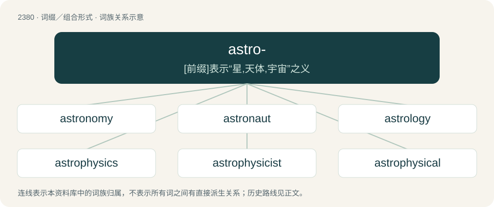

# 2484 · astro- — \[前缀\]表示“星,天体,宇宙”之义

[总目录](../00_总目录_按常用程度.md)

**类型**：词缀／组合形式　｜　**来源语言**：见词源记录

## 核心含义与来源

- 核心含义：\[前缀\]表示“星,天体,宇宙”之义
- 英文含义：celestial bodies: fixed stars, wandering stars (planets), etc.; space; astronomy
- 词形：astro-

**来源记录 1**（前缀／前置成分；celestial bodies: fixed stars, wandering stars (planets), etc.; space; astronomy）

From Ancient Greek ἄστρον (ástron, “celestial body”).

## 词族图

## 单词速览（常用到不常用）

| 单词 | 音标 | 释义 |
|---|---|---|
| [astronomy](#w-1) | 英 /əˈstɹɒn.ə.mi/；美 /əˈstɹɑ.nə.mi/ | n. 天文学 |
| [astronaut](#w-2) | 英 /ˈæstɹəˌnɔːt/；美 /ˈæstɹəˌnɔt/ | n. 太空旅行者, 宇航员；\[法\] 美国太空人 |
| [astrology](#w-3) | 英 /əˈstɹɒlədʒi/ | n. 占星术, 占星学 |
| [astrophysics](#w-4) | /ˌæs.tɹoʊˈfɪz.ɪks/ | n. 天体物理学；\[化\] 天体物理; 天体物理学 |
| [astrophysicist](#w-5) | /ˌæstɹəʊˈfɪzɪsɪst/ | n. 天体物理学家 |
| [astrophysical](#w-6) | /.æstrəˈfizikl/ | a. 天体物理学的 |
| [astrodome](#w-7) |  | 【英文】A transparent dome in the fuselage of an aircraft or spacecraft through which navigational observations may be made |
| [astrophotography](#w-8) | /.æstrəfəuˈtɒgrəfi/ | n. 天体摄影 |
| [astrobiology](#w-9) | /.æstrəubaiˈɒlədʒi/ | n. 天体生物学；\[医\] 天体生物学 |

## 逐词详解

### 1. astronomy

**词性**：名词　｜　**音标**：英 /əˈstɹɒn.ə.mi/；美 /əˈstɹɑ.nə.mi/

**中文释义**：n. 天文学

**英文义项**：The study of the physical universe beyond the Earth's atmosphere, including the process of mapping locations and properties of the matter and radiation in the universe. / Astrology.

**构词拆分**：astro- + -nomy

**词源与演化**：

From Middle English astronomie, astronemy, from Old French astronomie, equivalent to astro- + -nomy. Displaced native Old English tungolcræft.

**例句**：

> Tom does not know what the difference is between astronomy and astrology.

### 2. astronaut

**词性**：名词　｜　**音标**：英 /ˈæstɹəˌnɔːt/；美 /ˈæstɹəˌnɔt/

**中文释义**：n. 太空旅行者, 宇航员；\[法\] 美国太空人

**英文义项**：A member of the crew of a spaceship or other spacecraft that travels beyond Earth's atmosphere, or someone trained to serve that purpose. / An American space traveler, when contrasted against equivalent terms from other countries such as cosmonaut, taikonaut, spationaut, and vyomanaut.

**构词拆分**：astro- + -naut

**词源与演化**：

From astro- + -naut. Coined from Ancient Greek ἄστρον (ástron, “star”) and ναύτης (naútēs, “sailor”).

**例句**：

> Tom doesn't want to give up his dream of becoming an astronaut.

### 3. astrology

**词性**：名词　｜　**音标**：英 /əˈstɹɒlədʒi/

**中文释义**：n. 占星术, 占星学

**英文义项**：Divination about human affairs or natural phenomena from the relative positions of celestial bodies.

**构词拆分**：astro- + -logy

**词源与演化**：

From Middle French astrologie, and its source, Latin astrologia (“astronomy”), from Ancient Greek ἀστρολογία (astrología, “telling of the stars”), from ἄστρον (ástron, “star, planet, or constellation”) + -λογία (-logía, “treating of”), a combination form of -λόγος (-lógos, “one who speaks (in a certain manner)”). Morphologically astro- + -logy.

**例句**：

> You can clearly see he is crazy. He doesn't believe in astrology.

### 4. astrophysics

**词性**：名词　｜　**音标**：/ˌæs.tɹoʊˈfɪz.ɪks/

**中文释义**：n. 天体物理学；\[化\] 天体物理; 天体物理学

**英文义项**：The branch of astronomy or physics that deals with the physical properties of celestial bodies and with the interaction between matter and radiation in celestial bodies and in the space between them.

**构词拆分**：astro- + physics

**词源与演化**：

From astro- + physics.

**例句**：

> James began his degree in astrophysics because he wanted to become an astronaut.

### 5. astrophysicist

**词性**：名词　｜　**音标**：/ˌæstɹəʊˈfɪzɪsɪst/

**中文释义**：n. 天体物理学家

**英文义项**：One who studies astrophysics.

**构词拆分**：astro- + physicist

**词源与演化**：

From astro- + physicist.

**例句**：

> I once wanted to be an astrophysicist.

### 6. astrophysical

**词性**：形容词　｜　**音标**：/.æstrəˈfizikl/

**中文释义**：a. 天体物理学的

**英文义项**：Of or pertaining to astrophysics.

**构词拆分**：astro- + physical

**词源与演化**：

From astro- + physical.

**例句**：

> He was awarded by the chancellor of the university for his doctoral thesis which applied the latest in astrophysical knowledge to how underboobs swing.

### 7. astrodome

**词性**：名词

**英文义项**：A transparent dome in the fuselage of an aircraft or spacecraft through which navigational observations may be made

**构词拆分**：astro- + dome

**词源与演化**：

From astro- + dome.

### 8. astrophotography

**词性**：名词　｜　**音标**：/.æstrəfəuˈtɒgrəfi/

**中文释义**：n. 天体摄影

**英文义项**：The photography or imaging of astronomical objects, celestial events or areas of the night sky.

**构词拆分**：astro- + photography

**词源与演化**：

From astro- + photography.

### 9. astrobiology

**词性**：名词　｜　**音标**：/.æstrəubaiˈɒlədʒi/

**中文释义**：n. 天体生物学；\[医\] 天体生物学

**英文义项**：The study of life anywhere in the universe, including Earth.

**构词拆分**：astro- + biology

**词源与演化**：

From astro- + biology.

**例句**：

> My expertise at the Space Academy was astrobiology, aka exobiology.
