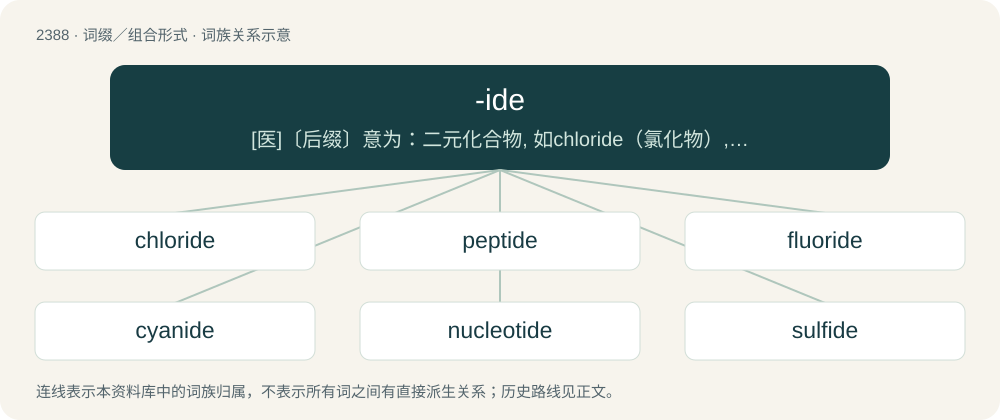

# 2496 · -ide — \[医\]〔后缀〕意为：二元化合物, 如chloride（氯化物）, sulfide（硫化物）或carbide（碳化物）

[总目录](../00_总目录_按常用程度.md)

**类型**：词缀／组合形式　｜　**来源语言**：见词源记录

## 核心含义与来源

- 核心含义：\[医\]〔后缀〕意为：二元化合物, 如chloride（氯化物）, sulfide（硫化物）或carbide（碳化物）
- 英文含义：Any of a group of related compounds - azide, polysaccharide, glycoside.
- 词形：-ide

## 词族图

## 单词速览（常用到不常用）

| 单词 | 音标 | 释义 |
|---|---|---|
| [chloride](#w-1) | 英 /ˈklɔːˌɹaɪd/；美 /ˈklɔɹˌaɪd/ | n. 氯化物；\[化\] 氯化物; 盐酸盐 |
| [peptide](#w-2) | /ˈpɛptaɪd/ | n. 肽, 缩氨酸；\[化\] 肽; 缩氨酸 |
| [fluoride](#w-3) | 英 /ˈflʊəˌɹaɪd/；美 /ˈflʊɚˌaɪd/ | n. 氟化物；\[化\] 氟化物 |
| [cyanide](#w-4) | /ˈsaɪənaɪd/ | n. 氰化物；vt. 用氰化物处理；\[计\] 氰化物 |
| [nucleotide](#w-5) | 美 /ˈn(j)u(ː)kliəˌtaɪd/；/ˈn(j)u(ː)kliəˌtaɪd/ | n. 核苷酸；\[化\] 核苷酸 |
| [sulfide](#w-6) | /ˈsʌlfaid/ | n. 硫化物；\[化\] 硫化物 |
| [bromide](#w-7) | 英 /ˈbɹəʊ.maɪd/；美 /ˈbɹoʊ.maɪd/ | n. 溴化物, 庸俗的人；\[化\] 溴化物 |
| [nitride](#w-8) | /ˈnaɪ.tɹaɪd/ | n. 氮化物；\[化\] 氮化物 |
| [telluride](#w-9) | /ˈtɛl.jə.raɪd/ | n. 碲化物；\[医\] 碲化物 |
| [iodide](#w-10) | /ˈɑɪ.əˌdɑɪd/ | n. 碘化物；\[化\] 碘化物 |
| [halide](#w-11) | 英 /ˈheɪ.laɪd/；美 /ˈhæl.aɪd/ | n. 卤化物；a. 卤化物的 |
| [hydride](#w-12) | /ˈhaɪdɹaɪd/ | \[医\] 氢化物 |
| [amide](#w-13) | 英 /ˈæ.maɪd/；美 /ˈæ.maɪd/ | n. 氨化物, 酰胺；\[化\] 酰胺 |
| [arsenide](#w-14) | 美 /ˈaɹsəˌnaɪd/ | \[化\] 砷化物；\[医\] 砷化物 |
| [glucoside](#w-15) | /ˈgluːkəusaid/ | n. 糖苷；\[化\] 葡糖苷; 葡萄糖苷; 糖苷 |

## 逐词详解

### 1. chloride

**词性**：名词　｜　**音标**：英 /ˈklɔːˌɹaɪd/；美 /ˈklɔɹˌaɪd/

**中文释义**：n. 氯化物；\[化\] 氯化物; 盐酸盐

**英文义项**：Any binary compound of chlorine and another element or radical. / Any salt of hydrochloric acid.

**构词拆分**：chlor(ine) + -ide

**词源与演化**：

From chlor(ine) + -ide, coined by British chemist Humphry Davy in 1812.

**例句**：

> In culinary, can you substitute sodium bromide for sodium chloride?

### 2. peptide

**词性**：名词　｜　**音标**：/ˈpɛptaɪd/

**中文释义**：n. 肽, 缩氨酸；\[化\] 肽; 缩氨酸

**英文义项**：Any of a class of organic compounds consisting of various numbers of amino acids in which the amine of one is reacted with the carboxylic acid of the next to form an amide bond. Such molecules joined into polypeptides and proteins constitute crucial components of living organisms. / The peptide bond itself.

**构词拆分**：peptone + -ide

**词源与演化**：

From peptone, partially hydrolyzed protein, or German Peptid, from German Pepton, from Ancient Greek πεπτόν (peptón, “cooked, digested”) derived from πέπτω (péptō, “soften, ripen, boil, cook, bake, digest”).

**例句**：

> Jacob said an flu-fighting peptide could be especially useful when vaccines are not available or when circulating viral strains become resistant to current drugs.

### 3. fluoride

**词性**：名词　｜　**音标**：英 /ˈflʊəˌɹaɪd/；美 /ˈflʊɚˌaɪd/

**中文释义**：n. 氟化物；\[化\] 氟化物

**英文义项**：A binary compound of fluorine and another element or radical. / Any of certain salts of hydrofluoric acid, such as the simple metallic ones.

**构词拆分**：fluorine + -ide

**词源与演化**：

From fluor(ine) + -ide.

**例句**：

> I'd like to make an appointment for fluoride treatments for my son.

### 4. cyanide

**词性**：名词　｜　**音标**：/ˈsaɪənaɪd/

**中文释义**：n. 氰化物；vt. 用氰化物处理；\[计\] 氰化物

**英文义项**：Any compound containing the -C≡N group or the CN⁻ anion. / Sodium or potassium cyanide, used in the extraction of gold and silver or as a poison.

**构词拆分**：cyan- + -ide

**词源与演化**：

From cyan- + -ide.

**例句**：

> The trace amounts of cyanide produced when apple seeds are digested are harmless.

### 5. nucleotide

**词性**：名词　｜　**音标**：美 /ˈn(j)u(ː)kliəˌtaɪd/；/ˈn(j)u(ː)kliəˌtaɪd/

**中文释义**：n. 核苷酸；\[化\] 核苷酸

**英文义项**：The monomer constituting DNA or RNA biopolymer molecules. Each nucleotide consists of a nitrogenous heterocyclic base (or nucleobase), which can be either a double-ringed purine or a single-ringed pyrimidine; a five-carbon pentose sugar (deoxyribose in DNA or ribose in RNA); and a phosphate group.

**构词拆分**：nucleo- + -ide

**词源与演化**：

From nucleo- (“relating to the nucleus”) + -ide (“chemical suffix”).

### 6. sulfide

**词性**：名词　｜　**音标**：/ˈsʌlfaid/

**中文释义**：n. 硫化物；\[化\] 硫化物

**英文义项**：Any compound of sulfur and a metal or other electropositive element or group. / (organosulfide) A class of organic compounds RSR', where R and R' represent an alkyl group or other organic substituent.

**构词拆分**：sulfur + -ide

**词源与演化**：

From sulf(ur) + -ide.

**例句**：

> The rotting leaves produced large quantities of hydrogen sulfide, a toxic gas.

### 7. bromide

**词性**：名词　｜　**音标**：英 /ˈbɹəʊ.maɪd/；美 /ˈbɹoʊ.maɪd/

**中文释义**：n. 溴化物, 庸俗的人；\[化\] 溴化物

**英文义项**：A binary compound of bromine and some other element or radical. / Any salt of hydrobromic acid.

**构词拆分**：brom- + -ide

**词源与演化**：

From brom- + -ide. First used in the sense “dull person” by American artist, art critic, poet, author and humorist Gelett Burgess. Figurative sense ("platitude") by extending the medicating sense through the metaphor of pacifying or placating.

**例句**：

> My adviser at college was a bromide who had not had an original thought in years.

该用例对应义项：A dull person with conventional thoughts.

### 8. nitride

**词性**：名词　｜　**音标**：/ˈnaɪ.tɹaɪd/

**中文释义**：n. 氮化物；\[化\] 氮化物

**英文义项**：A compound of nitrogen where nitrogen has an oxidation state of −3.

**构词拆分**：From nitr(ogen) + -ide.

**词源与演化**：

From nitr(ogen) + -ide.

### 9. telluride

**词性**：名词　｜　**音标**：/ˈtɛl.jə.raɪd/

**中文释义**：n. 碲化物；\[医\] 碲化物

**英文义项**：A binary compound of a metal with tellurium; metal salts of tellurane / Any organic compound of general formula R₂Te (R not = H), the tellurium analogues of ethers

**构词拆分**：tellurium + -ide

**词源与演化**：

From tellurium + -ide.

### 10. iodide

**词性**：名词　｜　**音标**：/ˈɑɪ.əˌdɑɪd/

**中文释义**：n. 碘化物；\[化\] 碘化物

**英文义项**：A binary compound of iodine and another element or radical. / Any salt of hydroiodic acid.

**构词拆分**：From iodine + -ide.

**词源与演化**：

From iodine + -ide.

**例句**：

> In chemistry, "I" can mean both iodine and iodide.

### 11. halide

**词性**：名词　｜　**音标**：英 /ˈheɪ.laɪd/；美 /ˈhæl.aɪd/

**中文释义**：n. 卤化物；a. 卤化物的

**英文义项**：Any salt of any halogen acid (such as hydrochloric acid, hydrofluoric acid, or hydroiodic acid). / Such a salt with a single halogen atom.

**构词拆分**：From hal(ogen) + -ide.

**词源与演化**：

From hal(ogen) + -ide.

**例句**：

> Potassium iodide is a halide.

该用例对应义项：Such a salt with a single halogen atom.

### 12. hydride

**词性**：名词　｜　**音标**：/ˈhaɪdɹaɪd/

**中文释义**：\[医\] 氢化物

**英文义项**：A compound of hydrogen with a more electropositive element.

**构词拆分**：hydro- + -ide

**词源与演化**：

From hydro- + -ide.

### 13. amide

**词性**：名词　｜　**音标**：英 /ˈæ.maɪd/；美 /ˈæ.maɪd/

**中文释义**：n. 氨化物, 酰胺；\[化\] 酰胺

**英文义项**：Any derivative of an oxoacid in which the hydroxyl group has been replaced with an amino or substituted amino group; especially such derivatives of a carboxylic acid, the carboxamides or acid amides / Any ionic derivative of ammonia in which a hydrogen atom has been replaced with a metal cation (R-NH⁻ or R₂N⁻)

**构词拆分**：ammonia + -ide

**词源与演化**：

From ammonia + -ide.

### 14. arsenide

**词性**：名词　｜　**音标**：美 /ˈaɹsəˌnaɪd/

**中文释义**：\[化\] 砷化物；\[医\] 砷化物

**英文义项**：An ion that is an arsenic atom with three extra electrons and charge −3. / A compound with arsenic in oxidation state −3.

**构词拆分**：arsenic + -ide

**词源与演化**：

From arsenic + -ide.

### 15. glucoside

**词性**：名词　｜　**音标**：/ˈgluːkəusaid/

**中文释义**：n. 糖苷；\[化\] 葡糖苷; 葡萄糖苷; 糖苷

**英文义项**：A glycoside that yields glucose after hydrolysis.

**构词拆分**：glucose + -ide

**词源与演化**：

From glucose + -ide (1865-70).
