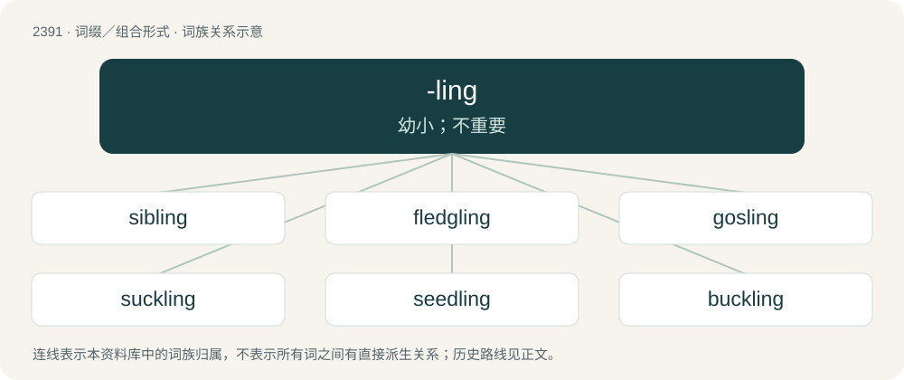

# 2501 · -ling — 幼小；不重要

[总目录](../00_总目录_按常用程度.md)

**类型**：词缀／组合形式　｜　**来源语言**：见词源记录

## 核心含义与来源

- 核心含义：幼小；不重要
- 英文含义：small, immature, miniature
- 词形：-ling

**多个词源／构词路径**：同一拼写可能有不同来源；以下按词性和含义分别列出。

**来源记录 1**（后缀／后置成分；small, immature, miniature）

From Middle English -ling, from Old English -ling, from Proto-West Germanic \*-ling, from Proto-Germanic \*-lingaz, a nominal suffix, probably composed of Proto-Germanic \*-ilaz (agent/instrumental/diminutive suffix) + Proto-Germanic \*-ingaz (patronymic suffix). Akin to Dutch -ling, German -ling, Icelandic -lingur, Gothic -𐌻𐌹𐌲𐌲𐍃 (-liggs). More at -le, -ing.

**来源记录 2**（后缀／后置成分；An adverbial suffix denoting manner, direction, or position.）

From Middle English -ling, from Old English -ling, -linga, -lunga (adverbial suffix). Compare -long.

## 词族图

## 单词速览（常用到不常用）

| 单词 | 音标 | 释义 |
|---|---|---|
| [sibling](#w-1) | /ˈsɪb.lɪŋ/ | n. 兄弟, 同胞；\[医\] 同胞(兄弟姐妹) |
| [fledgling](#w-2) | /ˈflɛd͡ʒ.lɪŋ/ | n. 羽毛初长的雏鸟, 刚会飞的幼鸟, 无经验的人 |
| [gosling](#w-3) | 英 /ˈɡɒzlɪŋ/；美 /ˈɡɑzlɪŋ/ | n. 小鹅, 年轻无知的人 |
| [suckling](#w-4) | /ˈsʌkliŋ/ | n. 乳儿, 乳臭未干的小子 |
| [seedling](#w-5) | /ˈsiːdlɪŋ/ | n. 秧苗, 树苗；\[医\] 籽苗, 幼苗, 实生苗 |
| [buckling](#w-6) | /ˈbʌk.lɪŋ/ | 【英文】A young male domestic goat of between one and two years. |
| [yearling](#w-7) | 英 /ˈjɜː.lɪŋ/；美 /ˈjɪɚ.lɪŋ/ | n. 一岁崽 |
| [dumpling](#w-8) | /ˈdʌmp.lɪŋ/ | n. 面团布丁, 团子 |
| [duckling](#w-9) | /ˈdʌklɪŋ/ | n. 小鸭子 |
| [grayling](#w-10) | /ˈgreiliŋ/ | n. 茴鱼, 眼蝶 |
| [changeling](#w-11) | 英 /ˈtʃeɪn(d)ʒlɪŋ/；美 /ˈt͡ʃeɪnd͡ʒlɪŋ/ | n. 被偷换后留下的孩童, 矮小丑陋的小孩, 低能儿 |
| [fondling](#w-12) | /ˈfɒndlɪŋ/ | n. 被溺爱的人, 爱子, 宠爱的动物 |
| [carling](#w-13) | /ˈkɑːliŋ/ | 【英文】A cultivar of field pea or maple pea, dried, soaked, boiled, then fried. |
| [sapling](#w-14) | /ˈsæplɪŋ/ | n. 树苗, 小树 |
| [weakling](#w-15) | /ˈwiːkˈlɪŋɡ/ | n. 虚弱的人, 弱小的动物, 低能儿；a. 虚弱的, 懦弱的 |
| [nestling](#w-16) | /ˈnɛstlɪŋ/ | n. 刚孵出的雏, 未离巢的雏, 幼儿 |
| [foundling](#w-17) | /ˈfaundliŋ/ | n. 弃儿, 拾来的孩儿 |
| [titling](#w-18) | /ˈtɪtlɪŋ/ | 【英文】The hedge sparrow, dunnock, titlene, Prunella modularis. |
| [cowling](#w-19) | /ˈkauliŋ/ | n. 飞机整流罩, 外壳 |
| [halfling](#w-20) | 美 /ˈhæflɪŋ/；/ˈhɑːflɪŋ/ | n. 半成年人, 半便士的银币 |
| [needling](#w-21) | /ˈniːdlɪŋ/ | \[医\] 针刺, 针术 |
| [underling](#w-22) | 英 /ˈʌndəlɪŋ/；美 /ˈʌndɚlɪŋ/ | n. 部下, 下手, 下属 |
| [earthling](#w-23) | 英 /ˈɜːθlɪŋ/；美 /ˈɝθlɪŋ/ | n. 世人, 俗人, 俗物 |
| [wildling](#w-24) | /ˈwaildliŋ/ | n. 野生动物或野生植物 |
| [hatchling](#w-25) | /ˈhæt͡ʃlɪŋ/ | n. 人工孵化的鱼苗或小鸟 |
| [shearling](#w-26) | /ˈʃiəliŋ/ | n. 剪过一次毛的羊；\[化\] 剪毛绵羊革 |
| [stripling](#w-27) | 英 /ˈstɹɪplɪŋ/ | n. 年轻人, 小伙子 |
| [darkling](#w-28) | /ˈdɑː(ɹ)klɪŋ/ | adv. 在暗中；a. 黑暗的, 神秘莫测的 |

## 逐词详解

### 1. sibling

**词性**：名词　｜　**音标**：/ˈsɪb.lɪŋ/

**中文释义**：n. 兄弟, 同胞；\[医\] 同胞(兄弟姐妹)

**英文义项**：A person who shares a parent; one's brother or sister who one shares a parent with. / A node in a data structure that shares its parent with another node.

**构词拆分**：sib + -ling

**词源与演化**：

First use appears c. 1903, a modern revival of Old English sibling (“relative, a relation, kinsman”), equivalent to sib + -ling. Compare Middle English siblynges pl, sib, sibbe (“relative; kinsman”), German Sippe. The term apparently meant merely kin or relative until the 20th century when it was applied in a way that aided the study of genetics, which led to its specialized use. For example, the OED has a citation in 1902 in which sibling must be defined for those who do not know the intended meaning.

**例句**：

> None of my siblings are married yet.

该用例对应义项：A person who shares a parent; one's brother or sister who one shares a parent with.

### 2. fledgling

**词性**：形容词　｜　**音标**：/ˈflɛd͡ʒ.lɪŋ/

**中文释义**：n. 羽毛初长的雏鸟, 刚会飞的幼鸟, 无经验的人

**英文义项**：Untried or inexperienced. / Emergent or rising.

**构词拆分**：fledge + -ling

**词源与演化**：

From fledge (“prepare for flying”) + -ling.

**例句**：

> It's a fledgling technology but it shows great promise.

### 3. gosling

**词性**：名词　｜　**音标**：英 /ˈɡɒzlɪŋ/；美 /ˈɡɑzlɪŋ/

**中文释义**：n. 小鹅, 年轻无知的人

**英文义项**：A young goose. / An inexperienced and immature, or foolish and naive, young person.

**构词拆分**：goose + -ling

**词源与演化**：

From Late Middle English goslyng (“gosling”), alteration (due to Middle English goos (“goose”)) of earlier gesling (“gosling”), of North Germanic origin, from Old Norse gæsling, géslingr (“gosling”), from gás (“goose”) + -lingr (“-ling”), equivalent to goose + -ling. Cognate with Danish gæsling (“gosling”), Swedish gässling (“gosling”). Compare also Low German gossel, gössel (“gosling”), German Gänslein (“gosling”).

**例句**：

> The cat pounced on the stray gosling.

### 4. suckling

**词性**：名词　｜　**音标**：/ˈsʌkliŋ/

**中文释义**：n. 乳儿, 乳臭未干的小子

**英文义项**：An infant that is still being breastfed (being suckled) by its mother. / A young mammal not yet weaned and still being fed milk by its mother.

**构词拆分**：suck + -ling

**词源与演化**：

From Middle English sukling, sukeling, sokeling, equivalent to suck + -ling. Cognate with Middle Dutch sogelinc (“suckling”), Dutch zuigeling (“suckling”), German Säugling (“suckling”).

**例句**：

> The baby giraffe stood up and started suckling.

### 5. seedling

**词性**：名词　｜　**音标**：/ˈsiːdlɪŋ/

**中文释义**：n. 秧苗, 树苗；\[医\] 籽苗, 幼苗, 实生苗

**英文义项**：A young plant grown from seed. / one grown in a nursery for transplanting.

**构词拆分**：seed + -ling

**词源与演化**：

From seed + -ling.

**例句**：

> At the foot of the palm tree there grows a palm seedling.

### 6. buckling

**词性**：名词　｜　**音标**：/ˈbʌk.lɪŋ/

**英文义项**：A young male domestic goat of between one and two years.

**构词拆分**：buck + -ling

**词源与演化**：

From buck + -ling.

### 7. yearling

**词性**：名词　｜　**音标**：英 /ˈjɜː.lɪŋ/；美 /ˈjɪɚ.lɪŋ/

**中文释义**：n. 一岁崽

**英文义项**：An animal that is between one and two years old; one that is in its second year (but not yet two full years old). / A racehorse that is considered to be one year old until a subsequent January 1st.

**构词拆分**：year + -ling

**词源与演化**：

From Middle English yerling, yerlyng, equivalent to year + -ling. Cognate with Dutch jaarling (“yearling”), German Jährling (“yearling”).

**用法示例／搭配（非完整句）**：

> a yearling lamb

该用例对应义项：An animal that is between one and two years old; one that is in its second year (but not yet two full years old).

### 8. dumpling

**词性**：名词　｜　**音标**：/ˈdʌmp.lɪŋ/

**中文释义**：n. 面团布丁, 团子

**英文义项**：Specifically, a ball of dough used in stews and other sauced dishes; a thick noodle. / Specifically, a food composed of a dough wrapper around a filling.

**词源与演化**：

A folk word, first attested in c. 1600s, apparently from a Norfolk (East Anglian) dialect, of uncertain origin: \* perhaps from some Low German word (compare dümpeln (“bobbing up and down”)), \* or from the rare dialectal adjective dump (“lump, of the consistency of dough”) (first attested in the late 1800s), + -ling (diminutive suffix), although dumpling is recorded much earlier. However, compare dumpy (“short and stout”).

**用法示例／搭配（非完整句）**：

> My little dumpling.

该用例对应义项：A term of endearment.

### 9. duckling

**词性**：名词　｜　**音标**：/ˈdʌklɪŋ/

**中文释义**：n. 小鸭子

**英文义项**：A young duck. / A young female duck.

**构词拆分**：duck + -ling

**词源与演化**：

From Middle English dokeling, dukling, dookelynge (“duckling”), equivalent to duck + -ling.

**例句**：

> The small duckling can swim but has not demonstrated this ability.

### 10. grayling

**词性**：名词　｜　**音标**：/ˈgreiliŋ/

**中文释义**：n. 茴鱼, 眼蝶

**英文义项**：Any freshwater fish of the genus Thymallus or specifically Thymallus thymallus, of the salmon family, having a large dorsal fin. / Thymallus arcticus (Arctic grayling)

**构词拆分**：gray + -ling

**词源与演化**：

From Middle English greylyng, equivalent to gray + -ling.

### 11. changeling

**词性**：名词　｜　**音标**：英 /ˈtʃeɪn(d)ʒlɪŋ/；美 /ˈt͡ʃeɪnd͡ʒlɪŋ/

**中文释义**：n. 被偷换后留下的孩童, 矮小丑陋的小孩, 低能儿

**英文义项**：In pre-modern European folklore: an infant of a magical creature that was secretly exchanged for a human infant. In British, Irish and Scandinavian mythology the exchanged infants were thought to be those of fairies, sprites or trolls; in other places, they were ascribed to demons, devils, or witches. / A person or object (especially when regarded as inferior) secretly exchanged for something else.

**构词拆分**：change + -ling (suffix with the sense ‘immature; small’)

**词源与演化**：

The noun is derived from change + -ling (suffix with the sense ‘immature; small’). Sense 6 (“idiot, simpleton”) is from the idea that foolish children had been left by magical creatures (sense 1). The adjective is derived from the noun.

**例句**：

> In the Deep Space 9 space station, Odo is a Changeling security chief.

### 12. fondling

**词性**：名词　｜　**音标**：/ˈfɒndlɪŋ/

**中文释义**：n. 被溺爱的人, 爱子, 宠爱的动物

**英文义项**：A pet or person who is fondled; someone who is much loved.

**构词拆分**：From fond + -ling.

**词源与演化**：

From fond + -ling.

**例句**：

> Skura woke up to find Yanni fondling her.

### 13. carling

**词性**：名词　｜　**音标**：/ˈkɑːliŋ/

**英文义项**：A cultivar of field pea or maple pea, dried, soaked, boiled, then fried.

**构词拆分**：care + -ling

**词源与演化**：

From care + -ling (synchronically), being connected to the custom of serving these peas to the poor on Care Sunday, called also Carling Sunday after the peas.

### 14. sapling

**词性**：名词　｜　**音标**：/ˈsæplɪŋ/

**中文释义**：n. 树苗, 小树

**英文义项**：A young tree, larger than a seedling. / A youngster, especially a male nearing maturity.

**构词拆分**：sap + -ling

**词源与演化**：

From Middle English saplyng, seplyng, sapling, equivalent to sap + -ling.

**例句**：

> We planted an acer sapling in our garden last spring.

### 15. weakling

**词性**：名词　｜　**音标**：/ˈwiːkˈlɪŋɡ/

**中文释义**：n. 虚弱的人, 弱小的动物, 低能儿；a. 虚弱的, 懦弱的

**英文义项**：A person of weak or even sickly physical constitution. / A person of weak character, lacking in courage and/or moral strength.

**构词拆分**：From weak + -ling.

**词源与演化**：

From weak + -ling.

**例句**：

> "What is that weakling that you put on the picture?" replied Ssinistri.

### 16. nestling

**词性**：名词　｜　**音标**：/ˈnɛstlɪŋ/

**中文释义**：n. 刚孵出的雏, 未离巢的雏, 幼儿

**英文义项**：A small, young bird that is still confined to the nest.

**构词拆分**：nest + -ling

**词源与演化**：

From Middle English nestling, equivalent to nest + -ling.

### 17. foundling

**词性**：名词　｜　**音标**：/ˈfaundliŋ/

**中文释义**：n. 弃儿, 拾来的孩儿

**英文义项**：An abandoned child, left by its parent(s), often a baby left at a convent or similar safe place.

**构词拆分**：By surface analysis, found + -ling

**词源与演化**：

From Middle English foundlyng, fondeyng, variants of Middle English fyndling, fyndlyng. By surface analysis, found + -ling.

**用法示例／搭配（非完整句）**：

> foundling hospital

该用例对应义项：An abandoned child, left by its parent(s), often a baby left at a convent or similar safe place.

### 18. titling

**词性**：名词　｜　**音标**：/ˈtɪtlɪŋ/

**英文义项**：The hedge sparrow, dunnock, titlene, Prunella modularis. / The meadow pipit (Anthus pratensis).

**构词拆分**：tit (“a small bird”) + -ling (“small”)

**词源与演化**：

Uncertain. Superficially tit (“a small bird”) + -ling (“small”). Attested from the 16th century. Probably from Icelandic titlingr (“tit sparrow”), Old Norse titlingr (“sparrow”). Compare Old Norse tittr (“titmouse”). Also see Middle English titmose (“titmouse”).

### 19. cowling

**词性**：名词　｜　**音标**：/ˈkauliŋ/

**中文释义**：n. 飞机整流罩, 外壳

**英文义项**：A young or little cow; calf.

**构词拆分**：cow + -ling

**词源与演化**：

From cow + -ling.

### 20. halfling

**词性**：名词　｜　**音标**：美 /ˈhæflɪŋ/；/ˈhɑːflɪŋ/

**中文释义**：n. 半成年人, 半便士的银币

**英文义项**：A fictional small humanoid creature featuring in fantasy fiction; a hobbit. / A fictional humanoid born of a human parent and a parent of another race in fantasy fiction.

**构词拆分**：half + -ling

**词源与演化**：

From half + -ling. Sense 3 ("half-grown young person") is attested to 1794. It was then used by J.R.R. Tolkien in The Lord of the Rings (1954) as an alternative reference to members of his hobbit race. Hobbits were used in the original 1974 releases of the role-playing game Dungeons and Dragons, but in later editions they were changed to "halflings" for legal reasons, as being a pre-existing word rather than one invented by Tolkien.

**例句**：

> The brave halfling stumbled from a frying pan straight into a fire.

### 21. needling

**词性**：名词　｜　**音标**：/ˈniːdlɪŋ/

**中文释义**：\[医\] 针刺, 针术

**英文义项**：A needy person.

**构词拆分**：need + -ling

**词源与演化**：

From need + -ling.

**例句**：

> His older brother keeps needling him.

### 22. underling

**词性**：名词　｜　**音标**：英 /ˈʌndəlɪŋ/；美 /ˈʌndɚlɪŋ/

**中文释义**：n. 部下, 下手, 下属

**英文义项**：A subordinate, or person of lesser rank or authority. / A low, wretched person.

**构词拆分**：By surface analysis, under + -ling

**词源与演化**：

From Middle English underling, from Old English underling. By surface analysis, under + -ling.

**例句**：

> You're just an underling. Know your place!

### 23. earthling

**词性**：名词　｜　**音标**：英 /ˈɜːθlɪŋ/；美 /ˈɝθlɪŋ/

**中文释义**：n. 世人, 俗人, 俗物

**英文义项**：One who tills the earth; a farmer, a husbandman, a ploughman.

**构词拆分**：earth + -ling

**词源与演化**：

From Middle English erthling (“farmer, ploughman”) \[and other forms\] (in glossaries), from Old English ierþling, eorþling (“farmer, husbandman, ploughman”) \[and other forms\], from eorþe (“ground; dirt; planet Earth”) (ultimately from Proto-Indo-European \*h₁er- (“earth”)) + -ling (suffix forming personal nouns). The English word is analysable as earth + -ling.

**例句**：

> He had to choose between "Earthling" and "Terran" for their demonym.

### 24. wildling

**词性**：名词　｜　**音标**：/ˈwaildliŋ/

**中文释义**：n. 野生动物或野生植物

**英文义项**：A wild, i.e. not cultivated, plant. / A wild animal.

**构词拆分**：wild + -ling (“descendant”)

**词源与演化**：

From wild + -ling (“descendant”); cognate with Dutch (not synonymous) wildeling.

### 25. hatchling

**词性**：名词　｜　**音标**：/ˈhæt͡ʃlɪŋ/

**中文释义**：n. 人工孵化的鱼苗或小鸟

**英文义项**：A newly hatched bird, reptile or other animal that has emerged from an egg. / A person who has (especially recently) realized that they are transgender.

**构词拆分**：hatch + -ling

**词源与演化**：

From hatch + -ling. Sense 2 in reference to the term crack one's egg (“realize one is transgender”).

**例句**：

> The hatchling alligator had just broken out of its shell but was already trying to follow its mother, who hunted hatchling birds.

该用例对应义项：A newly hatched bird, reptile or other animal that has emerged from an egg.

### 26. shearling

**词性**：名词　｜　**音标**：/ˈʃiəliŋ/

**中文释义**：n. 剪过一次毛的羊；\[化\] 剪毛绵羊革

**英文义项**：A sheep that has been shorn for the first time / A sheepskin or lambskin that has gone through a limited shearing process so that the fibers are of uniform depth

**构词拆分**：shear + -ling

**词源与演化**：

From Middle English scherling; equivalent to shear + -ling.

**例句**：

> Her coat was lined with shearling.

该用例对应义项：A sheepskin or lambskin that has gone through a limited shearing process so that the fibers are of uniform depth

### 27. stripling

**词性**：名词　｜　**音标**：英 /ˈstɹɪplɪŋ/

**中文释义**：n. 年轻人, 小伙子

**英文义项**：A young man in the state of adolescence, or just passing from boyhood to manhood; a lad. . / A seedling with most of the leaves stripped off.

**构词拆分**：strip (“long, narrow piece”) + -ling

**词源与演化**：

From Middle English stripling (“an adolescent, a youth (specifically one who is male); a child”) \[and other forms\], possibly from strepen (“to remove the clothes of, undress, strip; to peel off; to skin (an animal); to remove; to take something away from someone; to plunder, rob”) (connoting something that is stripped and thin, and yet to reach its full size) + -ling (suffix forming diminutives). Strepen is derived from Old English \*strēpan (Anglian), \*strīepan, \*strīpan, \*strȳpan (West Saxon), from Proto-West Germanic \*straupijan, from Proto-Germanic \*straupijaną (“to strip; to pluck; to wipe”), from \*streupaną (“to touch”) (ultimately from Proto-Indo-European \*strew-, \*sterw-, \*ster- (“a strip; a streak; a beam, ray”)) + \*-janą (suffix forming causatives from strong verbs with the sense of ‘to cause to do’). The English word is analysable as strip (“long, narrow piece”) + -ling.

### 28. darkling

**词性**：副词　｜　**音标**：/ˈdɑː(ɹ)klɪŋ/

**中文释义**：adv. 在暗中；a. 黑暗的, 神秘莫测的

**英文义项**：In the dark; in obscurity.

**构词拆分**：By surface analysis, dark + -ling

**词源与演化**：

From Middle English derkelyng. By surface analysis, dark + -ling.
