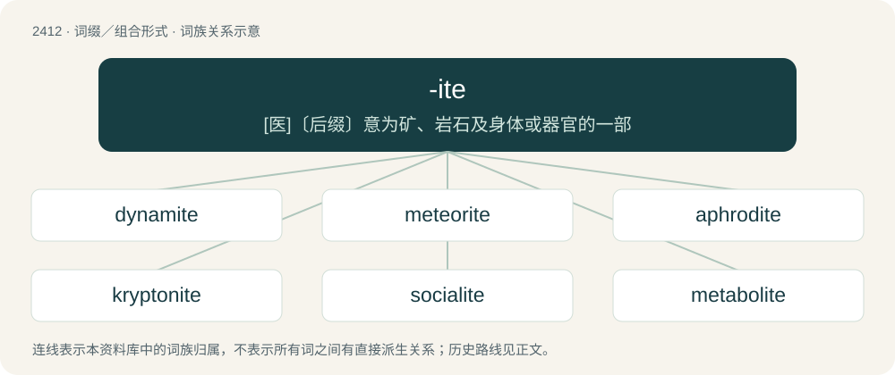

# 2519 · -ite — \[医\]〔后缀〕意为矿、岩石及身体或器官的一部

[总目录](../00_总目录_按常用程度.md)

**类型**：词缀／组合形式　｜　**来源语言**：见词源记录

## 核心含义与来源

- 核心含义：\[医\]〔后缀〕意为矿、岩石及身体或器官的一部
- 英文含义：Used to form nouns denoting followers or adherents of a specified person, idea, doctrine, movement, etc.
- 词形：-ite

**多个词源／构词路径**：同一拼写可能有不同来源；以下按词性和含义分别列出。

**来源记录 1**（后缀／后置成分；Used to form nouns denoting followers or adherents of a specified person, idea, doctrine, movement, etc.）

From French -ite, from Old French, from Latin -ītēs, from Ancient Greek -ῑ́της (-ī́tēs).

**来源记录 2**（后缀／后置成分；Forms adjectives.）

From Latin past participles in -ītus, of verbs in -īre, -ĕre, -ēre, partly via Old French.

## 词族图

## 单词速览（常用到不常用）

| 单词 | 音标 | 释义 |
|---|---|---|
| [dynamite](#w-1) | 英 /ˈdʌɪnəmʌɪt/；美 /ˈdaɪ.nəˌmaɪt/ | n. 炸药；vt. 炸毁, 破坏 |
| [meteorite](#w-2) | 英 /ˈmiː.tɪ.ə.ɹaɪt/；美 /ˈmi.ti.əˌɹaɪt/ | n. 陨星；\[化\] 陨石; 陨铁 |
| [aphrodite](#w-3) | /ˈæ.fɹəʊ.daɪt/ | 【英文】A soft and earthy mineral of a white or yellowish color, and with a waxy lustre, found at Langbanshytta in Sweden. It is a hydrated silicate of magnesia, and resembles meerschaum. |
| [kryptonite](#w-4) | /ˈkɹɪptənaɪt/ | n. 氪星石 |
| [socialite](#w-5) | 美 /ˈsoʊʃəˌlaɪt/ | n. 社交名流 |
| [metabolite](#w-6) | /mɪˈtæbəlaɪt/ | n. 代谢物；\[化\] 代谢物 |
| [bauxite](#w-7) | 英 /ˈbɔːksaɪt/；美 /ˈbɔːksaɪt/ | n. 铝矾土, 铝土矿；\[化\] 铝土矿 |
| [calcite](#w-8) | /ˈkælˌsaɪt/ | n. 方解石；\[化\] 方解石 |
| [magnetite](#w-9) | 英 /ˈmaɡ.nə.taɪt/ | n. 磁铁矿；\[医\] 磁铁矿 |
| [pyrite](#w-10) | /ˈpaɪˌɹaɪt/ | n. 黄铁矿；\[化\] 黄铁矿 |
| [lignite](#w-11) | /ˈlɪɡnaɪ̯t/ | n. 褐煤；\[化\] 褐煤 |
| [quartzite](#w-12) | 英 /ˈk(w)ɔːtˌsaɪt/；美 /ˈk(w)ɔɹtˌsaɪt/ | n. 石英岩；\[化\] 石英岩 |
| [muscovite](#w-13) |  | 【英文】A pale brown mineral of the mica group, being a basic potassium aluminosilicate with the chemical formula KAl₂(Si₃Al)O₁₀(OH,F)₂; used as an electrical insulator etc. |
| [bentonite](#w-14) | /ˈbentə,nait/ | n. &lt;美&gt;\[地质\]斑脱土(火山灰分解成的一种粘土) |
| [inositol](#w-15) | 英 /ʌɪˈnəʊ.sɪ.tɒl/；美 /ɪˈnoʊ.səˌtɒl/ | n. 肌醇；\[化\] 肌醇 |
| [fluorite](#w-16) | 美 /ˈflʊɚˌaɪt/ | n. 萤石；\[化\] 萤石 |
| [ferrite](#w-17) | /ˈfɛɹaɪt/ | n. 铁酸盐；\[计\] 铁淦氧; 铁氧体 |
| [ammonite](#w-18) | /ˈæ.məˌnaɪt/ | n. 菊石；\[化\] 菊石; 干肉粉; 阿芒炸药; 硝铵二硝基萘炸药 |
| [andesite](#w-19) | /ˈæn.dɪˌsaɪt/ | n. 安山岩；\[化\] 安山岩 |
| [thermite](#w-20) | 英 /ˈθɜː(ɹ).maɪt/ | \[医\] 铝热剂 |
| [perovskite](#w-21) | /pəˈrɒvskaɪt/ | 钙钛矿 |
| [sulfite](#w-22) | /ˈsʌlfaɪt/ | n. 亚硫酸盐；\[化\] 亚硫酸盐; 亚硫酸盐或酯、根 |
| [samsonite](#w-23) | /ˈsæmsənait/ | n. \[矿\]硫锑锰银矿 |
| [laterite](#w-24) | 英 /ˈlatəɹʌɪt/ | n. 铁矾土, 红土带；\[机\] 红土, 砖红壤 |
| [carbonite](#w-25) | /ˈkɑːbənait/ | n. 硝酸甘油, 硝酸钾；\[化\] 碳质炸药(硝化甘油、硝酸钾、锯屑炸药) |
| [nanite](#w-26) |  | 【英文】Synonym of nanorobot. |
| [kimberlite](#w-27) | /ˈkimbəlait/ | \[化\] 金伯利岩; 角砾云橄岩(含钻石火成岩) |
| [aragonite](#w-28) | /əˈræ^ənait, ˈærə^ənait/ | n. \[矿\]霰石, 文石 |
| [cordite](#w-29) | 英 /ˈkɔːdaɪt/ | n. 无烟线状火药；\[化\] 柯达炸药; 柯戴特(硝棉、硝化甘油、石油脂炸药) |
| [jadeite](#w-30) | /ˈd͡ʒeɪˌdaɪt/ | n. 硬玉；\[化\] 硬玉; 翡翠 |
| [dendrite](#w-31) | 英 /ˈdɛndɹaɪt/ | n. 树枝石, 树枝状石, 枝蔓晶；\[化\] 树枝晶 |
| [biotite](#w-32) | /ˈbaɪəˌtaɪt/ | n. 黑云母；\[化\] 黑云母 |
| [labradorite](#w-33) | 美 /ˈlæb.ɹəˌdɔɹˌaɪt/ | n. 闪光拉长石, 富拉玄武岩 |

## 逐词详解

### 1. dynamite

**词性**：动词　｜　**音标**：英 /ˈdʌɪnəmʌɪt/；美 /ˈdaɪ.nəˌmaɪt/

**中文释义**：n. 炸药；vt. 炸毁, 破坏

**英文义项**：To blow up with dynamite or other high explosive. / To dismantle or destroy.

**词源与演化**：

Coined by Alfred Nobel in 1867. Ultimately from Ancient Greek δύναμις (dúnamis, “power”) + -ite, most likely under the influence of dynamo or dynamic.

**用法示例／搭配（非完整句）**：

> the brakes will dynamite

该用例对应义项：To lock up from being invoked too suddenly.

### 2. meteorite

**词性**：名词　｜　**音标**：英 /ˈmiː.tɪ.ə.ɹaɪt/；美 /ˈmi.ti.əˌɹaɪt/

**中文释义**：n. 陨星；\[化\] 陨石; 陨铁

**英文义项**：A metallic or stony object or body that is the remains of a meteoroid.

**构词拆分**：meteor + -ite

**词源与演化**：

From meteor + -ite.

**例句**：

> A meteorite is what a meteor is called once it lands on Earth.

### 3. aphrodite

**词性**：名词　｜　**音标**：/ˈæ.fɹəʊ.daɪt/

**英文义项**：A soft and earthy mineral of a white or yellowish color, and with a waxy lustre, found at Langbanshytta in Sweden. It is a hydrated silicate of magnesia, and resembles meerschaum.

**词源与演化**：

From stem of Ancient Greek ἀφρός (aphrós, “sea foam, froth”) (for its supposed resemblance) + -ite. This coining matches not only the name of the goddess, but also the popular folk etymology for her by the Ancient Greeks.

**例句**：

> Mary was so beautiful, that it was thought that she must be Aphrodite's daughter.

### 4. kryptonite

**词性**：名词　｜　**音标**：/ˈkɹɪptənaɪt/

**中文释义**：n. 氪星石

**英文义项**：The one weakness of something or someone that is otherwise invulnerable. / Crack cocaine.

**构词拆分**：Krypton + -ite

**词源与演化**：

From a fictional radioactive element, kryptonite, that has a detrimental effect on the otherwise invulnerable character Superman. Formed from Superman's home planet Krypton + -ite, which was named after the chemical element krypton.

**例句**：

> The feelings of others are like kryptonite for Tom.

### 5. socialite

**词性**：名词　｜　**音标**：美 /ˈsoʊʃəˌlaɪt/

**中文释义**：n. 社交名流

**英文义项**：A person (often a woman) of social prominence, considered to be an influential figure. / A person who goes to fashionable parties and is often written about in the newspapers, etc.

**构词拆分**：social (“pertaining to high society”) + -ite

**词源与演化**：

From social (“pertaining to high society”) + -ite, perhaps as a play on social light, in imitation of words in -ite.

**例句**：

> Ziri is a boring snobby socialite.

### 6. metabolite

**词性**：名词　｜　**音标**：/mɪˈtæbəlaɪt/

**中文释义**：n. 代谢物；\[化\] 代谢物

**英文义项**：Any substance produced by, or taking part in, a metabolic reaction.

**构词拆分**：metabolism + -ite

**词源与演化**：

From metabolism + -ite.

### 7. bauxite

**词性**：名词　｜　**音标**：英 /ˈbɔːksaɪt/；美 /ˈbɔːksaɪt/

**中文释义**：n. 铝矾土, 铝土矿；\[化\] 铝土矿

**英文义项**：The principal ore of aluminium; a clay-like mineral, being a mixture of hydrated oxides and hydroxides.

**词源与演化**：

Derived from the name of Les Baux in France, plus + -ite. The /ks/ in the English pronunciation is from a spelling pronunciation.

**例句**：

> Gold, bauxite, and diamonds are Guinea's main exports.

### 8. calcite

**词性**：名词　｜　**音标**：/ˈkælˌsaɪt/

**中文释义**：n. 方解石；\[化\] 方解石

**英文义项**：A very widely distributed crystalline form of calcium carbonate, CaCO₃, found as limestone, chalk and marble.

**词源与演化**：

From Latin calx + -ite.

### 9. magnetite

**词性**：名词　｜　**音标**：英 /ˈmaɡ.nə.taɪt/

**中文释义**：n. 磁铁矿；\[医\] 磁铁矿

**英文义项**：A magnetic mineral, with the chemical formula Fe²⁺Fe3+2O₄, one of the primary ores of iron. / Any instance of iron(II,III) oxide, regardless of whether it is a geologic mineral or a chemical result or product.

**构词拆分**：magnet + -ite

**词源与演化**：

From magnet + -ite, after German Magnetit.

**例句**：

> Lodestones are magnetized pieces of magnetite.

### 10. pyrite

**词性**：名词　｜　**音标**：/ˈpaɪˌɹaɪt/

**中文释义**：n. 黄铁矿；\[化\] 黄铁矿

**英文义项**：The common mineral iron disulfide (FeS₂), of a pale brass-yellow color and brilliant metallic luster, crystallizing in the isometric system. / Any metallic-looking sulphide, such as the above, which is the most common.

**构词拆分**：pyr- + -ite

**例句**：

> Copper diselenide can occur both as a marcasite and a pyrite.

该用例对应义项：(usually as a plural: pyrites) Any metal dichalcogenide that is isostructural to the common mineral.

### 11. lignite

**词性**：名词　｜　**音标**：/ˈlɪɡnaɪ̯t/

**中文释义**：n. 褐煤；\[化\] 褐煤

**英文义项**：A low-grade, brownish-black coal.

**构词拆分**：Latin lignum (“firewood”) + -ite

**词源与演化**：

From French lignite, from Latin lignum (“firewood”) + -ite.

**例句**：

> The opencast lignite mines in Germany cover tens of square kilometers.

### 12. quartzite

**词性**：名词　｜　**音标**：英 /ˈk(w)ɔːtˌsaɪt/；美 /ˈk(w)ɔɹtˌsaɪt/

**中文释义**：n. 石英岩；\[化\] 石英岩

**英文义项**：A metamorphic rock from sandstone, consisting of interlocking grains of quartz.

**构词拆分**：quartz + -ite

**词源与演化**：

From quartz + -ite.

**例句**：

> Quartzite is a white or pinkish rock, in which the dominant mineral is quartz.

### 13. muscovite

**词性**：名词

**英文义项**：A pale brown mineral of the mica group, being a basic potassium aluminosilicate with the chemical formula KAl₂(Si₃Al)O₁₀(OH,F)₂; used as an electrical insulator etc.

**词源与演化**：

In 1850 from Muscovy glass + -ite, from the province Muscovy in Russia. Named by James Dwight Dana.

### 14. bentonite

**词性**：名词　｜　**音标**：/ˈbentə,nait/

**中文释义**：n. &lt;美&gt;\[地质\]斑脱土(火山灰分解成的一种粘土)

**英文义项**：Any of several impure clay minerals consisting mostly of montmorillonite. / A porous clay formed by the decomposition of volcanic ash that swells 5 to 6 times its original volume in the presence of water.

**构词拆分**：Benton + -ite

**词源与演化**：

From Benton + -ite, after the place where it was first mined: Fort Benton, Montana.

### 15. inositol

**词性**：名词　｜　**音标**：英 /ʌɪˈnəʊ.sɪ.tɒl/；美 /ɪˈnoʊ.səˌtɒl/

**中文释义**：n. 肌醇；\[化\] 肌醇

**英文义项**：A simple carbocyclic sugar (hexahydroxycyclohexane; chemical formula: C₆H₁₂O₆) which occurs in animal and plant tissue. Once treated as part of the vitamin B complex, but is not a vitamin as it can be synthesized by the body.

**构词拆分**：inosite + -ol；inosite + -ol (“an alcohol”)；Ancient Greek ἰνός (inós, genitive singular of ἴς (ís, “sinew, tendon”)) + -ite

**词源与演化**：

From its former name inosite + -ol (“an alcohol”), from Ancient Greek ἰνός (inós, genitive singular of ἴς (ís, “sinew, tendon”)) + -ite.

### 16. fluorite

**词性**：名词　｜　**音标**：美 /ˈflʊɚˌaɪt/

**中文释义**：n. 萤石；\[化\] 萤石

**英文义项**：A widely occurring mineral comprising calcium fluoride plus or minus impurities, of various colours, used as a flux in steelmaking, and in the manufacture of glass, enamels and hydrofluoric acid.

**构词拆分**：fluor + -ite

**词源与演化**：

From fluor + -ite.

**例句**：

> Fluorite is an important natural resource of Thailand.

该用例对应义项：A widely occurring mineral comprising calcium fluoride plus or minus impurities, of various colours, used as a flux in steelmaking, and in the manufacture of glass, enamels and hydrofluoric acid.

### 17. ferrite

**词性**：名词　｜　**音标**：/ˈfɛɹaɪt/

**中文释义**：n. 铁酸盐；\[计\] 铁淦氧; 铁氧体

**英文义项**：The interstitial solid solution of carbon in body-centered cubic iron. / Any of a class of metal oxides which show ferrimagnetism; used in transformers, inductors, antennas, recording heads, microwave devices, motors and loudspeakers.

**词源与演化**：

From New Latin, from Latin ferrum (“iron”) + -ite.

**用法示例／搭配（非完整句）**：

> ferrite transition zone

该用例对应义项：The interstitial solid solution of carbon in body-centered cubic iron.

### 18. ammonite

**词性**：名词　｜　**音标**：/ˈæ.məˌnaɪt/

**中文释义**：n. 菊石；\[化\] 菊石; 干肉粉; 阿芒炸药; 硝铵二硝基萘炸药

**英文义项**：Any of an extinct group of cephalopods of the subclass Ammonoidea; a fossil shell of such an animal.

**构词拆分**：Ammon + -ite

**词源与演化**：

From French ammonite, from Latin Ammōnis (cornū) (“horn of Ammon”), as it was called by Pliny the Elder in reference to coiling ram horns used to symbolise the Egyptian god Amun. Equivalent to Ammon + -ite.

### 19. andesite

**词性**：名词　｜　**音标**：/ˈæn.dɪˌsaɪt/

**中文释义**：n. 安山岩；\[化\] 安山岩

**英文义项**：Any of a class of fine-grained intermediate igneous rock, of volcanic origin, containing mostly plagioclase feldspar.

**构词拆分**：Andes + -ite

**词源与演化**：

From Andes + -ite.

### 20. thermite

**词性**：名词　｜　**音标**：英 /ˈθɜː(ɹ).maɪt/

**中文释义**：\[医\] 铝热剂

**英文义项**：A mixture of a metal and a metal oxide capable of producing a thermite reaction, such as aluminium metal and ferric oxide; used in incendiary devices.

**构词拆分**：therm- + -ite

**词源与演化**：

From German Thermit, from Ancient Greek θερμός (thermós, “heat”) + -it; comparable to English therm- + -ite.

**例句**：

> The chemical equation for a thermite reaction is quite simple, really.

### 21. perovskite

**词性**：名词　｜　**音标**：/pəˈrɒvskaɪt/

**中文释义**：钙钛矿

**英文义项**：A minor accessory mineral, CaTiO₃, occurring in basic rocks, as orthorhombic crystals.

**构词拆分**：Perovski + -ite

**词源与演化**：

From Perovski + -ite. Named for Russian mineralogist L. A. Perovski (1792-1856) in 1839.

### 22. sulfite

**词性**：名词　｜　**音标**：/ˈsʌlfaɪt/

**中文释义**：n. 亚硫酸盐；\[化\] 亚硫酸盐; 亚硫酸盐或酯、根

**英文义项**：Any salt of sulfurous acid.

**构词拆分**：sulfur + -ite

**词源与演化**：

From sulfur + -ite (“suffix used for salts of acids ending in -ous”).

**例句**：

> The principal chemical preservatives used in the curing of meats are borax and boric acid and sulfite of soda.

### 23. samsonite

**词性**：名词　｜　**音标**：/ˈsæmsənait/

**中文释义**：n. \[矿\]硫锑锰银矿

**英文义项**：A black, monoclinic silver manganese antimony sulfosalt mineral.

**构词拆分**：Samson + -ite

**词源与演化**：

From Samson + -ite, after an occurrence in the Samson Vein of the Sankt Andreasberg silver mines, Harz Mountains, Germany.

### 24. laterite

**词性**：名词　｜　**音标**：英 /ˈlatəɹʌɪt/

**中文释义**：n. 铁矾土, 红土带；\[机\] 红土, 砖红壤

**英文义项**：A red hard or gravel-like soil or subsoil formed in the tropics that has been leached of soluble minerals leaving insoluble iron and aluminium oxides and hydroxides; used to make bricks and roads.

**词源与演化**：

From Latin later (“brick”) + -ite.

### 25. carbonite

**词性**：名词　｜　**音标**：/ˈkɑːbənait/

**中文释义**：n. 硝酸甘油, 硝酸钾；\[化\] 碳质炸药(硝化甘油、硝酸钾、锯屑炸药)

**英文义项**：An explosive manufactured from a variety of materials, including nitroglycerine, wood meal and nitrates. / An explosive composed of nitrobenzene, saltpetre, sulfur, and kieselguhr.

**构词拆分**：carbon + -ite

**词源与演化**：

From carbon + -ite.

### 26. nanite

**词性**：名词

**英文义项**：Synonym of nanorobot.

**构词拆分**：nano- + -ite

**词源与演化**：

From nano- + -ite.

### 27. kimberlite

**词性**：名词　｜　**音标**：/ˈkimbəlait/

**中文释义**：\[化\] 金伯利岩; 角砾云橄岩(含钻石火成岩)

**英文义项**：A variety of peridotite containing a high proportion of carbon dioxide; often contains diamonds.

**构词拆分**：Kimberley + -ite

**词源与演化**：

From Kimberley + -ite, from the name of the South African town of Kimberley where the mineral was first found.

### 28. aragonite

**词性**：名词　｜　**音标**：/əˈræ^ənait, ˈærə^ənait/

**中文释义**：n. \[矿\]霰石, 文石

**英文义项**：An evaporite consisting of anhydrous calcium carbonate with the chemical formula CaCO₃ and occurring in pearls, shells and nacre; it is dimorphous with calcite.

**构词拆分**：Aragon + -ite

**词源与演化**：

From Aragon + -ite, after the province in Spain, named by Abraham Gottlob Werner in 1790.

### 29. cordite

**词性**：名词　｜　**音标**：英 /ˈkɔːdaɪt/

**中文释义**：n. 无烟线状火药；\[化\] 柯达炸药; 柯戴特(硝棉、硝化甘油、石油脂炸药)

**英文义项**：A smokeless propellant made by combining two high explosives, nitrocellulose and nitroglycerine, used in some firearm ammunition.

**构词拆分**：cord + -ite

**词源与演化**：

From cord + -ite, because the material is manufactured into long cordlike cylinders.

**例句**：

> Cordite is a smokeless powder of the British Services.

### 30. jadeite

**词性**：名词　｜　**音标**：/ˈd͡ʒeɪˌdaɪt/

**中文释义**：n. 硬玉；\[化\] 硬玉; 翡翠

**英文义项**：A pyroxene mineral, a sodium aluminium silicate with the chemical formula Na(Al,Fe³⁺)Si₂O₆, found in metamorphic rocks.

**构词拆分**：jade + -ite

**词源与演化**：

From jade + -ite.

### 31. dendrite

**词性**：名词　｜　**音标**：英 /ˈdɛndɹaɪt/

**中文释义**：n. 树枝石, 树枝状石, 枝蔓晶；\[化\] 树枝晶

**英文义项**：A slender projection of a nerve cell which conducts nerve impulses from a synapse to the body of the cell; a dendron. / Slender cell process emanating from the cell bodies of dendritic cells and follicular dendritic cells of the immune system.

**构词拆分**：dendr- + -ite

**词源与演化**：

From Ancient Greek δενδρίτης (dendrítēs, “of or pertaining to a tree”). Equivalent to dendr- + -ite.

### 32. biotite

**词性**：名词　｜　**音标**：/ˈbaɪəˌtaɪt/

**中文释义**：n. 黑云母；\[化\] 黑云母

**英文义项**：A dark brown mica; it is a mixed aluminosilicate and fluoride of potassium, magnesium and iron.

**构词拆分**：Biot + -ite

**词源与演化**：

From Biot + -ite, named by J.F.L. Hausmann in 1847 in honour of the French physicist Jean-Baptiste Biot, who, in 1816, researched the optical properties of mica, discovering many unique properties.

### 33. labradorite

**词性**：名词　｜　**音标**：美 /ˈlæb.ɹəˌdɔɹˌaɪt/

**中文释义**：n. 闪光拉长石, 富拉玄武岩

**英文义项**：A plagioclase feldspar mineral, calcium sodium aluminum silicate, often very coarsely crystalline, used as a decorative stone for carvings and building façades.

**构词拆分**：Labrador + -ite

**词源与演化**：

From Labrador + -ite.
