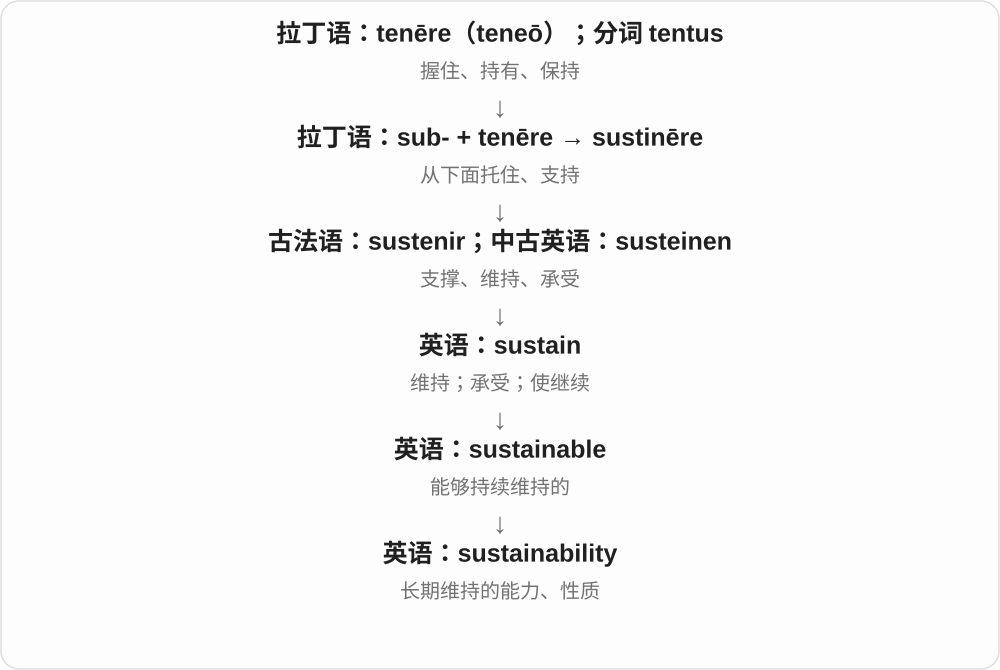
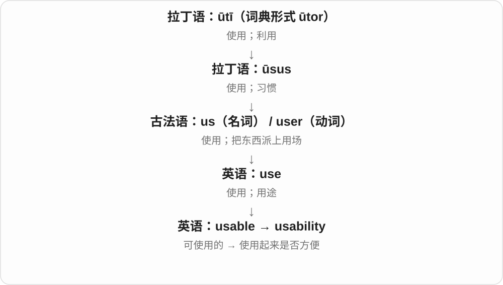
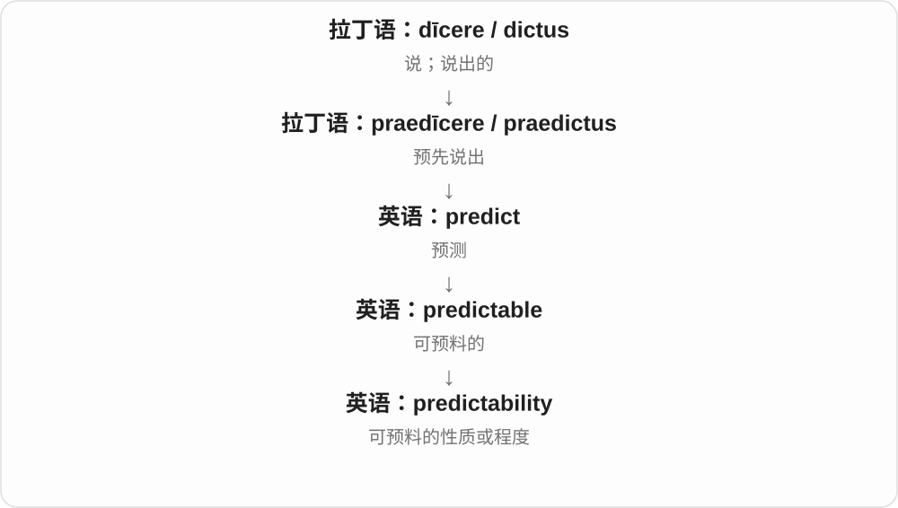
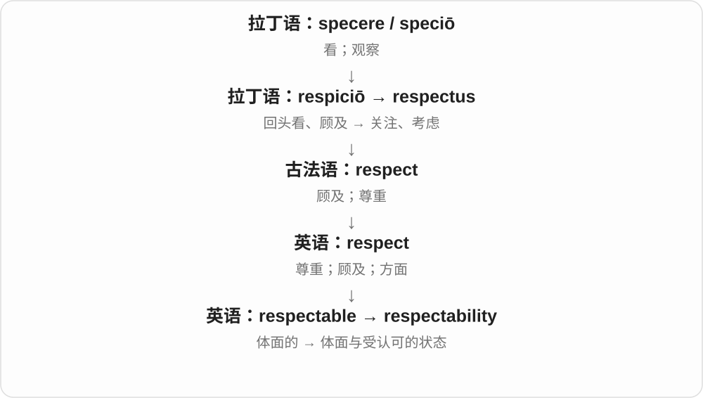
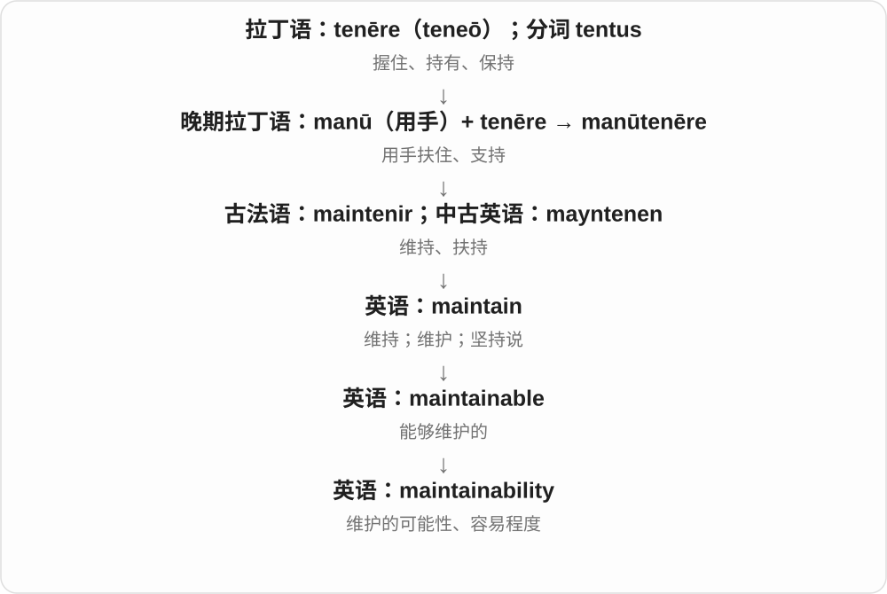

# 2523 · -ability — 把能否、适合与可接受的性质名词化

[逐词精讲目录](../00_逐词精讲目录.md) · [总目录](../00_总目录_按常用程度.md)

## 核心词根与来源

同一个词尾只帮你认出名词这一层，真正的理解还在前半：reusability 问能否再用，serviceability 问能否使用或检修，favorability 说好感或有利程度。

**-ABILITY：把能不能、好不好用变成可讨论的性质**

从 -able 到 -ability：可读、可再用、可维护、可承受等各有具体对象。

- **使用、适配与长期运作**：usability · reusability · serviceability · suitability · adaptability · workability · sustainability · maintainability · scalability
- **预测、识别与追踪**：predictability · readability · traceability · repeatability · believability · deniability
- **接受、评价与可负担**：favorability · tolerability · affordability · desirability · respectability · notability
- **其他具体能力**：manoeuvrability · survivability · dependability · marketability · playability · excitability · enforceability · livability

## 词形与演化规律

-able 相应变 -ability，通常可理解为性质形容词 + -ity；并非每个词都能机械译成被……的能力。

## 单词速览（按词族由简到繁）

同一基础词的相关扩展放在一起，先读基础形式，再读扩展；各组之间优先读常用的。具体词源关系见各词讲解。

| 单词 | 音标 | 核心意思 |
|---|---|---|
| [sustainability](#w-1) | /səˌsteɪnəˈbɪləti/ | 可持续性；长期维持能力 |
| [suitability](#w-2) | /ˌsuːtəˈbɪləti/；英式也 /ˌsjuːtəˈbɪləti/ | 适合程度；适用性 |
| [affordability](#w-3) | 英 /əˌfɔːdəˈbɪləti/；美 /əˌfɔːrdəˈbɪləti/ | 可负担性、支付得起的程度 |
| [usability](#w-4) | /ˌjuːzəˈbɪləti/ | 易用性；可用性 |
| [reusability](#w-25) | /ˌriːjuːzəˈbɪləti/ | 可重复使用性、可复用程度 |
| [adaptability](#w-5) | 英、美 /əˌdæptəˈbɪləti/ | 适应能力；可调整性 |
| [predictability](#w-6) | /prɪˌdɪktəˈbɪləti/ | 可预测性；稳定可预期的程度 |
| [respectability](#w-7) | /rɪˌspektəˈbɪləti/ | 体面；受人尊重的名声 |
| [readability](#w-8) | /ˌriːdəˈbɪləti/ | 可读性；易读程度 |
| [scalability](#w-9) | /ˌskeɪləˈbɪləti/ | 可扩展性 |
| [desirability](#w-10) | 英 /dɪˌzaɪərəˈbɪləti/；美 /dɪˌzaɪrəˈbɪləti/ | 可取性、吸引力、受欢迎程度 |
| [survivability](#w-11) | 英 /səˌvaɪvəˈbɪləti/；美 /sərˌvaɪvəˈbɪləti/ | 生存能力；抗毁生存能力；存续能力 |
| [dependability](#w-12) | 英、美 /dɪˌpendəˈbɪləti/ | 可靠性；可依赖的程度 |
| [deniability](#w-13) | /dɪˌnaɪəˈbɪləti/ | 可否认性；能够否认知情或参与的余地 |
| [marketability](#w-14) | 英 /ˌmɑːkɪtəˈbɪləti/；美 /ˌmɑːrkɪtəˈbɪləti/ | 适销性；市场吸引力；就业市场竞争力 |
| [traceability](#w-15) | /ˌtreɪsəˈbɪləti/ | 可追溯性；可追查来源、过程的能力 |
| [favorability](#w-16) | 英 /ˌfeɪvərəˈbɪləti/；美 /ˌfeɪvərəˈbɪləti/ | 好感度、受认可程度；有利程度 |
| [playability](#w-17) | /ˌpleɪəˈbɪləti/ | 可玩性；可演奏性 |
| [repeatability](#w-18) | /rɪˌpiːtəˈbɪləti/ | 可重复性；重复测量的一致程度 |
| [excitability](#w-19) | /ɪkˌsaɪtəˈbɪləti/ | 易激动性；兴奋性 |
| [enforceability](#w-20) | 英 /ɪnˌfɔːsəˈbɪləti/；美 /ɪnˌfɔːrsəˈbɪləti/ | 可执行性、执行约束力 |
| [believability](#w-21) | /bɪˌliːvəˈbɪləti/ | 可信程度；令人信服的程度 |
| [maintainability](#w-22) | /meɪnˌteɪnəˈbɪləti/ | 可维护性；维护难易程度 |
| [manoeuvrability](#w-23) | 英 /məˌnuːvərəˈbɪləti/；美常拼 maneuverability /məˌnuːvərəˈbɪləti/ | 机动性、易操纵程度 |
| [serviceability](#w-24) | 英 /ˌsɜːvɪsəˈbɪləti/；美 /ˌsɜːrvɪsəˈbɪləti/ | 可用性、适用性；可检修性 |
| [tolerability](#w-26) | 英 /ˌtɒlərəˈbɪləti/；美 /ˌtɑːlərəˈbɪləti/ | 可忍受、可耐受程度 |
| [livability](#w-27) | /ˌlɪvəˈbɪləti/ | 宜居性；适居程度 |
| [notability](#w-28) | 英 /ˌnəʊtəˈbɪləti/；美 /ˌnoʊtəˈbɪləti/ | 显著性；知名度；值得记述的程度；知名人物 |
| [workability](#w-29) | 英 /ˌwɜːkəˈbɪləti/；美 /ˌwɜːrkəˈbɪləti/ | 可行性；可加工性；和易性 |

## 逐词讲解

### 1. sustainability — 可持续性；长期维持能力

**音标**：/səˌsteɪnəˈbɪləti/

**先抓住这个画面**

sustainability 是追问“这样一直做下去，还撑不撑得住”，要把资源、成本和长期影响一起考虑。

**怎么拆**

sustain + -ability，或从 sustainable 的名词形式理解。

**怎么变成今天的意思**

可以讨论生态，也可以讨论项目经费、工作安排。单词不是给任何新产品自动盖环保认证章。

**常见搭配与例句**

environmental sustainability；financial sustainability；long-term sustainability。

> The review questioned the financial sustainability of the programme.

评审对项目的财务可持续性提出了疑问。

> Sustainability was considered from the beginning of the design process.

设计过程从一开始就考虑了可持续性。

**别混淆**

efficiency 看投入与产出如何；sustainability 看这种做法能否持续。短期高效的做法未必长期撑得住。

### 2. suitability — 适合程度；适用性

**音标**：/ˌsuːtəˈbɪləti/；英式也 /ˌsjuːtəˈbɪləti/

**先抓住这个画面**

从好不好看的评价，转成问它到底适不适合这个用途、这个人。

**怎么拆**

suitable + -ity，-able 对应 -ability，重音移到 -bil-。把适合这个性质变成可讨论、可评估的名词。

**怎么变成今天的意思**

**拉丁 sequī、secūtus → 通俗拉丁 \*sequita**  
跟随；跟随、追随相关形式

↓

**古法语 suite、siute → 英语 suit**  
随从、追随、成套 → 套服、花色、诉讼；相配、适合

↓

**suitable + -ity → suitability**  
合适这个性质、程度

assess suitability 评估适用性，suitability for the job 对工作的适合程度，question the suitability 质疑是否合适。

**常见搭配与例句**

assess suitability；suitability for；question the suitability。

> The interview assesses each candidate’s suitability for the role.

面试评估每位候选人对岗位的适合程度。

> We tested the material’s suitability for outdoor use.

我们测试了材料是否适合户外使用。

**别混淆**

suitability 适合特定要求，quality 一般质量；质量高的材料也可能不适合当前用途。

### 3. affordability — 可负担性、支付得起的程度

**音标**：英 /əˌfɔːdəˈbɪləti/；美 /əˌfɔːrdəˈbɪləti/

**先抓住这个画面**

把买得起这件事拿出来比较：价格与收入、开销放一起，到底有多少人能承受。

**怎么拆**

afford + -ability，也可对应 affordable 的 -able → -ability。词尾变化形成性质名词，不是 affordable 原样直接加 ity。

**怎么变成今天的意思**

**古英语 ġeforþian → 中古英语 aforth 等 → afford**  
促进、完成、提供等旧义

↓

**现代 afford 的两条常见分支**  
资源足够承担；事物能够提供某种机会、景观等

↓

**affordable 对应 -ability → affordability**  
价格相对资源可承受的程度

housing affordability 住房可负担性，improve affordability 提升可负担性，concerns about affordability 对负担能力的担忧。

**常见搭配与例句**

housing affordability；improve affordability；concerns about affordability。

> The report examines housing affordability in the city.

报告考察了这座城市的住房可负担性。

> Affordability was an important factor in their decision.

能否负担是他们作决定时的重要因素。

**别混淆**

affordability 付得起，availability 能否获得、是否有货；有货但贵，两个指标可能一高一低。

### 4. usability — 易用性；可用性

**音标**：/ˌjuːzəˈbɪləti/

**先抓住这个画面**

usability 看的是“人用起来顺不顺”：按钮找不找得到，步骤好不好懂，犯错后能不能补救。

**怎么拆**

usable + -ity；-able 在这类性质名词中对应 -ability。不是“使用的超能力”。

**怎么变成今天的意思**

一般意义上是可使用的程度；在产品设计里，重点常落到用户完成任务是否有效、顺手。东西有很多功能，usability 仍然可能很差。

**常见搭配与例句**

usability testing；improve usability；a usability problem；website usability。

> The team tested the usability of the booking form.

团队测试了预约表单是否容易使用。

> Clearer labels greatly improved the app’s usability.

更清楚的标签大大改善了这个应用的易用性。

**别混淆**

usability 问好不好用；utility 问能不能满足某种需要。没有你需要的功能，再容易操作也解决不了你的问题。

### 5. reusability — 可重复使用性、可复用程度

**音标**：/ˌriːjuːzəˈbɪləti/

**先抓住这个画面**

一次用完以后，还能不能在下一次、别的地方继续用？这种能力就是 reusability，杯子、软件模块、材料都可讨论。

**怎么拆**

reuse 再使用 + -ability，对应 reusable + -ity。reuse 动词的 /z/ 保留，和单独名词 use 的 /s/ 不同。

**怎么变成今天的意思**

**动词、名词词干 + -able**  
能够、适合、可接受等性质，不只一种被动意思

↓

**-able → -ability**  
把这种性质变成可讨论、比较的状态或能力

↓

**reuse → reusable → reusability**  
可再用 → 这种能力、程度

code reusability 代码复用性，improve reusability 提高可复用性，the reusability of materials 材料重复利用的能力。

**常见搭配与例句**

code reusability；improve reusability。

> The design improves the reusability of the containers.

这个设计提高了容器的重复使用能力。

> Clear interfaces can improve code reusability.

清晰的接口有助于提高代码复用性。

**别混淆**

reusability 是能再用，recyclability 是能回收加工再利用；原物直接再用与材料重新加工不是同一步。

### 6. adaptability — 适应能力；可调整性

**音标**：英、美 /əˌdæptəˈbɪləti/

**先抓住这个画面**

生活换了一套题，你还能换种方法把题做下去。

**怎么拆**

adaptable + -ity，词尾 -able 变成 -ability，重音移到 /bɪl/。

**怎么变成今天的意思**

**拉丁语：ad**  
朝向；靠近；加到

↓

**拉丁语：aptāre → adaptāre**  
使合适 → 调整到合适

↓

**中古英语 adapten → 英语 adapt**  
适应；改编

↓

**英语 adaptable → adaptability**  
能够适应 → 适应能力

评价人、组织或设计面对变化的能力，尤其在条件不固定时。不是说什么都接受、没有原则。

**常见搭配与例句**

show adaptability；adaptability to；flexibility and adaptability。

> The job requires patience and adaptability.

这份工作需要耐心和适应能力。

> The design’s adaptability allowed us to reuse it in three buildings.

这一设计便于调整，因此我们把它用在了三栋建筑中。

**别混淆**

adaptation 是具体的适应过程或结果；adaptability 是做到这件事的能力。

### 7. predictability — 可预测性；稳定可预期的程度

**音标**：/prɪˌdɪktəˈbɪləti/

**先抓住这个画面**

你有多大把握提前知道它下一步会怎样？predictability 就是在讨论这种把握和规律性。

**怎么拆**

predict + -ability，与 predictable“可预测的”对应的名词。

**怎么变成今天的意思**

用于收入、制度或系统时，稳定可预期常是优点；用于故事时，又可能批评套路明显。它描述性质，不是某一次预测内容。

**常见搭配与例句**

greater predictability；the predictability of…；improve predictability。

> A regular schedule gives children a sense of predictability.

规律的作息让孩子对接下来会发生什么心里有数。

> Critics complained about the predictability of the plot.

评论者批评情节太容易猜到。

**别混淆**

prediction 是一条预测；predictability 是事情有多容易被预测。

### 8. respectability — 体面；受人尊重的名声

**音标**：/rɪˌspektəˈbɪləti/

**先抓住这个画面**

respectability 像一个人在社区里积累的“看起来正派、可靠”的社会形象。

**怎么拆**

respectable + -ity，词尾 -able 对应 -ability，构成性质名词。

**怎么变成今天的意思**

常讨论社会评价和外在名声；小说里也常揭示表面体面与实际行为之间的距离。

**常见搭配与例句**

an air of respectability；social respectability；a veneer of respectability。

> The office gave the small business an air of respectability.

这间办公室让小企业显得更体面可信。

> The novel questions the town’s idea of respectability.

小说质疑了小镇对“体面”的理解。

**别混淆**

respectability 是受认可的形象或状态，不等于一个人实际上必然诚实。

### 9. readability — 可读性；易读程度

**音标**：/ˌriːdəˈbɪləti/

**先抓住这个画面**

同样的信息，换了字号、句子和安排，读者需要花的力气就不同。

**怎么拆**

readable + -ity，词尾 -able 对应 -ability；也可整体看 read + -ability。它是易读这一性质的名词，不是另一个阅读动作。

**怎么变成今天的意思**

**古英语 rǣdan → 中古英语 reden**  
劝告、解释；读懂文字

↓

**英语 read**  
阅读；解读；读出信息

↓

**read + -able → readable**  
可读、易读的

↓

**readable + -ity → readability**  
可读、易读的程度

improve readability 可指改善字体排版，也可指简化句子和组织。可读性指标只是部分线索，不保证内容正确或解释到位。

**常见搭配与例句**

improve readability；text readability；a readability score。

> Shorter paragraphs improved the readability of the report.

更短的段落提升了报告的可读性。

> The designer tested the page’s readability on a small screen.

设计师测试了页面在小屏幕上的易读程度。

**别混淆**

readability 关注阅读的容易程度，accuracy 关注信息准确；改得简洁不该把准确细节删错。

### 10. scalability — 可扩展性

**音标**：/ˌskeɪləˈbɪləti/

**先抓住这个画面**

从服务十个人到服务十万人，系统还能否有效运转，这类能力就是可扩展性。

**怎么拆**

scalable + -ity，-able 变为 -ability；由可扩展的性质形成抽象名词。

**怎么变成今天的意思**

**拉丁语 scala，常用复数 scalae**  
梯子、台阶；与 scandere“攀登”相连

↓

**中古英语 scale / scalen → 英语 scale**  
梯子、刻度；攀登 → 等级、音阶、比例、规模

↓

**英语 scalable → scalability**  
可扩展的 → 调整规模、承受增长的能力

software scalability 常涉及负载增大时性能、成本和资源如何变化；business scalability 关注商业模式能否扩大。仅仅能运行更大的任务，还不足以说明扩展效率好。

**常见搭配与例句**

improve scalability；test scalability；scalability requirements。

> The load test revealed a problem with scalability.

负载测试暴露了可扩展性方面的问题。

> They chose the design for its simplicity and scalability.

他们因设计简洁、便于扩展而选择了这个方案。

**别混淆**

capacity 是当前容量；scalability 是容量能怎样增长，以及增长后是否仍有效。

### 11. desirability — 可取性、吸引力、受欢迎程度

**音标**：英 /dɪˌzaɪərəˈbɪləti/；美 /dɪˌzaɪrəˈbɪləti/

**先抓住这个画面**

把值不值得想要、能吸引多少意愿当一个性质来谈；房子的地点、工作条件都可能影响它。

**怎么拆**

desirable + -ity，词尾 -able 在相应名词里变为 -ability；不是保留整个 -able 后再机械接 ity。

**怎么变成今天的意思**

**拉丁 dēsīderāre → 古法语 desirer 等 → desire**  
渴望、想得到、感到缺少

↓

**desirable → desirability〔-able 对应 -ability〕**  
合意、值得拥有的性质或程度

the desirability of a location 地点的吸引力，increase desirability 提高吸引力，question the desirability 质疑是否可取。

**常见搭配与例句**

the desirability of；increase desirability；question the desirability。

> Good transport links increased the area’s desirability.

良好交通提高了这一地区的吸引力。

> The report questioned the desirability of the change.

报告质疑这项改变是否可取。

**别混淆**

desirability 想要、可取的程度，availability 能否获得；很想要也可能没货，随处可得也未必吸引人。

### 12. survivability — 生存能力；抗毁生存能力；存续能力

**音标**：英 /səˌvaɪvəˈbɪləti/；美 /sərˌvaɪvəˈbɪləti/

**先抓住这个画面**

面对冲击或危险时，究竟有多大本事保住生命、结构或运行功能。

**怎么拆**

英语 survive + -ability，或按 survivable 对应 -ability 名词分析；survive 的远源仍是“越过之后继续活着”。

**怎么变成今天的意思**

**拉丁 super**  
在上方、超过、越过

↓

**后期拉丁 super- + vivere → supervivere**  
超过某时点而活着；比别人活得久

↓

**古法语／盎格鲁法语 survivre → 英语 survive**  
继续活着、幸存；继续存在

↓

**英语 survive / survivable → survivability**  
可存活、可延续的能力

工程语境可说 aircraft survivability，关心受损后能否继续飞行或保护乘员；不等于只比材料有多硬。

**常见搭配与例句**

improve survivability；system survivability；survivability under stress。

> The redesign improved the vehicle’s survivability after an impact.

重新设计提高了车辆遭受撞击后的生存能力。

> The study compares the survivability of seedlings during drought.

研究比较了幼苗在干旱中的存活能力。

**别混淆**

survival 是实际生存或存续；survivability 是在条件下生存的能力。

### 13. dependability — 可靠性；可依赖的程度

**音标**：英、美 /dɪˌpendəˈbɪləti/

**先抓住这个画面**

评价一个人或工具时，问的是“关键时刻能不能靠得住”，把这个特点当成一种品质。

**怎么拆**

英语 dependable 配成 -ability 名词；可理解为 dependable 的可靠性质。重音移到 /ˈbɪl/，不要照 dependable 的原重音一读到底。

**怎么变成今天的意思**

**拉丁 pendēre；相关动词 pendere**  
悬垂；使悬挂、称量

↓

**拉丁 de- + pendere → dependere**  
从某物垂下 → 依靠、取决于

↓

**古法语 dependre／拉丁借入 → 英语 depend**  
依靠；由另一条件决定

↓

**英语 dependable → dependability**  
可靠的 → 可靠性

设备的 dependability 可以体现在很少出故障，人的 dependability 可以体现在守时、兑现承诺。具体衡量方式由场景决定，不是一个固定的单一数值。

**常见搭配与例句**

a reputation for dependability；value dependability；test dependability。

> Her dependability mattered more to the team than her job title.

对团队来说，她的可靠比她的职位头衔更重要。

> The company built its reputation on the dependability of its equipment.

这家公司凭设备的可靠性建立了声誉。

**别混淆**

dependence 是需要依靠的状态；dependability 是值得别人依靠的性质，方向不同。

### 14. deniability — 可否认性；能够否认知情或参与的余地

**音标**：/dɪˌnaɪəˈbɪləti/

**先抓住这个画面**

出了事，还能说“我不知道、我没参与”，而且一时难证明你说假话；这块回旋空间就是 deniability。

**怎么拆**

deny → deniable → deniability；y 后接元音开头的派生材料改写 i，-able 对应 -ability 形成性质名词。不是说否认越大声就越有 deniability。

**怎么变成今天的意思**

**拉丁 dēnegāre → 法语 denier → deny**  
否定、拒绝承认

↓

**deny → deniable → deniability**  
能否认的 → 可否认性、否认余地

plausible deniability 是还能提出看似可信的“不知情、未参与”说法；maintain deniability 保留否认余地。常见于政治、组织责任、小说情节。

**常见搭配与例句**

plausible deniability；maintain deniability；a degree of deniability。

> The character avoids written orders to preserve deniability.

这个人物避免下书面命令，以保留否认的余地。

> The emails left the director with little deniability.

这些邮件让主管几乎没有否认的余地。

**别混淆**

denial 是否认这个行为或说法，deniability 是能否认的余地；plausible deniability 不证明一个人确实无辜。

### 15. marketability — 适销性；市场吸引力；就业市场竞争力

**音标**：英 /ˌmɑːkɪtəˈbɪləti/；美 /ˌmɑːrkɪtəˈbɪləti/

**先抓住这个画面**

不是问“它是什么”，而是问“拿出去，有多少人愿意要”。

**怎么拆**

marketable + -ity，-able 对应变为 -ability；英语名词构词。

**怎么变成今天的意思**

**拉丁语 merx，属格 mercis**  
货物、商品

↓

**拉丁语 mercari**  
做买卖、交易

↓

**拉丁语 mercatus → 北部古法语 market / 古法语 marchiet**  
交易；市场

↓

**中古英语 market〔也承接晚期古英语形式〕**  
集市；买卖的范围

↓

**英语 marketable → marketability**  
有销路的 → 具有销路的程度或性质

产品、方案、作品和个人技能都可以谈 marketability。好卖与质量优秀可能有关，但不是同一个判断。

**常见搭配与例句**

improve marketability；the marketability of a product。

> The new packaging improved the product’s marketability.

新包装提高了产品的市场吸引力。

> Learning another language may improve her marketability to employers.

学会另一门语言可能提高她在雇主眼中的竞争力。

**别混淆**

profitability 是能否盈利；marketability 主要是能否吸引购买或获得市场接受。

### 16. traceability — 可追溯性；可追查来源、过程的能力

**音标**：/ˌtreɪsəˈbɪləti/

**先抓住这个画面**

不是只在箱子上印个编号，而是编号和记录能连起来，让人查清原料、批次、处理、去向等相关环节。这种能力叫 traceability。

**怎么拆**

traceable + -ity，对应 trace + -ability；-able 的形容词结构变成 -ability 名词，重音移到 /bɪl/。

**怎么变成今天的意思**

**古法语 trace／tracer → 中古英语 trace／tracen**  
痕迹、轮廓；描画、跟随、追查

↓

**英语 trace 的不同常用方向**  
沿痕追溯；按轮廓描画；留下的细微痕迹、微量

↓

**traceable → traceability**  
能够沿记录追溯的性质、能力

product traceability 产品可追溯性，improve traceability 改善可追溯性，a traceability system 追溯系统。不同领域要求的链条、记录粒度不相同。

**常见搭配与例句**

product traceability；improve traceability；a traceability system。

> The new labels improved product traceability.

新标签改善了产品可追溯性。

> Traceability depends on reliable records at each stage.

可追溯性依赖各环节可靠的记录。

**别混淆**

tracking 常看物品现在去了哪里，traceability 更强调能够串回来源、过程的能力；具体行业用法可能重叠。

### 17. favorability — 好感度、受认可程度；有利程度

**音标**：英 /ˌfeɪvərəˈbɪləti/；美 /ˌfeɪvərəˈbɪləti/

**先抓住这个画面**

问大家对某人有没有好感，或条件对一件事有多有利，可以用 favorability。它把 favorable 的正面、有利变成可讨论的程度。

**怎么拆**

favorable + -ity，-able 对应变为 -ability；也可按 favor + -ability 看表层结构。英式对应常拼 favourability，此处保留美式词头。

**怎么变成今天的意思**

**动词、名词词干 + -able**  
能够、适合、可接受等性质，不只一种被动意思

↓

**-able → -ability**  
把这种性质变成可讨论、比较的状态或能力

↓

**favorable → favorability**  
正面、有利的性质与程度

a favorability rating 好感度评分，public favorability 公众好感，the favorability of conditions 条件有利程度。

**常见搭配与例句**

a favorability rating；the favorability of。

> The survey measured public favorability towards the proposal.

调查衡量公众对提案的好感程度。

> The report considered the favorability of local conditions.

报告考察当地条件的有利程度。

**别混淆**

好感不等于实际投票、购买或赞成每项政策；rating 测什么要看题目，而不是只看词尾。

### 18. playability — 可玩性；可演奏性

**音标**：/ˌpleɪəˈbɪləti/

**先抓住这个画面**

不仅问它有没有启动，还问玩法能否顺手、条件是否适合持续玩下去。

**怎么拆**

playable 对应性质名词，-able → -ability；也可分析 play + -ability。具体评价维度由游戏、乐器或场地语境给出。

**怎么变成今天的意思**

**古英语 plegian／plegan；plega**  
游戏、活动；游戏这一名词

↓

**中古英语 pleyen／pleye → 英语 play**  
玩、比赛、表演、演奏；剧作等

↓

**playable → playability**  
能玩、能演奏等方面的性质、程度

游戏评论里可涉及操作、规则等如何让游戏可玩；乐器 playability 可说易于演奏的手感。不是一个所有领域统一计分的指标。

**常见搭配与例句**

improve playability；the game’s playability；the playability of a guitar。

> The update improved the game’s playability on smaller screens.

更新改善了游戏在小屏幕上的可玩性。

> The guitarist praised the instrument’s playability.

吉他手称赞了这件乐器的演奏手感。

**别混淆**

playability 不等于 popularity：可玩或好上手与流行程度相关，却不是同一事实。

### 19. repeatability — 可重复性；重复测量的一致程度

**音标**：/rɪˌpiːtəˈbɪləti/

**先抓住这个画面**

同一套条件下反复做，结果能不能聚在一起？重点是多次之间的一致程度，不是要求每个数字绝对一模一样。

**怎么拆**

英语 repeatable 对应的 -ity 名词，也可按 repeat + -ability 理解。

**怎么变成今天的意思**

**拉丁 petere**  
朝向、寻求、争取；也可指扑向、攻击或请求

↓

**拉丁 re- 再 + petere → repetere**  
再次寻求、再次去做 → 重说、重做

↓

**古法语 repeter／直接拉丁借入 → 中古英语 repeten → repeat**  
重复说或做；后来名词可指重播或重复部分

↓

**英语 repeat + -able → repeatable**  
可重复的

↓

**英语 repeatable → repeatability**  
可重复性质；规定重复条件下的测量精密度

计量学中，它关注规定重复条件下的精密度，例如相同方法、设备和较短时间内的多次测量。若设备总偏高却次次很接近，repeatability 仍可能很好，所以不能与 accuracy 画等号。

**常见搭配与例句**

measurement repeatability；test repeatability；good repeatability。

> The instrument showed good repeatability over ten measurements.

这台仪器在十次测量中表现出良好的重复性。

> The study assessed repeatability separately from accuracy.

研究分别评估了重复性和准确度。

**别混淆**

repeatability 关注重复条件下的结果一致；reproducibility 常涉及改变操作者、地点等条件后的结果一致，具体定义依领域规范。

### 20. excitability — 易激动性；兴奋性

**音标**：/ɪkˌsaɪtəˈbɪləti/

**先抓住这个画面**

把“有多容易被调动起来”当作一种可以比较的性质。

**怎么拆**

excitable 的 -able 改为性质名词后缀 -ability。

**怎么变成今天的意思**

**拉丁 ciēre → citāre**  
使动起来、唤起 → 召唤、促动

↓

**拉丁 ex- + ciēre → excitāre → 法语 exciter**  
向外唤起、激发

↓

**英语 excite**  
使兴奋；激发

↓

**英语 excitable → excitability**  
容易受激发 → 易激动或兴奋的性质

日常可说 nervous excitability，形容容易紧张激动；生理研究可测 neuronal excitability，考察神经元对刺激的反应能力。两者不能直接混成同一种测量。

**常见搭配与例句**

neuronal excitability；increased excitability。

> The study measured changes in neuronal excitability.

研究测量了神经元兴奋性的变化。

> Her usual excitability disappeared once the work began.

工作一开始，她平时容易激动的劲头便消失了。

**别混淆**

excitement 是已经兴奋；excitability 是容易兴奋的程度或能力。

### 21. enforceability — 可执行性、执行约束力

**音标**：英 /ɪnˌfɔːsəˈbɪləti/；美 /ɪnˌfɔːrsəˈbɪləti/

**先抓住这个画面**

把“这条规定到底能不能管用、要求遵守”当成一个性质来讨论；不等于执行人员有多强壮。

**怎么拆**

enforceable 的相应 -ability 名词，对应 enforce + -ability。-able 的可行性质变成 ability 形式的抽象名词。

**怎么变成今天的意思**

**法语 enforcier 等 → 英语 enforce**  
强化、用力等旧义 → 使规定真正执行

↓

**enforceable → enforceability**  
能够执行这一性质

the enforceability of a rule 规则的可执行性，question enforceability 质疑执行约束力，practical enforceability 实际可执行性。

**常见搭配与例句**

the enforceability of；question enforceability；practical enforceability。

> The report questions the rule’s practical enforceability.

报告质疑这条规则在实际中的可执行性。

> The chapter discusses the enforceability of written promises.

这一章讨论书面承诺的执行约束力。

**别混淆**

enforceability 是否具有可执行性质，enforcement 是实施执行过程；规则能执行与目前有没有被执行，是两个问题。

### 22. believability — 可信程度；令人信服的程度

**音标**：/bɪˌliːvəˈbɪləti/

**先抓住这个画面**

不是只问一句“信不信”，而是看情节、人物、解释有多能站得住。

**怎么拆**

believable 对应 -ability 名词，也可整体看 believe + -ability；形容词 -able 到性质名词 -ability，重音随之变化。

**怎么变成今天的意思**

**古英语 belīefan 等 → 中古英语 beleven / bileven**  
相信、信任；与准许、信赖旧词族相关

↓

**英语 believe**  
相信某说法；信赖某人或理念

↓

**believe + -able → believable**  
令人相信的

↓

**believable 对应 believability**  
令人信服的程度

the believability of a story 是故事可信程度，add believability 是增强真实感。创作评论中常用，不是严格数值化真伪检验。

**常见搭配与例句**

the believability of；add believability；question believability。

> Small details added believability to the story.

小细节增强了故事的可信感。

> The review praised the believability of the characters.

评论称赞人物塑造可信。

**别混淆**

believability 关注是否让人信服，reliability 常关注是否持续可靠；一段演出可以可信，但不能拿它当事实材料的可靠性证明。

### 23. maintainability — 可维护性；维护难易程度

**音标**：/meɪnˌteɪnəˈbɪləti/

**先抓住这个画面**

maintainability 是问“以后修、改、检查它费不费劲”，不是只看今天能不能运行。

**怎么拆**

maintain + -ability；也可联系 maintainable 对应的名词形式。

**怎么变成今天的意思**

常用于设备、软件和工程设计。零件可更换、结构清晰、文档好，通常都能帮助维护。

**常见搭配与例句**

improve maintainability；design for maintainability；software maintainability。

> The redesign improved the maintainability of the engine.

重新设计提高了发动机的可维护性。

> The review considered readability and maintainability, not just speed.

评审考虑了可读性和可维护性，而不只看速度。

**别混淆**

availability 看此刻或一段时间是否可用；maintainability 看需要维护时容易不容易。

### 24. manoeuvrability — 机动性、易操纵程度

**音标**：英 /məˌnuːvərəˈbɪləti/；美常拼 maneuverability /məˌnuːvərəˈbɪləti/

**先抓住这个画面**

车能不能在窄路转弯，船能不能灵活变向，讲的是 manoeuvrability。不是只问开得多快，而是能否方便、灵活地调整运动。

**怎么拆**

manoeuvre 操纵、机动 + -ability；对应 manoeuvrable + -ity。英式 manoeuvre 与美式 maneuver 拼法不同，形成的能力名词同理。

**怎么变成今天的意思**

**动词、名词词干 + -able**  
能够、适合、可接受等性质，不只一种被动意思

↓

**-able → -ability**  
把这种性质变成可讨论、比较的状态或能力

↓

**manoeuvre → manoeuvrable → manoeuvrability**  
能机动、好操纵 → 这种能力程度

improve manoeuvrability 提高机动性，excellent manoeuvrability 出色操纵性，manoeuvrability in tight spaces 狭小空间中的机动性。

**常见搭配与例句**

improve manoeuvrability；excellent manoeuvrability。

> The small boat offers good manoeuvrability in narrow channels.

这艘小船在狭窄水道里机动性很好。

> The new wheels improved the cart’s manoeuvrability.

新轮子让手推车更容易操纵转向。

**别混淆**

manoeuvrability 不等于速度、动力或可靠性；各指标可以互相影响，但不是同一个意思。

### 25. serviceability — 可用性、适用性；可检修性

**音标**：英 /ˌsɜːvɪsəˈbɪləti/；美 /ˌsɜːrvɪsəˈbɪləti/

**先抓住这个画面**

设备还能不能好好服役，是 serviceability 的可用义；坏了后能不能方便地检修，也会用这个词讨论。两者都围着 service 的服务、使用或保养。

**怎么拆**

serviceable + -ity，对应 service + -ability；由可供使用、可服务或检修的性质形成名词。

**怎么变成今天的意思**

**动词、名词词干 + -able**  
能够、适合、可接受等性质，不只一种被动意思

↓

**-able → -ability**  
把这种性质变成可讨论、比较的状态或能力

↓

**service → serviceable → serviceability**  
能用、能检修 → 相应性质

check serviceability 检查能否使用，improve serviceability 改善可用或检修性质，easy access improves serviceability 便于接近部件可改善检修。

**常见搭配与例句**

equipment serviceability；improve serviceability。

> The technician checked the serviceability of the equipment.

技术人员检查设备能否正常使用。

> Removable panels improve the machine’s serviceability.

可拆面板提高了机器的检修便利性。

**别混淆**

可用和易检修不是同一指标，读报告先看它的定义；serviceability 也不等于单次服务的礼貌程度。

### 26. tolerability — 可忍受、可耐受程度

**音标**：英 /ˌtɒlərəˈbɪləti/；美 /ˌtɑːlərəˈbɪləti/

**先抓住这个画面**

可能不舒服，但在多大程度上还能承受，这是 tolerability。它问能否忍受，而不直接评价效果多好、你多喜欢。

**怎么拆**

tolerate 容忍、承受 + -ability，去词尾 e；也可从 tolerable 可忍受的对应变成 -ability 名词。

**怎么变成今天的意思**

**动词、名词词干 + -able**  
能够、适合、可接受等性质，不只一种被动意思

↓

**-able → -ability**  
把这种性质变成可讨论、比较的状态或能力

↓

**tolerate → tolerable → tolerability**  
可承受 → 可承受的程度

the tolerability of a treatment 治疗的耐受性，assess tolerability 评估可耐受程度，poor tolerability 难以耐受。专业报告里通常与效果等指标分开。

**常见搭配与例句**

assess tolerability；poor tolerability。

> The study assessed both effectiveness and tolerability.

研究同时评估效果与耐受性。

> The questionnaire asked about the tolerability of the noise.

问卷询问人们对噪声的可忍受程度。

**别混淆**

tolerability 不等于 effectiveness 效果，也不等于没有任何不适；这是词义上的指标区别。

### 27. livability — 宜居性；适居程度

**音标**：/ˌlɪvəˈbɪləti/

**先抓住这个画面**

把交通、空间、生活方便与否等放在一起问：这里住起来怎么样？

**怎么拆**

livable 对应的名词，-able 变为 -ability；也可看 live + -ability。另有 liveability 拼写。

**怎么变成今天的意思**

**古英语 libban / lifian → 中古英语 live 等形式**  
活着、生活

↓

**英语动词 live /lɪv/**  
活；居住；过某种生活

↓

**live + -able → livable**  
适合生活的

↓

**livable 对应 livability**  
适居、宜居的程度

常见于城市、社区设计讨论。a livability ranking 是宜居性排名，各指标如何算要看方法，名字不保证普遍客观。

**常见搭配与例句**

urban livability；improve livability；a livability ranking。

> More green space could improve the neighbourhood’s livability.

增加绿地可能提升社区的宜居性。

> The survey asked residents to rate the area’s livability.

调查请居民评价这个地区的宜居程度。

**别混淆**

livability 是住起来的适合程度，livelihood 是谋生来源；前者好不好住，后者靠什么生活。

### 28. notability — 显著性；知名度；值得记述的程度；知名人物

**音标**：英 /ˌnəʊtəˈbɪləti/；美 /ˌnoʊtəˈbɪləti/

**先抓住这个画面**

把“为什么值得专门写他、写它”当成一个可讨论的问题。

**怎么拆**

现代可拆 notable + -ity。历史上经古法语 notabilite 或中世纪拉丁名词支线借入，不宜只说英语形容词后面临时加后缀。

**怎么变成今天的意思**

**拉丁 nota → notare**  
标记、符号；做记号、记下

↓

**拉丁 notabilis；古法语 notabilite／中世纪拉丁名词支线**  
值得注意；显著之处

↓

**中古英语 notabilite → notability**  
显著性、知名度；也可指知名人物

写人物传记、百科条目时，notability 常说对象是否具有足以被记录的重要性或知名度。日常更常用 fame、importance；notability 带评价标准的口气。

**常见搭配与例句**

historical notability；establish someone’s notability；a local notability。

> The archive helps establish the inventor’s historical notability.

这些档案有助于确立这位发明家在历史上的重要性。

> The article explains the building’s architectural notability.

文章说明了这座建筑在建筑史上值得关注的原因。

**别混淆**

popularity 是受欢迎程度；notability 是值得注意或记述，并不保证受欢迎。

### 29. workability — 可行性；可加工性；和易性

**音标**：英 /ˌwɜːkəˈbɪləti/；美 /ˌwɜːrkəˈbɪləti/

**先抓住这个画面**

不是只问它看上去对不对，而是问实际执行、塑形或处理起来顺不顺。

**怎么拆**

workable 对应的性质名词，-able → -ability，现代也可分析 work + -ability。结尾表示“可行、可加工”这种性质。

**怎么变成今天的意思**

**古英语 weorc；wyrcan → 中古英语 work／werken**  
工作、做出的事物；做、制作

↓

**英语 work**  
工作；运作；做出的成果

↓

**workable → workability**  
从可行、可加工，转为相应性质名词

计划的 workability 说落地是否行得通；材料领域可说处理性能，如混凝土拌合物的和易性。语境决定衡量的对象，不能混成统一数值。

**常见搭配与例句**

the workability of a plan；improve workability；concrete workability。

> The trial will test the workability of the new system.

试行将检验新制度的可操作性。

> The added water changed the workability of the mixture.

加水改变了混合物的可加工性能。

**别混淆**

workability 与 affordability 不同：做得出来和付得起钱是两个条件，实际方案可能需要两者都满足。

## 这一组要分清什么

同后缀不表示同一种能力；reusability 与回收加工不同；tolerability 与效果不同。

## 串起来练习

The design balances affordability, serviceability and reusability.

设计兼顾可负担性、检修便利性和重复使用能力。
