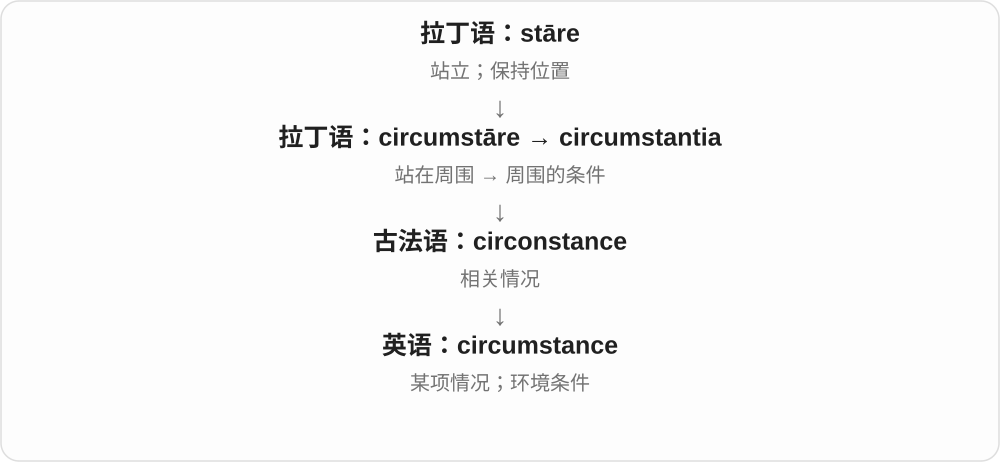
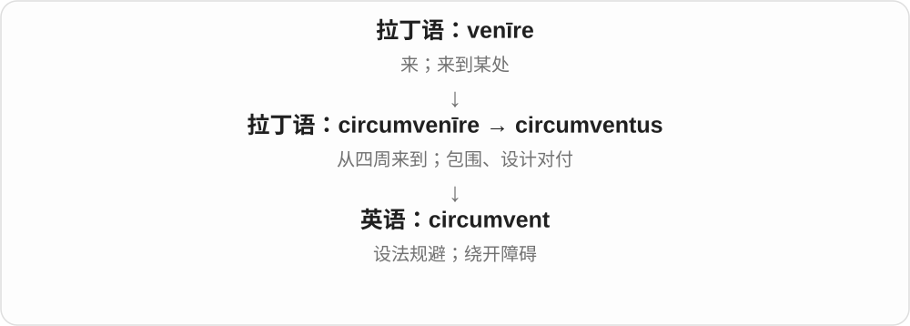
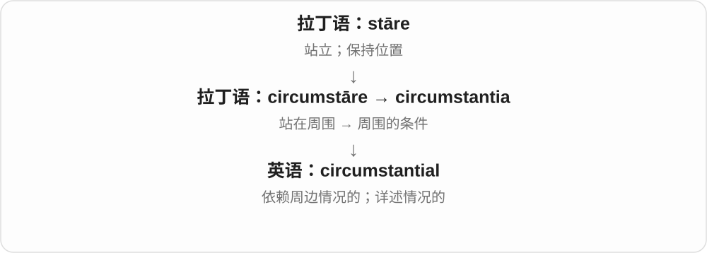
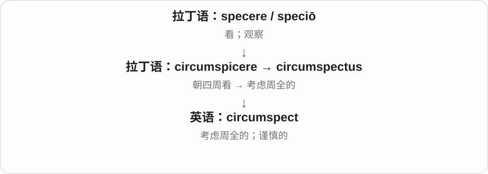
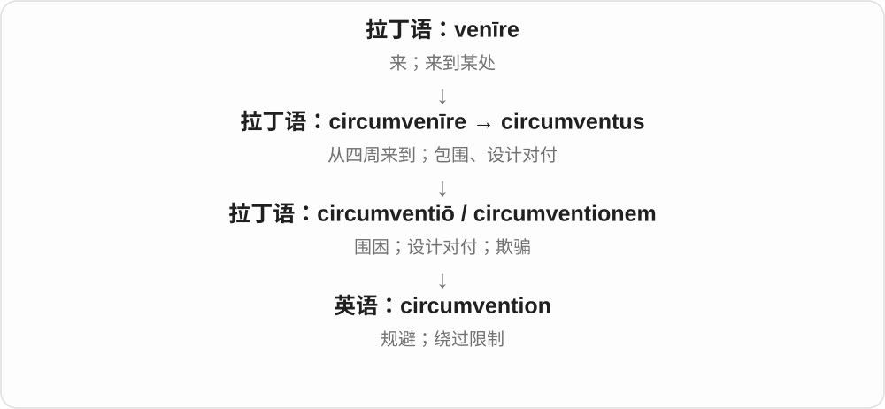
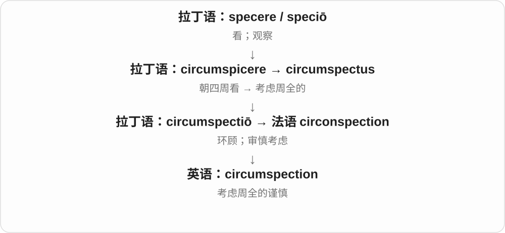

# 2542 · circum- — 周围；绕一圈；从旁边绕过

[逐词精讲目录](../00_逐词精讲目录.md) · [总目录](../00_总目录_按常用程度.md)

## 核心词根与来源

circumference 是围一圈的长度；circumnavigate 是环绕航行。circumscribe 像在外面画边界，延伸为限制；circumstance 是周围的情况；circumspect 是做事先顾及四周，所以谨慎。词源画面好记，具体借入历史仍分别看单词。

**想象站在中间往四周看，或绕着边缘走一圈；不同后半部分说明具体做什么。**

拉丁 circum 周围与不同动词、名词组合：周围站着 → circumstance；周围看 → circumspect；周围写划 → circumscribe；绕行 → circumvent；近代航行、极地组合见 circumnavigate、circumpolar。

- **周边情况与谨慎**：circumstance, circumstantial, circumspect, circumspection
- **绕行、周长与空间**：circumference, circumnavigate, circumnavigation, circumpolar
- **画边界与绕过限制**：circumscribe, circumscribed, circumvent, circumvention
- **绕着说与切除名称**：circumlocution, circumcise, circumcision

## 词形与演化规律

circum- 是前缀，不是一个能自由放在句中的英语单词。它与 circ- 圆形词族相关，但不是所有带 cir 的词都从 circum 加后缀得到。circumscribed 的 -ed 读 /d/。

## 单词速览（常用到不常用）

| 单词 | 音标 | 核心意思 |
|---|---|---|
| [circumstance](#w-1) | 英 /ˈsɜːkəmstəns/；美 /ˈsɜːrkəmstæns/ | 情况；环境；条件 |
| [circumcision](#w-2) | 英 /ˌsɜːkəmˈsɪʒən/；美 /ˌsɜːrkəmˈsɪʒən/ | 包皮环切术；割礼 |
| [circumference](#w-3) | 英 /səˈkʌmfərəns/；美 /sərˈkʌmfərəns/ | 圆周；周长；一圈的外缘 |
| [circumvent](#w-4) | 英 /ˌsɜːkəmˈvent/；美 /ˌsɜːrkəmˈvent/ | 设法规避；绕过；绕开障碍 |
| [circumstantial](#w-5) | 英 /ˌsɜːkəmˈstænʃəl/；美 /ˌsɜːrkəmˈstænʃəl/ | 间接的；与情况有关的；详述细节的 |
| [circumscribed](#w-6) | 英 /ˈsɜːkəmskraɪbd/；美 /ˈsɜːrkəmskraɪbd/ | 受限制的；界限明确的；几何学中外接的 |
| [circumspect](#w-7) | 英 /ˈsɜːkəmspekt/；美 /ˈsɜːrkəmspekt/ | 谨慎周全的 |
| [circumvention](#w-8) | 英 /ˌsɜːkəmˈvenʃən/；美 /ˌsɜːrkəmˈvenʃən/ | 规避；绕过；设法避开限制 |
| [circumnavigate](#w-9) | 英 /ˌsɜːkəmˈnævɪɡeɪt/；美 /ˌsɜːrkəmˈnævɪɡeɪt/ | 环航；绕……一周 |
| [circumnavigation](#w-10) | 英 /ˌsɜːkəmˌnævɪˈɡeɪʃən/；美 /ˌsɜːrkəmˌnævɪˈɡeɪʃən/ | 环航；环绕一周的旅程 |
| [circumpolar](#w-11) | 英 /ˌsɜːkəmˈpəʊlə/；美 /ˌsɜrkəmˈpoʊlər/ | 环极的；拱极的 |
| [circumcise](#w-12) | 英 /ˈsɜːkəmsaɪz/；美 /ˈsɜːrkəmsaɪz/ | 为……施行包皮环切；施行割礼 |
| [circumspection](#w-13) | 英 /ˌsɜːkəmˈspekʃən/；美 /ˌsɜːrkəmˈspekʃən/ | 谨慎；周全考虑 |
| [circumscribe](#w-14) | 英 /ˈsɜːkəmskraɪb/；美 /ˈsɝːkəmskraɪb/ | 限制；划定界限；作外接图形 |
| [circumlocution](#w-15) | 英 /ˌsɜːkəmləˈkjuːʃən/；美 /ˌsɜːrkəmləˈkjuːʃən/ | 迂回说法；绕着说；拐弯抹角的表达 |

## 逐词讲解

### 1. circumstance — 情况；环境；条件

**音标**：英 /ˈsɜːkəmstəns/；美 /ˈsɜːrkəmstæns/

**先抓住这个画面**

一个人做决定时，收入、时间、天气、身边的人都围着他。这些“围在周围”的条件就是 circumstances。

**怎么拆**

拉丁语 circum-（周围）+ stāre（站）→ circumstantia，经法语进入。

**怎么变成今天的意思**

周围站着的东西被抽象成周围条件。常用复数 circumstances；单数 a circumstance 可以指某一个具体情况。

**常见搭配与例句**

under the circumstances；in difficult circumstances；beyond our control。

> Under the circumstances, postponing the trip was sensible.

在这种情况下，推迟旅行是明智的。

> Her circumstances changed after she moved to the city.

搬到城市后，她的生活境况改变了。

**别混淆**

circumstances 是事情发生的条件；situation 是整体局面。under no circumstances 表示任何情况下都不。

### 2. circumcision — 包皮环切术；割礼

**音标**：英 /ˌsɜːkəmˈsɪʒən/；美 /ˌsɜːrkəmˈsɪʒən/

**先抓住这个画面**

词的原始动作是围着切去一圈；现代常用名词指去除部分或全部阴茎包皮的手术，也见于宗教文化讨论。

**怎么拆**

拉丁 circumcisio 已是名词，来自 circumcidere“围绕切”；经古法语 circumcisiun 进入中古英语，不是必须由英语 circumcise 派生。

**怎么变成今天的意思**

**拉丁 caedere，分词 caesus；复合词常见 -cidere / -cisus**  
切、砍、击杀

↓

**拉丁 circum- + caedere → circumcidere；分词 circumcisus**  
围绕切除

↓

**拉丁 circumcisio → 古法语 circumcisiun → 中古英语 circumcisioun**  
环切、割礼

↓

**英语 circumcision**  
手术名称；相关仪式

医学通常指男性包皮环切。某些文本的 female circumcision 指另一类女性生殖器切割行为，不能理解为男女完全相同的手术。

**常见搭配与例句**

male circumcision；religious circumcision。

> The leaflet explains what circumcision means in medical language.

宣传册解释了 circumcision 在医学中的含义。

> The historian discusses circumcision in several religious traditions.

历史学家讨论了几种宗教传统中的割礼。

**别混淆**

incision 是切口或切开，circumcision 是有特定对象与范围的名称，不是所有环状切口。

### 3. circumference — 圆周；周长；一圈的外缘

**音标**：英 /səˈkʌmfərəns/；美 /sərˈkʌmfərəns/

**先抓住这个画面**

拿一根绳子沿外边绕一圈，回到起点；这圈边界以及它的长度，就是这里的重点。

**怎么拆**

拉丁 circum-“周围” + ferre → circumferre，再有名词 circumferentia；经中古法语及直接拉丁借入进入中古英语。

**怎么变成今天的意思**

**拉丁语：ferre；第一人称 ferō**  
带、承载；承受；生出

↓

**拉丁语：circum- + ferre → circumferre**  
绕着带、绕行

↓

**拉丁语：circumferentia**  
外围、周边

↓

**中古法语及直接拉丁借入 → 中古英语、英语 circumference**  
周界；圆周及其长度

数学里 a circle’s circumference 指圆周或圆周长，C = 2πr。日常测量也可说腰围、树干围长等，都是围着外面走一圈。

**常见搭配与例句**

the circumference of a circle；measure the circumference；in circumference。

> Measure the circumference of the trunk with a flexible tape.

用软尺测量树干一圈的长度。

> Doubling the radius doubles the circumference of the circle.

半径加倍，圆周长也会加倍。

**别混淆**

diameter 横穿圆心从一边到另一边；circumference 沿边界绕一圈。

### 4. circumvent — 设法规避；绕过；绕开障碍

**音标**：英 /ˌsɜːkəmˈvent/；美 /ˌsɜːrkəmˈvent/

**先抓住这个画面**

前面有一道限制，你找到旁边的路，让它挡不住自己，这幅画面很适合记 circumvent。

**怎么拆**

拉丁语 circumvenīre 由 circum-（周围）+ venīre（来）构成；先有包围、设计对付的意思，经分词词干 circumvent- 进入英语。

**怎么变成今天的意思**

现代常说绕过障碍、规则或手续，可能是聪明解决问题，也可能带钻空子的批评。记忆时可以想绕路，但早期英语已有包围、算计人的含义，不能虚构成英语先有日常走路义、后来才有抽象义。

**常见搭配与例句**

circumvent a restriction；circumvent the rules；circumvent a technical limitation。

> The new design circumvents a limitation of the older equipment.

新设计绕开了旧设备的一项限制。

> The audit found that several firms had circumvented the rules.

审计发现，几家公司曾设法规避规定。

**别混淆**

overcome 是克服障碍本身；circumvent 更像换一条路绕过去。contravene 是违反规定，不特别强调用了什么绕行办法。

### 5. circumstantial — 间接的；与情况有关的；详述细节的

**音标**：英 /ˌsɜːkəmˈstænʃəl/；美 /ˌsɜːrkəmˈstænʃəl/

**先抓住这个画面**

没有直接拍到事情发生，却能从时间、物品和其他周边事实推断，这类证据常叫 circumstantial evidence。

**怎么拆**

拉丁语 circumstantia 的基础加形容词后缀；现代可对照 circumstance + -ial。

**怎么变成今天的意思**

重点在由周边情况作推断，不是亲眼直接看见。正式旧用法也可指把具体情节讲得很详细。

**常见搭配与例句**

circumstantial evidence；a circumstantial account；purely circumstantial。

> The detective assembled several pieces of circumstantial evidence.

侦探收集了几项间接证据。

> The connection remained circumstantial rather than directly observed.

这种联系仍是根据周边情况推断出来的，没有被直接观察到。

**别混淆**

circumstantial evidence 不等于无效证据，也不自动等于充分证据；词本身只说明间接推断的类型。

### 6. circumscribed — 受限制的；界限明确的；几何学中外接的

**音标**：英 /ˈsɜːkəmskraɪbd/；美 /ˈsɜːrkəmskraɪbd/

**先抓住这个画面**

像在事物外面画出边界：一般语境说活动范围受到限制，几何语境说图形在另一图形外面围住它。

**怎么拆**

circumscribe + -ed；circumscribe 接拉丁 circum 周围 + scribere 写、划。现代 -ed 说明过去分词或由此形成的形容词。

**怎么变成今天的意思**

**拉丁 circum 周围 + scribere 写 → circumscribere**  
在周围划线，限定边界

↓

**英语 circumscribe + -ed → circumscribed**  
被限定的；几何中的外接的

circumscribed powers 是被明确限定的权限。三角形的 circumscribed circle 是经过三个顶点、在外面包住三角形的圆；这里不是在里面放一个相切的圆。

**常见搭配与例句**

circumscribed powers；a carefully circumscribed role；a circumscribed circle。

> Her authority was carefully circumscribed by the agreement.

协议严格限定了她的权限。

> Draw the circle circumscribed about the triangle.

画出这个三角形的外接圆。

**别混淆**

inscribed circle 内切圆在三角形内部并与三边相切；circumscribed circle 外接圆经过三个顶点。constrained 更泛指受到条件限制。

### 7. circumspect — 谨慎周全的

**音标**：英 /ˈsɜːkəmspekt/；美 /ˈsɜːrkəmspekt/

**先抓住这个画面**

circumspect 像过马路前先看看左右，再迈步：先把周围情况看清楚，避免冒失。

**怎么拆**

circum-（周围）+ specere（看）形成 circumspicere；英语来自其分词 circumspectus“考虑周全的”。

**怎么变成今天的意思**

空间上的四处看变成做决定前考虑各种因素。它是有意识的谨慎，不只是因为害怕而不行动。

**常见搭配与例句**

be circumspect about；a circumspect approach；remain circumspect。

> She was circumspect about making promises.

她对作出承诺很谨慎。

> A more circumspect approach would have avoided the confusion.

如果考虑得更周全，本可以避免这场混乱。

**别混淆**

careful 范围广；circumspect 更突出考虑周围情况和潜在后果。

### 8. circumvention — 规避；绕过；设法避开限制

**音标**：英 /ˌsɜːkəmˈvenʃən/；美 /ˌsɜːrkəmˈvenʃən/

**先抓住这个画面**

把“找一条旁路避开限制”这件事作为一个过程或问题来讨论，用 circumvention。

**怎么拆**

来自拉丁语 circumventionem，是 circumventiō 的宾格，根在 circumvenīre；现代与 circumvent + -ion 对应。英语名词的早期记录还早于动词，历史不能只按词尾反推。

**怎么变成今天的意思**

常见于规则、监管和技术讨论，语气比 get around 正式。重点是限制原本在那里，却被一条旁路避开；并不自动说明行为合法或非法。

**常见搭配与例句**

circumvention of the rules；prevent circumvention；a means of circumvention。

> The new policy aims to prevent circumvention of the reporting rules.

新政策旨在防止人们规避申报规定。

> The engineers discussed whether circumvention of the limitation was worth the extra cost.

工程师们讨论了绕开这项限制是否值得付出额外成本。

**别混淆**

evasion 也可指逃避，强调躲开责任或要求；circumvention 更容易让人想到绕开某个具体机制。

### 9. circumnavigate — 环航；绕……一周

**音标**：英 /ˌsɜːkəmˈnævɪɡeɪt/；美 /ˌsɜːrkəmˈnævɪɡeɪt/

**先抓住这个画面**

围着一个岛、陆地或地球走完一圈，而不只是从旁边经过。

**怎么拆**

来自拉丁 circumnavigatus、circumnavigare，circum-“周围” + navigare“航行”；现代也能按 circum- + navigate 理解。

**怎么变成今天的意思**

**拉丁语 navis**  
船

↓

**拉丁语 navis + agere → navigare**  
船 + 驱动 → 驾船航行

↓

**拉丁语 circum- + navigare → circumnavigare / circumnavigatus**  
围绕 + 航行 → 绕行一周

↓

**英语 circumnavigate**  
环航、绕行

最典型是 circumnavigate the globe；也可以绕岛航行。现代还可扩展到其他交通方式；关键是完成环绕路线。

**常见搭配与例句**

circumnavigate the globe；circumnavigate an island；circumnavigate by sea。

> The crew plans to circumnavigate the island in two days.

船员们计划用两天绕岛航行一周。

> She became the first person in her family to circumnavigate the globe.

她成为家里第一个完成环球旅行的人。

**别混淆**

circumvent 常指绕开障碍或规避规则；circumnavigate 主要是实际环绕行程。

### 10. circumnavigation — 环航；环绕一周的旅程

**音标**：英 /ˌsɜːkəmˌnævɪˈɡeɪʃən/；美 /ˌsɜːrkəmˌnævɪˈɡeɪʃən/

**先抓住这个画面**

把出发点、整圈路线和返抵这件事看成一次完整行程。

**怎么拆**

circumnavigate + -ion，-ate 对应名词 -ation；英语名词从环航动词派生。

**怎么变成今天的意思**

**拉丁语 navis**  
船

↓

**拉丁语 navis + agere → navigare**  
船 + 驱动 → 驾船航行

↓

**拉丁语 circum- + navigare → circumnavigare / circumnavigatus**  
围绕 + 航行 → 绕行一周

↓

**英语 circumnavigate**  
环航、绕行

↓

**英语 circumnavigate → circumnavigation**  
环航 → 环航行动或行程

a circumnavigation of the world 是环球行程；a solo circumnavigation 强调独自完成。词本身不规定必须不停靠或必须使用同一种交通工具。

**常见搭配与例句**

complete a circumnavigation；a solo circumnavigation；a circumnavigation of the island。

> The book describes a difficult circumnavigation of the world.

这本书描写了一次艰难的环球航行。

> Their circumnavigation of the island ended at the harbour where it began.

他们绕岛一周后回到了出发的港口。

**别混淆**

voyage 只表示一次远航；circumnavigation 还包含绕目标一周的路线要求。

### 11. circumpolar — 环极的；拱极的

**音标**：英 /ˌsɜːkəmˈpəʊlə/；美 /ˌsɜrkəmˈpoʊlər/

**先抓住这个画面**

围着极点走一圈：可以说极地周围的区域，也可以说星星看起来围着天极转。

**怎么拆**

circum- 环绕 + polar 极的；这里谈的是绕极点，不是把 polar 的极地义重复一遍。

**怎么变成今天的意思**

**希腊 polos → 拉丁 polus**  
旋转轴；轴端

↓

**中世纪拉丁 polaris／法语 polaire**  
极点相关的

↓

**circum- + polar → circumpolar**  
围绕极点的

circumpolar regions 是环极地区；对某个观测地点而言，circumpolar stars 指绕天极转动而不落到地平线下的恒星。是否属于拱极星与观测纬度有关，不是某颗星在全球任何地点都不落。

**常见搭配与例句**

circumpolar regions；circumpolar stars；a circumpolar constellation。

> The project brings together researchers from circumpolar regions.

这个项目汇集了环极地区的研究人员。

> At this latitude, several familiar constellations are circumpolar.

在这个纬度，几个熟悉的星座是拱极星座。

**别混淆**

polar 只说与极有关，circumpolar 多了“围绕”的关系。天文学里的“极”指天极，地理语境才直接指地球极地。

### 12. circumcise — 为……施行包皮环切；施行割礼

**音标**：英 /ˈsɜːkəmsaɪz/；美 /ˈsɜːrkəmsaɪz/

**先抓住这个画面**

在常见医学用法中，动词指对某人去除部分或全部阴茎包皮；circum- 留下了绕周围切的历史画面。

**怎么拆**

拉丁 circum- 周围 + caedere → circumcidere；分词 circumcisus 经法语 circumciser 进入英语。

**怎么变成今天的意思**

**拉丁 caedere，分词 caesus；复合词常见 -cidere / -cisus**  
切、砍、击杀

↓

**拉丁 circum- + caedere → circumcidere；分词 circumcisus**  
围绕切除

↓

**古法语 circumciser → 中古英语 circumcisen → circumcise**  
施行环切、割礼

常用被动式 be circumcised。具体医学、宗教或历史语境可能不同；女性相关旧称涉及另一类行为，不能直接等同于男性手术。

**常见搭配与例句**

be circumcised；circumcise a patient。

> The medical record states that the patient was circumcised.

病历注明患者做过包皮环切。

> The text discusses the age at which boys were circumcised in that community.

文本讨论了该社群男孩接受割礼的年龄。

**别混淆**

circumcise 是动词，circumcision 是手术或仪式名词；后者并非现代英语动词才造出的新词。

### 13. circumspection — 谨慎；周全考虑

**音标**：英 /ˌsɜːkəmˈspekʃən/；美 /ˌsɜːrkəmˈspekʃən/

**先抓住这个画面**

circumspection 是行动前环顾四周的那份谨慎：既看眼前收益，也看潜在麻烦。

**怎么拆**

来自法语或拉丁语 circumspectiō，属于 circum-“周围”+ specere“看”一族。

**怎么变成今天的意思**

circumspect 描述人或做法，circumspection 把这种谨慎作为一种品质或态度来谈。

**常见搭配与例句**

with circumspection；exercise circumspection；a need for circumspection。

> The negotiators proceeded with circumspection.

谈判者谨慎周全地推进讨论。

> The uncertain evidence called for circumspection.

证据尚不明确，需要审慎判断。

**别混淆**

caution 可以只是避免危险；circumspection 更突出把相关情况想周全。

### 14. circumscribe — 限制；划定界限；作外接图形

**音标**：英 /ˈsɜːkəmskraɪb/；美 /ˈsɝːkəmskraɪb/

**先抓住这个画面**

circumscribe 像围着一件事画一圈：“活动只能到这里。”圈可以是几何图形，也可以是权力、自由或讨论范围的边界。

**怎么拆**

拉丁语 circum（围绕）+ scrībere（写、画），形成 circumscrībere“在周围画线”。

**怎么变成今天的意思**

从画出外围线，扩展成限定某事物的范围。几何里也保留具体的外接用法，如作三角形的外接圆。

**常见搭配与例句**

circumscribe someone’s powers（限制某人的权力）；be circumscribed by rules（受规则限制）；circumscribe a circle about a triangle（作三角形外接圆）。

> The committee’s powers are carefully circumscribed.

委员会的权力受到明确限制。

> Circumscribe a circle about the triangle.

作这个三角形的外接圆。

**别混淆**

describe 是描写；circumscribe 是围着画界限。restrict 更常用，circumscribe 带较正式、边界明确的感觉。

### 15. circumlocution — 迂回说法；绕着说；拐弯抹角的表达

**音标**：英 /ˌsɜːkəmləˈkjuːʃən/；美 /ˌsɜːrkəmləˈkjuːʃən/

**先抓住这个画面**

本来一句“我们忘了”就能说明白，却说成“在执行过程中存在未被充分落实的环节”。

**怎么拆**

拉丁 circum- 周围 + locutio 说话，组成 circumlocutio，字面是绕着说；这个拉丁构词仿照了希腊语相应表达。

**怎么变成今天的意思**

**拉丁 loqui**  
说话

↓

**拉丁 circum- + locutio → circumlocutio**  
绕着说

↓

**英语 circumlocution**  
不用直接简短的话，而迂回表达

常带批评意味：绕开要点、说得冗长，甚至回避责任。但绕说也可能只是暂时想不起一个词，用“开瓶子的那个工具”来描述它，不能一律认定为欺骗。

**常见搭配与例句**

avoid circumlocution；a clumsy circumlocution；hide behind circumlocution。

> Please answer directly, without unnecessary circumlocution.

请直接回答，不必拐弯抹角。

> Unable to remember “thermometer,” he used the circumlocution “the thing that measures temperature.”

他想不起 thermometer，就绕着说成“测温度的那个东西”。

**别混淆**

euphemism 是用较温和的说法避开刺耳内容；circumlocution 侧重绕远路，两者有时重合，但绕说未必更温和。

## 这一组要分清什么

circumspect 是谨慎，circumstantial 是环境或间接证据相关，不是同一形容词。circumscribed circle 是外接圆；circumlocution 是绕弯说话，不一定真的绕着地方走。

## 串起来练习

用一个项目分别说明 circumstances、circumscribed powers 与 circumvention；在三角形外接圆的画面中理解 circumscribed。
