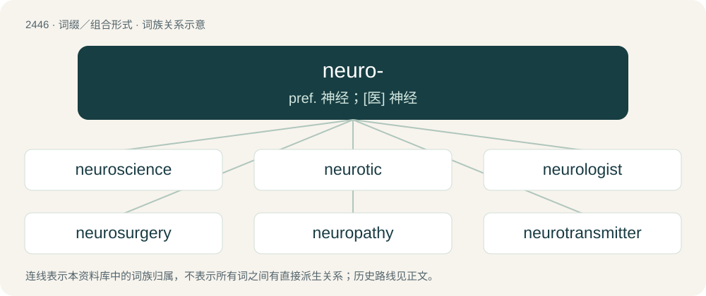

# 2550 · neuro- — pref. 神经；\[医\] 神经

[总目录](../00_总目录_按常用程度.md)

**类型**：词缀／组合形式　｜　**来源语言**：见词源记录

## 核心含义与来源

- 核心含义：pref. 神经；\[医\] 神经
- 英文含义：Relating to the nerves, nervous tissue, or the nervous system.
- 词形：neuro-

**来源记录 1**（前缀／前置成分；Relating to the nerves, nervous tissue, or the nervous system.）

From Ancient Greek νευρο- (neuro-), combining form of νεῦρον (neûron, “sinew, tendon, cord”). By surface analysis, neur- + -o-.

## 词族图

## 单词速览（常用到不常用）

| 单词 | 音标 | 释义 |
|---|---|---|
| [neuroscience](#w-1) | 英 /ˈnjʊəɹəʊsaɪ.əns/；美 /ˈnʊɹoʊsaɪ.əns/ | n. 神经系统科学( 指神经病学、 神经化学等) |
| [neurotic](#w-2) | /n(j)ʊəˈɹɒtɪk/ | n. 神经症患者；a. 神经质的, 神经症的 |
| [neurologist](#w-3) | /njuˈrɒlədʒist/ | n. 神经病学者, 神经科医师；\[医\] 神经病学家 |
| [neurosurgery](#w-4) | /, njuərəuˈsəːdʒəri, nuə-/ | \[医\] 神经外科学 |
| [neuropathy](#w-5) | /ˌnjuːˈrɒ.pə.θiː/ | n. 神经病；\[医\] 神经病 |
| [neurotransmitter](#w-6) | /,njuərətrænsˈmitə/ | n. 神经递质；\[化\] 神经递质 |
| [neurosurgeon](#w-7) | /,njjərəjˈs\\\\ːdʒən/ | n. 神经外科医师；\[医\] 神经外科医师 |
| [neuroscientist](#w-8) | /ˈnjʊərəʊsaɪəntɪst/ | \[医\]神经科学家：神经科学各分支的专家 |
| [neurodegenerative](#w-9) |  | \[医\] 神经变性的 |
| [neuromuscular](#w-10) | /njuərəuˈmʌskjulə, nuər-/ | a. 神经肌肉的；\[医\] 神经肌肉的 |
| [neurobiology](#w-11) | /,njuərəubaiˈɔlədʒi/ | \[医\] 神经生物学 |
| [neurosis](#w-12) | 英 /n(j)ʊˈɹəʊ̯.sɪs/；美 /n(j)ʊˈɹoʊ̯.sɪs/ | n. 神经症, 神经机能病；\[医\] 神经机能病, 神经\[官能\]症 |
| [neuroimaging](#w-13) | 英 /ˌnjʊəɹəʊˈɪmɪdʒɪŋ/ | \[医\]神经影像 |
| [neuropsychological](#w-14) |  | 神经心理学 |
| [neuroblastoma](#w-15) | /,njuərəblæsˈtəumə/ | n. \[医\]成神经细胞瘤 |
| [neuropsychology](#w-16) | /ˌnjuːɹəʊˌsaɪˈkɒ.lə.dʒi/ | \[医\] 神经心理学 |
| [neuropathic](#w-17) | /.njurəˈpæθik/ | a. 神经病的；\[医\] 神经病的 |
| [neuropsychiatric](#w-18) |  | a. 神经精神病学的 |
| [neuroendocrine](#w-19) | /,njuːrəˈendəkrain/ | \[医\] 神经内分泌的 |
| [neurotoxin](#w-20) | 美 /ˈn(j)ʊɹoʊtɑksɪn/ | \[化\] 神经毒素；\[医\] 神经毒素 |
| [neurosurgical](#w-21) | /ˌnjʊərəʊˈsɜːdʒɪkl/ | a. &lt;医&gt;神经外科的 |
| [neurodevelopmental](#w-22) | /nərəʊdiːˈveləpmentl/ | \[医\]神经发育的 |
| [neurogenesis](#w-23) | /,njuərəˈdʒenisis/ | n. \[生\]神经发生,神经形成 |
| [neurophysiology](#w-24) | /,njuərəu,fiziˈɔlədʒi, ,nuə-/ | n. 神经生理学；\[医\] 神经生理学 |
| [neurotoxic](#w-25) | /,njuərəuˈtɔksik, nuə-/ | a. 毒害神经的；\[医\] 神经中毒的 |
| [neurotoxicity](#w-26) | /,njuərəutɔkˈsisəti/ | n. \[农药\] 神经中毒性, 神经毒性 |
| [neurobiological](#w-27) | /,njuərəu,baiəˈlɔdʒikəl/ | a. 神经生物学的 |
| [neurodegeneration](#w-28) | /njʊərəʊdedʒenəˈreɪʃn/ | \[医\]神经变性，神经退行性变 |
| [neuroplasticity](#w-29) |  | 神经可塑性 |
| [neurocognitive](#w-30) |  | 【英文】pertaining to cognitive functions that are linked to a particular area, pathway or network of the brain |
| [neurogenic](#w-31) | /njuərəuˈdʒenik/ | a. 神经原的, 神经性的；\[医\] 发生神经的; 神经原\[性\]的 |
| [neurotrophic](#w-32) | /,njjərəjˈtrɔfik/ | a. 神经营养的,\[解\]向神经的,亲神经的 |
| [neuroanatomy](#w-33) | 英 /njʊəɹəʊəˈnatəmi/；美 /ˌn(j)ʊroʊəˈnætəmi/ | \[医\] 神经解剖学 |
| [neurophysiological](#w-34) |  | a. 神经生理学的; 神经生理的 |
| [neuroprotective](#w-35) |  | 【英文】That provides neuroprotection. |
| [neuropeptide](#w-36) | /,njjərəˈpeptaid/ | n. \[生化\]神经肽 |

## 逐词详解

### 1. neuroscience

**词性**：名词　｜　**音标**：英 /ˈnjʊəɹəʊsaɪ.əns/；美 /ˈnʊɹoʊsaɪ.əns/

**中文释义**：n. 神经系统科学( 指神经病学、 神经化学等)

**英文义项**：The scientific study of the nervous system.

**构词拆分**：neuro- + science

**词源与演化**：

From neuro- + science.

**例句**：

> I repurposed the notebook I was using to study neuroscience for calculus.

### 2. neurotic

**词性**：形容词　｜　**音标**：/n(j)ʊəˈɹɒtɪk/

**中文释义**：n. 神经症患者；a. 神经质的, 神经症的

**英文义项**：Affected with a neurosis. / Overly anxious.

**构词拆分**：neuro- (“of nerves or the nervous system”) + -otic (“having abnormal condition”)

**词源与演化**：

Formed of neuro- (“of nerves or the nervous system”) + -otic (“having abnormal condition”). The initial element, in turn, is from Ancient Greek νεῦρον (neûron, “nerve”). Attested from the 17th century. Compare French névrotique.

**例句**：

> He is getting neurotic about time-keeping.

该用例对应义项：Overly anxious.

### 3. neurologist

**词性**：名词　｜　**音标**：/njuˈrɒlədʒist/

**中文释义**：n. 神经病学者, 神经科医师；\[医\] 神经病学家

**英文义项**：A doctor or scientist who practices or specializes in neurology.

**构词拆分**：neuro- + -logist

**词源与演化**：

From neuro- + -logist.

**例句**：

> Tom thought that he might want to become a pediatric neurologist.

### 4. neurosurgery

**词性**：名词　｜　**音标**：/, njuərəuˈsəːdʒəri, nuə-/

**中文释义**：\[医\] 神经外科学

**英文义项**：The surgical discipline focused on treating those central and peripheral nervous system diseases. / Any surgical procedure performed on the nervous system, especially the brain.

**构词拆分**：neuro- + surgery

**词源与演化**：

From neuro- + surgery.

### 5. neuropathy

**词性**：名词　｜　**音标**：/ˌnjuːˈrɒ.pə.θiː/

**中文释义**：n. 神经病；\[医\] 神经病

**英文义项**：Any disease of the peripheral nervous system; peripheral neuropathy. / Any disease of the nerves and nervous system, usually and more specifically the peripheral nervous system, thus including both non-neuraxial and neuraxial instances of neural damage or dysfunction but excluding the neuraxis's psychiatric aspects (mental illnesses).

**构词拆分**：neuro- + -pathy

**词源与演化**：

From neuro- + -pathy.

**例句**：

> Long-standing diabetes often causes neuropathy in the retinas, fingertips, and toes.

该用例对应义项：Any disease of the peripheral nervous system; peripheral neuropathy.

### 6. neurotransmitter

**词性**：名词　｜　**音标**：/,njuərətrænsˈmitə/

**中文释义**：n. 神经递质；\[化\] 神经递质

**英文义项**：Any substance, such as acetylcholine or dopamine, responsible for sending nerve signals across a synapse between two neurons.

**构词拆分**：neuro- + transmitter

**词源与演化**：

From neuro- + transmitter.

### 7. neurosurgeon

**词性**：名词　｜　**音标**：/,njjərəjˈs\\\\ːdʒən/

**中文释义**：n. 神经外科医师；\[医\] 神经外科医师

**英文义项**：A surgeon specializing in brain surgery.

**构词拆分**：neuro- + surgeon

**词源与演化**：

From neuro- + surgeon.

**例句**：

> James's dad is the only neurosurgeon in that hospital.

### 8. neuroscientist

**词性**：名词　｜　**音标**：/ˈnjʊərəʊsaɪəntɪst/

**中文释义**：\[医\]神经科学家：神经科学各分支的专家

**英文义项**：A scientist whose speciality is neuroscience.

**构词拆分**：neuro- + scientist

**词源与演化**：

From neuro- + scientist.

**例句**：

> Neuroscientist António Damásio defines consciousness as "the sensation of what is happening".

### 9. neurodegenerative

**词性**：形容词

**中文释义**：\[医\] 神经变性的

**英文义项**：Of, pertaining to, or resulting in the progressive loss of nerve cells and of neurologic function.

**构词拆分**：neuro- + degenerative

**词源与演化**：

From neuro- + degenerative.

**用法示例／搭配（非完整句）**：

> neurodegenerative disease

该用例对应义项：Of, pertaining to, or resulting in the progressive loss of nerve cells and of neurologic function.

### 10. neuromuscular

**词性**：形容词　｜　**音标**：/njuərəuˈmʌskjulə, nuər-/

**中文释义**：a. 神经肌肉的；\[医\] 神经肌肉的

**英文义项**：Pertaining to the voluntary or reflexive control of muscles by nerves.

**构词拆分**：neuro- + muscular

**词源与演化**：

From neuro- + muscular.

**例句**：

> Multiple sclerosis is a neuromuscular disease.

该用例对应义项：Pertaining to the voluntary or reflexive control of muscles by nerves.

### 11. neurobiology

**词性**：名词　｜　**音标**：/,njuərəubaiˈɔlədʒi/

**中文释义**：\[医\] 神经生物学

**英文义项**：The scientific study of nerve and brain function in people and animals: the biological extent of neuroscience.

**构词拆分**：neuro- + biology

**词源与演化**：

From neuro- + biology.

### 12. neurosis

**词性**：名词　｜　**音标**：英 /n(j)ʊˈɹəʊ̯.sɪs/；美 /n(j)ʊˈɹoʊ̯.sɪs/

**中文释义**：n. 神经症, 神经机能病；\[医\] 神经机能病, 神经\[官能\]症

**英文义项**：A mental disorder, less severe than psychosis, marked by anxiety or fear differing from normal measures by its intensity, and resulting from a failure to compromise or properly adjust during the developmental stages of life, between normal human instinctual impulses and the demands of human society.

**构词拆分**：neuro- + -sis

**词源与演化**：

From neuro- + -sis.

**例句**：

> Neurosis is a trait often stereotypically assigned to Ashkenazi Jews.

### 13. neuroimaging

**词性**：名词　｜　**音标**：英 /ˌnjʊəɹəʊˈɪmɪdʒɪŋ/

**中文释义**：\[医\]神经影像

**英文义项**：The generation of images showing activity in the nervous system, usually and especially brain activity.

**构词拆分**：neuro- + imaging

**词源与演化**：

From neuro- + imaging.

### 14. neuropsychological

**词性**：形容词

**中文释义**：神经心理学

**英文义项**：Of or pertaining to neuropsychology, the relation or combination of brain and mind.

**构词拆分**：neuro- + psychological；neuropsychology + -ical

**词源与演化**：

From neuro- + psychological or neuropsychology + -ical.

### 15. neuroblastoma

**词性**：名词　｜　**音标**：/,njuərəblæsˈtəumə/

**中文释义**：n. \[医\]成神经细胞瘤

**英文义项**：A form of cancer that affects the ganglia in various parts of the body

**构词拆分**：neuro- + blastoma

**词源与演化**：

From neuro- + blastoma.

### 16. neuropsychology

**词性**：名词　｜　**音标**：/ˌnjuːɹəʊˌsaɪˈkɒ.lə.dʒi/

**中文释义**：\[医\] 神经心理学

**英文义项**：A branch of neurology and of clinical psychology that investigates the physiological basis of psychological processes. / The facts uncovered thereby, or the body of knowledge thus produced.

**构词拆分**：neuro- + psychology

**词源与演化**：

From neuro- + psychology.

**用法示例／搭配（非完整句）**：

> the neuropsychology of culpability comprises the neurology of competence and indeed all neuroscience of the neural correlates of consciousness

该用例对应义项：The facts uncovered thereby, or the body of knowledge thus produced.

### 17. neuropathic

**词性**：形容词　｜　**音标**：/.njurəˈpæθik/

**中文释义**：a. 神经病的；\[医\] 神经病的

**英文义项**：Of or relating to neuropathy.

**构词拆分**：neuro- + -pathic

**词源与演化**：

From neuro- + -pathic.

**例句**：

> Less recognized is a common side effect called neuropathic pain, which creates feelings of electric shocks and stabs.

### 18. neuropsychiatric

**词性**：形容词

**中文释义**：a. 神经精神病学的

**英文义项**：Of or pertaining to neuropsychiatry; both neurological and psychiatric.

**构词拆分**：neuro- + psychiatric

**词源与演化**：

From neuro- + psychiatric.

### 19. neuroendocrine

**词性**：形容词　｜　**音标**：/,njuːrəˈendəkrain/

**中文释义**：\[医\] 神经内分泌的

**英文义项**：pertaining to the nervous system and endocrine system together

**构词拆分**：neuro- + endocrine

**词源与演化**：

From neuro- + endocrine.

**用法示例／搭配（非完整句）**：

> a neuroendocrine cancer

该用例对应义项：pertaining to the nervous system and endocrine system together

### 20. neurotoxin

**词性**：名词　｜　**音标**：美 /ˈn(j)ʊɹoʊtɑksɪn/

**中文释义**：\[化\] 神经毒素；\[医\] 神经毒素

**英文义项**：A toxin that specifically acts upon neurons, their synapses, or the nervous system in its entirety.

**构词拆分**：neuro- + toxin

**词源与演化**：

From neuro- + toxin.

**例句**：

> He presses just the right part of the snail's foot to encourage it to secrete a neurotoxin directly onto a skein of cotton yarn.

### 21. neurosurgical

**词性**：形容词　｜　**音标**：/ˌnjʊərəʊˈsɜːdʒɪkl/

**中文释义**：a. &lt;医&gt;神经外科的

**英文义项**：Of, or pertaining to neurosurgery.

**构词拆分**：neuro- + surgical

**词源与演化**：

From neuro- + surgical.

### 22. neurodevelopmental

**词性**：形容词　｜　**音标**：/nərəʊdiːˈveləpmentl/

**中文释义**：\[医\]神经发育的

**英文义项**：Of or pertaining to the development of neurological pathways in the brain.

**构词拆分**：neuro- + developmental

**词源与演化**：

From neuro- + developmental.

### 23. neurogenesis

**词性**：名词　｜　**音标**：/,njuərəˈdʒenisis/

**中文释义**：n. \[生\]神经发生,神经形成

**英文义项**：The creation and development of neurons

**构词拆分**：neuro- + -genesis

**词源与演化**：

From neuro- + -genesis.

### 24. neurophysiology

**词性**：名词　｜　**音标**：/,njuərəu,fiziˈɔlədʒi, ,nuə-/

**中文释义**：n. 神经生理学；\[医\] 神经生理学

**英文义项**：The branch of physiology that deals with the nervous system.

**构词拆分**：neuro- + physiology

**词源与演化**：

From neuro- + physiology.

### 25. neurotoxic

**词性**：形容词　｜　**音标**：/,njuərəuˈtɔksik, nuə-/

**中文释义**：a. 毒害神经的；\[医\] 神经中毒的

**英文义项**：Having a toxic effect on nerve tissue.

**构词拆分**：neuro- + toxic

**词源与演化**：

From neuro- + toxic.

**例句**：

> The spikes on a stonefish's fins contain glands that inject neurotoxic and cytotoxic venom.

### 26. neurotoxicity

**词性**：名词　｜　**音标**：/,njuərəutɔkˈsisəti/

**中文释义**：n. \[农药\] 神经中毒性, 神经毒性

**英文义项**：The state or property of being neurotoxic.

**构词拆分**：neuro- + toxicity

**词源与演化**：

From neuro- + toxicity.

### 27. neurobiological

**词性**：形容词　｜　**音标**：/,njuərəu,baiəˈlɔdʒikəl/

**中文释义**：a. 神经生物学的

**英文义项**：Of or pertaining to neurobiology, the biological study of nerve and brain function.

**构词拆分**：neuro- + biological

**词源与演化**：

From neuro- + biological.

### 28. neurodegeneration

**词性**：名词　｜　**音标**：/njʊərəʊdedʒenəˈreɪʃn/

**中文释义**：\[医\]神经变性，神经退行性变

**英文义项**：The degeneration (and death) of neurons.

**构词拆分**：neuro- + degeneration

**词源与演化**：

From neuro- + degeneration.

### 29. neuroplasticity

**词性**：名词

**中文释义**：神经可塑性

**英文义项**：The state or quality of being neuroplastic, of having a brain that adapts to experience.

**构词拆分**：neuro- + plastic + -ity

**词源与演化**：

From neuro- + plastic + -ity.

### 30. neurocognitive

**词性**：形容词

**英文义项**：pertaining to cognitive functions that are linked to a particular area, pathway or network of the brain

**构词拆分**：neuro- + cognitive

**词源与演化**：

From neuro- + cognitive.

### 31. neurogenic

**词性**：形容词　｜　**音标**：/njuərəuˈdʒenik/

**中文释义**：a. 神经原的, 神经性的；\[医\] 发生神经的; 神经原\[性\]的

**英文义项**：Originating in, or caused by, the nervous system

**构词拆分**：neuro- + -genic

**词源与演化**：

From neuro- + -genic.

### 32. neurotrophic

**词性**：形容词　｜　**音标**：/,njjərəjˈtrɔfik/

**中文释义**：a. 神经营养的,\[解\]向神经的,亲神经的

**英文义项**：Of or relating to neurotrophy.

**构词拆分**：neuro- + -trophic

**词源与演化**：

From neuro- + -trophic.

### 33. neuroanatomy

**词性**：名词　｜　**音标**：英 /njʊəɹəʊəˈnatəmi/；美 /ˌn(j)ʊroʊəˈnætəmi/

**中文释义**：\[医\] 神经解剖学

**英文义项**：The anatomy of the nervous system. / The structure of the nerves of a specific organ or organism.

**构词拆分**：neuro- + anatomy

**词源与演化**：

From neuro- + anatomy.

### 34. neurophysiological

**词性**：形容词

**中文释义**：a. 神经生理学的; 神经生理的

**英文义项**：Of or pertaining to neurophysiology.

**构词拆分**：neuro- + physiological + neurophysiology + -ical

**词源与演化**：

From neuro- + physiological. By surface analysis, neurophysiology + -ical.

### 35. neuroprotective

**词性**：形容词

**英文义项**：That provides neuroprotection.

**构词拆分**：neuro- + protective

**词源与演化**：

From neuro- + protective.

### 36. neuropeptide

**词性**：名词　｜　**音标**：/,njjərəˈpeptaid/

**中文释义**：n. \[生化\]神经肽

**英文义项**：Any of several peptides, such as endorphins, that function as neurotransmitters.

**构词拆分**：neuro- + peptide

**词源与演化**：

From neuro- + peptide.
