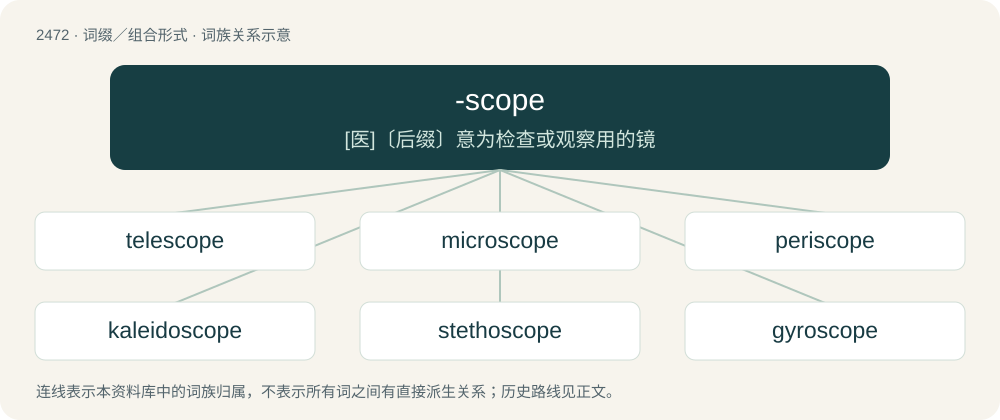

# 2573 · -scope — \[医\]〔后缀〕意为检查或观察用的镜

[总目录](../00_总目录_按常用程度.md)

**类型**：词缀／组合形式　｜　**来源语言**：见词源记录

## 核心含义与来源

- 核心含义：\[医\]〔后缀〕意为检查或观察用的镜
- 英文含义：Used to make terms denoting an instrument used for viewing or examination.
- 词形：-scope

**来源记录 1**（后缀／后置成分；Used to make terms denoting an instrument used for viewing or examination.）

From Ancient Greek σκοπέω (skopéō, “examine, inspect, look to or into, consider”).

## 词族图

## 单词速览（常用到不常用）

| 单词 | 音标 | 释义 |
|---|---|---|
| [telescope](#w-1) | 英 /ˈtɛl.ɪ.skəʊp/；美 /ˈtɛl.əˌskoʊp/ | n. 望远镜；vi. 叠缩, 嵌进, 缩短；vt. 使叠缩, 使缩短 |
| [microscope](#w-2) | 英 /ˈmaɪ.kɹəˌskəʊp/；美 /ˈmaɪ.kɹəˌskoʊp/ | n. 显微镜；\[化\] 显微镜 |
| [periscope](#w-3) | 英 /ˈpɛɹɪskəʊp/；美 /ˈpɛɹɪskoʊp/ | n. 潜望镜(镜头)；\[化\] 潜望镜 |
| [kaleidoscope](#w-4) | 英 /kəˈlaɪ.dəˌskəʊp/；美 /kəˈlaɪ.dəˌskoʊp/ | n. 万花筒 |
| [stethoscope](#w-5) | 英 /ˈstɛθəskəʊp/；美 /ˈstɛθəsˌkoʊp/ | n. 听诊器；vt. 用听诊器诊断 |
| [gyroscope](#w-6) | 英 /ˈd͡ʒaɪ.ɹəˌskəʊp/；美 /ˈd͡ʒaɪ.ɹəˌskoʊp/ | n. 陀螺仪, 回转仪；\[化\] 陀螺仪 |
| [oscilloscope](#w-7) | 英 /əˈsɪl.ɪ.skəʊp/ | n. 示波镜；\[计\] 示波器 |
| [endoscope](#w-8) | /ˈendəskəup/ | n. 内窥镜；\[医\] 内窥镜, 内腔镜 |

## 逐词详解

### 1. telescope

**词性**：名词　｜　**音标**：英 /ˈtɛl.ɪ.skəʊp/；美 /ˈtɛl.əˌskoʊp/

**中文释义**：n. 望远镜；vi. 叠缩, 嵌进, 缩短；vt. 使叠缩, 使缩短

**英文义项**：A monocular optical instrument that magnifies distant objects, especially in astronomy. / Any instrument used in astronomy for observing distant objects (such as a radio telescope).

**构词拆分**：tele- + -scope

**词源与演化**：

From tele- + -scope. From Latin tēlescopium, from Ancient Greek τηλεσκόπος (tēleskópos, “far-seeing”), from τῆλε (têle, “afar”) + σκοπέω (skopéō, “to look at”). Coined in 1611 by the Greek mathematician Giovanni Demisiani for one of Galileo Galilei's instruments presented at a banquet at the Accademia dei Lincei. Doublet of Telescopium.

**例句**：

> Seen through a telescope, the planets take on a completely new appearance.

### 2. microscope

**词性**：名词　｜　**音标**：英 /ˈmaɪ.kɹəˌskəʊp/；美 /ˈmaɪ.kɹəˌskoʊp/

**中文释义**：n. 显微镜；\[化\] 显微镜

**英文义项**：An optical instrument used for observing small objects. / Any instrument for imaging very small objects (such as an electron microscope).

**构词拆分**：micro- + -scope

**词源与演化**：

From New Latin microscopium and Italian microscopio, from Ancient Greek μικρός (mikrós, “small”) + σκοπέω (skopéō, “to look at”), equivalent to micro- + -scope.

**例句**：

> The invention of the microscope led to the discovery of the cell.

该用例对应义项：magnifier of the image of small objects

### 3. periscope

**词性**：名词　｜　**音标**：英 /ˈpɛɹɪskəʊp/；美 /ˈpɛɹɪskoʊp/

**中文释义**：n. 潜望镜(镜头)；\[化\] 潜望镜

**英文义项**：A form of viewing device that allows the viewer to see things at a different height level and usually with minimal visibility. / A general or comprehensive view.

**构词拆分**：peri- + -scope

**词源与演化**：

Formed in English from peri- + -scope.

**例句**：

> In the woods, Felix came across a periscope pipe protruding from the ground.

### 4. kaleidoscope

**词性**：名词　｜　**音标**：英 /kəˈlaɪ.dəˌskəʊp/；美 /kəˈlaɪ.dəˌskoʊp/

**中文释义**：n. 万花筒

**英文义项**：An instrument consisting of a tube containing mirrors and loose, colourful beads or other objects; when the tube is looked into and rotated, a succession of symmetrical designs can be seen. / A constantly changing series of colours or other things.

**例句**：

> This kaleidoscope is giving me a headache.

### 5. stethoscope

**词性**：名词　｜　**音标**：英 /ˈstɛθəskəʊp/；美 /ˈstɛθəsˌkoʊp/

**中文释义**：n. 听诊器；vt. 用听诊器诊断

**英文义项**：A medical instrument used for listening to sounds produced within the body.

**构词拆分**：stetho- + -scope

**词源与演化**：

Borrowed from French stéthoscope, a word coined by its inventor, physician René Laennec, equivalent to stetho- + -scope.

**例句**：

> The doctor is listening to the patient's lungs using a stethoscope.

### 6. gyroscope

**词性**：名词　｜　**音标**：英 /ˈd͡ʒaɪ.ɹəˌskəʊp/；美 /ˈd͡ʒaɪ.ɹəˌskoʊp/

**中文释义**：n. 陀螺仪, 回转仪；\[化\] 陀螺仪

**英文义项**：An apparatus composed of a wheel which spins inside of a frame (gimbal) and causes the balancing of the frame in any direction or position. In the form of a gyroscopic stabilizer, used to help keep aircraft and ships steady.

**构词拆分**：gyro- + -scope

**词源与演化**：

Borrowed from French gyroscope, coined in 1852 by physicist Leon Foucault, equivalent to gyro- + -scope, from Ancient Greek γῦρος (gûros, “circle”) and σκοπός (skopós, “watcher”).

### 7. oscilloscope

**词性**：名词　｜　**音标**：英 /əˈsɪl.ɪ.skəʊp/

**中文释义**：n. 示波镜；\[计\] 示波器

**英文义项**：An electronic measuring instrument that creates a visible two-dimensional graph, on a screen, of one or more continuously varying voltages or currents.

**构词拆分**：oscillo- + -scope

**词源与演化**：

From oscillo- + -scope.

**例句**：

> Next, try to confirm the deviation with an oscilloscope.

### 8. endoscope

**词性**：名词　｜　**音标**：/ˈendəskəup/

**中文释义**：n. 内窥镜；\[医\] 内窥镜, 内腔镜

**英文义项**：An instrument used to examine a bodily orifice or canal, or a hollow organ.

**构词拆分**：endo- + -scope

**词源与演化**：

From endo- + -scope.

**例句**：

> Endoscopy is a medical procedure that uses an endoscope.
