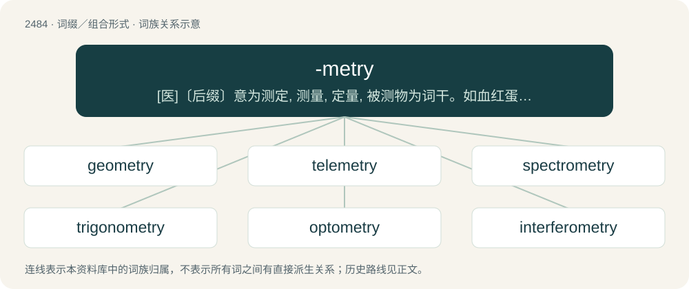

# 2583 · -metry — \[医\]〔后缀〕意为测定, 测量, 定量, 被测物为词干。如血红蛋白定量为hemoglobinometry

[总目录](../00_总目录_按常用程度.md)

**类型**：词缀／组合形式　｜　**来源语言**：见词源记录

## 核心含义与来源

- 核心含义：\[医\]〔后缀〕意为测定, 测量, 定量, 被测物为词干。如血红蛋白定量为hemoglobinometry
- 英文含义：Forming nouns relating to measures and measurement.
- 词形：-metry

**来源记录 1**（后缀／后置成分；Forming nouns relating to measures and measurement.）

From Old French -métrie, from Latin -metria, from Ancient Greek -μετρία (-metría), from μέτρον (métron, “measurement”) + -ίᾱ (-íā, “-y: forming abstract nouns”). Equivalent to -meter + -y.

## 词族图

## 单词速览（常用到不常用）

| 单词 | 音标 | 释义 |
|---|---|---|
| [geometry](#w-1) | 英 /d͡ʒiːˈɒm.ɪ.tɹi/；美 /d͡ʒiˈɑ.mə.tɹi/ | n. 几何学；\[机\] 几何学 |
| [telemetry](#w-2) | 英 /tɪˈlɛm.ɪ.tɹi/；美 /təˈlɛm.əˌtɹi/ | n. 遥测技术, 遥测数据；\[医\] 远距测定法, 遥测术 |
| [spectrometry](#w-3) | /spekˈtrɔmitri/ | \[医\] 分光术, 光谱测定法 |
| [trigonometry](#w-4) | /ˌtɹɪɡəˈnɒmətɹi/ | n. 三角学 |
| [optometry](#w-5) | /ɒpˈtɒmɪtri/ | n. 视力测定(法), 验光配镜(法)；\[医\] 视力测定法, 验光\[法\] |
| [interferometry](#w-6) | 英 /ˌɪn.tə.fəˈɹɒ.mɪ.tɹi/；美 /ˌɪn.(t)ɚ.fəˈɹɑ.mɪ.tɹi/ | n .干涉测量(法) |
| [cytometry](#w-7) | /saiˈtɔmətri/ | n. 血细胞计数 |
| [photometry](#w-8) | /fəuˈtɒmitri/ | n. 光度学, 光度测定, 测光法；\[化\] 光度学; 光度滴定法 |
| [stoichiometry](#w-9) | /ˌstɔɪ.kiˈɒm.ə.tɹi/ | n. 化学计算, 化学计算法, 化学计量学；\[化\] 化学计量学; 化学计量法 |
| [calorimetry](#w-10) | /.kæləˈrimitri/ | n. 量热学；\[化\] 量热学; 量热法 |

## 逐词详解

### 1. geometry

**词性**：名词　｜　**音标**：英 /d͡ʒiːˈɒm.ɪ.tɹi/；美 /d͡ʒiˈɑ.mə.tɹi/

**中文释义**：n. 几何学；\[机\] 几何学

**英文义项**：The branch of mathematics dealing with spatial relationships. / A mathematical system that deals with spatial relationships and that is built on a particular set of axioms; a subbranch of geometry which deals with such a system or systems.

**构词拆分**：geo- + -metry

**词源与演化**：

From Middle English gemetry, geometrie, from Old French geometrie (modern French géométrie), from Latin geōmetria, from Ancient Greek γεωμετρία (geōmetría, “geometry, land-survey”), from γεωμέτρης (geōmétrēs, “geometer, land measurer”), from γῆ (gê, “earth, land, country”) + -μετρία (-metría, “measurement”), from μέτρον (métron, “a measure”). By surface analysis, geometer + -y or geo- + -metry. Doublet of gematria. Displaced native Old English eorþcræft, literally, "earth-craft".

**例句**：

> 1975 \[Addison-Wesley\], Eugene F. Krause, Taxicab Geometry, 1986, Dover, page 64, Entire new geometries are also suggested by real-world cities.

该用例对应义项：A mathematical system that deals with spatial relationships and that is built on a particular set of axioms; a subbranch of geometry which deals with such a system or systems.

### 2. telemetry

**词性**：名词　｜　**音标**：英 /tɪˈlɛm.ɪ.tɹi/；美 /təˈlɛm.əˌtɹi/

**中文释义**：n. 遥测技术, 遥测数据；\[医\] 远距测定法, 遥测术

**英文义项**：The science, and associated technology, of the automatic recording and transmission of data from a remote source to a receiving station for analysis.

**构词拆分**：tele- + -metry

**词源与演化**：

From tele- + -metry.

### 3. spectrometry

**词性**：名词　｜　**音标**：/spekˈtrɔmitri/

**中文释义**：\[医\] 分光术, 光谱测定法

**英文义项**：The measurement of the wavelength of electromagnetic radiation, especially any of several techniques used to analyze the structure of molecules; the measurement of spectra of things other than radiation, such as the masses of molecules and their breakdown products

**构词拆分**：spectro- + -metry

**词源与演化**：

From spectro- + -metry.

### 4. trigonometry

**词性**：名词　｜　**音标**：/ˌtɹɪɡəˈnɒmətɹi/

**中文释义**：n. 三角学

**英文义项**：The branch of mathematics that deals with the relationships between the sides and angles of (in particular) right-angled triangles, as represented by the trigonometric functions, and with calculations based on said relationships.

**构词拆分**：trigono- + -metry

**词源与演化**：

From 1610s, from New Latin trigōnometria, from Ancient Greek τρίγωνον (trígōnon, “triangle”) + μέτρον (métron, “measure”), equivalent to trigono- + -metry.

**例句**：

> Historically, trigonometry has been applied in areas such as geodesy, surveying, celestial mechanics and navigation.

该用例对应义项：The branch of mathematics that deals with the relationships between the sides and angles of (in particular) right-angled triangles, as represented by the trigonometric functions, and with calculations based on said relationships.

### 5. optometry

**词性**：名词　｜　**音标**：/ɒpˈtɒmɪtri/

**中文释义**：n. 视力测定(法), 验光配镜(法)；\[医\] 视力测定法, 验光\[法\]

**英文义项**：The art and science of vision and eye care.

**构词拆分**：opto- + -metry

**词源与演化**：

From opto- + -metry.

### 6. interferometry

**词性**：名词　｜　**音标**：英 /ˌɪn.tə.fəˈɹɒ.mɪ.tɹi/；美 /ˌɪn.(t)ɚ.fəˈɹɑ.mɪ.tɹi/

**中文释义**：n .干涉测量(法)

**英文义项**：The design and use of optical or radio interferometers.

**构词拆分**：interfere + -o- + -metry

**词源与演化**：

From interfere + -o- + -metry.

### 7. cytometry

**词性**：名词　｜　**音标**：/saiˈtɔmətri/

**中文释义**：n. 血细胞计数

**英文义项**：The measurement or the counting and classification of cells

**构词拆分**：cyto- + -metry

**词源与演化**：

From cyto- + -metry.

**例句**：

> I used cytometry to examine my girlfriend's blood and tissue samples and determined she could not be easily killed.

### 8. photometry

**词性**：名词　｜　**音标**：/fəuˈtɒmitri/

**中文释义**：n. 光度学, 光度测定, 测光法；\[化\] 光度学; 光度滴定法

**英文义项**：The measurement of various aspects of light, especially its intensity. / The measurement of the intensity and spectrum of light from stars.

**构词拆分**：photo- + -metry

**词源与演化**：

From photo- + -metry.

### 9. stoichiometry

**词性**：名词　｜　**音标**：/ˌstɔɪ.kiˈɒm.ə.tɹi/

**中文释义**：n. 化学计算, 化学计算法, 化学计量学；\[化\] 化学计量学; 化学计量法

**英文义项**：The study and calculation of quantitative (measurable) relationships of the reactants and products in chemical reactions (chemical equations). / The quantitative relationship between the reactants and products of a specific reaction or equation.

**构词拆分**：Ancient Greek στοιχεῖον (stoikheîon, “element”) + -metry

**词源与演化**：

Coined as German Stöchiometrie by Jeremias Benjamin Richter in 1792. From Ancient Greek στοιχεῖον (stoikheîon, “element”) + -metry.

### 10. calorimetry

**词性**：名词　｜　**音标**：/.kæləˈrimitri/

**中文释义**：n. 量热学；\[化\] 量热学; 量热法

**英文义项**：The science of measuring the heat absorbed or evolved during the course of a chemical reaction or change of state. / A wide headband that covers the ears, for wearing on cold days.

**词源与演化**：

From Latin calor (“warmth, heat”) + -metry.
