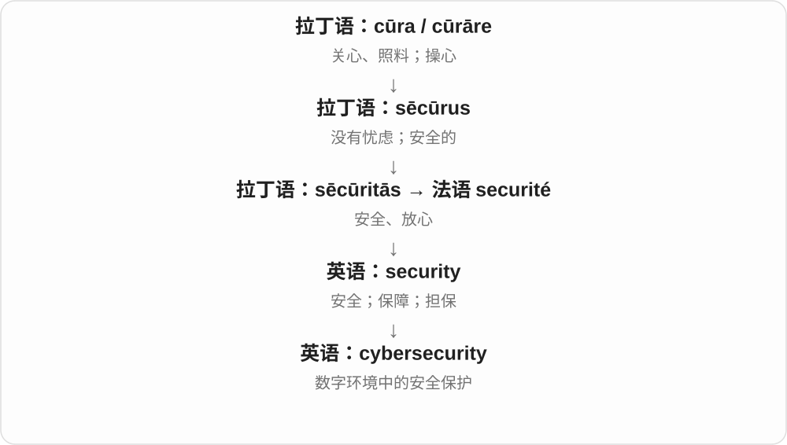

# 2589 · cyber- — 从掌舵、控制材料走向计算机和网络领域

[逐词精讲目录](../00_逐词精讲目录.md) · [总目录](../00_总目录_按常用程度.md)

## 核心词根与来源

掌舵画面帮助理解控制、通信学科名 cybernetics 的远源。现代 cyber- 已扩为网络相关，不能逐词死译成船舵。

**CYBER-：今天多指网络，远源却是掌舵**

cyberpunk、cyberspace 看技术文化与空间；cybersecurity、cybercrime 等看风险与活动。

- **技术空间与文化**：cyberspace · cyberpunk
- **安全、攻击与犯罪**：cybersecurity · cyberattack · cybercrime · cyberbullying
- **其他网络活动语境**：cyberwarfare · cybersex
- **cyber：掌舵、控制词族到计算机网络相关**：cyber

## 词形与演化规律

希腊 kybernetes 舵手等 → cybernetics；缩取 cyber- 再构词。后半决定空间、安全、犯罪、文化、活动等类别。

cyber 接 cybernetics、cybernetic 的构词材料，远处是希腊 kybernētēs 掌舵者、kybernan 掌舵、控制；现代组合形式又可独立作形容词，表示计算机、网络相关。

## 单词速览（按词族由简到繁）

同一基础词的相关扩展放在一起，先读基础形式，再读扩展；各组之间优先读常用的。具体词源关系见各词讲解。

| 单词 | 音标 | 核心意思 |
|---|---|---|
| [cyber](#w-9) | 英 /ˈsaɪbə/；美 /ˈsaɪbɚ/ | 计算机、网络相关的 |
| [cybersecurity](#w-1) | 英 /ˌsaɪbəsɪˈkjʊərəti/；美 /ˌsaɪbərsɪˈkjʊrəti/ | 网络安全；数字系统安全 |
| [cyberspace](#w-2) | 英 /ˈsaɪbəspeɪs/；美 /ˈsaɪbərspeɪs/ | 网络空间 |
| [cyberpunk](#w-3) | 英 /ˈsaɪbəpʌŋk/；美 /ˈsaɪbɚˌpʌŋk/ | 赛博朋克；相关创作、人物 |
| [cybercrime](#w-4) | 英 /ˈsaɪbəkraɪm/；美 /ˈsaɪbɚkraɪm/ | 网络犯罪 |
| [cyberbullying](#w-5) | 英 /ˈsaɪbəbʊliɪŋ/；美 /ˈsaɪbərbʊliɪŋ/ | 网络欺凌、网络霸凌 |
| [cyberattack](#w-6) | /ˈsaɪbərəˌtæk/ | 网络攻击 |
| [cybersex](#w-7) | 英 /ˈsaɪbəseks/；美 /ˈsaɪbərseks/ | 网络性互动 |
| [cyberwarfare](#w-8) | 英 /ˈsaɪbəwɔːfeə/；美 /ˈsaɪbərwɔːrfer/ | 网络战、网络战争 |

## 逐词讲解

### 1. cyber — 计算机、网络相关的

**音标**：英 /ˈsaɪbə/；美 /ˈsaɪbɚ/

**先抓住这个画面**

cyber risks 是网络风险，cyber skills 是网络、计算机方面的技能。现代先抓“计算机和网络这一边的”意思。

**怎么拆**

cybernetics 通信与控制理论、cybernetic 的材料 → cyber- 组合形式，再独立作形容词 cyber；更远接希腊 kybernētēs 掌舵者、kybernan 掌舵、控制。

**怎么变成今天的意思**

**希腊掌舵、控制词族 → cybernetics 通信与控制理论**  
船舵保持航向的画面帮助理解控制、引导

↓

**cybernetic 等材料 → cyber- → cyber 形容词**  
现代大量用于计算机、网络领域

cyber security 是网络安全；cyber risks 是网络风险；cyber skills 是计算机、网络相关技能。

**常见搭配与例句**

cyber security；cyber risks；cyber skills。

> The course introduces basic cyber security concepts.

这门课介绍基础网络安全概念。

> The report examines cyber risks faced by small businesses.

报告考察小企业面临的网络风险。

**别混淆**

cyber 的现代用法重点在计算机、网络；掌舵是理解更远词源的画面，翻译具体搭配时按现代领域处理。

### 2. cybersecurity — 网络安全；数字系统安全

**音标**：英 /ˌsaɪbəsɪˈkjʊərəti/；美 /ˌsaɪbərsɪˈkjʊrəti/

**先抓住这个画面**

给联网设备、软件和数据加上保护，让它们不轻易被偷看、篡改或破坏，这个领域叫 cybersecurity。

**怎么拆**

cyber-（计算机、网络相关）+ security（安全防护）。

**怎么变成今天的意思**

它涉及技术、流程和人的操作习惯，并不是安装一个程序就结束。词根里的“安心”在这里变成对数字系统的保护目标。

**常见搭配与例句**

cybersecurity training；a cybersecurity team；cybersecurity risks。

> The company provides cybersecurity training for new employees.

公司为新员工提供网络安全培训。

> The incident prompted a review of cybersecurity practices.

这次事件促使人们重新审查网络安全做法。

**别混淆**

privacy 关注个人信息的使用与控制；cybersecurity 关注系统和信息的保护。两者相关但不完全相同。

### 3. cyberspace — 网络空间

**音标**：英 /ˈsaɪbəspeɪs/；美 /ˈsaɪbərspeɪs/

**先抓住这个画面**

人没有走到同一间房里，却通过网络在同一个信息世界中交流、工作。

**怎么拆**

cyber- + space；cyber- 源于 cybernetics。作家 William Gibson 在1982年发表的短篇中使用这个新造词，随后广泛传播。

**怎么变成今天的意思**

**拉丁语 spatium**  
空间、范围、距离；也指一段时间，远源尚有不同解释

↓

**古法语 espace / 盎格鲁法语 space → 中古英语 space → 现代 space**  
空间、间隔、时间段；后来包括太空和抽象活动领域

↓

**英语 cyber- + space → cyberspace**  
计算机网络中的虚拟活动空间；先见于科幻写作

可以说 debates in cyberspace，指网络中的讨论。它是描述联网活动领域的比喻，不是地球大气以外的太空。

**常见搭配与例句**

in cyberspace；security in cyberspace；the boundaries of cyberspace。

> Their friendship began in cyberspace and continued offline.

他们的友谊始于网络，后来延续到线下。

> The article explores how identity is presented in cyberspace.

这篇文章探讨人们如何在网络空间中呈现身份。

**别混淆**

the internet 指互联网络本身；cyberspace 更把网络中的活动、关系和信息环境当成一个空间。

### 4. cyberpunk — 赛博朋克；相关创作、人物

**音标**：英 /ˈsaɪbəpʌŋk/；美 /ˈsaɪbɚˌpʌŋk/

**先抓住这个画面**

技术已经非常发达，城市生活却可能混乱、贫富悬殊，人物在系统夹缝里生存，这类科幻常有 cyberpunk 的气质。不是加上霓虹灯就够了。

**怎么拆**

cyber- 计算机、控制技术相关 + punk 反叛人物、文化材料。Bruce Bethke 于 1983 年发表同名短篇，此名后来成为流派称呼。

**怎么变成今天的意思**

**希腊 kybernetes 舵手、掌舵者 → cybernetics**  
控制、通信相关学科名称

↓

**cybernetics 等缩取 cyber-**  
逐渐广用于计算机、网络、虚拟空间

↓

**cyber- + punk／crime**  
赛博朋克；网络犯罪

cyberpunk fiction 赛博朋克小说；a cyberpunk setting 赛博朋克背景；cyberpunk aesthetics 赛博朋克美学。常结合高科技与社会失序、权力压迫等主题。

**常见搭配与例句**

cyberpunk fiction；a cyberpunk setting；cyberpunk aesthetics。

> The novel combines cyberpunk themes with a detective story.

这部小说把赛博朋克主题与侦探故事结合起来。

> The game is set in a crowded cyberpunk city.

游戏背景是一座拥挤的赛博朋克城市。

**别混淆**

cyberpunk 是流派、风格相关名，cybercrime 是借网络实施犯罪；喜欢此类小说不等于参与犯罪。

### 5. cybercrime — 网络犯罪

**音标**：英 /ˈsaɪbəkraɪm/；美 /ˈsaɪbɚkraɪm/

**先抓住这个画面**

电脑、网络成为作案工具或攻击目标，像窃取账户资料这类行为，常落在 cybercrime 的讨论范围。

**怎么拆**

cyber- 网络、计算机相关 + crime 犯罪 → cybercrime。cyber- 从控制、通信词族缩取后扩展，不是原始希腊语就表示互联网。

**怎么变成今天的意思**

**希腊 kybernetes 舵手、掌舵者 → cybernetics**  
控制、通信相关学科名称

↓

**cybernetics 等缩取 cyber-**  
逐渐广用于计算机、网络、虚拟空间

↓

**cyber- + punk／crime**  
赛博朋克；网络犯罪

combat cybercrime 打击网络犯罪；cybercrime investigations 网络犯罪调查；可说整体类型，也可数某次此类犯罪。

**常见搭配与例句**

combat cybercrime；cybercrime investigations；a rise in cybercrime。

> The report describes a rise in cybercrime targeting small businesses.

报告描述了针对小企业的网络犯罪增多。

> The course introduces basic terms used in cybercrime investigations.

课程介绍网络犯罪调查中的基本术语。

**别混淆**

cybercrime 涉及犯罪，不是所有网络争吵、系统故障都自动算；具体法律分类随适用制度判断。

### 6. cyberbullying — 网络欺凌、网络霸凌

**音标**：英 /ˈsaɪbəbʊliɪŋ/；美 /ˈsaɪbərbʊliɪŋ/

**先抓住这个画面**

欺凌转到群聊、评论、社交平台等地方，网络让伤害内容能反复传播、随时被看见，这就是 cyberbullying 的场景。

**怎么拆**

cyber- 数字网络 + bullying 欺凌，现代组合词；cyber- 限定发生媒介、环境。

**怎么变成今天的意思**

**bully 欺负、威吓 → bullying**  
反复压迫、欺凌的活动名与分词

↓

**cyber- + bullying → cyberbullying**  
利用数字通信媒介的欺凌

online harassment and cyberbullying 网络骚扰与网络欺凌，reports of cyberbullying 网络欺凌报告。

**常见搭配与例句**

cyberbullying incidents；cyberbullying prevention。

> The report describes cyberbullying in group chats.

报告描述了群聊中的网络欺凌。

> The workshop discussed how cyberbullying differs from an ordinary online disagreement.

研讨会讨论网络欺凌与普通网上争执的区别。

**别混淆**

cyberbullying 不是所有网上不同意见；它关注伤害、威吓、羞辱等欺凌行为及相应关系背景。

### 7. cyberattack — 网络攻击

**音标**：/ˈsaɪbərəˌtæk/

**先抓住这个画面**

攻击对象换成计算机系统、网络或数据，可能干扰服务、破坏或窃取信息。

**怎么拆**

cyber- 计算机、网络相关 + attack。cyber- 的更远背景接 cybernetics 控制论的截短用法，现代已经成为常见网络前缀。

**怎么变成今天的意思**

**意大利语 attaccare 接合、贴上 → 法语 attaquer、attaque**  
接战 → 进攻、攻击

↓

**英语 attack**  
攻击 → 抨击；疾病等突然发作；着手解决

↓

**cyber- + attack → cyberattack**  
网络相关攻击 → 网络攻击

a cyberattack on a company 针对公司的网络攻击，respond to a cyberattack 应对网络攻击；不把所有系统故障都叫攻击。

**常见搭配与例句**

a cyberattack on；a cyberattack attempt；respond to a cyberattack。

> The company investigated a cyberattack on its network.

公司调查了一次针对其网络的攻击。

> The exercise tested the team’s response to a cyberattack.

演练检验了团队应对网络攻击的能力。

**别混淆**

cyberattack 是有意攻击，outage 只是服务中断结果；中断原因也可能是故障或施工。

### 8. cybersex — 网络性互动

**音标**：英 /ˈsaɪbəseks/；美 /ˈsaɪbərseks/

**先抓住这个画面**

双方通过网络交流带有性意味的文字、声音或影像。

**怎么拆**

cyber-“网络、计算机环境” + sex，网络时代的复合词。

**怎么变成今天的意思**

**拉丁 sexus**  
性别、雌雄类别；更早是否接“切分”词根仍有争议

↓

**古法语 sexe → 中古英语 sexe → 英语 sex**  
性别；后来也指性行为

↓

**英语 cyber- + sex → cybersex**  
通过网络进行的性互动

重点是远程互动，和只是观看预先制作的内容不同。可出现在网络文化、关系研究和隐私讨论中。

**常见搭配与例句**

online cybersex；research on cybersex。

> The study distinguishes cybersex from passive viewing of online material.

研究把网络性互动与被动观看网上材料区分开。

> The couple discussed whether cybersex crossed the boundaries of their relationship.

这对伴侣讨论了网络性互动是否越过了他们关系中的约定边界。

**别混淆**

pornography 可以只是单向观看材料；cybersex 通常涉及参与者之间的互动。

### 9. cyberwarfare — 网络战、网络战争

**音标**：英 /ˈsaɪbəwɔːfeə/；美 /ˈsaɪbərwɔːrfer/

**先抓住这个画面**

战场转到数字网络，目标可能是信息、系统和关键服务；cyberwarfare 把网络领域与战争活动接在了一起。

**怎么拆**

cyber- 网络、数字领域 + warfare 战争、作战。cyber- 经 cybernetics 控制论名称普及，后扩展到计算机网络。

**怎么变成今天的意思**

**希腊 kybernetes 舵手 → cybernetics → cyber-**  
从控制、通信研究名称，到数字网络领域的组合成分

↓

**cyber- + warfare → cyberwarfare**  
通过数字网络展开的战争相关活动

cyberwarfare capabilities 网络战能力，the history of cyberwarfare 网络战历史。

**常见搭配与例句**

cyberwarfare capabilities；cyberwarfare research。

> The course examines cyberwarfare and its effects on civilian infrastructure.

课程考察网络战及其对民用基础设施的影响。

> The report distinguishes cyberwarfare from ordinary cybercrime.

报告区分了网络战与普通网络犯罪。

**别混淆**

普通网络犯罪、系统故障不自动等于网络战；warfare 带战争相关语境，具体归属要看事实。

## 这一组要分清什么

cyber- 不等于每个词都涉及违法；cyberpunk 流派也不是单纯一切霓虹灯装饰。

## 串起来练习

The article contrasts cyberpunk fiction with real issues of cybersecurity and cybercrime.

文章把赛博朋克小说与现实中的网络安全、网络犯罪问题作了对照。
